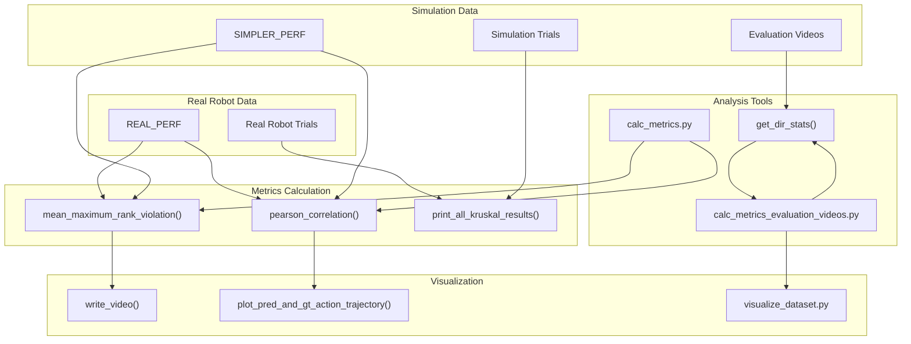
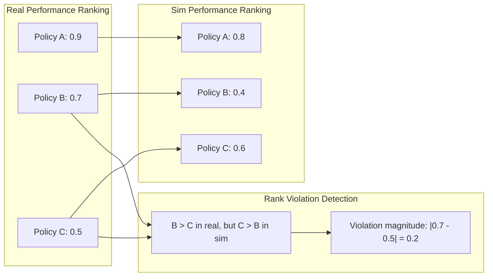
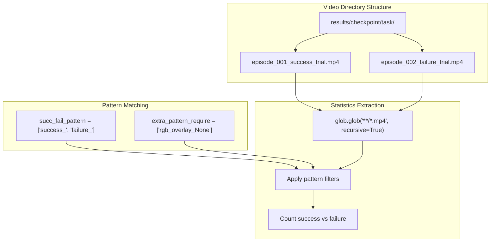

<!-- source: DeepWiki mcp.deepwiki.com · repo allenai/SimplerEnv · page 4.3 Metrics and Analysis · fetched 2026-10-26 -->

# Metrics and Analysis

<details>
<summary>Relevant source files</summary>

The following files were used as context for generating this wiki page:

- [simpler_env/utils/metrics.py](simpler_env/utils/metrics.py)
- [simpler_env/utils/visualization.py](simpler_env/utils/visualization.py)
- [tools/calc_metrics.py](tools/calc_metrics.py)
- [tools/calc_metrics_evaluation_videos.py](tools/calc_metrics_evaluation_videos.py)
- [tools/visualize_dataset.py](tools/visualize_dataset.py)

</details>


This page covers the metrics calculation and analysis capabilities within SimplerEnv's evaluation framework. It details how to compute performance statistics, compare real vs simulated robot performance, and analyze evaluation results using statistical methods. For information about running evaluations and generating the raw data that these metrics analyze, see [Running Evaluations](#4.2).

## Overview of Metrics System

SimplerEnv provides a comprehensive metrics system for evaluating how well simulated policy performance correlates with real robot performance. The system implements several statistical measures and provides tools for analyzing task-specific results.



**Sources:** [simpler_env/utils/metrics.py:1-230](), [tools/calc_metrics.py:1-35](), [tools/calc_metrics_evaluation_videos.py:1-427]()

## Performance Data and Baselines

The metrics system maintains comprehensive performance baselines for real robot evaluations and corresponding simulated results through two main data structures:

### Real Robot Performance Data

The `REAL_PERF` dictionary contains ground truth performance data from real robot evaluations across multiple tasks and policy models:

| Task | RT-1-X | RT-1-Converged | RT-2-X | Octo-Base |
|------|--------|----------------|--------|-----------|
| google_robot_pick_coke_can | 0.760 | 0.853 | 0.907 | 0.293 |
| google_robot_move_near | 0.450 | 0.633 | 0.733 | 0.350 |
| google_robot_open_drawer | 0.519 | 0.815 | 0.333 | 0.148 |
| google_robot_close_drawer | 0.741 | 0.926 | 0.630 | 0.519 |

### Simulated Performance Data

The `SIMPLER_PERF` dictionary contains corresponding simulated evaluation results for the same tasks and policies:

```python
# Example access pattern
real_performance = REAL_PERF["google_robot_pick_coke_can"]["rt-1-x"]  # 0.760
sim_performance = SIMPLER_PERF["google_robot_pick_coke_can"]["rt-1-x"]  # 0.567
```

**Sources:** [simpler_env/utils/metrics.py:7-132]()

## Statistical Analysis Methods

### Mean Maximum Rank Violation (MMRV)

The `mean_maximum_rank_violation()` function measures how well simulation preserves the relative ordering of policy performance compared to real robot evaluations:



The algorithm compares each pair of policies and identifies when their relative ranking differs between real and simulated performance, measuring the magnitude of performance difference for violated rankings.

**Sources:** [simpler_env/utils/metrics.py:148-163]()

### Pearson Correlation

The `pearson_correlation()` function computes the linear correlation between real and simulated performance values:

```python
# Usage example from calc_metrics.py
pearson = pearson_correlation(
    list(SIMPLER_PERF[task].values()), 
    list(REAL_PERF[task].values())
)
```

The function handles edge cases where all values are identical and includes numerical stability through epsilon addition.

**Sources:** [simpler_env/utils/metrics.py:134-145](), [tools/calc_metrics.py:31-33]()

### Kruskal-Wallis Statistical Tests

The `print_all_kruskal_results()` function performs non-parametric statistical tests to compare trial-by-trial success distributions between real and simulated evaluations:

```python
# Construct trial results from success rates
sim_trials = construct_unordered_trial_results(n_trials_per_ckpt, sim_success_rates)
real_trials = construct_unordered_trial_results(n_trials_per_ckpt, real_success_rates)

# Run statistical tests
print_all_kruskal_results(sim_trials, real_trials, "Task Comparison")
```

**Sources:** [simpler_env/utils/metrics.py:166-198]()

## Task-Specific Evaluation Analysis

### Video-Based Result Processing

The `get_dir_stats()` function processes evaluation video directories to extract success/failure statistics based on filename patterns:



**Sources:** [simpler_env/utils/metrics.py:202-229](), [tools/calc_metrics_evaluation_videos.py:15-42]()

### Task-Specific Analysis Functions

The evaluation system provides specialized analysis functions for different manipulation tasks:

#### Pick Coke Can Analysis
The `calc_pick_coke_can_stats()` function analyzes pick-and-place performance across different object orientations and environmental variants:

- **Orientations**: horizontal (`lr_switch`), vertical (`laid_vertically`), standing (`upright`)
- **Variant Groups**: base, background, lighting, distractor, table_texture
- **Visual Matching**: Different URDF versions with real-world texture matching

#### Move Near Analysis  
The `calc_move_near_stats()` function evaluates object approach behaviors across simulation variants and visual matching conditions.

#### Drawer Analysis
The `calc_drawer_stats()` function assesses drawer manipulation (open/close) performance across different drawer positions (top, middle, bottom) and environmental conditions.

**Sources:** [tools/calc_metrics_evaluation_videos.py:53-395]()

## Visualization and Reporting Tools

### Video Generation

The `write_video()` function creates MP4 files from image sequences for evaluation visualization:

```python
# Example usage
from simpler_env.utils.visualization import write_video

write_video("evaluation_results.mp4", image_list, fps=5)
```

### Action Trajectory Plotting

The `plot_pred_and_gt_action_trajectory()` function generates comprehensive plots comparing predicted and ground truth action sequences:

- **Action Dimensions**: world_vector (x,y,z), rotation_delta, gripper_closedness_action, terminate_episode
- **Visualization**: Time-series plots with ground truth vs predicted overlays
- **Image Integration**: Synchronized with episode image sequences

### Dataset Visualization

The `visualize_dataset.py` tool processes robotics datasets (Fractal, Bridge) to generate evaluation videos and action analysis plots using TensorFlow Datasets integration.

**Sources:** [simpler_env/utils/visualization.py:19-90](), [tools/visualize_dataset.py:1-60]()

## Usage Examples

### Basic Metrics Calculation

```python
# Import metrics functions
from simpler_env.utils.metrics import mean_maximum_rank_violation, pearson_correlation, REAL_PERF

# Calculate metrics for a task
task = "google_robot_move_near"
sim_performance = [your_simulation_results]
real_performance = [REAL_PERF[task][policy] for policy in policy_list]

mmrv = mean_maximum_rank_violation(real_performance, sim_performance)
pearson = pearson_correlation(real_performance, sim_performance)
```

### Running Complete Analysis

```bash
# Calculate metrics for all tasks using the main script
python tools/calc_metrics.py

# Analyze specific task evaluation videos
python tools/calc_metrics_evaluation_videos.py --task pick_coke_can --log-dir-root ./results
```

**Sources:** [tools/calc_metrics.py:23-34](), [tools/calc_metrics_evaluation_videos.py:412-425]()

---

