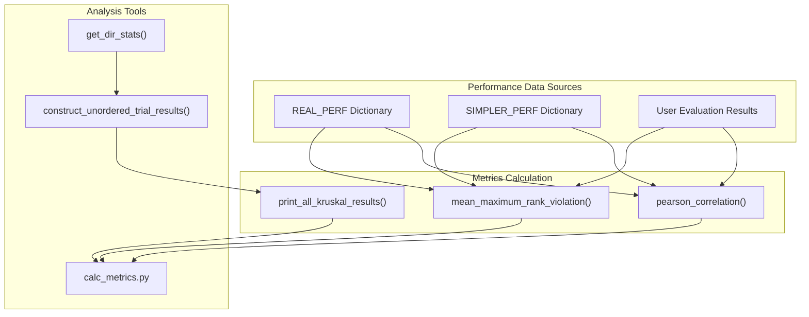
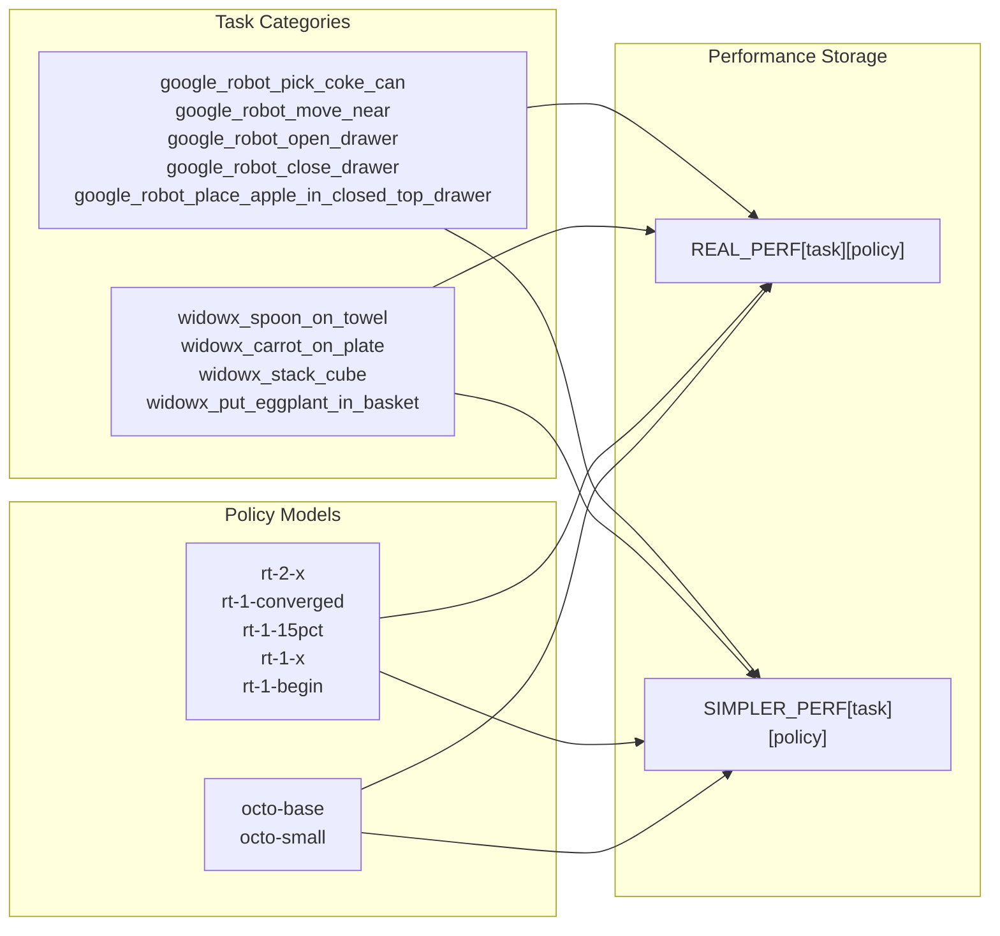
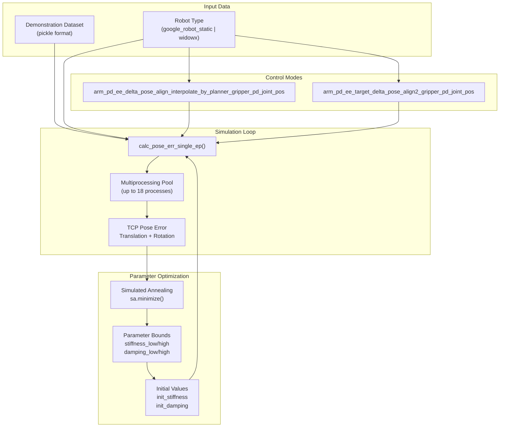
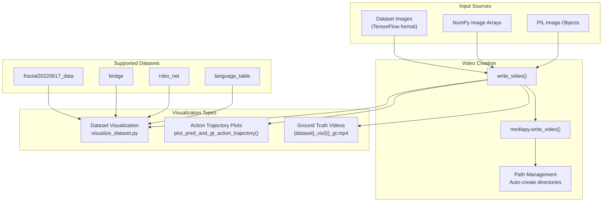
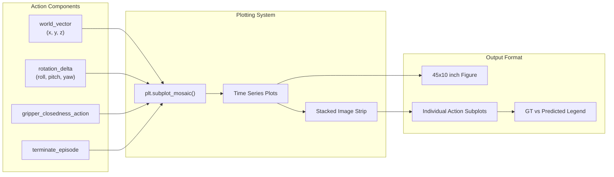

<!-- source: DeepWiki mcp.deepwiki.com · repo allenai/SimplerEnv · page 5 Tools and Utilities · fetched 2026-10-26 -->

# Tools and Utilities

Relevant source files

The following files were used as context for generating this wiki page:

- [simpler_env/utils/metrics.py](simpler_env/utils/metrics.py)
- [simpler_env/utils/visualization.py](simpler_env/utils/visualization.py)
- [tools/calc_metrics.py](tools/calc_metrics.py)
- [tools/sysid/sysid.py](tools/sysid/sysid.py)
- [tools/visualize_dataset.py](tools/visualize_dataset.py)

This page covers the comprehensive set of tools and utilities available in SimplerEnv for system identification, performance analysis, visualization, and debugging. These tools support the core evaluation pipeline by providing metrics calculation, robot parameter optimization, and visualization capabilities.

For information about running evaluations with these tools, see [Evaluation Framework](#4). For policy-specific inference tools, see [Policy Models](#3).

## Metrics and Performance Analysis

SimplerEnv provides sophisticated tools for calculating and analyzing evaluation metrics that compare simulated and real robot performance.

### Core Metrics Framework

The metrics system centers around two key evaluation measures:

| Metric | Purpose | Function |
|--------|---------|----------|
| **Mean Maximum Rank Violation (MMRV)** | Measures ranking consistency between sim and real | `mean_maximum_rank_violation()` |
| **Pearson Correlation** | Measures linear correlation between performances | `pearson_correlation()` |

**Metrics Calculation Workflow**

The `calc_metrics.py` tool provides a command-line interface for computing evaluation metrics:

Sources: [tools/calc_metrics.py:1-35](), [simpler_env/utils/metrics.py:134-163]()

### Performance Data Management

The metrics system includes comprehensive performance data for both Google Robot and WidowX platforms:

- **Real Performance Data**: Stored in `REAL_PERF` dictionary with task-policy mappings
- **Simulated Performance Data**: Stored in `SIMPLER_PERF` dictionary for baseline comparisons
- **Statistical Analysis**: Kruskal-Wallis tests for comparing trial-by-trial success rates

**Directory-Based Result Analysis**

The `get_dir_stats()` function automatically extracts success/failure statistics from evaluation video files:

Sources: [simpler_env/utils/metrics.py:7-68](), [simpler_env/utils/metrics.py:201-229]()

## System Identification (SysID)

The SysID module provides automated optimization of robot physical parameters to improve simulation accuracy.

### SysID Optimization Process

The system identification process optimizes robot arm stiffness and damping parameters using simulated annealing:

**SysID Parameter Optimization**

The optimization process minimizes 6D pose errors by adjusting:

- **Stiffness Parameters**: Joint-specific stiffness values within defined bounds
- **Damping Parameters**: Joint-specific damping coefficients
- **Control Frequency**: Robot-specific simulation and control frequencies
- **Error Metrics**: Combined translation and rotation error minimization

Sources: [tools/sysid/sysid.py:1-14](), [tools/sysid/sysid.py:143-177](), [tools/sysid/sysid.py:180-269]()

### Robot-Specific Configuration

The SysID system supports different robot platforms with specialized parameter ranges:

| Robot | Control Mode | Sim Freq | Control Freq | Joint Count |
|-------|-------------|----------|--------------|-------------|
| `google_robot_static` | `arm_pd_ee_delta_pose_align_interpolate_by_planner_gripper_pd_joint_pos` | 252 Hz | 3 Hz | 7 (+ 2 camera) |
| `widowx` | `arm_pd_ee_target_delta_pose_align2_gripper_pd_joint_pos` | 500 Hz | 5 Hz | 6 |

Sources: [tools/sysid/sysid.py:16-43](), [tools/sysid/sysid.py:199-238]()

## Visualization and Dataset Tools

SimplerEnv provides comprehensive visualization tools for dataset analysis, video generation, and trajectory plotting.

### Video Generation and Processing

The visualization system supports multiple video formats and processing workflows:

**Dataset Visualization Workflow**

The `visualize_dataset.py` tool processes TensorFlow Datasets and generates video summaries:

Sources: [tools/visualize_dataset.py:1-31](), [simpler_env/utils/visualization.py:19-29]()

### Action Trajectory Analysis

The trajectory plotting system provides detailed analysis of predicted vs ground truth actions:

- **Action Dimensions**: `world_vector`, `rotation_delta`, `gripper_closedness_action`, `terminate_episode`
- **Visualization Layout**: Synchronized image strips with multi-subplot action plots
- **Comparison Mode**: Overlaid predicted and ground truth trajectories

**Trajectory Plotting Configuration**

Sources: [simpler_env/utils/visualization.py:31-90](), [tools/visualize_dataset.py:32-59]()

## Development and Debugging Utilities

The utility framework includes several helper functions for development and debugging:

### File and Path Management

- **Directory Statistics**: `get_dir_stats()` extracts success/failure counts from video filenames
- **Pattern Matching**: Configurable success/failure detection patterns
- **Recursive Search**: Glob-based recursive file discovery

### Statistical Analysis Tools

- **Trial Construction**: `construct_unordered_trial_results()` converts success rates to trial arrays
- **Kruskal-Wallis Testing**: Statistical significance testing between simulation and real results
- **Result Aggregation**: Automated collection and analysis of evaluation outcomes

### Color and Font Resources

The visualization system includes predefined palettes and font resources:

- **Color Palette**: Deterministic random color generation for consistent visualization
- **Font Support**: Ubuntu Mono font for consistent text rendering
- **Image Processing**: Binary dilation and drawing utilities

Sources: [simpler_env/utils/metrics.py:189-229](), [simpler_env/utils/visualization.py:1-17]()

---

