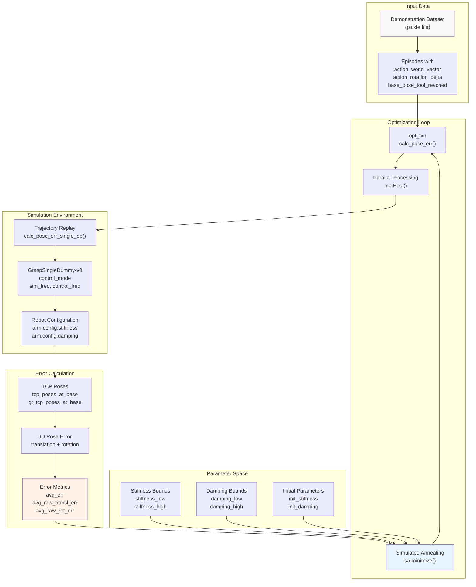
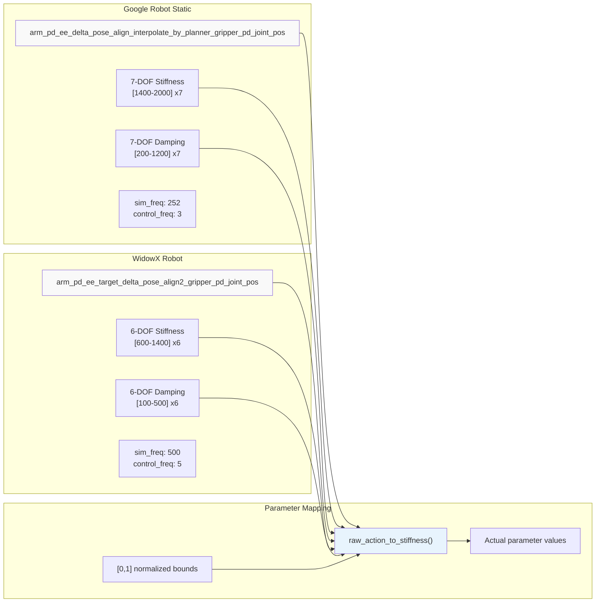
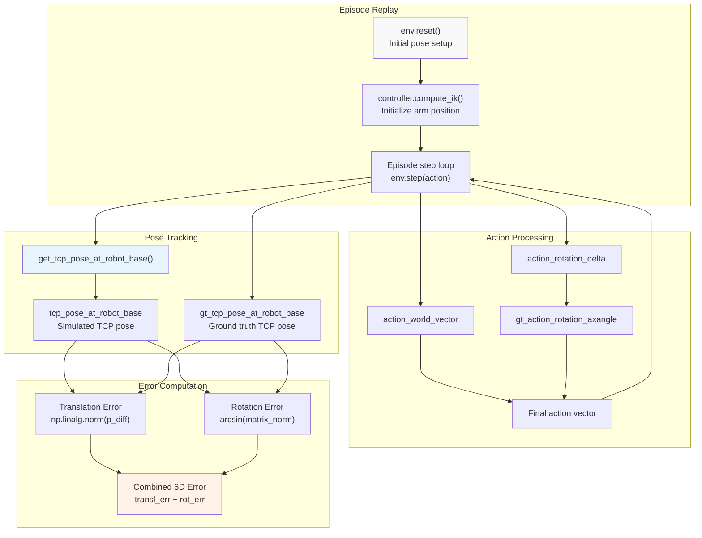
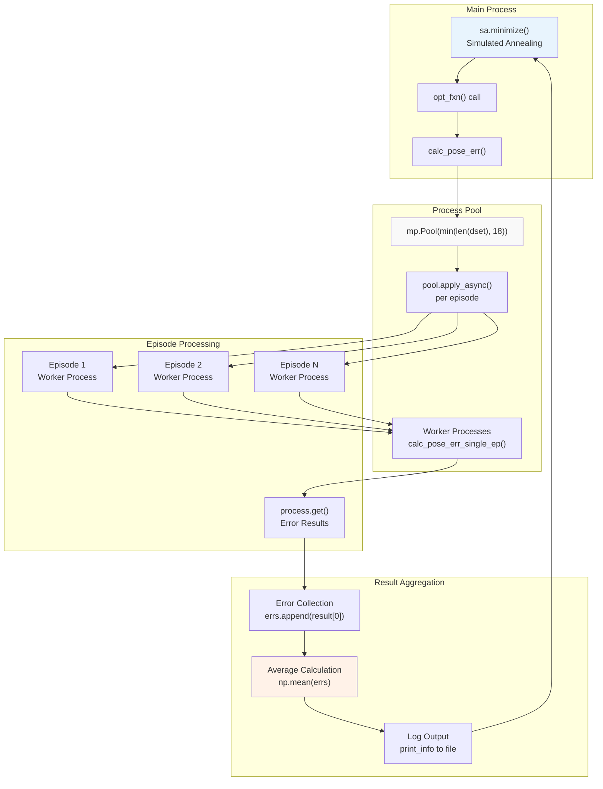

<!-- source: DeepWiki mcp.deepwiki.com · repo allenai/SimplerEnv · page 5.1 System Identification · fetched 2026-10-26 -->

# System Identification

<details>
<summary>Relevant source files</summary>

The following files were used as context for generating this wiki page:

- [tools/sysid/sysid.py](tools/sysid/sysid.py)

</details>


## Purpose and Scope

System identification in SimplerEnv is a tool for optimizing robot simulation parameters to improve sim-to-real transfer. The system uses simulated annealing to find optimal stiffness and damping values for robot joints by minimizing 6D pose errors when replaying real-world demonstration trajectories in simulation.

This process is essential for achieving accurate robot behavior in simulation that closely matches real-world performance. For information about running evaluations with optimized parameters, see [Evaluation Framework](#4). For general utility tools, see [Tools and Utilities](#5).

## System Identification Workflow

The system identification process follows a data-driven optimization approach that compares simulated robot trajectories against ground truth demonstrations.

**System Identification Process Flow**



Sources: [tools/sysid/sysid.py:1-286]()

## Robot Parameter Optimization

The system identification tool optimizes physical simulation parameters for two supported robot platforms, each with specific parameter ranges and control modes.

**Robot-Specific Parameter Configuration**



The optimization process uses normalized parameter spaces where all stiffness and damping values are mapped to [0,1] ranges for the simulated annealing algorithm.

| Robot | Stiffness Range | Damping Range | Control Mode |
|-------|----------------|---------------|--------------|
| `google_robot_static` | 7-DOF: [380-2000] | 7-DOF: [200-1200] | `arm_pd_ee_delta_pose_align_interpolate_by_planner_gripper_pd_joint_pos` |
| `widowx` | 6-DOF: [600-1400] | 6-DOF: [100-500] | `arm_pd_ee_target_delta_pose_align2_gripper_pd_joint_pos` |

Sources: [tools/sysid/sysid.py:199-238](), [tools/sysid/sysid.py:240-243]()

## Error Calculation and Metrics

The system calculates 6D pose errors by comparing simulated tool center point (TCP) poses against ground truth demonstration data during trajectory replay.

**Pose Error Calculation Pipeline**



The error calculation implements specific formulas for translation and rotation errors:

- **Translation Error**: `np.linalg.norm(tcp_pose_at_base.p - gt_tcp_pose_at_base.p)`
- **Rotation Error**: `arcsin(clip(1/(2√2) * √(trace((R_pred - R_gt)^T @ (R_pred - R_gt))), 0, 1))`
- **Combined Error**: Translation error + rotation error

Sources: [tools/sysid/sysid.py:16-141](), [tools/sysid/sysid.py:104-121]()

## Parallel Processing and Optimization

The system uses multiprocessing for efficient evaluation of parameter combinations across multiple demonstration episodes.

**Parallel Evaluation Architecture**



The optimization uses simulated annealing with the following configuration:
- **Step Maximum**: 2000 iterations
- **Temperature Range**: 1.5 (max) to 0 (min)
- **Parameter Bounds**: [0, 1] for all normalized parameters
- **Parallel Workers**: Minimum of dataset size or 18 processes

Sources: [tools/sysid/sysid.py:143-178](), [tools/sysid/sysid.py:260-268]()

## Usage and Configuration

The system identification tool is executed as a standalone script with configurable parameters for different robot platforms and datasets.

### Command Line Interface

```bash
# Google Robot Static optimization
python tools/sysid/sysid.py \
    --dataset-path /path/to/sysid_dataset.pkl \
    --log-path /path/to/opt_results.txt \
    --robot google_robot_static

# WidowX Robot optimization  
python tools/sysid/sysid.py \
    --dataset-path /path/to/sysid_dataset_bridge.pkl \
    --log-path /path/to/opt_results_bridge.txt \
    --robot widowx
```

### Dataset Format

The input dataset must be a pickled file containing demonstration episodes with the following structure per episode step:

| Field | Description | Data Type |
|-------|-------------|-----------|
| `base_pose_tool_reached` | Ground truth TCP pose (xyz + wxyz quaternion) | `np.array(7,)` |
| `action_world_vector` | Translation action in world coordinates | `np.array(3,)` |
| `action_rotation_delta` | Rotation action (axis-angle or euler angles) | `np.array(3,)` |

### Output Logging

The optimization process logs detailed results including:
- Current parameter values (`arm_stiffness`, `arm_damping`)
- Error metrics (`avg_raw_transl_err`, `avg_raw_rot_err`, `avg_err`)
- Per-trajectory errors (`per_traj_err`)

Sources: [tools/sysid/sysid.py:180-198](), [tools/sysid/sysid.py:171-175]()

---

