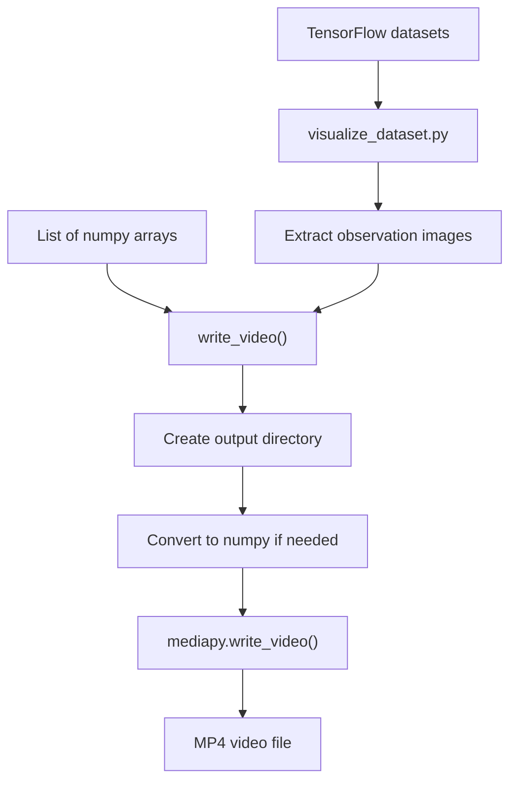
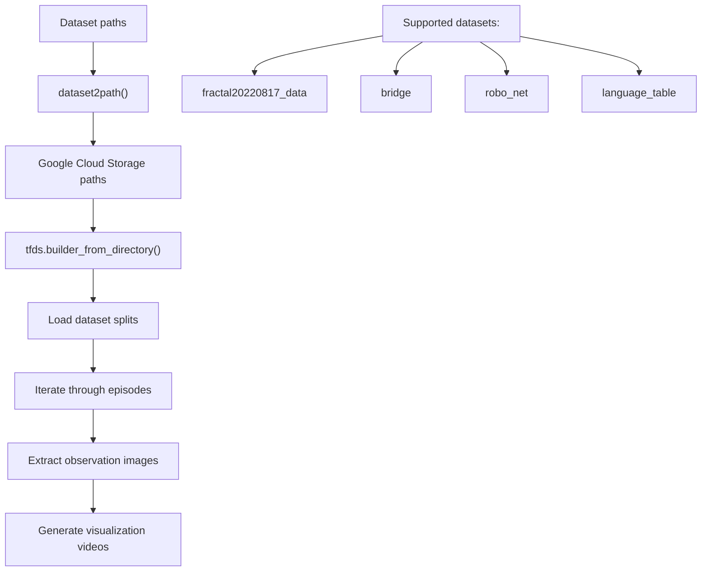

<!-- source: DeepWiki mcp.deepwiki.com · repo allenai/SimplerEnv · page 5.2 Visualization and Analysis · fetched 2026-10-26 -->

# Visualization and Analysis

<details>
<summary>Relevant source files</summary>

The following files were used as context for generating this wiki page:

- [images/example_visualization/google_robot_close_drawer_visual_matching.png](images/example_visualization/google_robot_close_drawer_visual_matching.png)
- [images/example_visualization/google_robot_coke_can_visual_matching.png](images/example_visualization/google_robot_coke_can_visual_matching.png)
- [images/example_visualization/google_robot_move_near_visual_matching.png](images/example_visualization/google_robot_move_near_visual_matching.png)
- [images/example_visualization/google_robot_open_drawer_visual_matching.png](images/example_visualization/google_robot_open_drawer_visual_matching.png)
- [images/example_visualization/widowx_carrot_on_plate_visual_matching.png](images/example_visualization/widowx_carrot_on_plate_visual_matching.png)
- [images/example_visualization/widowx_spoon_on_towel_visual_matching.png](images/example_visualization/widowx_spoon_on_towel_visual_matching.png)
- [images/example_visualization/widowx_stack_cube_visual_matching.png](images/example_visualization/widowx_stack_cube_visual_matching.png)
- [simpler_env/utils/metrics.py](simpler_env/utils/metrics.py)
- [simpler_env/utils/visualization.py](simpler_env/utils/visualization.py)
- [tools/calc_metrics.py](tools/calc_metrics.py)
- [tools/visualize_dataset.py](tools/visualize_dataset.py)

</details>


This page covers the tools and utilities for visualizing evaluation results, computing performance metrics, and analyzing policy performance in SimplerEnv. These tools help researchers understand how well different policies perform across tasks and provide insights into the effectiveness of simulation-to-real transfer.

For information about system identification and robot parameter optimization, see [System Identification](#5.1). For debugging and testing utilities, see [Debugging and Testing](#5.3).

## Performance Metrics Computation

SimplerEnv provides comprehensive tools for computing and analyzing policy performance metrics to evaluate the quality of simulation-to-real transfer.

### Core Metrics Functions

The primary metrics computation is handled through several key functions in the metrics module:

```mermaid
graph TD
    calc_metrics["calc_metrics.py"] --> metrics_module["simpler_env.utils.metrics"]
    metrics_module --> mmrv["mean_maximum_rank_violation()"]
    metrics_module --> pearson["pearson_correlation()"]
    metrics_module --> kruskal["print_all_kruskal_results()"]
    metrics_module --> real_perf["REAL_PERF dictionary"]
    metrics_module --> simpler_perf["SIMPLER_PERF dictionary"]
    
    mmrv --> "Measures rank violation between real and sim performance"
    pearson --> "Computes correlation between real and sim results"
    kruskal --> "Statistical significance testing per checkpoint"
    real_perf --> "Ground truth real robot performance data"
    simpler_perf --> "SIMPLER evaluation performance data"
```

Sources: [simpler_env/utils/metrics.py:1-230](), [tools/calc_metrics.py:1-35]()

### Performance Data Structure

The metrics module maintains performance data for different tasks and policies:

| Task | RT-1 Models | Octo Models | RT-2 Models |
|------|-------------|-------------|-------------|
| `google_robot_pick_coke_can` | rt-1-x, rt-1-converged, rt-1-15pct, rt-1-begin | octo-base | rt-2-x |
| `google_robot_move_near` | rt-1-x, rt-1-converged, rt-1-15pct, rt-1-begin | octo-base | rt-2-x |
| `google_robot_open_drawer` | rt-1-x, rt-1-converged, rt-1-15pct, rt-1-begin | octo-base | rt-2-x |
| `google_robot_close_drawer` | rt-1-x, rt-1-converged, rt-1-15pct, rt-1-begin | octo-base | rt-2-x |
| `widowx_spoon_on_towel` | rt-1-x | octo-base, octo-small | - |
| `widowx_carrot_on_plate` | rt-1-x | octo-base, octo-small | - |

The performance data is stored in `REAL_PERF` and `SIMPLER_PERF` dictionaries with the structure `performance_dict[task_name][policy_name]`.

Sources: [simpler_env/utils/metrics.py:7-132]()

### Statistical Analysis Tools

```mermaid
graph LR
    trial_results["construct_unordered_trial_results()"] --> "Convert success rates to trial arrays"
    dir_stats["get_dir_stats()"] --> "Extract success/failure from video files"
    kruskal_test["print_all_kruskal_results()"] --> "Statistical significance testing"
    
    trial_results --> kruskal_test
    dir_stats --> trial_results
```

The `construct_unordered_trial_results()` function converts success rates into arrays of individual trial results for statistical testing. The `get_dir_stats()` function automatically extracts success/failure statistics from evaluation video files by looking for "success" and "failure" patterns in filenames.

Sources: [simpler_env/utils/metrics.py:189-230](), [simpler_env/utils/metrics.py:166-187]()

## Video Generation and Visualization

SimplerEnv provides utilities for generating videos from evaluation runs and visualizing policy performance.

### Video Creation Pipeline



The `write_video()` function in [simpler_env/utils/visualization.py:19-28]() handles the core video generation, automatically creating output directories and converting image formats as needed.

Sources: [simpler_env/utils/visualization.py:19-28](), [tools/visualize_dataset.py:1-60]()

### Action Trajectory Visualization

The `plot_pred_and_gt_action_trajectory()` function provides detailed analysis of policy actions by comparing predicted actions against ground truth:

| Action Component | Dimensions | Description |
|------------------|------------|-------------|
| `terminate_episode` | 1 | Episode termination signal |
| `world_vector` | 3 | X, Y, Z translation commands |
| `rotation_delta` | 3 | Roll, pitch, yaw rotation changes |
| `gripper_closedness_action` | 1 | Gripper open/close command |

This function generates comprehensive plots showing action trajectories over time alongside stacked observation images.

Sources: [simpler_env/utils/visualization.py:31-90]()

## Dataset Visualization Tools

The `visualize_dataset.py` tool provides capabilities for exploring and visualizing robotics datasets:



The tool supports multiple dataset formats and automatically handles version management for different datasets. It extracts observation images from episode steps and generates videos at 5 FPS for visual inspection.

Sources: [tools/visualize_dataset.py:6-31]()

## Example Visualization Outputs

SimplerEnv generates visual matching examples for different robot tasks. The system produces comparative visualizations showing real robot environments alongside their simulated counterparts:

- Google Robot tasks: `google_robot_move_near`, `google_robot_close_drawer`, `google_robot_coke_can`, `google_robot_open_drawer`
- WidowX tasks: `widowx_spoon_on_towel`

These visualizations demonstrate the visual matching approach used to align simulation environments with real-world conditions.

Sources: [images/example_visualization/google_robot_move_near_visual_matching.png](), [images/example_visualization/google_robot_close_drawer_visual_matching.png](), [images/example_visualization/google_robot_coke_can_visual_matching.png](), [images/example_visualization/google_robot_open_drawer_visual_matching.png](), [images/example_visualization/widowx_spoon_on_towel_visual_matching.png]()

## Usage Examples

### Computing Performance Metrics

To compute metrics comparing simulation and real performance:

```python
from simpler_env.utils.metrics import mean_maximum_rank_violation, pearson_correlation, REAL_PERF

# Get simulation evaluation results for a task
sim_results = [your_sim_eval(task="google_robot_move_near", policy=p) for p in policies]
real_results = [REAL_PERF["google_robot_move_near"][p] for p in policies]

# Compute metrics
mmrv = mean_maximum_rank_violation(real_results, sim_results)
correlation = pearson_correlation(real_results, sim_results)
```

### Generating Videos

To create videos from evaluation runs:

```python
from simpler_env.utils.visualization import write_video

# images should be a list of numpy arrays with shape [H, W, 3]
write_video("output/evaluation_video.mp4", images, fps=5)
```

The main metrics computation script can be run directly to see SIMPLER evaluation results:

```bash
python tools/calc_metrics.py
```

Sources: [tools/calc_metrics.py:23-34](), [simpler_env/utils/visualization.py:19-28]()

---

