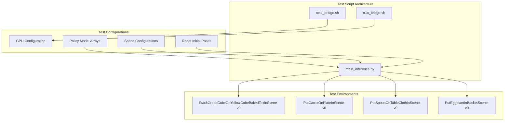
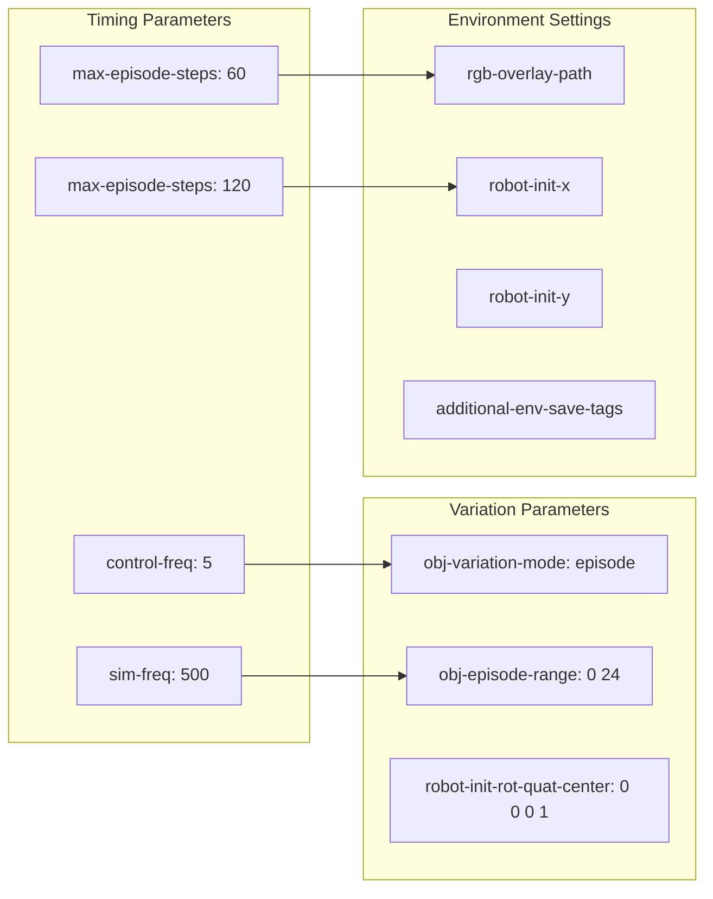
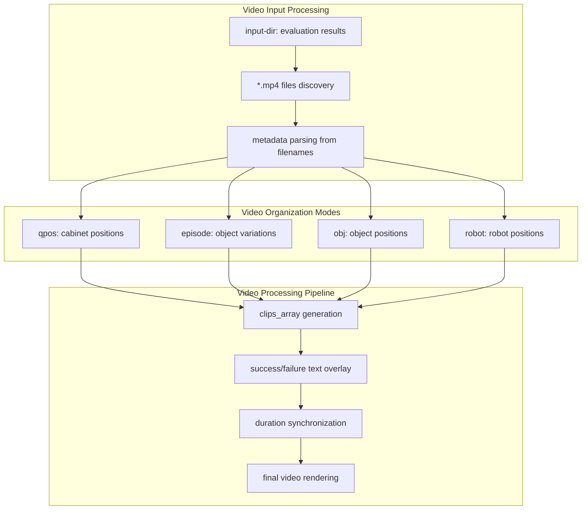
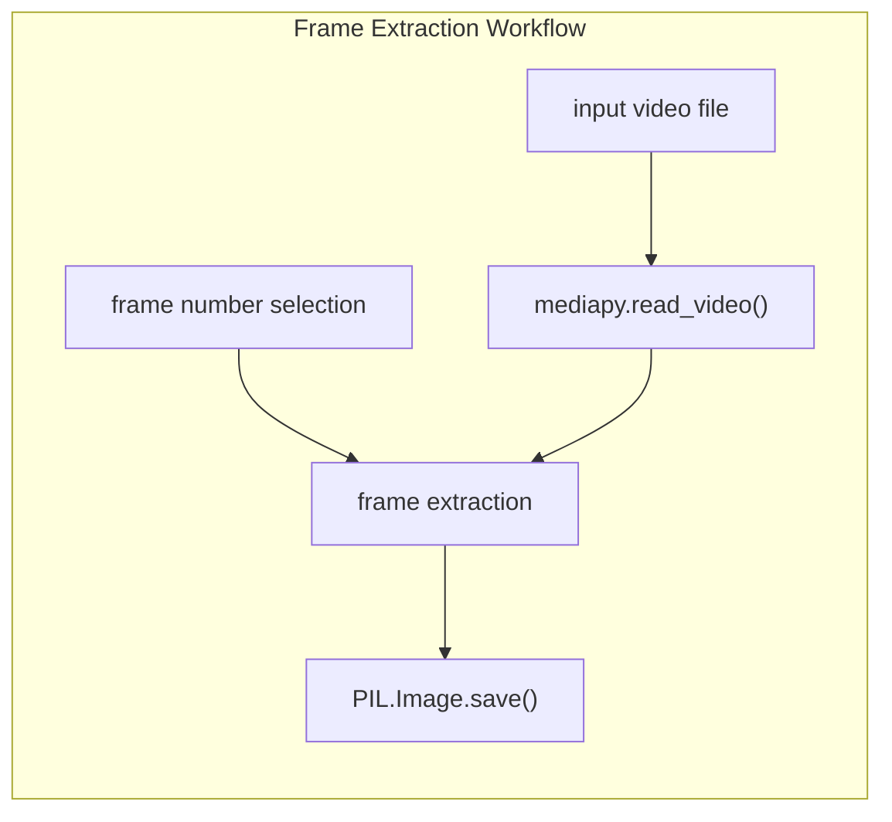
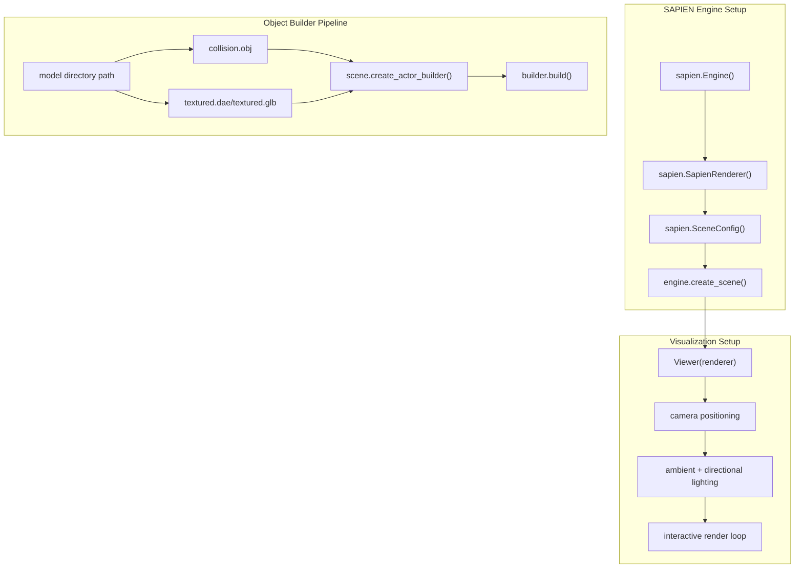

<!-- source: DeepWiki mcp.deepwiki.com · repo allenai/SimplerEnv · page 5.3 Debugging and Testing · fetched 2026-10-26 -->

# Debugging and Testing

Relevant source files

The following files were used as context for generating this wiki page:

- [.gitignore](.gitignore)
- [scripts/octo_bridge.sh](scripts/octo_bridge.sh)
- [scripts/rt1x_bridge.sh](scripts/rt1x_bridge.sh)
- [tools/merge_videos.py](tools/merge_videos.py)
- [tools/robot_object_visualization/test_object.py](tools/robot_object_visualization/test_object.py)
- [tools/save_video_frame.py](tools/save_video_frame.py)

This document covers the debugging tools, test scripts, and development utilities available in SimplerEnv for troubleshooting policy evaluations, visualizing results, and testing system components. These tools help developers verify correct system behavior, diagnose issues, and analyze policy performance during development.

For information about visualization and analysis tools for policy performance, see [Visualization and Analysis](#5.2). For guidance on setting up the development environment, see [Docker Development Environment](#6.2).

## Test Scripts for Policy Evaluation

SimplerEnv provides pre-configured test scripts that allow developers to quickly validate policy implementations across different scenarios and configurations. These scripts serve as both testing tools and examples for proper system usage.

### Policy-Specific Test Scripts

The system includes specialized test scripts for each supported policy type, configured with realistic evaluation scenarios:

**Sources:** [scripts/octo_bridge.sh:1-79](), [scripts/rt1x_bridge.sh:1-54]()

#### Octo Policy Testing

The Octo test script evaluates multiple model variants with systematic parameter sweeps:

| Configuration | Purpose | Key Parameters |
|---------------|---------|----------------|
| Policy Models | Test different Octo variants | `octo-small`, `octo-base` |
| Initialization Seeds | Reproducibility testing | `--octo-init-rng 0 2 4` |
| Scene Variations | Environment robustness | `bridge_table_1_v1`, `bridge_table_1_v2` |
| Robot Setups | Camera configuration testing | `widowx`, `widowx_sink_camera_setup` |

The script systematically tests across different environments and configurations using nested loops [scripts/octo_bridge.sh:18-51]().

#### RT-1 Policy Testing

The RT-1 test script provides a streamlined evaluation setup for the RT-1 model with fixed checkpoints:

- **Checkpoint Configuration**: Uses pre-trained RT-1 model at `checkpoints/rt_1_x_tf_trained_for_002272480_step/` [scripts/rt1x_bridge.sh:5]()
- **Environment Coverage**: Tests the same task environments as Octo for comparison [scripts/rt1x_bridge.sh:14-51]()
- **Parameter Consistency**: Uses identical robot positioning and episode ranges for fair comparison

**Sources:** [scripts/octo_bridge.sh:3-78](), [scripts/rt1x_bridge.sh:4-52]()

### Test Execution Parameters

Both test scripts use consistent evaluation parameters for reliable testing:

**Sources:** [scripts/octo_bridge.sh:22-29](), [scripts/rt1x_bridge.sh:14-20]()

## Video Debugging Tools

Video output analysis is crucial for understanding policy behavior and diagnosing evaluation issues. SimplerEnv provides specialized tools for processing and analyzing evaluation videos.

### Video Merging for Comparative Analysis

The `merge_videos.py` tool consolidates multiple evaluation videos into a single comparative visualization:

**Sources:** [tools/merge_videos.py:55-182]()

#### Automatic Metadata Extraction

The tool automatically extracts evaluation metadata from video filenames and directory structures:

- **Success Status**: Parsed from video filename prefix [tools/merge_videos.py:92]()
- **Robot Positions**: Extracted from directory name using `rob` keyword [tools/merge_videos.py:85-87]()
- **Variation Information**: Detected based on filename patterns (`qpos`, `episode`, `obj`) [tools/merge_videos.py:64-74]()

#### Grid Layout Generation

Videos are arranged in a grid layout based on the variation mode, with automatic handling of empty slots for episode-based variations [tools/merge_videos.py:150-157]().

### Frame Extraction for Analysis

The `save_video_frame.py` tool extracts specific frames from evaluation videos for detailed analysis:

**Sources:** [tools/save_video_frame.py:25-28]()

This tool is particularly useful for:
- Extracting failure frames for detailed analysis
- Creating representative images for documentation
- Comparing specific moments across different evaluations

**Sources:** [tools/save_video_frame.py:40-42]()

## Object and Simulation Testing

The system includes tools for testing individual components of the simulation environment, particularly useful for debugging object models and physics interactions.

### Object Visualization Testing

The `test_object.py` tool provides a standalone environment for testing object models:

**Sources:** [tools/robot_object_visualization/test_object.py:37-81]()

#### Object Model Validation

The tool validates object models by:

1. **File Existence Checking**: Automatically falls back from `.dae` to `.glb` format [tools/robot_object_visualization/test_object.py:29-31]()
2. **Physics Testing**: Creates objects with realistic physical materials and density [tools/robot_object_visualization/test_object.py:55-61]()
3. **Visual Inspection**: Provides interactive viewer for manual validation [tools/robot_object_visualization/test_object.py:76-81]()

#### Camera Integration Testing

The tool includes camera setup for testing object interactions with camera systems:

- **Realistic Camera Parameters**: Uses Intel D435 specifications [tools/robot_object_visualization/test_object.py:67-73]()
- **Parent-Child Relationships**: Tests camera attachment to objects [tools/robot_object_visualization/test_object.py:74]()

**Sources:** [tools/robot_object_visualization/test_object.py:10-34](), [tools/robot_object_visualization/test_object.py:64-75]()

## Development Workflow Integration

### Version Control and File Management

The system's development workflow is informed by the `.gitignore` configuration, which excludes temporary and generated files:

| File Type | Purpose | Examples |
|-----------|---------|----------|
| Compilation artifacts | Build outputs | `__pycache__`, `*.pyc`, `*.so` |
| Editor temporaries | Development files | `*.swp`, `.idea`, `.vscode` |
| Results | Evaluation outputs | `results/` directory |
| Jupyter notebooks | Development checkpoints | `.ipynb_checkpoints/` |

**Sources:** [.gitignore:1-32]()

### Debugging Best Practices

When using these debugging tools, follow these workflow patterns:

1. **Start with Test Scripts**: Use policy-specific test scripts to validate basic functionality
2. **Video Analysis**: Use merge tools to compare performance across variations
3. **Component Testing**: Use object visualization for individual component validation
4. **Frame-by-Frame Analysis**: Extract specific frames when detailed investigation is needed

The tools are designed to work together as part of a comprehensive debugging workflow, from high-level policy testing down to individual component validation.

**Sources:** [scripts/octo_bridge.sh:1-79](), [scripts/rt1x_bridge.sh:1-54](), [tools/merge_videos.py:1-191](), [tools/save_video_frame.py:1-43](), [tools/robot_object_visualization/test_object.py:1-97]()

---

