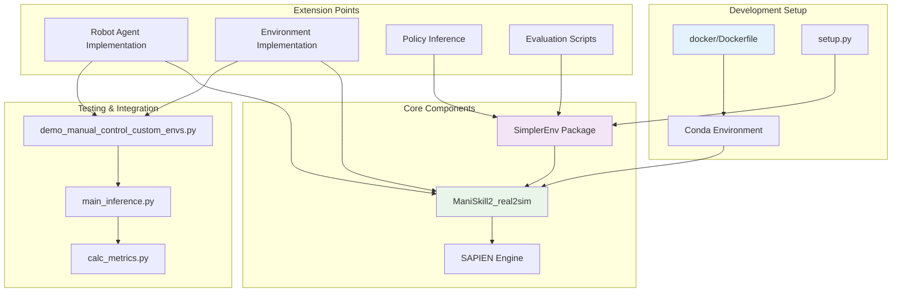
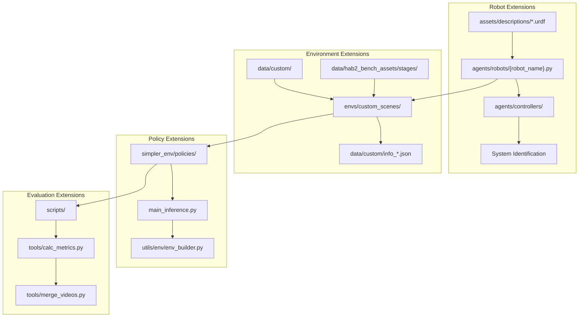
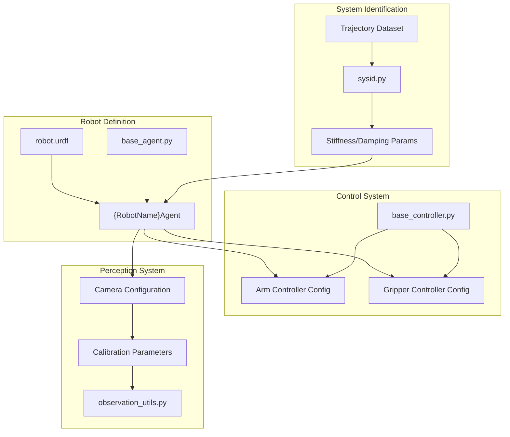
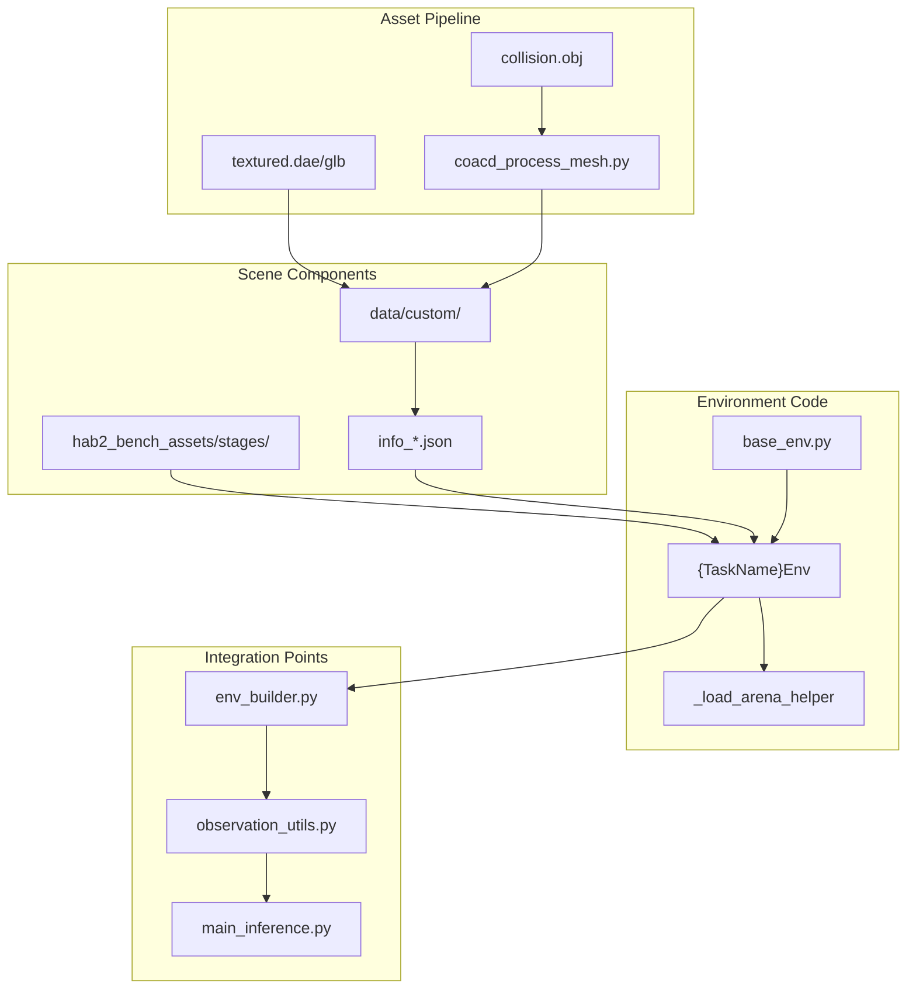
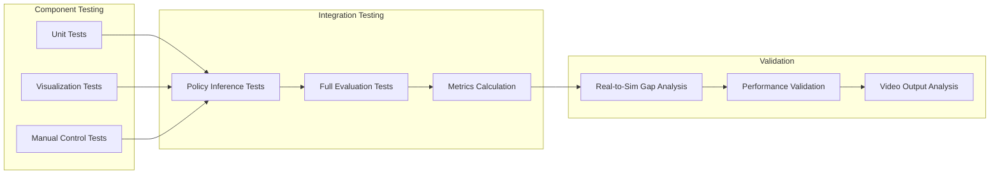

<!-- source: DeepWiki mcp.deepwiki.com · repo allenai/SimplerEnv · page 6 Development Guide · fetched 2026-10-26 -->

# Development Guide

Relevant source files

The following files were used as context for generating this wiki page:

- [ADDING_NEW_ENVS_ROBOTS.md](ADDING_NEW_ENVS_ROBOTS.md)
- [docker/10_nvidia.json](docker/10_nvidia.json)
- [docker/Dockerfile](docker/Dockerfile)
- [docker/nvidia_icd.json](docker/nvidia_icd.json)
- [docker/nvidia_layers.json](docker/nvidia_layers.json)
- [setup.py](setup.py)

This document provides guidance for developers who want to extend SimplerEnv with new environments, robots, policies, or contribute to the codebase. It covers the development environment setup, extension points in the system architecture, and workflows for adding new components.

For step-by-step instructions on adding new environments and robots, see [Adding New Environments and Robots](#6.1). For Docker development environment details, see [Docker Development Environment](#6.2).

## Development Overview

SimplerEnv is designed to be extensible at multiple levels. The main extension points include adding new robot models, simulation environments, policy implementations, and evaluation methodologies. The development workflow typically involves setting up the Docker environment, implementing new components in the appropriate modules, and integrating them with the evaluation framework.

### Development Workflow

The following diagram illustrates the typical development workflow for extending SimplerEnv:

**Sources:** [docker/Dockerfile:1-71](), [setup.py:1-9](), [ADDING_NEW_ENVS_ROBOTS.md:1-126]()

### System Extension Points

The SimplerEnv architecture provides several well-defined extension points for adding new functionality:

**Sources:** [ADDING_NEW_ENVS_ROBOTS.md:9-28](), [ADDING_NEW_ENVS_ROBOTS.md:34-78]()

## Development Environment Setup

### Docker Environment

The recommended development environment uses Docker with NVIDIA GPU support. The Docker setup includes all necessary dependencies and configurations for running SimplerEnv.

| Component | Version/Configuration |
|-----------|----------------------|
| Base Image | `nvidia/cudagl:11.3.1-devel-ubuntu20.04` |
| Python | 3.10 |
| CUDA Architectures | Turing, Ampere, Ada, Hopper |
| ManiSkill2 | 0.5.0 |
| TensorFlow | 2.15.1 with CUDA support |

### Key Docker Configuration Files

The Docker environment requires several NVIDIA-specific configuration files for GPU access:

| File | Purpose |
|------|---------|
| `docker/nvidia_icd.json` | OpenGL ICD configuration |
| `docker/nvidia_layers.json` | Vulkan layer configuration |  
| `docker/10_nvidia.json` | EGL ICD configuration |

### Package Installation Sequence

The Docker build follows this installation sequence:

1. **System packages**: Build tools, graphics libraries, Vulkan support
2. **Conda environment**: Miniforge with Python 3.10
3. **ManiSkill2**: Core simulation framework
4. **SimplerEnv**: Main package with submodules
5. **Policy dependencies**: TensorFlow, JAX, additional requirements

**Sources:** [docker/Dockerfile:1-71](), [docker/nvidia_icd.json:1-7](), [docker/nvidia_layers.json:1-21]()

## Code Organization for Extensions

### Robot Implementation Structure

When adding new robots, the implementation follows this modular structure:

**Sources:** [ADDING_NEW_ENVS_ROBOTS.md:14-28]()

### Environment Implementation Structure

Environment extensions require coordination between multiple components:

**Sources:** [ADDING_NEW_ENVS_ROBOTS.md:34-78]()

## Development Tools and Debugging

SimplerEnv provides several debugging and development tools to assist with extending the system:

### Visualization Tools

| Tool | Purpose | Location |
|------|---------|----------|
| Robot/Object Viewer | Visualize robots and objects in SAPIEN | `tools/robot_object_visualization/` |
| Manual Control Demo | Interactive environment testing | `ManiSkill2_real2sim/examples/demo_manual_control_custom_envs.py` |
| Video Merging | Combine evaluation videos | `tools/merge_videos.py` |
| Frame Extraction | Save specific video frames | `tools/save_video_frame.py` |

### Debug Scripts

| Script Category | Purpose | Location |
|----------------|---------|----------|
| Dataset Rollout | Test ground-truth actions in simulation | `simpler_env/utils/debug/*_test_dataset_inference_rollout_gt_traj_in_sim.py` |
| Policy Testing | Debug policy inference on video frames | `simpler_env/utils/debug/*_inference_real_video.py` |
| Trajectory Analysis | Plot action trajectories | `simpler_env/utils/debug/rt1_plot_dataset_inference_trajectory.py` |

### SAPIEN Viewer Controls

The SAPIEN viewer provides interactive debugging capabilities:

- **Navigation**: Right-click to rotate, middle-click+shift to translate, scroll to zoom
- **Object Selection**: Click objects and press 'f' to focus
- **Joint Control**: Use articulation panel to move robot joints
- **Collision Visualization**: Show/hide collision meshes in right panel
- **Simulation Control**: Press 'pause' to stop simulation, 'g' to grab objects

**Sources:** [ADDING_NEW_ENVS_ROBOTS.md:84-126]()

## Testing and Validation Workflow

The development workflow includes several validation steps to ensure new components work correctly:

**Sources:** [ADDING_NEW_ENVS_ROBOTS.md:73-78](), [ADDING_NEW_ENVS_ROBOTS.md:84-103]()

---

