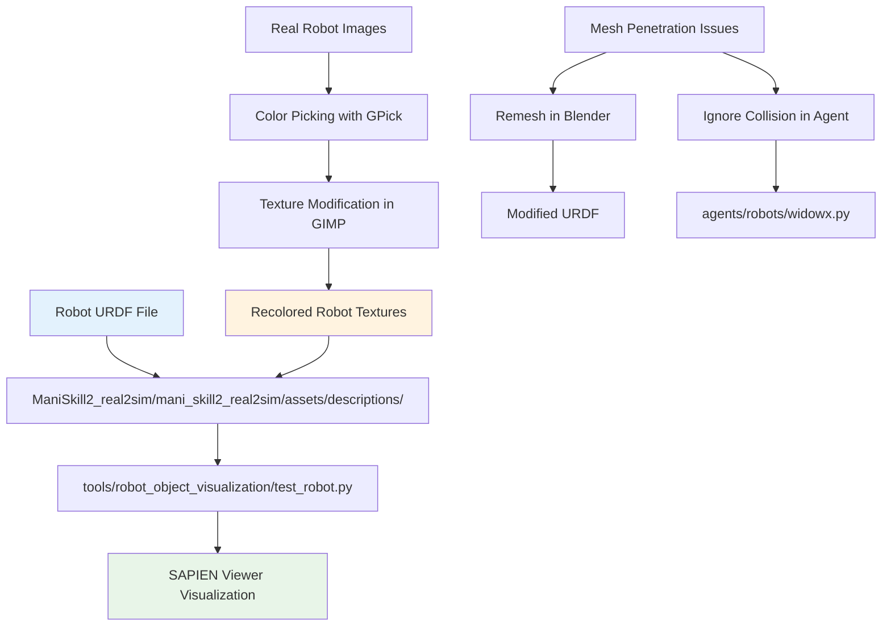
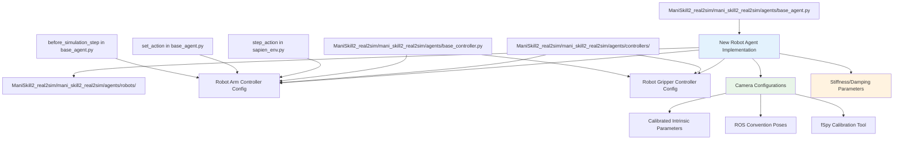
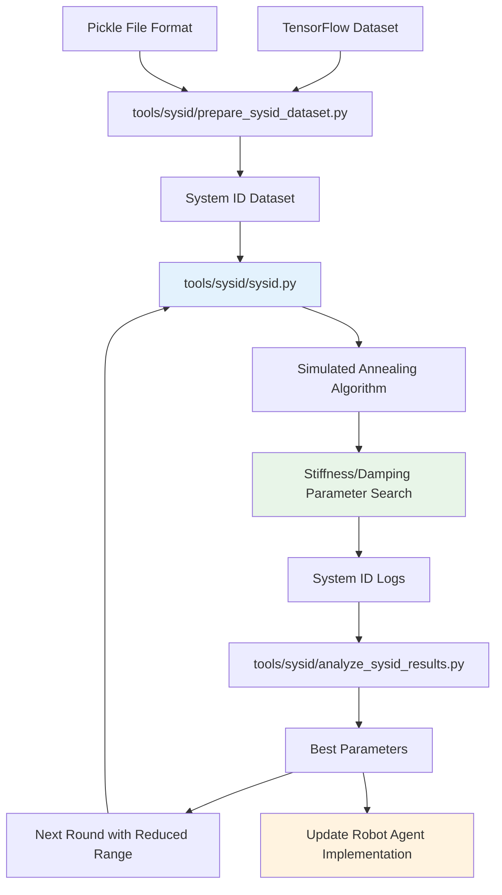
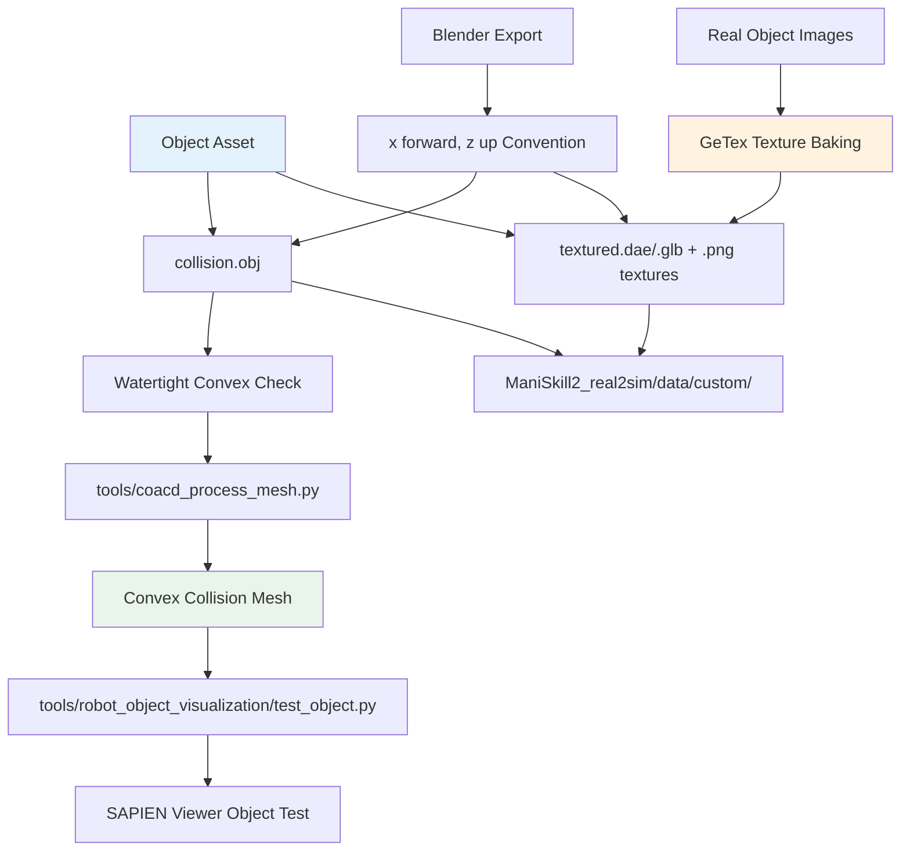
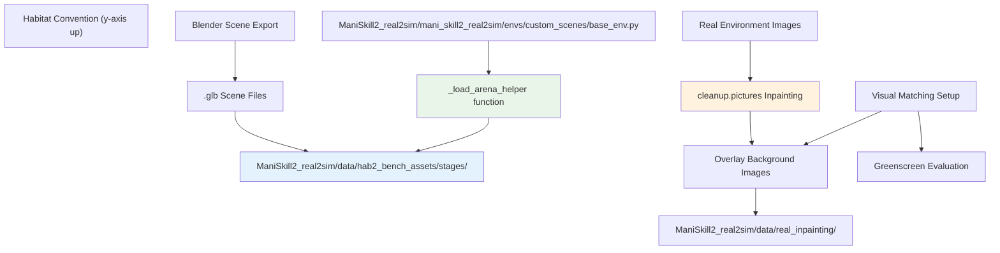
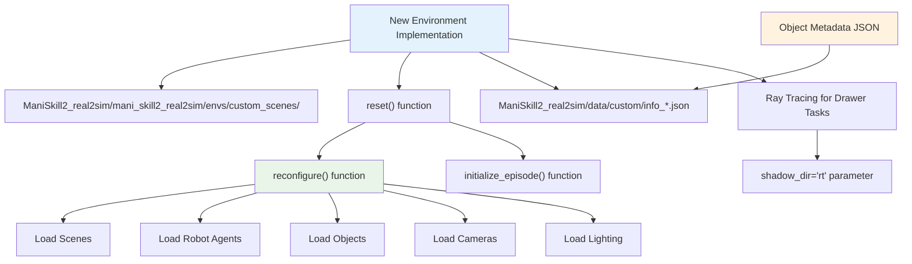
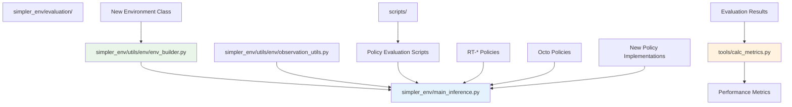

<!-- source: DeepWiki mcp.deepwiki.com · repo allenai/SimplerEnv · page 6.1 Adding New Environments and Robots · fetched 2026-10-26 -->

# Adding New Environments and Robots

Relevant source files

The following files were used as context for generating this wiki page:

- [ADDING_NEW_ENVS_ROBOTS.md](ADDING_NEW_ENVS_ROBOTS.md)
- [setup.py](setup.py)
- [tools/coacd_process_mesh.py](tools/coacd_process_mesh.py)

This guide provides a comprehensive step-by-step process for extending SimplerEnv with new robot models and simulation environments. It covers the technical implementation details for integrating new hardware configurations and manipulation tasks into the evaluation framework.

For information about using existing environments and robots for evaluation, see [Basic Usage](#2.2). For advanced evaluation configurations and task-specific setups, see [Task-Specific Evaluations](#7.1).

## Robot Addition Workflow

Adding a new robot to SimplerEnv involves three main phases: URDF setup and visualization, agent implementation, and system identification for accurate dynamics modeling.

### URDF Setup and Visualization

The first step involves adding robot descriptions and creating visualization tools to verify the robot model loads correctly in the SAPIEN simulation environment.

The robot URDF file should be placed in [ManiSkill2_real2sim/mani_skill2_real2sim/assets/descriptions]() and can be tested using scripts in [tools/robot_object_visualization]() which provide SAPIEN viewer integration for visual verification.

For visual matching evaluation setups, robot recoloring may be necessary to reduce the real-to-sim perception gap. This involves extracting colors from real-world images and applying them to robot textures using image editing tools.

**Sources:** [ADDING_NEW_ENVS_ROBOTS.md:9-12]()

### Agent Implementation

The robot agent implementation defines the control interface, camera configurations, and controller parameters that enable policy interaction with the robot model.

The agent implementation inherits from [ManiSkill2_real2sim/mani_skill2_real2sim/agents/base_agent.py]() and must define controller configurations found in [ManiSkill2_real2sim/mani_skill2_real2sim/agents/controllers/](). Camera poses follow ROS convention (x forward, y left, z up) and should include calibrated intrinsic parameters to minimize real-to-sim evaluation gaps.

**Sources:** [ADDING_NEW_ENVS_ROBOTS.md:14-24]()

### System Identification

System identification optimizes robot dynamics parameters to achieve accurate simulation behavior that matches real-world robot performance.

The system identification process uses [tools/sysid/sysid.py]() with simulated annealing to optimize dynamics parameters. Results are analyzed using [tools/sysid/analyze_sysid_results.py]() to identify the best parameters for subsequent optimization rounds.

**Sources:** [ADDING_NEW_ENVS_ROBOTS.md:26-28]()

## Environment Addition Workflow

Adding new environments involves creating object assets, scene backgrounds, environment implementations, and integrating visual matching capabilities for real-to-sim evaluation.

### Object Asset Creation

Object assets require both visual and collision meshes that follow SAPIEN's coordinate conventions and support realistic physics simulation.

Object assets are stored in [ManiSkill2_real2sim/data/custom/]() and require both textured visual meshes and watertight convex collision meshes. The [tools/coacd_process_mesh.py]() script converts non-convex collision meshes to convex ones using the CoACD algorithm.

**Sources:** [ADDING_NEW_ENVS_ROBOTS.md:34-44]()

### Scene Background Integration

Scene backgrounds provide realistic environments for manipulation tasks and support both standard and visual matching evaluation approaches.

Scene backgrounds use the Habitat convention and are loaded through [_load_arena_helper]() in [ManiSkill2_real2sim/mani_skill2_real2sim/envs/custom_scenes/base_env.py](). For visual matching evaluation, overlay backgrounds with robots and objects removed are stored in [ManiSkill2_real2sim/data/real_inpainting/]().

**Sources:** [ADDING_NEW_ENVS_ROBOTS.md:56-66]()

### Environment Implementation

Environment classes define task logic, object metadata, and evaluation configurations for manipulation scenarios.

Environment implementations in [ManiSkill2_real2sim/mani_skill2_real2sim/envs/custom_scenes/]() follow a specific pattern where `reset()` calls `reconfigure()` to load components and `initialize_episode()` to set up the scenario. Object metadata is stored in JSON files like [ManiSkill2_real2sim/data/custom/info_*.json]().

**Sources:** [ADDING_NEW_ENVS_ROBOTS.md:68-71]()

## Integration and Testing

The final phase involves integrating new environments with policy inference systems and using debugging tools to validate the implementation.

### Policy Inference Integration

New environments must be integrated with the SimplerEnv policy evaluation framework to enable automated testing of robotic manipulation policies.

Integration requires updating [simpler_env/utils/env/env_builder.py]() and [simpler_env/utils/env/observation_utils.py]() to support the new environment. Policy evaluation scripts in [scripts/]() call [simpler_env/main_inference.py]() for automated testing.

**Sources:** [ADDING_NEW_ENVS_ROBOTS.md:76-78]()

### Testing and Debugging Tools

A comprehensive set of debugging tools enables validation of robot behavior, environment setup, and policy integration throughout the development process.

```mermaid
graph TD
    MANUAL_CONTROL["ManiSkill2_real2sim/mani_skill2_real2sim/examples/demo_manual_control_custom_envs.py"]
    ROBOT_VIS["tools/robot_object_visualization/"]
    DEBUG_UTILS["simpler_env/utils/debug/"]
    
    MANUAL_CONTROL --> ROBOT_INTERACTION["Manual Robot Control"]
    MANUAL_CONTROL --> SAPIEN_VIEWER_ENV["Environment SAPIEN Viewer"]
    MANUAL_CONTROL --> VISUAL_MATCH_TEST["Visual Matching Test"]
    MANUAL_CONTROL --> ENV_RESET_OPTIONS["env_reset_options Testing"]
    
    ROBOT_VIS --> TEST_ROBOT_SCRIPT["Robot Visualization Scripts"]
    ROBOT_VIS --> TEST_OBJECT_SCRIPT["Object Visualization Scripts"]
    
    DEBUG_UTILS --> GT_TRAJ_TEST["{robot}_test_dataset_inference_rollout_gt_traj_in_sim.py"]
    DEBUG_UTILS --> REAL_VIDEO_TEST["{policy}_inference_real_video.py"]
    DEBUG_UTILS --> PLOT_TRAJ["rt1_plot_dataset_inference_trajectory.py"]
    
    GT_TRAJ_TEST --> CONTROL_GAP["Real-to-Sim Control Gap Analysis"]
    REAL_VIDEO_TEST --> POLICY_DEBUG["Policy Behavior Debugging"]
    PLOT_TRAJ --> ACTION_TRAJ["Action Trajectory Analysis"]
    
    VIDEO_TOOLS["Video Processing Tools"]
    MERGE_VIDEOS["tools/merge_videos.py"]
    SAVE_FRAMES["tools/save_video_frame.py"]
    VIDEO_TOOLS --> MERGE_VIDEOS
    VIDEO_TOOLS --> SAVE_FRAMES
    
    style MANUAL_CONTROL fill:#e3f2fd
    style DEBUG_UTILS fill:#e8f5e8
    style VIDEO_TOOLS fill:#fff3e0
```

The [ManiSkill2_real2sim/mani_skill2_real2sim/examples/demo_manual_control_custom_envs.py]() script provides interactive testing capabilities. Debug utilities in [simpler_env/utils/debug/]() offer specialized tools for analyzing policy behavior and real-to-sim control gaps.

**Sources:** [ADDING_NEW_ENVS_ROBOTS.md:84-103]()

## File Structure and Dependencies

| Component | Directory | Key Files | Purpose |
|-----------|-----------|-----------|---------|
| Robot Assets | `ManiSkill2_real2sim/mani_skill2_real2sim/assets/descriptions/` | `*.urdf` | Robot model descriptions |
| Robot Agents | `ManiSkill2_real2sim/mani_skill2_real2sim/agents/robots/` | `{robot_name}.py` | Robot control implementations |
| Controllers | `ManiSkill2_real2sim/mani_skill2_real2sim/agents/controllers/` | `*.py` | Control algorithm implementations |
| Object Assets | `ManiSkill2_real2sim/data/custom/` | `textured.dae`, `collision.obj` | 3D object models |
| Scene Backgrounds | `ManiSkill2_real2sim/data/hab2_bench_assets/stages/` | `*.glb` | Environment scenes |
| Environments | `ManiSkill2_real2sim/mani_skill2_real2sim/envs/custom_scenes/` | `*.py` | Task environment definitions |
| System ID Tools | `tools/sysid/` | `sysid.py`, `analyze_sysid_results.py` | Parameter optimization |
| Visualization | `tools/robot_object_visualization/` | `test_*.py` | SAPIEN viewer scripts |
| Policy Integration | `simpler_env/utils/env/` | `env_builder.py`, `observation_utils.py` | Environment utilities |
| Debug Tools | `simpler_env/utils/debug/` | `*_test_*.py` | Development debugging |

**Sources:** [ADDING_NEW_ENVS_ROBOTS.md:1-126]()

---

