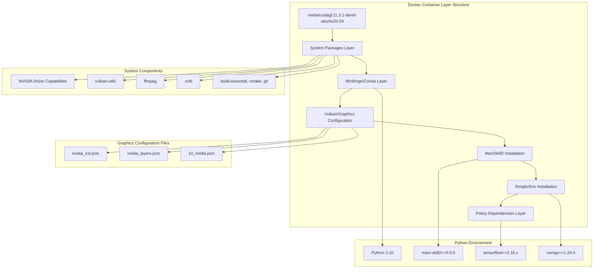
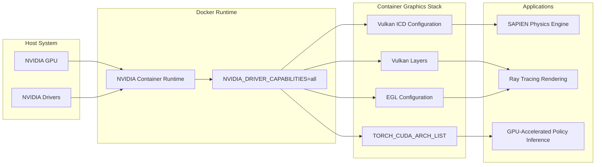
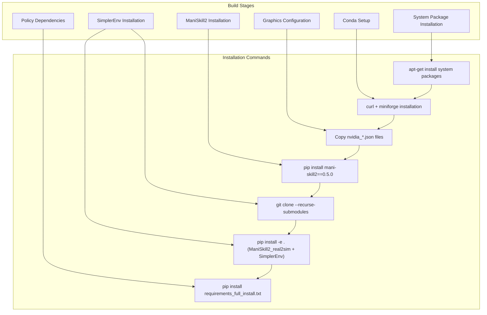

<!-- source: DeepWiki mcp.deepwiki.com · repo allenai/SimplerEnv · page 6.2 Docker Development Environment · fetched 2026-10-26 -->

# Docker Development Environment

<details>
<summary>Relevant source files</summary>

The following files were used as context for generating this wiki page:

- [docker/10_nvidia.json](docker/10_nvidia.json)
- [docker/Dockerfile](docker/Dockerfile)
- [docker/nvidia_icd.json](docker/nvidia_icd.json)
- [docker/nvidia_layers.json](docker/nvidia_layers.json)

</details>


This document covers the Docker-based development environment for SimplerEnv, which provides a containerized setup with all necessary dependencies, GPU support, and graphics rendering capabilities. The Docker environment ensures reproducible builds and simplifies dependency management across different host systems.

For basic installation instructions without Docker, see [Installation](#2.1). For information about adding new environments that may require custom Docker modifications, see [Adding New Environments and Robots](#6.1).

## Purpose and Benefits

The Docker development environment serves several key purposes:

- **Dependency Isolation**: Packages all required dependencies including CUDA, Vulkan, ManiSkill2, and policy frameworks in a controlled environment
- **GPU Acceleration**: Provides full NVIDIA GPU support with CUDA and Vulkan for physics simulation and rendering
- **Reproducibility**: Ensures consistent behavior across different development machines and CI/CD pipelines  
- **Simplified Setup**: Eliminates complex manual installation of graphics drivers, Vulkan, and conflicting Python dependencies

The container includes the complete SimplerEnv stack with all supported policy models (RT-1, Octo, MolmoAct) and evaluation frameworks.

## Container Architecture

The Docker environment is built on `nvidia/cudagl:11.3.1-devel-ubuntu20.04` and follows a layered architecture:



**Container Layer Dependencies**

| Layer | Purpose | Key Components |
|-------|---------|----------------|
| Base Image | CUDA/OpenGL foundation | nvidia/cudagl:11.3.1-devel-ubuntu20.04 |
| System Packages | OS-level dependencies | vulkan-utils, ffmpeg, xvfb, build tools |
| Conda Environment | Python runtime | Python 3.10, package management |
| Graphics Config | GPU rendering setup | Vulkan ICD, NVIDIA layers, EGL config |
| ManiSkill2 | Physics simulation | mani-skill2==0.5.0 |
| SimplerEnv | Core framework | SimplerEnv package + ManiSkill2_real2sim |
| Policy Dependencies | ML frameworks | TensorFlow 2.15.x, full requirements |

Sources: [docker/Dockerfile:1-71]()

## Graphics and GPU Configuration

The Docker environment includes comprehensive GPU and graphics support through multiple configuration layers:



**Graphics Configuration Files**

The container includes three critical NVIDIA configuration files:

- **nvidia_icd.json**: Vulkan Installable Client Driver configuration [docker/nvidia_icd.json:1-7]()
- **nvidia_layers.json**: Vulkan layer configuration with Optimus support [docker/nvidia_layers.json:1-21]()
- **10_nvidia.json**: EGL configuration for NVIDIA graphics [docker/10_nvidia.json:1-6]()

These files are copied to specific system paths to enable proper GPU acceleration:
- `/usr/share/vulkan/icd.d/nvidia_icd.json` [docker/Dockerfile:48]()
- `/etc/vulkan/implicit_layer.d/nvidia_layers.json` [docker/Dockerfile:49]()

**CUDA Architecture Support**

The environment supports multiple GPU architectures via `TORCH_CUDA_ARCH_LIST="Turing Ampere Ada Hopper"` [docker/Dockerfile:4](), ensuring compatibility with modern NVIDIA GPUs.

Sources: [docker/Dockerfile:1-50](), [docker/nvidia_icd.json:1-7](), [docker/nvidia_layers.json:1-21](), [docker/10_nvidia.json:1-6]()

## Build Process and Dependencies

The Docker build process follows a carefully orchestrated sequence to ensure all dependencies are correctly installed:



**Critical Installation Steps**

1. **System Dependencies**: Installs graphics libraries, development tools, and Vulkan support [docker/Dockerfile:7-31]()
2. **Conda Environment**: Downloads and installs Miniforge with Python 3.10 [docker/Dockerfile:36-42]()
3. **ManiSkill2**: Installs specific version `mani-skill2==0.5.0` [docker/Dockerfile:52-53]()
4. **SimplerEnv Clone**: Clones repository with `--recurse-submodules` flag [docker/Dockerfile:56]()
5. **Dependency Installation**: Installs NumPy, ManiSkill2_real2sim, and SimplerEnv in development mode [docker/Dockerfile:57-61]()
6. **Policy Frameworks**: Installs TensorFlow 2.15.x and full requirements [docker/Dockerfile:63-65]()

**Key Dependency Versions**

| Package | Version | Purpose |
|---------|---------|---------|
| mani-skill2 | 0.5.0 | Physics simulation framework |
| numpy | 1.24.4 | Numerical computing (specific version required) |
| tensorflow | 2.15.0/2.15.1 | RT-1 policy inference |
| Python | 3.10 | Runtime environment |

**Working Directory**

The container sets `/root/SimplerEnv` as the working directory [docker/Dockerfile:71](), providing immediate access to the SimplerEnv codebase upon container startup.

Sources: [docker/Dockerfile:7-71]()

## Usage and Development Workflow

The Docker environment supports both evaluation and development workflows through volume mounting and GPU passthrough:

**Building the Container**

```bash
# From repository root
docker build -t simplere-env -f docker/Dockerfile .
```

**Running Evaluations**

```bash
# Run with GPU support and volume mounting
docker run --gpus all \
  -v $(pwd):/workspace \
  -v /path/to/checkpoints:/checkpoints \
  simplere-env \
  python main_inference.py --policy-model rt1 --ckpt-path /checkpoints/rt1_model
```

**Development Mode**

```bash
# Interactive development with code mounting
docker run --gpus all -it \
  -v $(pwd):/root/SimplerEnv \
  simplere-env \
  /bin/bash
```

**Environment Variables**

The container sets several important environment variables:

- `NVIDIA_DRIVER_CAPABILITIES=all` [docker/Dockerfile:2](): Enables full GPU functionality
- `TORCH_CUDA_ARCH_LIST="Turing Ampere Ada Hopper"` [docker/Dockerfile:4](): GPU architecture support
- `PATH=/opt/conda/bin:$PATH` [docker/Dockerfile:44](): Conda environment activation
- `LD_LIBRARY_PATH=/opt/conda/lib:$LD_LIBRARY_PATH` [docker/Dockerfile:69](): Library path configuration

**Volume Mounting Recommendations**

| Mount Point | Purpose | Example |
|-------------|---------|---------|
| `/root/SimplerEnv` | Development code | `-v $(pwd):/root/SimplerEnv` |
| `/checkpoints` | Model checkpoints | `-v /data/checkpoints:/checkpoints` |
| `/results` | Evaluation outputs | `-v /results:/results` |

**GPU Requirements**

The container requires:
- NVIDIA GPU with Vulkan support
- NVIDIA Container Runtime installed on host
- Compatible NVIDIA drivers (compatible with CUDA 11.3)

Sources: [docker/Dockerfile:1-71]()

---

