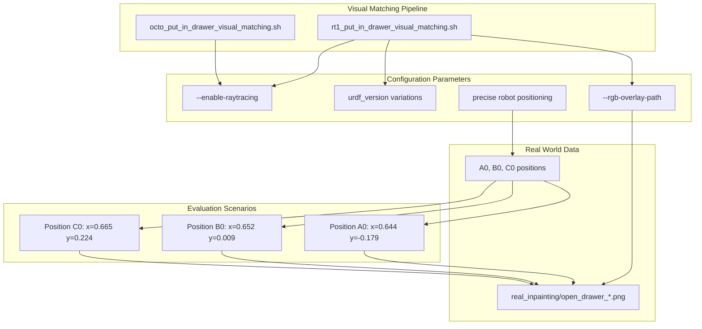
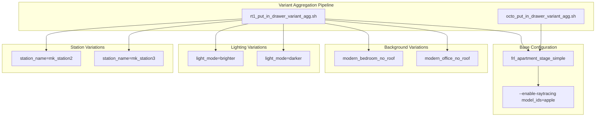
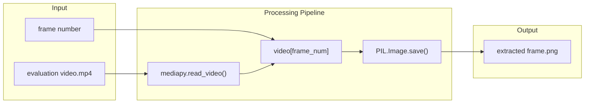
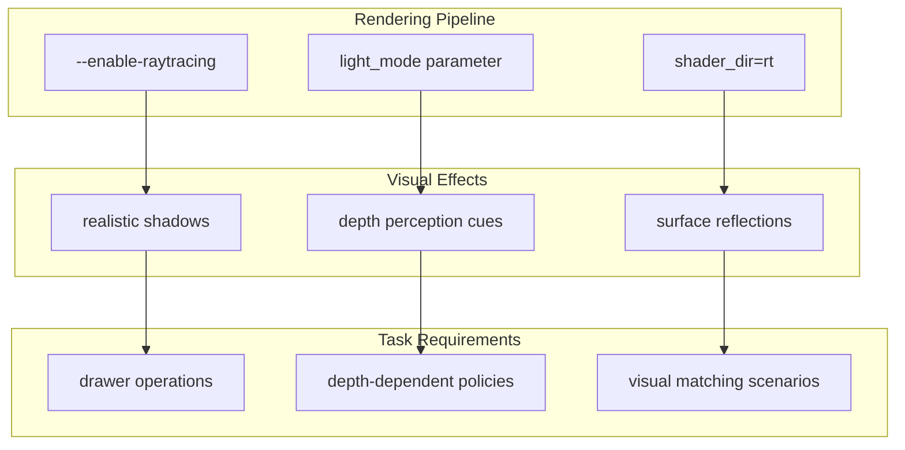
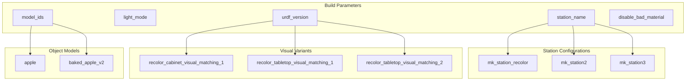
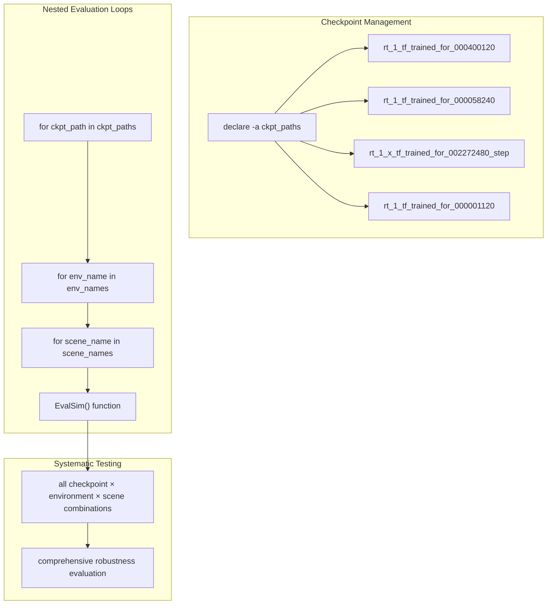

<!-- source: DeepWiki mcp.deepwiki.com · repo allenai/SimplerEnv · page 7 Advanced Topics · fetched 2026-10-26 -->

# Advanced Topics

<details>
<summary>Relevant source files</summary>

The following files were used as context for generating this wiki page:

- [scripts/octo_put_in_drawer_variant_agg.sh](scripts/octo_put_in_drawer_variant_agg.sh)
- [scripts/octo_put_in_drawer_visual_matching.sh](scripts/octo_put_in_drawer_visual_matching.sh)
- [scripts/rt1_put_in_drawer_variant_agg.sh](scripts/rt1_put_in_drawer_variant_agg.sh)
- [scripts/rt1_put_in_drawer_visual_matching.sh](scripts/rt1_put_in_drawer_visual_matching.sh)
- [tools/save_video_frame.py](tools/save_video_frame.py)

</details>


This document covers advanced configuration options, specialized evaluation scenarios, and expert-level usage patterns in SimplerEnv. It focuses on task-specific evaluation scripts, custom video processing workflows, and advanced rendering configurations for specialized research scenarios. For basic evaluation setup, see [Evaluation Framework](#4). For general tool usage, see [Tools and Utilities](#5).

## Task-Specific Evaluation Configurations

SimplerEnv provides specialized evaluation scripts that demonstrate advanced configuration patterns for specific manipulation tasks. These scripts showcase sophisticated parameter tuning and environment variations that go beyond basic policy evaluation.

### Drawer Operation Evaluations

The drawer operation task requires specific configurations due to the importance of visual depth cues and precise robot positioning. SimplerEnv includes dedicated scripts for both visual matching and variant aggregation approaches.

#### Visual Matching Configuration

The visual matching approach for drawer operations uses real background images and precise robot positioning to match real-world evaluation conditions.



Key configuration patterns include:

| Parameter | Purpose | Example Value |
|-----------|---------|---------------|
| `--enable-raytracing` | Enable realistic shadows for depth perception | Required for drawer tasks |
| `--rgb-overlay-path` | Real background image overlay | `./ManiSkill2_real2sim/data/real_inpainting/open_drawer_a0.png` |
| `urdf_version` | Visual appearance variations | `recolor_cabinet_visual_matching_1` |
| `station_name` | Cabinet configuration | `mk_station_recolor` |
| Robot positioning | Precise real-world alignment | x=0.644, y=-0.179 for station A0 |

**Sources:** [scripts/rt1_put_in_drawer_visual_matching.sh:1-71](), [scripts/octo_put_in_drawer_visual_matching.sh:1-67]()

#### Variant Aggregation Configuration

The variant aggregation approach systematically varies environmental conditions to test policy robustness across different scenarios.



The variant aggregation approach tests policies across multiple conditions:

- **Base Setup**: Standard apartment scene with ray-tracing enabled
- **Background Variations**: Modern bedroom and office scenes
- **Lighting Variations**: Brighter and darker lighting conditions
- **Station Variations**: Different cabinet configurations (mk_station2, mk_station3)

**Sources:** [scripts/rt1_put_in_drawer_variant_agg.sh:1-84](), [scripts/octo_put_in_drawer_variant_agg.sh:1-81]()

## Custom Video Processing Workflows

SimplerEnv provides tools for extracting and processing video frames from evaluation results, enabling detailed analysis of policy behavior and failure modes.

### Frame Extraction Tool

The `save_video_frame.py` tool enables extraction of specific frames from evaluation videos for analysis and visualization purposes.



**Usage Pattern:**
```bash
python tools/save_video_frame.py \
  -i /path/to/evaluation/video.mp4 \
  -o /path/to/output/frame.png \
  -n 0  # frame number
```

The tool supports:
- **Video Input**: Any evaluation video generated by SimplerEnv
- **Frame Selection**: Specific frame number (default: 0 for first frame)
- **Output Format**: PNG image file
- **Integration**: Can be used in batch processing scripts for systematic frame extraction

**Sources:** [tools/save_video_frame.py:1-43]()

### Advanced Video Analysis

Frame extraction enables several advanced analysis workflows:

| Use Case | Frame Selection | Analysis Purpose |
|----------|----------------|------------------|
| Initial conditions | Frame 0 | Verify environment setup |
| Failure analysis | Final frames | Understand failure modes |
| Action visualization | Key action frames | Analyze policy decisions |
| Success comparison | Final frames | Compare successful vs failed episodes |

## Advanced Rendering Configuration

SimplerEnv supports advanced rendering options that are crucial for specific evaluation scenarios, particularly those requiring realistic visual depth cues.

### Ray-Tracing Configuration

Ray-tracing rendering is essential for tasks like drawer operations where policies rely on shadows and lighting for depth perception.



**Key Configuration Parameters:**

| Parameter | Values | Purpose |
|-----------|--------|---------|
| `--enable-raytracing` | Boolean flag | Enable ray-tracing renderer |
| `shader_dir` | `rt` | Specify ray-tracing shader directory |
| `light_mode` | `simple`, `brighter`, `darker` | Control lighting intensity |
| `disable_bad_material` | `True` | Remove problematic materials |

**Sources:** [scripts/rt1_put_in_drawer_visual_matching.sh:1-71](), [scripts/rt1_put_in_drawer_variant_agg.sh:1-84]()

### Environment Build Parameters

Advanced environment configuration uses the `--additional-env-build-kwargs` parameter to pass complex configuration options:



**Advanced Parameter Combinations:**

```bash
# Visual matching configuration
EXTRA_ARGS="--enable-raytracing --additional-env-build-kwargs \
  station_name=mk_station_recolor \
  light_mode=simple \
  disable_bad_material=True \
  urdf_version=recolor_cabinet_visual_matching_1 \
  model_ids=baked_apple_v2"

# Variant aggregation configuration
EXTRA_ARGS="--additional-env-build-kwargs \
  shader_dir=rt \
  light_mode=brighter \
  model_ids=apple"
```

**Sources:** [scripts/rt1_put_in_drawer_visual_matching.sh:21-23](), [scripts/rt1_put_in_drawer_variant_agg.sh:62-68]()

## Expert Configuration Patterns

### Multi-Checkpoint Evaluation

Advanced evaluation scripts demonstrate patterns for testing multiple policy checkpoints across various conditions:



This pattern enables systematic evaluation across:
- Multiple policy checkpoints from different training stages
- Various environment configurations
- Different scene backgrounds and lighting conditions
- Comprehensive robustness testing

**Sources:** [scripts/rt1_put_in_drawer_variant_agg.sh:5-10](), [scripts/rt1_put_in_drawer_variant_agg.sh:36-40]()

### Precise Robot Initialization

Advanced scripts demonstrate precise robot positioning for matching real-world evaluation conditions:

| Position | X Coordinate | Y Coordinate | Rotation (RPY) | Purpose |
|----------|--------------|--------------|----------------|---------|
| A0 | 0.644 | -0.179 | -0.03 rad | Match real station A |
| B0 | 0.652 | 0.009 | 0.0 rad | Match real station B |
| C0 | 0.665 | 0.224 | 0.0 rad | Match real station C |

The positioning parameters use range specifications for systematic variation:
- `--robot-init-x 0.644 0.644 1`: Fixed X position
- `--robot-init-y -0.179 -0.179 1`: Fixed Y position  
- `--robot-init-rot-rpy-range 0 0 1 0 0 1 -0.03 -0.03 1`: Fixed rotation

**Sources:** [scripts/rt1_put_in_drawer_visual_matching.sh:29-33](), [scripts/rt1_put_in_drawer_visual_matching.sh:40-44]()

---

