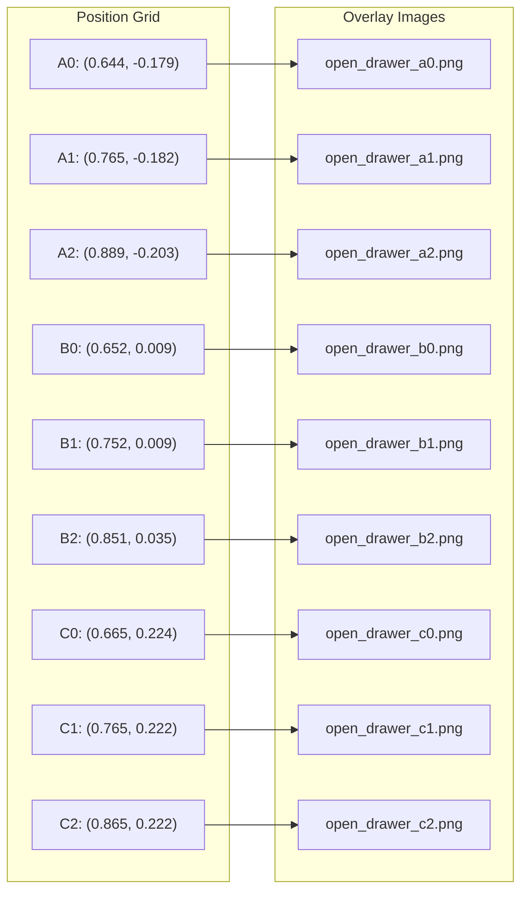
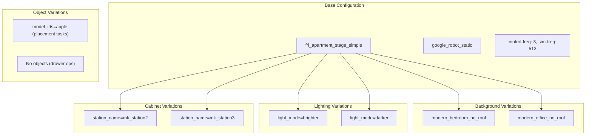
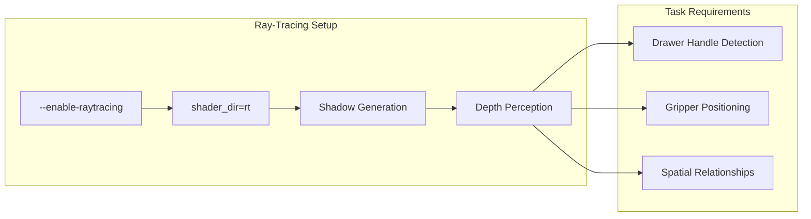
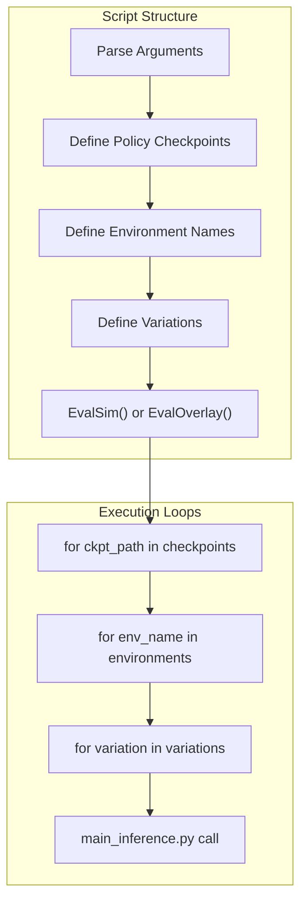

<!-- source: DeepWiki mcp.deepwiki.com · repo allenai/SimplerEnv · page 7.1 Task-Specific Evaluations · fetched 2026-10-26 -->

# Task-Specific Evaluations

<details>
<summary>Relevant source files</summary>

The following files were used as context for generating this wiki page:

- [scripts/molmoact_drawer_variant_agg.sh](scripts/molmoact_drawer_variant_agg.sh)
- [scripts/molmoact_drawer_visual_matching.sh](scripts/molmoact_drawer_visual_matching.sh)
- [scripts/octo_put_in_drawer_variant_agg.sh](scripts/octo_put_in_drawer_variant_agg.sh)
- [scripts/octo_put_in_drawer_visual_matching.sh](scripts/octo_put_in_drawer_visual_matching.sh)
- [scripts/rt1_put_in_drawer_variant_agg.sh](scripts/rt1_put_in_drawer_variant_agg.sh)
- [scripts/rt1_put_in_drawer_visual_matching.sh](scripts/rt1_put_in_drawer_visual_matching.sh)

</details>


This document covers specialized evaluation scripts designed for specific manipulation tasks within SimplerEnv, particularly drawer operations and object placement tasks. These evaluations use task-specific configurations, environments, and rendering settings that differ from general-purpose policy evaluations.

For general evaluation framework concepts, see [Evaluation Framework](#4). For information about the different evaluation approaches (visual matching vs variant aggregation), see [Evaluation Approaches](#4.1). For general evaluation execution, see [Running Evaluations](#4.2).

## Overview of Task-Specific Evaluations

Task-specific evaluations in SimplerEnv provide specialized configurations for complex manipulation tasks that require precise environmental setup, specific rendering options, and carefully tuned parameters. These evaluations are implemented as shell scripts that orchestrate multiple calls to `main_inference.py` with task-appropriate settings.

```mermaid
graph TD
    subgraph "Task Categories"
        DRAWER_OPS["Drawer Operations"]
        OBJ_PLACE["Object Placement"]
    end
    
    subgraph "Drawer Operations"
        OPEN_TOP["OpenTopDrawerCustomInScene-v0"]
        OPEN_MID["OpenMiddleDrawerCustomInScene-v0"] 
        OPEN_BOT["OpenBottomDrawerCustomInScene-v0"]
        CLOSE_TOP["CloseTopDrawerCustomInScene-v0"]
        CLOSE_MID["CloseMiddleDrawerCustomInScene-v0"]
        CLOSE_BOT["CloseBottomDrawerCustomInScene-v0"]
    end
    
    subgraph "Object Placement"
        PLACE_TOP["PlaceIntoClosedTopDrawerCustomInScene-v0"]
        PLACE_MID["PlaceIntoClosedMiddleDrawerCustomInScene-v0"]
        PLACE_BOT["PlaceIntoClosedBottomDrawerCustomInScene-v0"]
    end
    
    subgraph "Evaluation Scripts"
        MOLMO_DRAWER_VM["molmoact_drawer_visual_matching.sh"]
        MOLMO_DRAWER_VA["molmoact_drawer_variant_agg.sh"]
        RT1_PLACE_VM["rt1_put_in_drawer_visual_matching.sh"]
        RT1_PLACE_VA["rt1_put_in_drawer_variant_agg.sh"]
        OCTO_PLACE_VM["octo_put_in_drawer_visual_matching.sh"]
        OCTO_PLACE_VA["octo_put_in_drawer_variant_agg.sh"]
    end
    
    DRAWER_OPS --> OPEN_TOP
    DRAWER_OPS --> OPEN_MID
    DRAWER_OPS --> OPEN_BOT
    DRAWER_OPS --> CLOSE_TOP
    DRAWER_OPS --> CLOSE_MID
    DRAWER_OPS --> CLOSE_BOT
    
    OBJ_PLACE --> PLACE_TOP
    OBJ_PLACE --> PLACE_MID
    OBJ_PLACE --> PLACE_BOT
    
    MOLMO_DRAWER_VM --> DRAWER_OPS
    MOLMO_DRAWER_VA --> DRAWER_OPS
    RT1_PLACE_VM --> OBJ_PLACE
    RT1_PLACE_VA --> OBJ_PLACE
    OCTO_PLACE_VM --> OBJ_PLACE
    OCTO_PLACE_VA --> OBJ_PLACE
```



**Sources:** [scripts/molmoact_drawer_visual_matching.sh:35-42](), [scripts/molmoact_drawer_variant_agg.sh:35-42](), [scripts/rt1_put_in_drawer_visual_matching.sh:11-15](), [scripts/octo_put_in_drawer_visual_matching.sh:10-14]()

## Drawer Task Evaluations

Drawer tasks represent some of the most complex manipulation scenarios in SimplerEnv, requiring precise depth perception, spatial reasoning, and coordinated multi-step actions. These tasks are implemented with specific environmental configurations and rendering requirements.

### Task Types and Environments

The drawer evaluation tasks are divided into two main categories:

| Task Category | Environment Names | Description |
|---------------|-------------------|-------------|
| **Drawer Operations** | `OpenTopDrawerCustomInScene-v0`<br/>`OpenMiddleDrawerCustomInScene-v0`<br/>`OpenBottomDrawerCustomInScene-v0`<br/>`CloseTopDrawerCustomInScene-v0`<br/>`CloseMiddleDrawerCustomInScene-v0`<br/>`CloseBottomDrawerCustomInScene-v0` | Opening and closing different drawer levels |
| **Object Placement** | `PlaceIntoClosedTopDrawerCustomInScene-v0`<br/>`PlaceIntoClosedMiddleDrawerCustomInScene-v0`<br/>`PlaceIntoClosedBottomDrawerCustomInScene-v0` | Placing objects into closed drawers |

### Policy-Specific Configurations

Different policies require different evaluation setups:

| Policy Type | Checkpoints/Models | Inference Options |
|-------------|-------------------|-------------------|
| **MolmoAct** | `allenai/MolmoAct-7B-D-Pretrain-0812`<br/>`allenai/MolmoAct-7B-D-Pretrain-RT-1-0812` | Standard or vLLM (`--vllm` flag) |
| **RT-1** | `./checkpoints/rt_1_tf_trained_for_000400120/`<br/>`./checkpoints/rt_1_tf_trained_for_000058240/`<br/>`./checkpoints/rt_1_x_tf_trained_for_002272480_step/`<br/>`./checkpoints/rt_1_tf_trained_for_000001120/` | TensorFlow-based inference |
| **Octo** | N/A (no checkpoint path required) | `octo-base` or `octo-server` |

**Sources:** [scripts/molmoact_drawer_visual_matching.sh:30-33](), [scripts/rt1_put_in_drawer_visual_matching.sh:3-8](), [scripts/octo_put_in_drawer_visual_matching.sh:5-8]()

## Visual Matching Setup for Drawer Tasks

Visual matching evaluations use real robot background images overlaid on the simulation to create realistic visual conditions. This approach requires precise robot positioning and specific overlay images.

### Robot Positioning Matrix

The visual matching setup uses a 3x3 grid of predefined robot positions (A0-A2, B0-B2, C0-C2) with corresponding overlay images:



### Key Visual Matching Parameters

| Parameter | Value | Purpose |
|-----------|-------|---------|
| `scene-name` | `dummy_drawer` | Minimal scene for overlay compatibility |
| `rgb-overlay-path` | `./ManiSkill2_real2sim/data/real_inpainting/open_drawer_*.png` | Real background images |
| `station_name` | `mk_station_recolor` | Specialized recolored station |
| `light_mode` | `simple` | Simplified lighting for visual matching |
| `urdf_version` | `recolor_cabinet_visual_matching_1`, `recolor_tabletop_visual_matching_1`, `recolor_tabletop_visual_matching_2`, `None` | URDF variations for robustness |

**Sources:** [scripts/molmoact_drawer_visual_matching.sh:49-149](), [scripts/rt1_put_in_drawer_visual_matching.sh:23-58](), [scripts/octo_put_in_drawer_visual_matching.sh:21-55]()

## Variant Aggregation Setup for Drawer Tasks

Variant aggregation evaluations test policy robustness by varying environmental conditions while maintaining the same base task setup.

### Environmental Variations



### Variant Aggregation Parameters

| Variation Type | Parameter | Values |
|----------------|-----------|--------|
| **Scene Backgrounds** | `scene-name` | `modern_bedroom_no_roof`, `modern_office_no_roof` |
| **Lighting Conditions** | `light_mode` | `brighter`, `darker` |
| **Cabinet Types** | `station_name` | `mk_station2`, `mk_station3` |
| **Objects** | `model_ids` | `apple` (for placement tasks) |
| **Robot Positioning** | `robot-init-x`, `robot-init-y` | Randomized ranges for robustness |

**Sources:** [scripts/molmoact_drawer_variant_agg.sh:73-111](), [scripts/rt1_put_in_drawer_variant_agg.sh:42-83](), [scripts/octo_put_in_drawer_variant_agg.sh:42-80]()

## Ray-Tracing Requirements

Drawer tasks require ray-tracing rendering (`shader_dir=rt`) because policies heavily rely on shadow information for depth perception. This is critical for understanding the spatial relationship between the robot gripper and drawer handles or internal compartments.

### Ray-Tracing Configuration



The ray-tracing setup is consistently applied across all drawer task scripts with the `--enable-raytracing` flag and `shader_dir=rt` in the additional environment build kwargs.

**Sources:** [scripts/molmoact_drawer_visual_matching.sh:1](), [scripts/molmoact_drawer_variant_agg.sh:1](), [scripts/rt1_put_in_drawer_visual_matching.sh:1]()

## Running Task-Specific Evaluations

Task-specific evaluation scripts are designed to run comprehensive evaluations across multiple conditions automatically. Each script handles the iteration over policies, environments, and variations.

### Execution Pattern



### Example Usage

To run MolmoAct drawer evaluations with visual matching:
```bash
# Standard inference
./scripts/molmoact_drawer_visual_matching.sh

# With vLLM acceleration
./scripts/molmoact_drawer_visual_matching.sh --vllm
```

To run RT-1 object placement with variant aggregation:
```bash
./scripts/rt1_put_in_drawer_variant_agg.sh
```

### Common Parameters Across Scripts

| Parameter | Drawer Operations | Object Placement | Purpose |
|-----------|-------------------|------------------|---------|
| `--control-freq` | 3 | 3 | Control frequency |
| `--sim-freq` | 513 | 513 | Simulation frequency |
| `--max-episode-steps` | 113 | 200 | Episode length (shorter for drawer ops) |
| `--robot` | `google_robot_static` | `google_robot_static` | Robot model |

**Sources:** [scripts/molmoact_drawer_visual_matching.sh:53-60](), [scripts/rt1_put_in_drawer_variant_agg.sh:25-32](), [scripts/octo_put_in_drawer_visual_matching.sh:25-32]()

---

