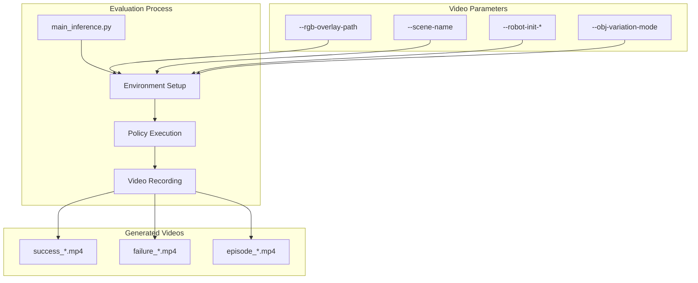
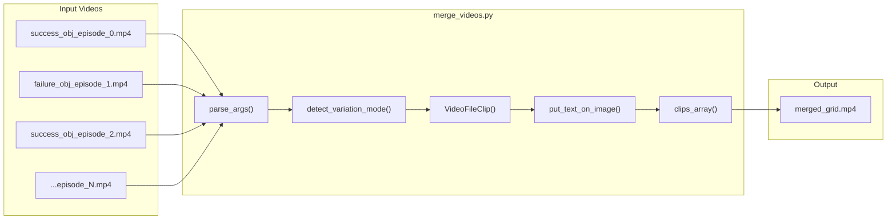
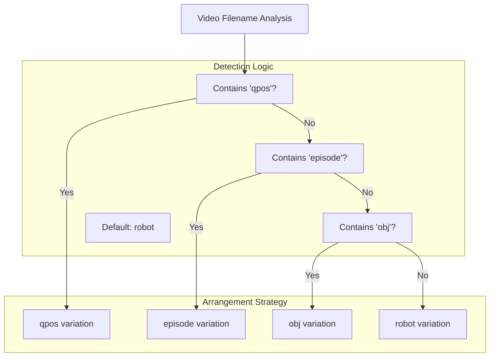
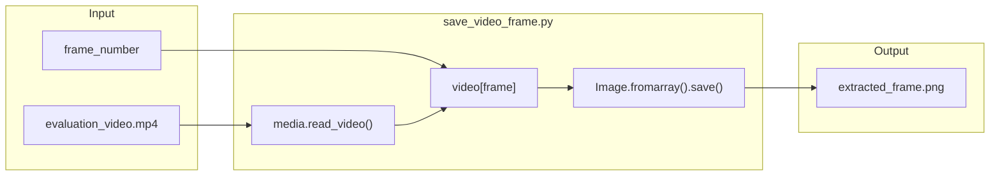

<!-- source: DeepWiki mcp.deepwiki.com · repo allenai/SimplerEnv · page 7.2 Custom Video Processing · fetched 2026-10-26 -->

# Custom Video Processing

<details>
<summary>Relevant source files</summary>

The following files were used as context for generating this wiki page:

- [scripts/octo_bridge.sh](scripts/octo_bridge.sh)
- [scripts/rt1x_bridge.sh](scripts/rt1x_bridge.sh)
- [tools/merge_videos.py](tools/merge_videos.py)
- [tools/save_video_frame.py](tools/save_video_frame.py)

</details>


This document covers the video processing capabilities and tools available in SimplerEnv for generating, manipulating, and analyzing evaluation videos. The system provides utilities for merging multiple evaluation videos into comparative grids, extracting individual frames, and customizing video outputs during policy evaluation.

For basic evaluation setup and running evaluations, see [Running Evaluations](#4.2). For visualization and analysis tools, see [Visualization and Analysis](#5.2).

## Video Generation Pipeline

SimplerEnv automatically generates videos during policy evaluation runs through the `main_inference.py` script. The video generation is integrated into the evaluation workflow and captures robot behavior across different scenarios.



**Video Generation During Evaluation**

Sources: [scripts/octo_bridge.sh:22-29](), [scripts/rt1x_bridge.sh:14-20]()

The evaluation scripts demonstrate how videos are automatically generated with descriptive filenames that encode the experimental parameters. Key video generation parameters include:

| Parameter | Purpose | Example |
|-----------|---------|---------|
| `--rgb-overlay-path` | Background image overlay for visual matching | `bridge_real_eval_1.png` |
| `--scene-name` | Scene configuration identifier | `bridge_table_1_v1` |
| `--robot-init-x/y` | Robot initial position parameters | `0.147`, `0.028` |
| `--obj-variation-mode` | Object variation strategy | `episode` |

## Video Merging System

The `merge_videos.py` tool combines multiple evaluation videos into a single comparative grid layout, enabling side-by-side analysis of policy performance across different conditions.



**Video Merging Workflow**

Sources: [tools/merge_videos.py:55-182]()

The merging system automatically detects the variation mode from video filenames and arranges them accordingly:

- **Robot Variation Mode**: Arranges by robot initial positions
- **Object Variation Mode**: Arranges by object initial positions  
- **Episode Variation Mode**: Arranges in grid based on episode numbers
- **QPos Variation Mode**: Arranges by joint position values

### Variation Mode Detection

The system analyzes video filenames to determine the appropriate arrangement strategy:



Sources: [tools/merge_videos.py:63-75]()

### Text Overlay System

The merging tool adds informational text overlays to each video sub-panel to display success status and relevant parameters:

- **Success Status**: Green text for successful episodes, red for failures
- **Parameter Information**: Displays relevant variation parameters (qpos, episode number, object position, etc.)
- **Color Coding**: Uses `cv2.putText()` with color-coded text based on outcome

Sources: [tools/merge_videos.py:30-53](), [tools/merge_videos.py:163-172]()

## Frame Extraction Utility

The `save_video_frame.py` tool extracts individual frames from evaluation videos for detailed analysis or documentation purposes.



**Frame Extraction Process**

Sources: [tools/save_video_frame.py:25-28]()

The utility uses `mediapy` for video reading and PIL for image output, providing a simple interface for extracting specific frames:

| Parameter | Description | Default |
|-----------|-------------|---------|
| `--input-video` | Path to source video file | Required |
| `--output-path` | Output image file path | Required |
| `--frame` | Frame number to extract | 0 |

## Advanced Video Processing Customization

### Custom Video Parameters

The evaluation system provides several parameters for customizing video generation:

- **RGB Overlay Path**: Integrates real-world background images for visual matching approaches
- **Scene Configuration**: Selects specific scene setups that affect lighting and environment appearance  
- **Robot Positioning**: Controls initial robot poses that affect camera viewpoints
- **Object Variation**: Determines how objects are positioned across episodes

Sources: [scripts/octo_bridge.sh:14-29](), [scripts/rt1x_bridge.sh:9-20]()

### Video Output Organization

Generated videos follow a structured naming convention that encodes experimental parameters:

```
{success_status}_{variation_params}_{additional_tags}.mp4
```

Where:
- `success_status`: "success" or "failure"  
- `variation_params`: Depends on variation mode (obj_x_y, episode_N, qpos_value, etc.)
- `additional_tags`: Optional tags specified via `--additional-env-save-tags`

### Grid Layout Configuration

The merge tool automatically calculates optimal grid dimensions based on the number of input videos:

- **Square Grids**: For episode-based variations, uses `ceil(sqrt(n_videos))` for grid side length
- **Position-Based Grids**: For robot/object position variations, arranges by sorted coordinate values
- **Padding**: Fills empty grid slots with black ColorClip objects when needed

Sources: [tools/merge_videos.py:120-126](), [tools/merge_videos.py:154-157]()

### Duration Synchronization

All videos in a merged grid are synchronized to the maximum duration among input videos, ensuring temporal alignment for comparative analysis.

Sources: [tools/merge_videos.py:78](), [tools/merge_videos.py:133](), [tools/merge_videos.py:159]()