# Page: Overview

# Overview

<details>
<summary>Relevant source files</summary>

The following files were used as context for generating this wiki page:

- [README.md](README.md)
- [images/example_visualization/google_robot_pick_random_object.png](images/example_visualization/google_robot_pick_random_object.png)
- [images/example_visualization/google_robot_put_apple_in_closed_top_drawer.png](images/example_visualization/google_robot_put_apple_in_closed_top_drawer.png)
- [requirements_full_install.txt](requirements_full_install.txt)
- [simpler_env/__init__.py](simpler_env/__init__.py)

</details>


This document provides a comprehensive overview of SimplerEnv, a simulation-based evaluation framework for robotic manipulation policies. SimplerEnv enables scalable and reproducible evaluation of robot policies by creating simulated environments that closely match real-world robot setups.

For installation instructions and basic usage examples, see [Getting Started](#2). For detailed information about supported policy models, see [Policy Models](#3). For comprehensive evaluation procedures and metrics, see [Evaluation Framework](#4).

## Purpose and Scope

SimplerEnv addresses the challenge of evaluating generalist robot manipulation policies in a scalable and reproducible manner. Real-world robot evaluation is operationally expensive and inefficient, making it difficult to compare policies or perform systematic analysis. This system provides a simulation-based alternative that offers:

- **Scalable evaluation**: Run hundreds of policy evaluations in parallel simulation environments
- **Reproducible benchmarks**: Standardized environments and metrics for consistent comparison
- **Real-to-sim validation**: Two evaluation methodologies (Visual Matching and Variant Aggregation) that correlate with real-world performance
- **Multi-policy support**: Built-in integration with RT-1, Octo, and MolmoAct policy architectures

The system is built on the SAPIEN physics simulator and extends the ManiSkill2 benchmark with real-world robot environments and objects.

## System Architecture

The following diagram illustrates the high-level architecture of SimplerEnv and how its major components interact:

### SimplerEnv System Components

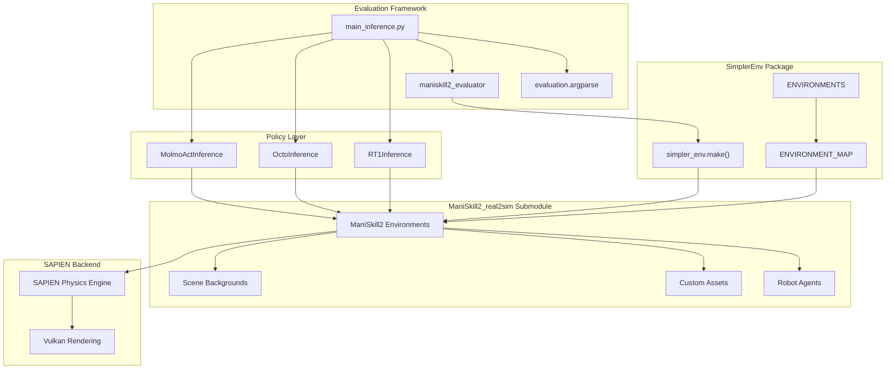

Sources: [README.md:182-221](), [simpler_env/__init__.py:1-89]()

## Evaluation Methodologies

SimplerEnv implements two distinct approaches for real-to-sim evaluation, each designed to address different aspects of the simulation-to-reality gap:

### Real-to-Sim Evaluation Approaches

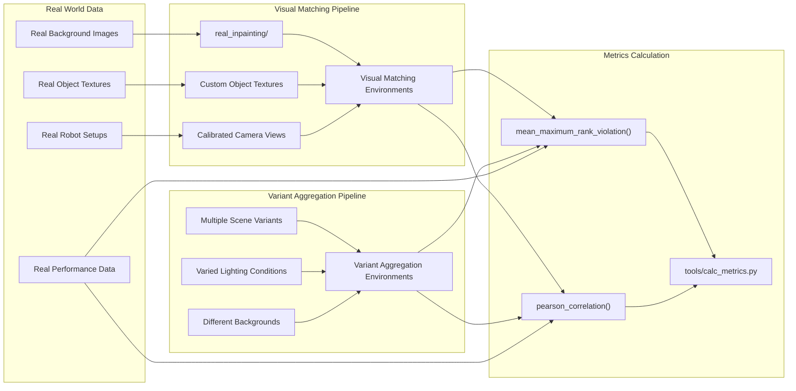

Sources: [README.md:11-14](), [README.md:156-180]()

## Code Organization and Entry Points

The system provides multiple entry points for different use cases, from simple environment creation to comprehensive policy evaluation:

### Core Code Structure and Entry Points

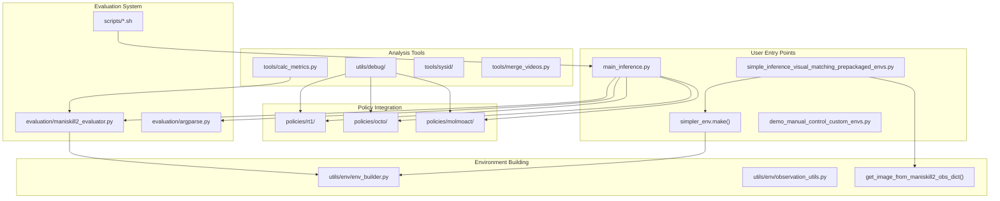

Sources: [README.md:182-221](), [simpler_env/__init__.py:74-88](), [README.md:124-128]()

## Key System Components

### Environment Management

The `simpler_env.make()` function serves as the primary entry point for creating evaluation environments. It maps high-level task names to specific ManiSkill2 environment configurations:

| Component | Description | Code Location |
|-----------|-------------|---------------|
| `ENVIRONMENTS` | List of supported task names | [simpler_env/__init__.py:5-31]() |
| `ENVIRONMENT_MAP` | Mapping from task names to ManiSkill2 environments | [simpler_env/__init__.py:33-71]() |
| `make()` function | Environment factory with prepackaged configurations | [simpler_env/__init__.py:74-88]() |

### Policy Support

SimplerEnv provides built-in support for three major policy architectures:

| Policy Type | Implementation | Key Dependencies |
|-------------|----------------|------------------|
| RT-1 | `simpler_env/policies/rt1/` | TensorFlow 2.15.x, tf_agents |
| Octo | `simpler_env/policies/octo/` | JAX with CUDA, Flax |
| MolmoAct | `simpler_env/policies/molmoact/` | vLLM 0.8.5, Transformers 4.52.3 |

### Evaluation Infrastructure

The evaluation system supports both simple and advanced evaluation scenarios:

- **Simple evaluation**: Use `simple_inference_visual_matching_prepackaged_envs.py` for basic policy testing
- **Advanced evaluation**: Use `main_inference.py` with `evaluation/maniskill2_evaluator.py` for comprehensive evaluation with logging and metrics
- **Batch evaluation**: Shell scripts in `scripts/` directory for reproducing paper results

Sources: [README.md:34-63](), [README.md:245-323](), [requirements_full_install.txt:1-24]()

The system integrates with the ManiSkill2_real2sim submodule to provide the underlying simulation environments, robot models, and object assets needed for realistic manipulation task evaluation.

---

# Page: Core Concepts

# Core Concepts

<details>
<summary>Relevant source files</summary>

The following files were used as context for generating this wiki page:

- [README.md](README.md)
- [requirements_full_install.txt](requirements_full_install.txt)
- [simpler_env/utils/metrics.py](simpler_env/utils/metrics.py)
- [simpler_env/utils/visualization.py](simpler_env/utils/visualization.py)
- [tools/calc_metrics.py](tools/calc_metrics.py)
- [tools/visualize_dataset.py](tools/visualize_dataset.py)

</details>


This document explains the fundamental concepts underlying SimplerEnv's real-to-sim evaluation framework. It covers the core evaluation methodologies, system components, and metrics used to assess robotic manipulation policies in simulation environments that mirror real-world setups.

For detailed installation procedures, see [Installation](#2.1). For specific policy implementations, see [Policy Models](#3). For running evaluations, see [Evaluation Framework](#4).

## Real-to-Sim Evaluation Framework

SimplerEnv enables evaluation of robot manipulation policies by creating simulation environments that closely match real-world robot setups. The system addresses the challenge of scalable policy evaluation by providing quantitative metrics that correlate with real-world performance while maintaining computational efficiency.

The framework operates on the principle that well-configured simulation environments can serve as reliable proxies for real-world evaluation, enabling checkpoint selection, failure mode analysis, and standardized benchmarking.

**Core System Integration**

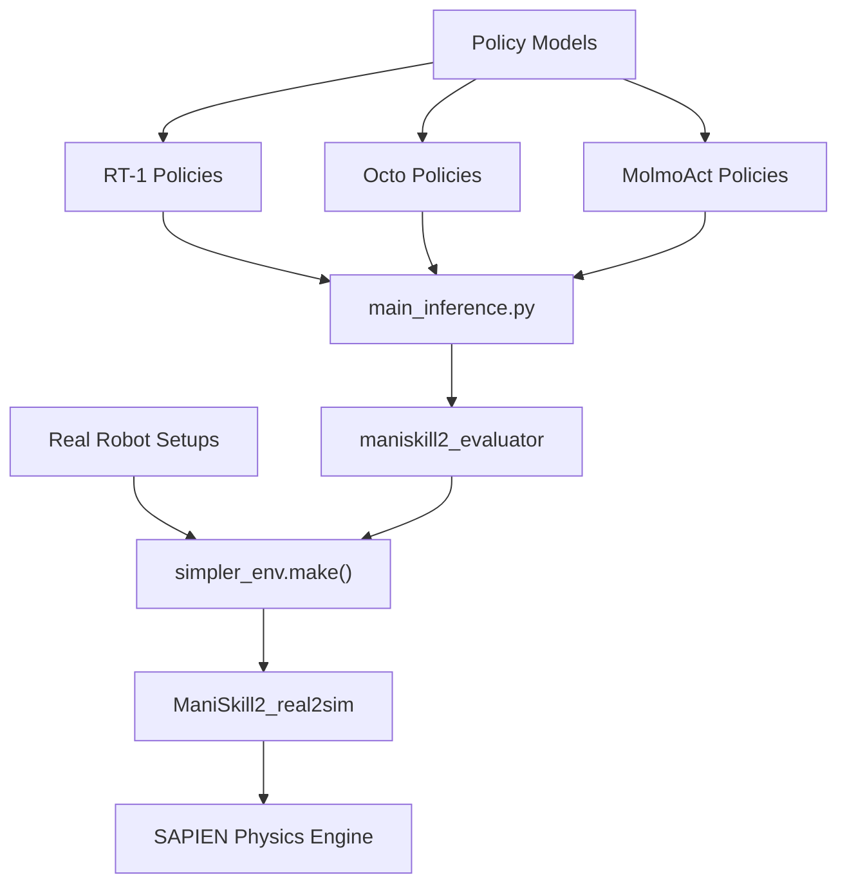

Sources: [README.md:11-15](), [README.md:38-63]()

## Evaluation Approaches

SimplerEnv implements two primary methodologies for real-to-sim evaluation, each designed to address different aspects of the sim-to-real gap.

### Visual Matching

Visual matching creates simulation environments that precisely replicate the visual appearance of real-world setups by overlaying real background images onto simulation scenes and adjusting object textures and lighting conditions.

**Visual Matching Pipeline**

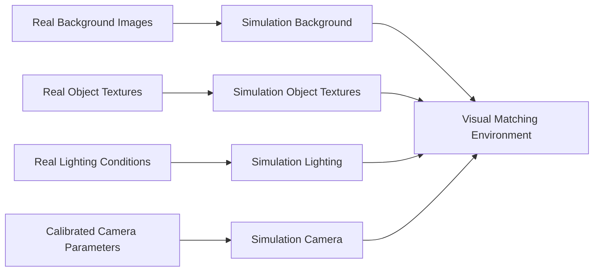

The visual matching approach uses real-world inpainting images stored in `ManiSkill2_real2sim/data/real_inpainting/` and applies them to simulation environments to achieve visual fidelity.

### Variant Aggregation

Variant aggregation creates multiple simulation environment variants with different visual configurations (backgrounds, lighting, distractors, textures) and averages performance across these variants to improve generalization.

**Variant Aggregation Strategy**

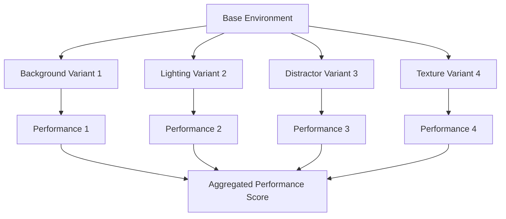

Sources: [README.md:12-13](), [README.md:36]()

## Core System Components

SimplerEnv's architecture centers around several key components that work together to provide a complete evaluation framework.

### Environment Creation and Management

The `simpler_env.make()` function serves as the primary entry point for creating evaluation environments. It interfaces with the ManiSkill2_real2sim submodule to instantiate environments with specific configurations.

**Environment Creation Flow**

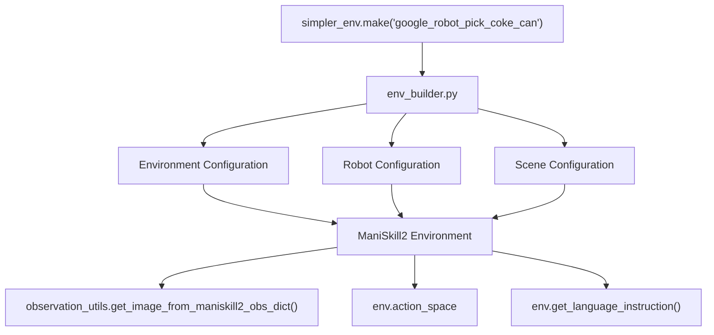

### Policy Integration Framework

The system supports multiple policy architectures through a unified interface that handles model loading, inference, and action processing.

**Policy Execution Pipeline**

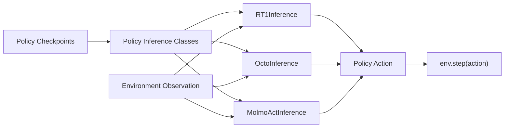

Sources: [README.md:42-44](), [README.md:50-54](), [README.md:198-210]()

## Evaluation Metrics

SimplerEnv employs specific metrics to quantify how well simulation evaluation correlates with real-world performance. These metrics are implemented in the `simpler_env.utils.metrics` module.

### Mean Maximum Rank Violation (MMRV)

MMRV measures the maximum performance difference between policies when their relative rankings differ between simulation and real-world evaluation.

The `mean_maximum_rank_violation()` function computes this metric by comparing policy rankings across evaluation approaches:

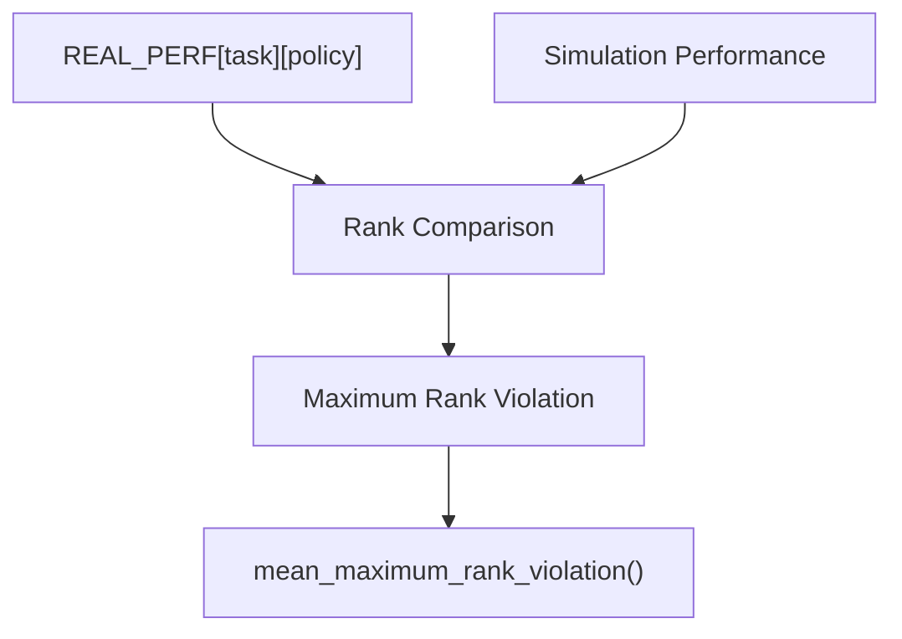

### Pearson Correlation Coefficient

The `pearson_correlation()` function measures the linear correlation between simulation and real-world performance scores across different policies.

**Metrics Calculation Workflow**

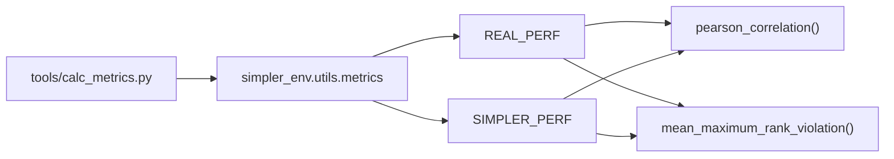

The metrics system allows researchers to compare their evaluation approaches against SimplerEnv's baseline using the standardized performance data stored in `REAL_PERF` and `SIMPLER_PERF` dictionaries.

Sources: [tools/calc_metrics.py:1-35](), [simpler_env/utils/metrics.py:134-163](), [README.md:156-180]()

## ManiSkill2 Integration

SimplerEnv builds upon the ManiSkill2_real2sim submodule, which provides the underlying simulation infrastructure powered by the SAPIEN physics engine. This integration enables realistic physics simulation while maintaining the flexibility needed for real-to-sim evaluation.

### Environment Variants and Tasks

The system provides prepackaged environments accessible through string identifiers that correspond to specific ManiSkill2 environment classes:

| SimplerEnv Task ID | ManiSkill2 Environment Class | Description |
|-------------------|----------------------------|-------------|
| `google_robot_pick_coke_can` | `GraspSingleOpenedCokeCanInScene-v0` | Object grasping task |
| `google_robot_move_near` | `MoveNearGoogleBakedTexInScene-v1` | Navigation and positioning |
| `google_robot_open_drawer` | `OpenDrawerCustomInScene-v0` | Drawer manipulation |
| `widowx_spoon_on_towel` | `PutSpoonOnTableClothInScene-v0` | Placement task |

**Environment Architecture**

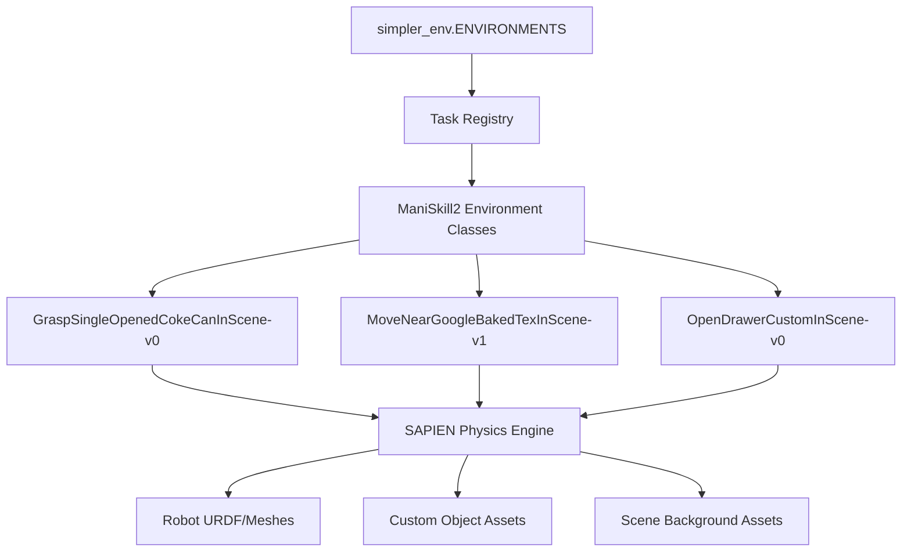

Sources: [README.md:130-154](), [README.md:185-197]()

---

# Page: System Architecture

# System Architecture

<details>
<summary>Relevant source files</summary>

The following files were used as context for generating this wiki page:

- [README.md](README.md)
- [requirements_full_install.txt](requirements_full_install.txt)
- [simpler_env/evaluation/maniskill2_evaluator.py](simpler_env/evaluation/maniskill2_evaluator.py)
- [simpler_env/policies/molmoact/dataset_statistics.json](simpler_env/policies/molmoact/dataset_statistics.json)

</details>


This document provides a comprehensive overview of SimplerEnv's system architecture, detailing how the core components interact to enable simulated evaluation of robotic manipulation policies. This covers the relationship between SimplerEnv, ManiSkill2_real2sim, SAPIEN, and the evaluation framework, along with policy integration and supporting infrastructure.

For information about specific policy implementations, see [Policy Models](#3). For detailed evaluation methodologies, see [Evaluation Framework](#4). For installation and setup instructions, see [Getting Started](#2).

## Overview

SimplerEnv is a comprehensive system for evaluating robotic manipulation policies in simulation environments that closely match real-world setups. The architecture consists of several interconnected layers: the core SimplerEnv package, the ManiSkill2_real2sim simulation backend, policy integration modules, and evaluation infrastructure.

### Core System Architecture

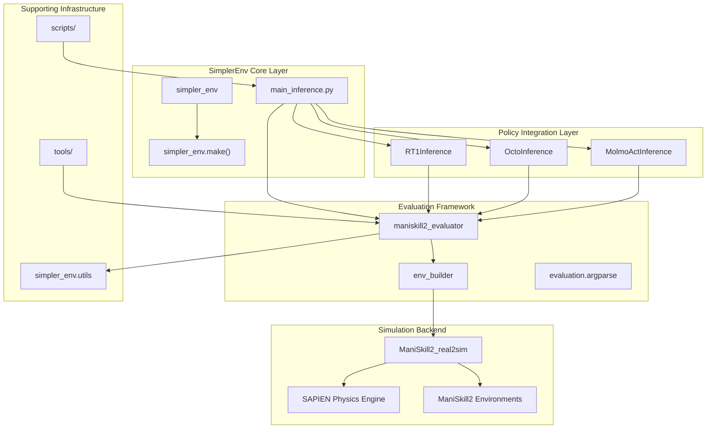

**Sources:** [README.md:182-221](), [simpler_env/main_inference.py](), [simpler_env/evaluation/maniskill2_evaluator.py:1-223]()

## Component Relationships and Data Flow

The following diagram illustrates the specific code entities and their interactions during policy evaluation:

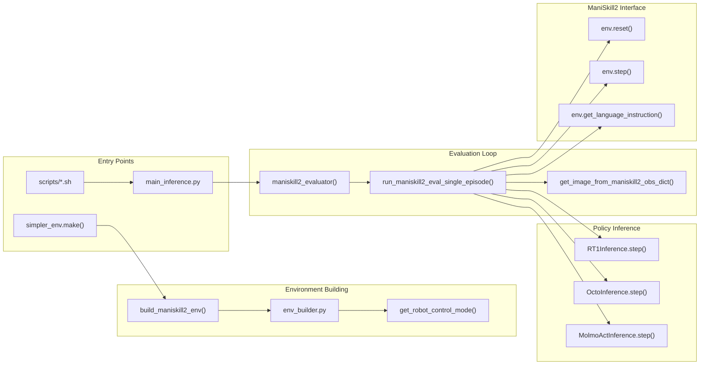

**Sources:** [simpler_env/evaluation/maniskill2_evaluator.py:15-223](), [simpler_env/utils/env/env_builder.py](), [simpler_env/utils/env/observation_utils.py]()

## Policy Integration Architecture

SimplerEnv supports multiple policy architectures through a common interface pattern. Each policy implementation provides standardized methods for initialization, action prediction, and visualization:

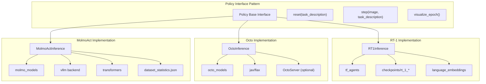

**Sources:** [simpler_env/policies/rt1/](), [simpler_env/policies/octo/](), [simpler_env/policies/molmoact/](), [simpler_env/policies/molmoact/dataset_statistics.json:1-3126]()

## Evaluation Pipeline Architecture

The evaluation system implements two main approaches: Visual Matching and Variant Aggregation. The pipeline coordinates environment creation, policy execution, and result collection:

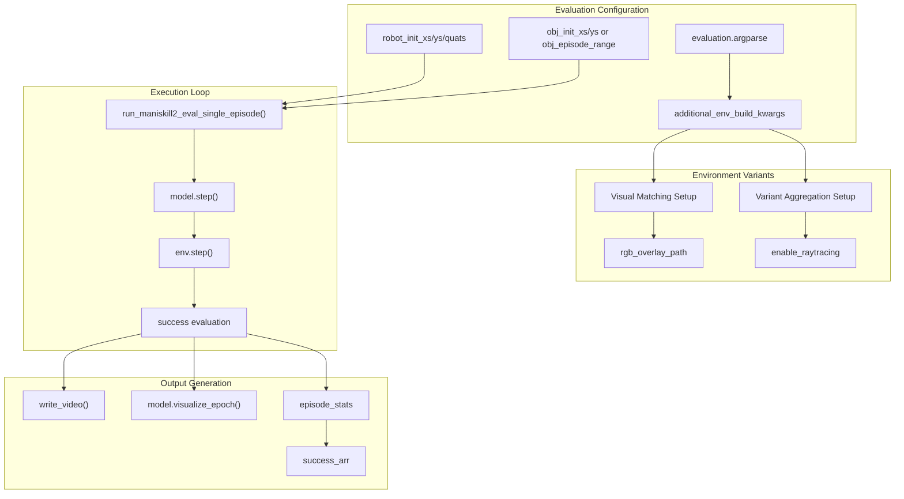

**Sources:** [simpler_env/evaluation/maniskill2_evaluator.py:15-176](), [simpler_env/evaluation/argparse.py](), [simpler_env/utils/visualization.py]()

## Backend Simulation Infrastructure

The simulation layer consists of ManiSkill2_real2sim environments built on SAPIEN physics engine, with specialized assets and configurations for real-to-sim evaluation:

### Environment and Asset Structure

| Component | Location | Purpose |
|-----------|----------|---------|
| Custom Objects | `ManiSkill2_real2sim/data/custom/` | Coke cans, cabinets, and other task objects |
| Scene Assets | `ManiSkill2_real2sim/data/hab2_bench_assets/` | Background scenes and environments |
| Real Inpainting | `ManiSkill2_real2sim/data/real_inpainting/` | Real-world images for visual matching |
| Robot Agents | `ManiSkill2_real2sim/mani_skill2_real2sim/agents/` | Robot configurations and controllers |
| Robot Assets | `ManiSkill2_real2sim/mani_skill2_real2sim/assets/` | URDF files and meshes |
| Environments | `ManiSkill2_real2sim/mani_skill2_real2sim/envs/` | Task environment implementations |

```mermaid
graph TD
    subgraph "ManiSkill2_real2sim Structure"
        DATA_DIR["data/"]
        AGENTS_DIR["mani_skill2_real2sim/agents/"]
        ASSETS_DIR["mani_skill2_real2sim/assets/"]
        ENVS_DIR["mani_skill2_real2sim/envs/"]
    end
    
    subgraph "Asset Categories"
        CUSTOM_OBJ["custom/ (objects)"]
        HAB_ASSETS["hab2_bench_assets/ (scenes)"]
        REAL_IMGS["real_inpainting/ (backgrounds)"]
        DEBUG_ASSETS["debug/ (testing)"]
    end
    
    subgraph "Robot Components"
        ROBOT_CONFIGS["robot configs"]
        ROBOT_URDF["URDF files"]
        ROBOT_MESH["mesh files"]
        CONTROLLERS["controller implementations"]
    end
    
    subgraph "Environment Types"
        GOOGLE_ENVS["Google Robot environments"]
        WIDOWX_ENVS["WidowX environments"]
        GRASP_ENVS["GraspSingle* tasks"]
        DRAWER_ENVS["*Drawer* tasks"]
    end
    
    DATA_DIR --> CUSTOM_OBJ
    DATA_DIR --> HAB_ASSETS
    DATA_DIR --> REAL_IMGS
    DATA_DIR --> DEBUG_ASSETS
    
    AGENTS_DIR --> ROBOT_CONFIGS
    AGENTS_DIR --> CONTROLLERS
    ASSETS_DIR --> ROBOT_URDF
    ASSETS_DIR --> ROBOT_MESH
    
    ENVS_DIR --> GOOGLE_ENVS
    ENVS_DIR --> WIDOWX_ENVS
    ENVS_DIR --> GRASP_ENVS
    ENVS_DIR --> DRAWER_ENVS
```

**Sources:** [README.md:185-197](), [ManiSkill2_real2sim/data/](), [ManiSkill2_real2sim/mani_skill2_real2sim/]()

## Supporting Tools and Utilities

SimplerEnv includes comprehensive tooling for system identification, visualization, debugging, and metrics calculation:

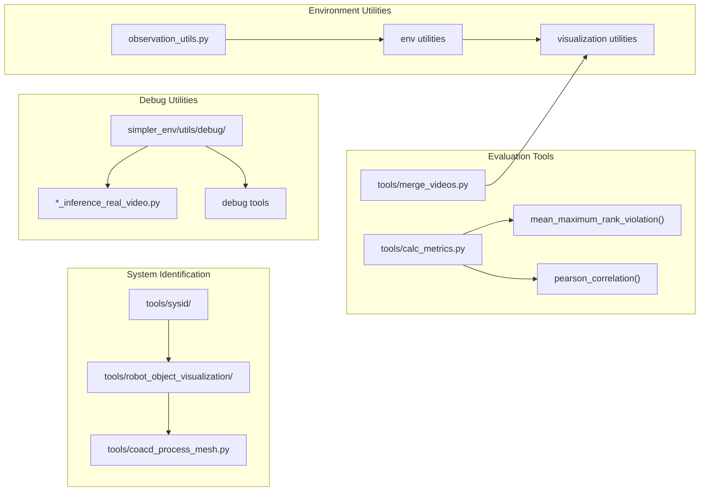

**Sources:** [tools/](), [simpler_env/utils/debug/](), [simpler_env/utils/env/](), [tools/calc_metrics.py]()

## Environment Registration and Factory Pattern

SimplerEnv uses a factory pattern for environment creation, with prepackaged configurations for visual matching and variant aggregation setups:

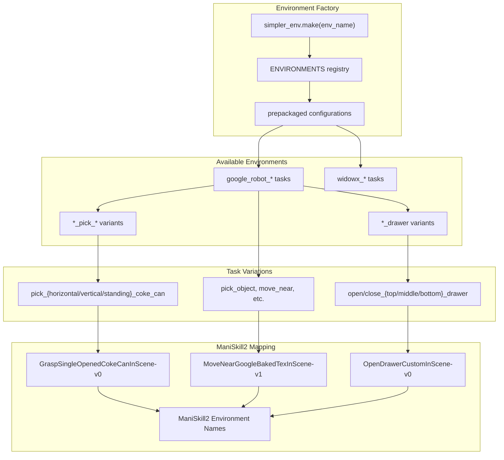

**Sources:** [README.md:130-154](), [simpler_env/__init__.py](), [README.md:38-63]()

---

# Page: Getting Started

# Getting Started

<details>
<summary>Relevant source files</summary>

The following files were used as context for generating this wiki page:

- [.gitmodules](.gitmodules)
- [docker/10_nvidia.json](docker/10_nvidia.json)
- [docker/Dockerfile](docker/Dockerfile)
- [docker/nvidia_icd.json](docker/nvidia_icd.json)
- [docker/nvidia_layers.json](docker/nvidia_layers.json)
- [example.ipynb](example.ipynb)

</details>


This document provides an overview of SimplerEnv installation, initial setup, and basic usage patterns. It introduces the core concepts and system components needed to begin evaluating robotic manipulation policies in simulation.

For detailed installation instructions including Docker setup and dependency management, see [Installation](#2.1). For step-by-step examples of creating environments and running evaluations, see [Basic Usage](#2.2).

## Overview

SimplerEnv is a simulation-based evaluation framework for robotic manipulation policies that bridges the gap between simulated and real-world performance. The system consists of several key components that work together to provide accurate policy evaluation.

### Core System Architecture

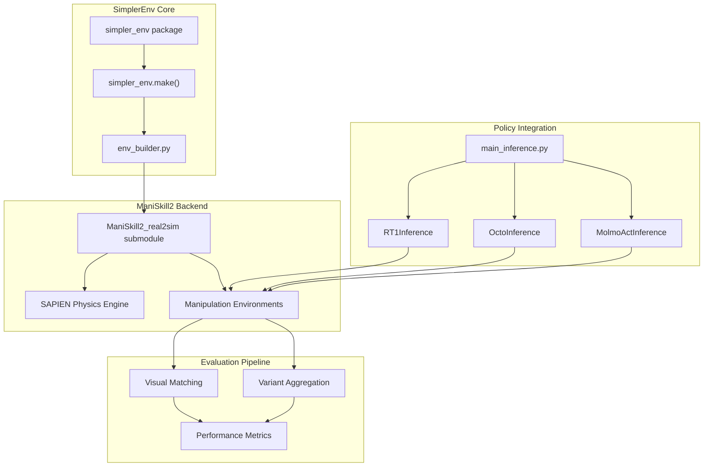

Sources: [example.ipynb:19-23](), [.gitmodules:1-4]()

### Installation Approaches

SimplerEnv supports three primary installation methods, each suited for different use cases:

| Installation Method | Use Case | Requirements | Policy Support |
|-------------------|----------|--------------|----------------|
| **Docker** | Reproducible environments, CI/CD | NVIDIA GPU, Docker | Full policy support |
| **Conda** | Development, customization | Python 3.10, CUDA | Configurable |
| **Colab** | Quick experimentation, demos | Google Colab GPU runtime | Limited to available packages |

### Installation Flow Diagram

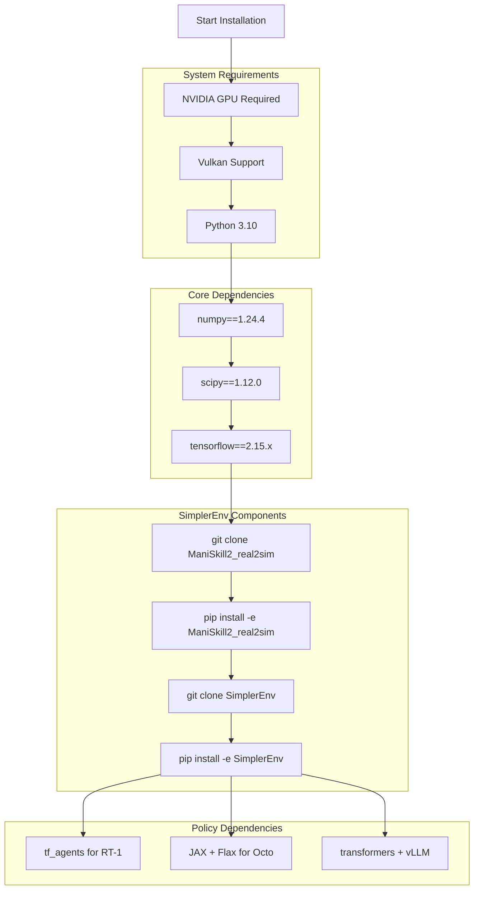

Sources: [example.ipynb:85-299](), [docker/Dockerfile:51-66]()

## Quick Start

### 1. Environment Setup

The fastest way to get started is using the provided example notebook or following the basic installation steps:

```python
# Core installation commands from example notebook
pip install numpy==1.24.4
git clone https://github.com/simpler-env/ManiSkill2_real2sim.git
pip install -e ./ManiSkill2_real2sim
git clone https://github.com/simpler-env/SimplerEnv.git  
pip install -e ./SimplerEnv
```

### 2. Creating Your First Environment

Once installed, you can create a simulation environment using the `simpler_env.make()` function:

```python
import simpler_env

# Create environment with visual matching approach
env = simpler_env.make(
    env_id="google_robot_pick_coke_can",
    robot="google_robot",
    policy_model="rt1"
)

# Reset environment and get initial observation
obs, info = env.reset()
```

### 3. Running Basic Evaluations

The primary evaluation interface is through `main_inference.py`, which handles policy loading, environment interaction, and results collection:

```bash
python main_inference.py \
    --policy_model=rt1 \
    --robot_name=google_robot \
    --env_name=google_robot_pick_coke_can \
    --visual_matching
```

Sources: [example.ipynb:423-451]()

## System Components

### Core Components Mapping

```mermaid
graph LR
    subgraph "User Interface"
        NOTEBOOK["Jupyter Notebooks"]
        CLI["Command Line Scripts"]
        API["Python API"]
    end
    
    subgraph "SimplerEnv Core"
        MAKE_FUNC["simpler_env.make()"]
        ENV_BUILDER["env_builder.py"]
        EVALUATOR["maniskill2_evaluator"]
    end
    
    subgraph "Policy Backends"
        RT1_INF["RT1Inference class"]
        OCTO_INF["OctoInference class"]
        MOLMO_INF["MolmoActInference class"]
    end
    
    subgraph "Simulation Backend"
        MS2_ENVS["ManiSkill2 Environments"]
        SAPIEN_ENG["SAPIEN Physics"]
        ASSETS["Robot/Object Assets"]
    end
    
    NOTEBOOK --> MAKE_FUNC
    CLI --> ENV_BUILDER
    API --> EVALUATOR
    
    MAKE_FUNC --> RT1_INF
    ENV_BUILDER --> OCTO_INF
    EVALUATOR --> MOLMO_INF
    
    RT1_INF --> MS2_ENVS
    OCTO_INF --> MS2_ENVS
    MOLMO_INF --> MS2_ENVS
    
    MS2_ENVS --> SAPIEN_ENG
    MS2_ENVS --> ASSETS
```

Sources: [example.ipynb:424-451](), [.gitmodules:1-4]()

### Dependencies and Requirements

| Component | Version Requirement | Purpose |
|-----------|-------------------|---------|
| `numpy` | `==1.24.4` | Core numerical operations |
| `scipy` | `==1.12.0` | Scientific computing |
| `tensorflow` | `==2.15.x` | RT-1 policy support |
| `sapien` | `==2.2.2` | Physics simulation |
| `gymnasium` | `>=0.28.1` | Environment interface |
| `vulkan` | System dependency | GPU rendering |

## Docker Installation

For the most reliable setup, use the provided Docker environment:

```dockerfile
# Key Docker setup from Dockerfile
FROM nvidia/cudagl:11.3.1-devel-ubuntu20.04
ENV NVIDIA_DRIVER_CAPABILITIES=all

# Install SimplerEnv
RUN cd ~ && git clone https://github.com/allenai/SimplerEnv --recurse-submodules && \
    pip install numpy==1.24.4 && \
    cd SimplerEnv/ManiSkill2_real2sim && \
    pip install -e . && \
    cd .. && \
    pip install -e .
```

The Docker approach automatically handles:
- NVIDIA GPU driver setup
- Vulkan rendering configuration  
- All dependency version management
- Submodule initialization

Sources: [docker/Dockerfile:1-71](), [docker/nvidia_icd.json:1-7](), [docker/10_nvidia.json:1-6]()

## Next Steps

After completing the basic setup:

1. **Detailed Installation**: Follow the comprehensive installation guide at [Installation](#2.1) for your specific environment
2. **Basic Usage Examples**: Work through step-by-step examples at [Basic Usage](#2.2) 
3. **Policy Integration**: Learn about supported policy models at [Policy Models](#3)
4. **Running Evaluations**: Understand the evaluation framework at [Evaluation Framework](#4)

The getting started process establishes the foundation for policy evaluation, but the full system capabilities require understanding the evaluation approaches, metrics calculation, and policy-specific configurations covered in subsequent sections.

---

# Page: Installation

# Installation

<details>
<summary>Relevant source files</summary>

The following files were used as context for generating this wiki page:

- [.gitmodules](.gitmodules)
- [docker/10_nvidia.json](docker/10_nvidia.json)
- [docker/Dockerfile](docker/Dockerfile)
- [docker/nvidia_icd.json](docker/nvidia_icd.json)
- [docker/nvidia_layers.json](docker/nvidia_layers.json)
- [example.ipynb](example.ipynb)
- [tools/coacd_process_mesh.py](tools/coacd_process_mesh.py)

</details>


This page provides comprehensive installation instructions for SimplerEnv, a robotic policy evaluation framework. SimplerEnv requires specific dependencies for simulation rendering, policy model support, and real-to-sim evaluation capabilities.

For basic usage examples after installation, see [Basic Usage](#2.2). For information about supported policy models that require additional dependencies, see [Policy Models](#3).

## Prerequisites

SimplerEnv requires a system with:
- NVIDIA GPU with CUDA support
- Linux operating system (Ubuntu 18.04+ recommended)
- Python 3.8 or higher
- At least 8GB of available disk space

### GPU and Rendering Requirements

The system depends on Vulkan for hardware-accelerated rendering through the SAPIEN physics engine. This requires:
- NVIDIA drivers (version 470+ recommended)
- Vulkan SDK and development libraries
- CUDA toolkit (version 11.3+ for TensorFlow compatibility)

## Installation Methods

SimplerEnv can be installed through three primary methods, each suited for different use cases:

### Installation Method Overview

```mermaid
graph TD
    subgraph "Installation Options"
        Docker["docker_install"]
        Conda["conda_install"] 
        Colab["colab_install"]
    end
    
    subgraph "Core Components"
        Vulkan["vulkan_setup"]
        MS2["ManiSkill2_real2sim"]
        SE["SimplerEnv"]
        Deps["policy_dependencies"]
    end
    
    subgraph "Verification"
        Test["test_installation"]
        Demo["run_demo"]
    end
    
    Docker --> Vulkan
    Docker --> MS2
    Docker --> SE
    Docker --> Deps
    
    Conda --> Vulkan
    Conda --> MS2
    Conda --> SE
    
    Colab --> Vulkan
    Colab --> MS2
    Colab --> SE
    
    MS2 --> Test
    SE --> Test
    Test --> Demo
    
    style Docker fill:#e3f2fd
    style Conda fill:#f1f8e9
    style Colab fill:#fff3e0
```

Sources: [example.ipynb:1-411](), [docker/Dockerfile:1-71]()

### Method 1: Docker Installation (Recommended)

Docker provides the most reliable installation with pre-configured dependencies and rendering support.

#### Docker Setup

```bash
# Clone the repository with submodules
git clone --recurse-submodules https://github.com/allenai/SimplerEnv
cd SimplerEnv

# Build the Docker image
docker build -t simpler_env -f docker/Dockerfile .

# Run the container with GPU support
docker run --gpus all -it --rm \
    -v $(pwd):/workspace \
    simpler_env bash
```

The Docker image includes:
- Ubuntu 20.04 base with CUDA 11.3.1
- Pre-installed Vulkan rendering stack
- ManiSkill2 and SimplerEnv in editable mode
- TensorFlow 2.15.0 with CUDA support
- Full dependency requirements

#### Docker Environment Configuration

The Dockerfile configures several critical components:

| Component | Configuration | Purpose |
|-----------|---------------|---------|
| Base Image | `nvidia/cudagl:11.3.1-devel-ubuntu20.04` | CUDA and OpenGL support |
| Vulkan ICD | `/usr/share/vulkan/icd.d/nvidia_icd.json` | NVIDIA Vulkan driver |
| EGL Vendor | `/usr/share/glvnd/egl_vendor.d/10_nvidia.json` | NVIDIA EGL implementation |
| Python | Miniforge with Python 3.10 | Conda environment |

Sources: [docker/Dockerfile:1-71](), [docker/nvidia_icd.json:1-7](), [docker/10_nvidia.json:1-6]()

### Method 2: Conda Installation

For local development or when Docker is not available:

#### Environment Setup

```bash
# Create and activate conda environment
conda create -n simpler_env python=3.10
conda activate simpler_env

# Install system-level Vulkan support (Ubuntu/Debian)
sudo apt-get update
sudo apt-get install -y libvulkan-dev vulkan-tools

# Clone repository with submodules
git clone --recurse-submodules https://github.com/allenai/SimplerEnv
cd SimplerEnv
```

#### Core Dependencies Installation

```bash
# Install specific numpy version (required for compatibility)
pip install numpy==1.24.4

# Install ManiSkill2_real2sim submodule
cd ManiSkill2_real2sim
pip install -e .
cd ..

# Install SimplerEnv
pip install -e .
```

#### Policy Dependencies (Optional)

Different policy models require specific dependency sets:

**RT-1 Policies:**
```bash
pip install tensorflow==2.15.1
pip install tf_agents
```

**Octo Policies:**
```bash
pip install "jax[cuda12_pip]==0.4.20" -f https://storage.googleapis.com/jax-releases/jax_cuda_releases.html
pip install distrax==0.1.5 "einops>=0.6.1"
```

**MolmoAct Policies:**
```bash
pip install vllm==0.8.5
pip install transformers==4.52.3
```

Sources: [example.ipynb:288-383]()

### Method 3: Google Colab Installation

For experimentation without local setup:

#### Colab Environment Preparation

The Colab installation requires GPU runtime and specific setup steps:

```python
# Verify GPU availability
!nvidia-smi

# Install Vulkan for rendering
!apt-get install -yqq --no-install-recommends libvulkan-dev vulkan-tools

# Configure Vulkan ICD files
!mkdir -p /usr/share/vulkan/icd.d
!wget -q -P /usr/share/vulkan/icd.d https://raw.githubusercontent.com/haosulab/ManiSkill/main/docker/nvidia_icd.json
!wget -q -O /usr/share/glvnd/egl_vendor.d/10_nvidia.json https://raw.githubusercontent.com/haosulab/ManiSkill/main/docker/10_nvidia.json
```

#### Package Installation

The Colab installation follows a specific sequence to avoid dependency conflicts:

```python
# Install core dependencies with pinned versions
!pip install numpy==1.24.4 orbax-checkpoint==0.4.4 scipy==1.12.0
!pip install keras==2.15.0 tensorflow==2.15.1

# Clone and install repositories
!git clone https://github.com/simpler-env/ManiSkill2_real2sim.git
!pip install -e ./ManiSkill2_real2sim
!git clone https://github.com/simpler-env/SimplerEnv.git
!pip install -e ./SimplerEnv

# Refresh Python import system
import site
site.main()
```

Sources: [example.ipynb:72-411]()

## Dependency Architecture

The SimplerEnv installation creates a complex dependency tree with specific version requirements:

### Core Dependency Graph

```mermaid
graph TD
    subgraph "System Level"
        Vulkan["vulkan-dev"]
        CUDA["cuda-toolkit"]
        NVIDIA["nvidia-drivers"]
    end
    
    subgraph "Python Core"
        Numpy["numpy==1.24.4"]
        Scipy["scipy==1.12.0"]
        Gym["gymnasium>=0.28.1"]
    end
    
    subgraph "Simulation Stack"
        SAPIEN["sapien==2.2.2"]
        MS2["mani_skill2_real2sim"]
        SE["simpler_env"]
    end
    
    subgraph "Policy Frameworks"
        TF["tensorflow==2.15.1"]
        JAX["jax==0.4.20"]
        VLLM["vllm==0.8.5"]
    end
    
    subgraph "Rendering"
        IMAGEIO["imageio[ffmpeg]"]
        OpenCV["opencv-python"]
        Trimesh["trimesh"]
    end
    
    NVIDIA --> Vulkan
    NVIDIA --> CUDA
    Vulkan --> SAPIEN
    CUDA --> TF
    CUDA --> JAX
    
    Numpy --> Scipy
    Numpy --> SAPIEN
    Gym --> MS2
    SAPIEN --> MS2
    MS2 --> SE
    
    TF --> SE
    JAX --> SE
    VLLM --> SE
    
    IMAGEIO --> SE
    OpenCV --> SE
    Trimesh --> SE
    
    style SAPIEN fill:#e1f5fe
    style MS2 fill:#f3e5f5
    style SE fill:#e8f5e8
```

Sources: [docker/Dockerfile:52-65](), [example.ipynb:215-283]()

## Installation Verification

### Environment Test

Verify the installation by creating a test environment:

```python
import simpler_env
import numpy as np

# Test environment creation
env = simpler_env.make(
    "google_robot_pick_coke_can_1_v4",
    render_mode="cameras",
    sim_freq=513,
    control_freq=3
)

# Verify environment functionality
obs = env.reset()
print(f"Observation keys: {obs.keys()}")
print(f"Environment ready: {env.unwrapped.robot_uid}")
```

### Rendering Verification

Test Vulkan rendering functionality:

```bash
# Verify Vulkan installation
vulkaninfo | head -n 10

# Test SAPIEN rendering
python -c "import sapien.core as sapien; print('SAPIEN import successful')"
```

## Troubleshooting Common Issues

### Vulkan Setup Issues

If encountering Vulkan-related errors:

1. **Missing ICD Files**: Ensure NVIDIA ICD configuration exists at `/usr/share/vulkan/icd.d/nvidia_icd.json`
2. **Driver Compatibility**: Update NVIDIA drivers to version 470 or higher
3. **Permission Issues**: Verify read access to Vulkan configuration files

### Memory and Performance

For systems with limited resources:

| Issue | Solution | Configuration |
|-------|----------|---------------|
| Out of Memory | Reduce simulation frequency | `sim_freq=256` instead of 513 |
| Slow Rendering | Disable ray tracing | Set `SAPIEN_DISABLE_RAYTRACING=1` |
| Large Downloads | Use checkpoint directory | Create `./checkpoints/` directory |

### Dependency Conflicts

Common version conflicts and solutions:

- **TensorFlow/JAX**: Use separate conda environments for different policy types
- **NumPy**: Pin to version 1.24.4 to avoid compatibility issues
- **Scipy**: Version 1.12.0 required for specific mathematical operations

Sources: [example.ipynb:406-411](), [docker/Dockerfile:47-50]()

---

# Page: Basic Usage

# Basic Usage

<details>
<summary>Relevant source files</summary>

The following files were used as context for generating this wiki page:

- [.gitmodules](.gitmodules)
- [example.ipynb](example.ipynb)
- [images/example_visualization/google_robot_pick_random_object.png](images/example_visualization/google_robot_pick_random_object.png)
- [images/example_visualization/google_robot_put_apple_in_closed_top_drawer.png](images/example_visualization/google_robot_put_apple_in_closed_top_drawer.png)
- [simpler_env/__init__.py](simpler_env/__init__.py)

</details>


This section covers the fundamental operations for creating and interacting with SimplerEnv simulation environments. It provides practical examples of environment instantiation, basic policy evaluation loops, and understanding the core API. For comprehensive evaluation workflows, see [Running Evaluations](#4.2). For advanced environment configuration and customization, see [Adding New Environments and Robots](#6.1).

## Environment Creation

SimplerEnv environments are created using the `simpler_env.make()` function, which serves as the primary entry point to the system. This function abstracts the underlying ManiSkill2 environment creation and applies SimplerEnv-specific configurations.

### Basic Environment Instantiation

```python
import simpler_env

# Create a basic picking task environment
env = simpler_env.make("google_robot_pick_coke_can")

# Create an environment with custom parameters
env = simpler_env.make(
    "google_robot_pick_object",
    camera_cfgs={"add_segmentation": True},
    render_mode="rgb_array"
)
```

The `make()` function automatically configures several default parameters:
- `obs_mode`: Set to `"rgbd"` for RGB-D observations
- `prepackaged_config`: Set to `True` to use SimplerEnv's optimized configurations

### Environment Creation Flow

```mermaid
graph TD
    A[User] --> B["simpler_env.make(task_name)"]
    B --> C["ENVIRONMENT_MAP lookup"]
    C --> D["ManiSkill2 env_name + env_kwargs"]
    D --> E["gym.make(env_name, **env_kwargs)"]
    E --> F[SimulatedEnvironment]
    
    G["ENVIRONMENTS list"] --> B
    H["Default configs"] --> D
    I["User kwargs"] --> D
    
    subgraph "Configuration"
        J["obs_mode: 'rgbd'"]
        K["prepackaged_config: True"]
        L["Custom parameters"]
    end
    
    H --> J
    H --> K
    I --> L
```

**Environment Creation Process**
- User provides task name from supported environments
- SimplerEnv maps task name to ManiSkill2 environment and configuration
- Default parameters are applied with user overrides
- Gymnasium creates the final environment instance

Sources: [simpler_env/__init__.py:74-88]()

## Available Environments

SimplerEnv supports 31 predefined manipulation tasks across two robot platforms: Google Robot and WidowX. Each task represents a specific manipulation scenario with configured objects, scenes, and success criteria.

### Supported Task Categories

| Robot Platform | Task Category | Example Tasks |
|-----------------|---------------|---------------|
| Google Robot | Object Manipulation | `google_robot_pick_coke_can`, `google_robot_pick_object` |
| Google Robot | Drawer Operations | `google_robot_open_drawer`, `google_robot_close_drawer` |
| Google Robot | Placement Tasks | `google_robot_place_in_closed_drawer` |
| Google Robot | Navigation | `google_robot_move_near` |
| WidowX | Tabletop Manipulation | `widowx_spoon_on_towel`, `widowx_carrot_on_plate` |
| WidowX | Stacking Tasks | `widowx_stack_cube` |
| WidowX | Container Tasks | `widowx_put_eggplant_in_basket` |

### Task Name to Environment Mapping

```mermaid
graph LR
    subgraph "Task Names"
        A["google_robot_pick_coke_can"]
        B["google_robot_open_drawer"] 
        C["widowx_spoon_on_towel"]
    end
    
    subgraph "ManiSkill2 Environments"
        D["GraspSingleOpenedCokeCanInScene-v0"]
        E["OpenDrawerCustomInScene-v0"]
        F["PutSpoonOnTableClothInScene-v0"]
    end
    
    subgraph "Environment Configuration"
        G["Default kwargs"]
        H["Task-specific kwargs"]
        I["User overrides"]
    end
    
    A --> D
    B --> E
    C --> F
    
    D --> G
    E --> H
    F --> I
```

**Environment Resolution Process**
- SimplerEnv task names map to specific ManiSkill2 environment IDs
- Each mapping includes task-specific configuration parameters
- User-provided kwargs override default configurations

Sources: [simpler_env/__init__.py:5-31](), [simpler_env/__init__.py:33-71]()

## Basic Environment Interaction

### Standard Gymnasium Interface

SimplerEnv environments follow the standard Gymnasium API, providing familiar methods for environment interaction:

```python
# Environment lifecycle
obs, info = env.reset()
action = env.action_space.sample()  # Random action
obs, reward, terminated, truncated, info = env.step(action)
env.close()
```

### Complete Interaction Example

The following demonstrates a complete environment interaction loop with observation handling and episode management:

```python
import simpler_env
import numpy as np

# Create environment
env = simpler_env.make("google_robot_pick_coke_can")

# Reset and get initial state
obs, info = env.reset()
print(f"Task instruction: {env.get_language_instruction()}")
print(f"Scene info: {info}")

# Run episode with random actions
for step in range(100):
    # Sample random action
    action = env.action_space.sample()
    
    # Execute action
    obs, reward, terminated, truncated, info = env.step(action)
    
    # Check episode completion
    if terminated or truncated:
        print(f"Episode completed at step {step}")
        print(f"Final stats: {info}")
        break

env.close()
```

Sources: [example.ipynb:424-450]()

## Understanding Observations and Actions

### Observation Structure

SimplerEnv environments provide RGB-D observations by default, containing visual information from multiple camera viewpoints:

```python
# Observation components
obs_keys = obs.keys()  # Typically includes camera views and robot state
rgb_obs = obs['base_camera']['rgb']  # RGB image array
depth_obs = obs['base_camera']['depth']  # Depth image array
robot_state = obs['agent']  # Robot joint positions and velocities
```

### Action Space

Actions in SimplerEnv follow the robot's native action space:

- **Google Robot**: 7-DOF arm actions plus gripper control
- **WidowX**: 6-DOF arm actions plus gripper control

Actions are typically normalized to `[-1, 1]` ranges for each degree of freedom.

### Episode Information

Each environment step returns information about the current episode state:

```python
# Episode information structure
info = {
    'scene_name': str,           # Current scene configuration
    'model_id': str,             # Object model identifier
    'success': bool,             # Task completion status
    'episode_stats': dict,       # Task-specific metrics
}
```

### Environment Interaction Flow

```mermaid
graph TD
    A[Environment] --> B["env.reset()"]
    B --> C["obs, info"]
    C --> D["Policy/User"]
    D --> E["action"]
    E --> F["env.step(action)"]
    F --> G["obs, reward, terminated, truncated, info"]
    G --> H{"Episode Complete?"}
    H -->|No| D
    H -->|Yes| I["env.reset()"]
    I --> C
    
    subgraph "Observation Types"
        J["RGB Images"]
        K["Depth Maps"]
        L["Robot State"]
        M["Scene Info"]
    end
    
    C --> J
    C --> K
    C --> L
    G --> M
```

**Interaction Loop Components**
- `env.reset()` initializes episode with scene randomization
- Observations contain multi-modal sensory data
- Actions control robot motion in task space
- Episode info tracks task progress and scene configuration

Sources: [example.ipynb:424-450](), [simpler_env/__init__.py:74-88]()

---

# Page: Policy Models

# Policy Models

<details>
<summary>Relevant source files</summary>

The following files were used as context for generating this wiki page:

- [simpler_env/main_inference.py](simpler_env/main_inference.py)
- [simpler_env/policies/octo/octo_model.py](simpler_env/policies/octo/octo_model.py)
- [simpler_env/policies/octo/octo_server_model.py](simpler_env/policies/octo/octo_server_model.py)
- [simpler_env/policies/rt1/rt1_model.py](simpler_env/policies/rt1/rt1_model.py)
- [simpler_env/simple_inference_visual_matching_prepackaged_envs.py](simpler_env/simple_inference_visual_matching_prepackaged_envs.py)
- [simpler_env/utils/env/env_builder.py](simpler_env/utils/env/env_builder.py)

</details>


This document covers the policy model implementations supported by SimplerEnv for robotic manipulation evaluation. Policy models are the core components that process visual observations and language instructions to generate robot actions. SimplerEnv supports three main policy architectures: RT-1, Octo, and MolmoAct, each with different inference backends and configurations.

For information about running evaluations with these policies, see [Evaluation Framework](#4). For setup and installation of policy dependencies, see [Installation](#2.1).

## Policy Architecture Overview

SimplerEnv implements a unified interface for different policy models, allowing seamless evaluation across various architectures. All policies follow a common pattern for initialization, reset, and action generation.

```mermaid
graph TB
    subgraph "Policy Interface"
        RESET["reset(task_description)"]
        STEP["step(image, task_description)"]
        VISUALIZE["visualize_epoch()"]
    end
    
    subgraph "RT-1 Implementation"
        RT1_CLASS["RT1Inference"]
        RT1_TFA["TensorFlow Agents Policy"]
        RT1_LANG["Universal Sentence Encoder"]
    end
    
    subgraph "Octo Implementation"
        OCTO_CLASS["OctoInference"]
        OCTO_SERVER["OctoServerInference"]
        OCTO_MODEL["OctoModel (JAX/Flax)"]
        OCTO_ENSEMBLE["ActionEnsembler"]
    end
    
    subgraph "MolmoAct Implementation"
        MOLMO_CLASS["MolmoActInference"]
        MOLMO_VLLM["MolmoActInferenceVLLM"]
        MOLMO_HF["HuggingFace Backend"]
        MOLMO_VLLM_ENGINE["vLLM Engine"]
    end
    
    subgraph "Action Processing"
        RAW_ACTION["Raw Policy Output"]
        PROCESSED_ACTION["Processed ManiSkill2 Action"]
        WORLD_VEC["world_vector (3D translation)"]
        ROT_AXANGLE["rot_axangle (axis-angle rotation)"]
        GRIPPER["gripper (open/close)"]
        TERMINATE["terminate_episode"]
    end
    
    RESET --> RT1_CLASS
    RESET --> OCTO_CLASS
    RESET --> MOLMO_CLASS
    
    STEP --> RT1_CLASS
    STEP --> OCTO_CLASS
    STEP --> MOLMO_CLASS
    
    RT1_CLASS --> RT1_TFA
    RT1_CLASS --> RT1_LANG
    
    OCTO_CLASS --> OCTO_MODEL
    OCTO_CLASS --> OCTO_ENSEMBLE
    OCTO_SERVER --> OCTO_MODEL
    
    MOLMO_CLASS --> MOLMO_HF
    MOLMO_VLLM --> MOLMO_VLLM_ENGINE
    
    RT1_CLASS --> RAW_ACTION
    OCTO_CLASS --> RAW_ACTION
    MOLMO_CLASS --> RAW_ACTION
    
    RAW_ACTION --> PROCESSED_ACTION
    PROCESSED_ACTION --> WORLD_VEC
    PROCESSED_ACTION --> ROT_AXANGLE
    PROCESSED_ACTION --> GRIPPER
    PROCESSED_ACTION --> TERMINATE
```

Sources: [simpler_env/policies/rt1/rt1_model.py:14-282](), [simpler_env/policies/octo/octo_model.py:16-273](), [simpler_env/main_inference.py:52-89]()

## Common Policy Interface

All policy implementations follow a standardized interface for integration with the evaluation framework. The interface consists of three main methods and consistent action output formats.

### Core Methods

| Method | Purpose | Input | Output |
|--------|---------|--------|--------|
| `reset(task_description)` | Initialize policy state for new episode | Task description string | None |
| `step(image, task_description)` | Generate action from observation | RGB image array, optional task description | Raw action dict, processed action dict |
| `visualize_epoch(actions, images, save_path)` | Generate visualization of policy predictions | Action sequence, image sequence, output path | None |

### Action Output Format

All policies output actions in a consistent format for ManiSkill2 environment integration:

```mermaid
graph LR
    subgraph "Raw Policy Output"
        RAW_WORLD["world_vector (3,)"]
        RAW_ROT["rotation_delta (3,)"]
        RAW_GRIP["open_gripper (1,)"]
    end
    
    subgraph "Action Processing"
        SCALE["Action Scaling"]
        ROT_CONVERT["Rotation Conversion"]
        GRIP_PROCESS["Gripper Processing"]
    end
    
    subgraph "ManiSkill2 Action"
        MS_WORLD["world_vector (3,)"]
        MS_ROT["rot_axangle (3,)"]
        MS_GRIP["gripper (1,)"]
        MS_TERM["terminate_episode (1,)"]
    end
    
    RAW_WORLD --> SCALE --> MS_WORLD
    RAW_ROT --> ROT_CONVERT --> MS_ROT
    RAW_GRIP --> GRIP_PROCESS --> MS_GRIP
    GRIP_PROCESS --> MS_TERM
```

Sources: [simpler_env/policies/rt1/rt1_model.py:150-230](), [simpler_env/policies/octo/octo_model.py:130-242]()

## Policy Model Instantiation

The `main_inference.py` entry point handles policy model selection and instantiation based on command-line arguments. The system supports different inference modes and configurations for each policy type.

```mermaid
graph TD
    subgraph "main_inference.py"
        ARGS["get_args()"]
        POLICY_CHECK["Policy Model Check"]
        MODEL_INIT["Model Instantiation"]
    end
    
    subgraph "RT-1 Path"
        RT1_CHECK["args.policy_model == 'rt1'"]
        RT1_INIT["RT1Inference(saved_model_path, policy_setup, action_scale)"]
    end
    
    subgraph "Octo Path"
        OCTO_CHECK["'octo' in args.policy_model"]
        OCTO_SERVER_CHECK["'server' in args.policy_model"]
        OCTO_LOCAL["OctoInference(model_type, policy_setup, init_rng, action_scale)"]
        OCTO_SERVER_INIT["OctoServerInference(model_type, policy_setup, action_scale)"]
    end
    
    subgraph "MolmoAct Path"
        MOLMO_CHECK["'molmoact' in args.policy_model"]
        MOLMO_VLLM_CHECK["'vllm' in args.policy_model"]
        MOLMO_HF["MolmoActInference(saved_model_path, policy_setup)"]
        MOLMO_VLLM_INIT["MolmoActInferenceVLLM(saved_model_path, policy_setup)"]
    end
    
    ARGS --> POLICY_CHECK
    POLICY_CHECK --> RT1_CHECK
    POLICY_CHECK --> OCTO_CHECK
    POLICY_CHECK --> MOLMO_CHECK
    
    RT1_CHECK --> RT1_INIT
    OCTO_CHECK --> OCTO_SERVER_CHECK
    OCTO_SERVER_CHECK -->|Yes| OCTO_SERVER_INIT
    OCTO_SERVER_CHECK -->|No| OCTO_LOCAL
    
    MOLMO_CHECK --> MOLMO_VLLM_CHECK
    MOLMO_VLLM_CHECK -->|Yes| MOLMO_VLLM_INIT
    MOLMO_VLLM_CHECK -->|No| MOLMO_HF
    
    RT1_INIT --> MODEL_INIT
    OCTO_LOCAL --> MODEL_INIT
    OCTO_SERVER_INIT --> MODEL_INIT
    MOLMO_HF --> MODEL_INIT
    MOLMO_VLLM_INIT --> MODEL_INIT
```

Sources: [simpler_env/main_inference.py:52-89]()

## Policy Setup Configurations

Each policy model supports different robot configurations through the `policy_setup` parameter. The two main setups are `google_robot` and `widowx_bridge`, which define robot-specific action processing and gripper control strategies.

| Policy Setup | Robot Type | Gripper Control | Action Normalization |
|--------------|------------|-----------------|---------------------|
| `google_robot` | Google Robot (static base) | Continuous with sticky gripper | Native policy output |
| `widowx_bridge` | WidowX Bridge | Binary open/close | Action rescaling applied |

### Google Robot Configuration

For Google Robot setups, policies implement sticky gripper behavior where gripper commands are repeated for multiple timesteps to ensure reliable execution.

```mermaid
graph LR
    subgraph "Google Robot Gripper Logic"
        GRIPPER_CMD["Current Gripper Command"]
        PREV_CMD["Previous Gripper Command"]
        STICKY_CHECK["Sticky Action Check"]
        REPEAT_COUNT["Repeat Counter"]
        STICKY_ACTION["Sticky Gripper Action"]
    end
    
    GRIPPER_CMD --> PREV_CMD
    PREV_CMD --> STICKY_CHECK
    STICKY_CHECK -->|"Change > 0.5"| REPEAT_COUNT
    REPEAT_COUNT -->|"< 15 steps"| STICKY_ACTION
    STICKY_ACTION --> GRIPPER_CMD
```

Sources: [simpler_env/policies/octo/octo_model.py:187-232](), [simpler_env/policies/rt1/rt1_model.py:214-224]()

### WidowX Bridge Configuration

WidowX Bridge setups use binary gripper control and may apply action normalization depending on the policy type.

Sources: [simpler_env/policies/octo/octo_model.py:234-238](), [simpler_env/policies/rt1/rt1_model.py:46-52]()

## Action Processing Pipeline

All policies follow a consistent action processing pipeline that converts raw policy outputs into ManiSkill2-compatible actions. The pipeline handles coordinate transformations, action scaling, and robot-specific adaptations.

```mermaid
graph TD
    subgraph "Raw Policy Action"
        RAW_TRANS["Translation (world_vector)"]
        RAW_ROT["Rotation (rotation_delta)"]
        RAW_GRIP["Gripper (open_gripper)"]
    end
    
    subgraph "Processing Steps"
        SCALE_TRANS["Apply action_scale to translation"]
        CONVERT_ROT["Convert rotation to axis-angle"]
        PROCESS_GRIP["Process gripper based on policy_setup"]
        ADD_TERMINATE["Add terminate_episode flag"]
    end
    
    subgraph "ManiSkill2 Action"
        MS_TRANS["world_vector (3,)"]
        MS_ROT["rot_axangle (3,)"]
        MS_GRIP["gripper (1,)"]
        MS_TERM["terminate_episode (1,)"]
    end
    
    RAW_TRANS --> SCALE_TRANS --> MS_TRANS
    RAW_ROT --> CONVERT_ROT --> MS_ROT
    RAW_GRIP --> PROCESS_GRIP --> MS_GRIP
    PROCESS_GRIP --> ADD_TERMINATE --> MS_TERM
```

### Rotation Conversion

Rotation actions are converted from Euler angles to axis-angle representation using the `transforms3d` library. This ensures compatibility with ManiSkill2's expected rotation format.

Sources: [simpler_env/policies/rt1/rt1_model.py:185-207](), [simpler_env/policies/octo/octo_model.py:178-185]()

## Image Processing

All policies implement consistent image preprocessing to ensure proper input formatting. Images are resized to policy-specific dimensions and converted to the appropriate data types.

| Policy Type | Input Size | Resize Method | Data Type |
|-------------|------------|---------------|-----------|
| RT-1 | 320x256 | `resize_with_pad` | uint8 |
| Octo | 256x256 | `lanczos3` with antialiasing | uint8 |
| MolmoAct | Variable | Policy-dependent | uint8 |

Sources: [simpler_env/policies/rt1/rt1_model.py:101-104](), [simpler_env/policies/octo/octo_model.py:88-96]()

---

# Page: RT-1 Policies

# RT-1 Policies

<details>
<summary>Relevant source files</summary>

The following files were used as context for generating this wiki page:

- [scripts/octo_drawer_visual_matching.sh](scripts/octo_drawer_visual_matching.sh)
- [scripts/octo_move_near_visual_matching.sh](scripts/octo_move_near_visual_matching.sh)
- [scripts/octo_pick_coke_can_visual_matching.sh](scripts/octo_pick_coke_can_visual_matching.sh)
- [scripts/rt1_drawer_visual_matching.sh](scripts/rt1_drawer_visual_matching.sh)
- [scripts/rt1_move_near_visual_matching.sh](scripts/rt1_move_near_visual_matching.sh)
- [scripts/rt1_pick_coke_can_visual_matching.sh](scripts/rt1_pick_coke_can_visual_matching.sh)
- [simpler_env/policies/octo/octo_model.py](simpler_env/policies/octo/octo_model.py)
- [simpler_env/policies/octo/octo_server_model.py](simpler_env/policies/octo/octo_server_model.py)
- [simpler_env/policies/rt1/rt1_model.py](simpler_env/policies/rt1/rt1_model.py)
- [simpler_env/simple_inference_visual_matching_prepackaged_envs.py](simpler_env/simple_inference_visual_matching_prepackaged_envs.py)
- [simpler_env/utils/env/env_builder.py](simpler_env/utils/env/env_builder.py)

</details>


This document covers the RT-1 (Robotics Transformer 1) policy implementation in SimplerEnv, including model initialization, action processing, and integration with the evaluation framework. RT-1 policies are vision-language robotic manipulation models that process RGB images and natural language instructions to generate robot actions.

For information about other policy models, see [Octo Policies](#3.2) and [MolmoAct Policies](#3.3). For general evaluation procedures, see [Running Evaluations](#4.2).

## RT1Inference Class Architecture

The core RT-1 implementation is provided by the `RT1Inference` class, which serves as the primary interface for RT-1 model inference within SimplerEnv.

```mermaid
graph TB
    subgraph "RT1Inference Class"
        RT1["RT1Inference"]
        init["__init__()"]
        reset["reset()"]
        step["step()"]
        visualize["visualize_epoch()"]
    end
    
    subgraph "TensorFlow Components"
        tfhub["hub.load()"]
        policy["py_tf_eager_policy.SavedModelPyTFEagerPolicy"]
        embed["lang_embed_model"]
        tfa_policy["tfa_policy"]
    end
    
    subgraph "Configuration"
        policy_setup["policy_setup"]
        action_scale["action_scale"]
        image_dims["image_width/height"]
        unnorm["unnormalize_action"]
    end
    
    subgraph "State Management"
        observation["observation"]
        tfa_time_step["tfa_time_step"]
        policy_state["policy_state"]
        task_desc["task_description_embedding"]
    end
    
    RT1 --> init
    RT1 --> reset
    RT1 --> step
    RT1 --> visualize
    
    init --> tfhub
    init --> policy
    init --> policy_setup
    init --> action_scale
    init --> image_dims
    
    tfhub --> embed
    policy --> tfa_policy
    
    reset --> observation
    reset --> tfa_time_step
    reset --> policy_state
    reset --> task_desc
    
    step --> tfa_policy
    step --> policy_state
```

Sources: [simpler_env/policies/rt1/rt1_model.py:14-53]()

## Policy Configuration and Setup

RT-1 policies support two main robot configurations, each with distinct action processing and normalization schemes:

| Configuration | Robot Type | Action Normalization | Gripper Inversion | Rotation Mode |
|---------------|------------|---------------------|-------------------|---------------|
| `google_robot` | Google Robot | Disabled | Disabled | `axis_angle` |
| `widowx_bridge` | WidowX | Enabled | Enabled | `rpy` |

```mermaid
graph LR
    subgraph "Policy Setup Selection"
        setup_param["policy_setup parameter"]
        google_setup["google_robot"]
        widowx_setup["widowx_bridge"]
    end
    
    subgraph "Google Robot Configuration"
        google_unnorm["unnormalize_action = False"]
        google_invert["invert_gripper_action = False"]
        google_rotation["action_rotation_mode = axis_angle"]
    end
    
    subgraph "WidowX Configuration"
        widowx_unnorm["unnormalize_action = True"]
        widowx_invert["invert_gripper_action = True"]
        widowx_rotation["action_rotation_mode = rpy"]
        widowx_function["_unnormalize_action_widowx_bridge()"]
    end
    
    setup_param --> google_setup
    setup_param --> widowx_setup
    
    google_setup --> google_unnorm
    google_setup --> google_invert
    google_setup --> google_rotation
    
    widowx_setup --> widowx_unnorm
    widowx_setup --> widowx_invert
    widowx_setup --> widowx_rotation
    widowx_setup --> widowx_function
```

Sources: [simpler_env/policies/rt1/rt1_model.py:40-52](), [simpler_env/policies/rt1/rt1_model.py:71-86]()

## Action Processing Pipeline

The RT-1 action processing pipeline transforms raw model outputs into standardized actions for ManiSkill2 environments:

```mermaid
graph TD
    subgraph "Input Processing"
        image_input["RGB Image (H,W,3) uint8"]
        task_input["Task Description String"]
        resize["_resize_image()"]
        lang_embed["Language Embedding"]
    end
    
    subgraph "Model Inference"
        observation["TF Observation Dict"]
        time_step["TF TimeStep"]
        tfa_action["tfa_policy.action()"]
        raw_action["Raw Action Dict"]
    end
    
    subgraph "Action Filtering"
        small_filter["_small_action_filter_google_robot()"]
        filtered_action["Filtered Raw Action"]
    end
    
    subgraph "Action Normalization"
        unnorm_check{"unnormalize_action?"}
        unnorm_func["unnormalize_action_fxn()"]
        normalized_action["Normalized Action"]
    end
    
    subgraph "Output Processing"
        world_vector["world_vector processing"]
        rotation_processing["Rotation mode processing"]
        gripper_processing["Gripper processing"]
        final_action["Final Action Dict"]
    end
    
    image_input --> resize
    task_input --> lang_embed
    resize --> observation
    lang_embed --> observation
    observation --> time_step
    time_step --> tfa_action
    tfa_action --> raw_action
    
    raw_action --> small_filter
    small_filter --> filtered_action
    filtered_action --> unnorm_check
    
    unnorm_check -->|Yes| unnorm_func
    unnorm_check -->|No| normalized_action
    unnorm_func --> normalized_action
    
    normalized_action --> world_vector
    normalized_action --> rotation_processing
    normalized_action --> gripper_processing
    
    world_vector --> final_action
    rotation_processing --> final_action
    gripper_processing --> final_action
```

Sources: [simpler_env/policies/rt1/rt1_model.py:150-230](), [simpler_env/policies/rt1/rt1_model.py:119-148]()

## Available Models and Checkpoints

RT-1 models are loaded from saved TensorFlow model checkpoints. The evaluation scripts reference several pre-trained checkpoints:

| Checkpoint Path | Training Steps | Usage Context |
|----------------|----------------|---------------|
| `rt_1_tf_trained_for_000400120/` | 400,120 | Standard evaluation |
| `rt_1_tf_trained_for_000058240/` | 58,240 | Early checkpoint |
| `rt_1_x_tf_trained_for_002272480_step/` | 2,272,480 | Extended training |
| `rt_1_tf_trained_for_000001120/` | 1,120 | Minimal training |

```mermaid
graph LR
    subgraph "Checkpoint Loading"
        ckpt_path["Checkpoint Path"]
        saved_model["SavedModelPyTFEagerPolicy"]
        load_specs["load_specs_from_pbtxt=True"]
        tf_function["use_tf_function=True"]
    end
    
    subgraph "Language Model"
        lang_path["TensorFlow Hub URL"]
        universal_encoder["universal-sentence-encoder-large/5"]
        lang_model["hub.load()"]
    end
    
    subgraph "Model Initialization"
        dummy_obs["Dummy Observation"]
        time_step["TF TimeStep"]
        policy_state["Initial Policy State"]
        trace_graph["Graph Tracing"]
    end
    
    ckpt_path --> saved_model
    load_specs --> saved_model
    tf_function --> saved_model
    
    lang_path --> universal_encoder
    universal_encoder --> lang_model
    
    saved_model --> dummy_obs
    lang_model --> dummy_obs
    dummy_obs --> time_step
    time_step --> policy_state
    policy_state --> trace_graph
```

Sources: [simpler_env/policies/rt1/rt1_model.py:24-29](), [scripts/rt1_drawer_visual_matching.sh:5-10](), [scripts/rt1_pick_coke_can_visual_matching.sh:5-8]()

## Integration with Evaluation Framework

RT-1 policies integrate with SimplerEnv's evaluation framework through the `main_inference.py` script and are commonly used in visual matching evaluations:

```mermaid
graph TB
    subgraph "Shell Script Execution"
        script["rt1_*_visual_matching.sh"]
        policy_models["ckpt_paths array"]
        env_names["env_names array"]
        urdf_versions["urdf_version_arr array"]
    end
    
    subgraph "Main Inference Call"
        main_inf["main_inference.py"]
        policy_flag["--policy-model rt1"]
        ckpt_flag["--ckpt-path"]
        robot_flag["--robot google_robot_static"]
        env_flag["--env-name"]
    end
    
    subgraph "RT1Inference Instantiation"
        rt1_class["RT1Inference"]
        saved_model_path["saved_model_path"]
        policy_setup_param["policy_setup"]
        action_scale_param["action_scale"]
    end
    
    subgraph "Environment Configuration"
        maniskill_env["ManiSkill2 Environment"]
        control_freq["--control-freq 3"]
        sim_freq["--sim-freq 513"]
        max_steps["--max-episode-steps"]
        overlay_path["--rgb-overlay-path"]
    end
    
    script --> policy_models
    script --> env_names
    script --> urdf_versions
    
    policy_models --> main_inf
    env_names --> main_inf
    
    main_inf --> policy_flag
    main_inf --> ckpt_flag
    main_inf --> robot_flag
    main_inf --> env_flag
    
    policy_flag --> rt1_class
    ckpt_flag --> saved_model_path
    robot_flag --> policy_setup_param
    
    rt1_class --> saved_model_path
    rt1_class --> policy_setup_param
    rt1_class --> action_scale_param
    
    main_inf --> maniskill_env
    control_freq --> maniskill_env
    sim_freq --> maniskill_env
    max_steps --> maniskill_env
    overlay_path --> maniskill_env
```

Sources: [scripts/rt1_drawer_visual_matching.sh:28-38](), [scripts/rt1_pick_coke_can_visual_matching.sh:30-37](), [simpler_env/simple_inference_visual_matching_prepackaged_envs.py:70-73]()

## Action Output Format

RT-1 policies output actions in a standardized format compatible with ManiSkill2 environments:

| Action Component | Data Type | Shape | Description |
|------------------|-----------|-------|-------------|
| `world_vector` | `np.ndarray` | `(3,)` | XYZ translation of end-effector |
| `rot_axangle` | `np.ndarray` | `(3,)` | Axis-angle rotation representation |
| `gripper` | `np.ndarray` | `(1,)` | Gripper action (-1 to 1) |
| `terminate_episode` | `np.ndarray` | `(1,)` | Episode termination signal |

The `step()` method returns both raw model output and processed actions:

```mermaid
graph LR
    subgraph "Raw Model Output"
        raw_world["world_vector"]
        raw_rotation["rotation_delta"]
        raw_gripper["gripper_closedness_action"]
        raw_terminate["terminate_episode"]
    end
    
    subgraph "Processing Functions"
        scale_world["* action_scale"]
        convert_rotation["axis_angle/rpy conversion"]
        process_gripper["gripper processing"]
        copy_terminate["direct copy"]
    end
    
    subgraph "Final Action Output"
        final_world["world_vector (3,)"]
        final_rotation["rot_axangle (3,)"]
        final_gripper["gripper (1,)"]
        final_terminate["terminate_episode (1,)"]
    end
    
    raw_world --> scale_world
    raw_rotation --> convert_rotation
    raw_gripper --> process_gripper
    raw_terminate --> copy_terminate
    
    scale_world --> final_world
    convert_rotation --> final_rotation
    process_gripper --> final_gripper
    copy_terminate --> final_terminate
```

Sources: [simpler_env/policies/rt1/rt1_model.py:186-225]()

## Usage Examples

### Basic RT-1 Inference

```python
from simpler_env.policies.rt1.rt1_model import RT1Inference

# Initialize RT-1 model
model = RT1Inference(
    saved_model_path="./checkpoints/rt_1_tf_trained_for_000400120/",
    policy_setup="google_robot",
    action_scale=1.0
)

# Reset with task description
model.reset("pick up the coke can")

# Step with image observation
raw_action, action = model.step(image)
```

### Evaluation Script Usage

The shell scripts demonstrate typical evaluation patterns:

```bash
python simpler_env/main_inference.py --policy-model rt1 \
  --ckpt-path ./checkpoints/rt_1_tf_trained_for_000400120/ \
  --robot google_robot_static \
  --control-freq 3 --sim-freq 513 --max-episode-steps 113 \
  --env-name OpenTopDrawerCustomInScene-v0 \
  --scene-name dummy_drawer \
  --rgb-overlay-path ./ManiSkill2_real2sim/data/real_inpainting/open_drawer_a0.png
```

Sources: [simpler_env/simple_inference_visual_matching_prepackaged_envs.py:70-79](), [scripts/rt1_drawer_visual_matching.sh:30-38]()

---

# Page: Octo Policies

# Octo Policies

<details>
<summary>Relevant source files</summary>

The following files were used as context for generating this wiki page:

- [scripts/octo_drawer_visual_matching.sh](scripts/octo_drawer_visual_matching.sh)
- [scripts/octo_move_near_visual_matching.sh](scripts/octo_move_near_visual_matching.sh)
- [scripts/octo_pick_coke_can_visual_matching.sh](scripts/octo_pick_coke_can_visual_matching.sh)
- [scripts/rt1_drawer_visual_matching.sh](scripts/rt1_drawer_visual_matching.sh)
- [scripts/rt1_move_near_visual_matching.sh](scripts/rt1_move_near_visual_matching.sh)
- [scripts/rt1_pick_coke_can_visual_matching.sh](scripts/rt1_pick_coke_can_visual_matching.sh)
- [simpler_env/policies/octo/octo_model.py](simpler_env/policies/octo/octo_model.py)
- [simpler_env/policies/octo/octo_server_model.py](simpler_env/policies/octo/octo_server_model.py)
- [simpler_env/policies/rt1/rt1_model.py](simpler_env/policies/rt1/rt1_model.py)
- [simpler_env/simple_inference_visual_matching_prepackaged_envs.py](simpler_env/simple_inference_visual_matching_prepackaged_envs.py)
- [simpler_env/utils/env/env_builder.py](simpler_env/utils/env/env_builder.py)

</details>


This document covers the Octo policy implementation in SimplerEnv, including local and server-based inference modes, policy configurations, and integration with the evaluation framework. Octo policies are transformer-based robotic manipulation models that can be used for visual manipulation tasks in the SimplerEnv evaluation system.

For information about RT-1 policies, see [RT-1 Policies](#3.1). For information about MolmoAct policies, see [MolmoAct Policies](#3.3).

## Architecture Overview

The Octo policy system in SimplerEnv supports two primary inference modes: local inference using JAX/Flax models and server-based inference through HTTP requests. Both modes implement the same interface for seamless integration with the evaluation framework.

**Octo Policy Architecture**
```mermaid
graph TB
    subgraph "Octo Policy System"
        PI["OctoInference"] 
        PSI["OctoServerInference"]
        OM["OctoModel (JAX/Flax)"]
        AE["ActionEnsembler"]
    end
    
    subgraph "Model Sources"
        HF["HuggingFace Models"]
        OS["Octo Server"]
        LC["Local Checkpoints"]
    end
    
    subgraph "Policy Configurations"
        WB["widowx_bridge setup"]
        GR["google_robot setup"]
    end
    
    subgraph "Action Processing"
        IP["Image Processing"]
        AP["Action Processing"]
        GP["Gripper Processing"]
    end
    
    PI --> OM
    PI --> AE
    PSI --> OS
    
    HF --> PI
    LC --> PI
    OS --> PSI
    
    PI --> WB
    PI --> GR
    PSI --> WB
    PSI --> GR
    
    PI --> IP
    PI --> AP
    PI --> GP
    PSI --> IP
    PSI --> AP
    PSI --> GP
    
    style PI fill:#e1f5fe
    style PSI fill:#f3e5f5
    style OM fill:#e8f5e8
```

Sources: [simpler_env/policies/octo/octo_model.py:1-273](), [simpler_env/policies/octo/octo_server_model.py:1-271]()

## Local Inference (OctoInference)

The `OctoInference` class provides local JAX-based inference for Octo models. It supports loading models from HuggingFace or local checkpoints and includes sophisticated action processing logic.

### Core Implementation

The `OctoInference` class handles model initialization, image history management, and action prediction:

| Component | Purpose | Key Methods |
|-----------|---------|-------------|
| Model Loading | Load Octo models from various sources | `__init__()` |
| Image Processing | Resize and manage image history | `_resize_image()`, `_add_image_to_history()` |
| Action Prediction | Generate and process actions | `step()` |
| State Management | Reset policy state | `reset()` |

**Octo Inference Pipeline**
```mermaid
graph LR
    subgraph "Input Processing"
        IMG["Raw Image"]
        TASK["Task Description"]
        RESIZE["_resize_image()"]
        HIST["_add_image_to_history()"]
    end
    
    subgraph "Model Inference"
        MODEL["OctoModel.sample_actions()"]
        NORM["Action Denormalization"]
        ENS["ActionEnsembler"]
    end
    
    subgraph "Action Processing"
        WORLD["World Vector"]
        ROT["Rotation Delta"]
        GRIP["Gripper Action"]
        STICKY["Sticky Gripper Logic"]
    end
    
    IMG --> RESIZE
    RESIZE --> HIST
    HIST --> MODEL
    TASK --> MODEL
    
    MODEL --> NORM
    NORM --> ENS
    ENS --> WORLD
    ENS --> ROT
    ENS --> GRIP
    
    GRIP --> STICKY
    
    style MODEL fill:#e1f5fe
    style ENS fill:#e8f5e8
    style STICKY fill:#fff3e0
```

Sources: [simpler_env/policies/octo/octo_model.py:16-242]()

### Policy Configurations

The `OctoInference` class supports two main policy setups with different parameters:

```python
# From OctoInference.__init__()
if policy_setup == "widowx_bridge":
    dataset_id = "bridge_dataset"
    action_ensemble = True
    self.sticky_gripper_num_repeat = 1
elif policy_setup == "google_robot":
    dataset_id = "fractal20220817_data" 
    action_ensemble = True
    self.sticky_gripper_num_repeat = 15
```

The key differences between configurations are documented in [simpler_env/policies/octo/octo_model.py:31-42]().

### Image History Management

Octo models use a sliding window of historical images. The implementation maintains an image deque and attention masks:

- Image history deque: [simpler_env/policies/octo/octo_model.py:81-86]()
- History management: [simpler_env/policies/octo/octo_model.py:98-114]()
- Attention mask computation: [simpler_env/policies/octo/octo_model.py:107-114]()

## Server-based Inference (OctoServerInference)

The `OctoServerInference` class provides an alternative inference mode that communicates with a remote Octo server via HTTP requests. This is useful for distributed evaluation or when local compute resources are limited.

### Server Communication

The server inference uses JSON serialization with numpy array encoding for communication:

- JSON encoding/decoding: [simpler_env/policies/octo/octo_server_model.py:15-68]()
- Server requests: [simpler_env/policies/octo/octo_server_model.py:136-146]()
- Payload construction: [simpler_env/policies/octo/octo_server_model.py:123-134]()

### Server vs Local Differences

| Aspect | Local Inference | Server Inference |
|--------|----------------|------------------|
| Model Loading | Direct JAX model loading | HTTP requests to server |
| State Management | Local state tracking | Server-side state |
| Action Ensembling | Local `ActionEnsembler` | Server-side ensembling |
| Latency | Low | Network-dependent |

Sources: [simpler_env/policies/octo/octo_server_model.py:71-240]()

## Action Processing Pipeline

Both inference modes implement sophisticated action processing to convert raw model outputs into robot-compatible actions.

### Gripper Action Processing

The gripper action processing differs significantly between robot setups:

**Google Robot Gripper Logic**
```mermaid
graph TD
    CGA["Current Gripper Action"]
    PGA["Previous Gripper Action"]
    
    subgraph "Relative Action Computation"
        REL["relative_gripper_action = previous - current"]
    end
    
    subgraph "Sticky Gripper State Machine"
        THRESH["abs(relative_action) > 0.5?"]
        STICKY["sticky_action_is_on = True"]
        REPEAT["gripper_action_repeat++"]
        RESET["Reset after sticky_gripper_num_repeat"]
    end
    
    CGA --> REL
    PGA --> REL
    REL --> THRESH
    THRESH -->|Yes| STICKY
    STICKY --> REPEAT
    REPEAT --> RESET
    
    style THRESH fill:#fff3e0
    style STICKY fill:#e8f5e8
```

Sources: [simpler_env/policies/octo/octo_model.py:187-232]()

### Rotation Processing

Rotation actions are converted from Euler angles to axis-angle representation:

- Euler to axis-angle conversion: [simpler_env/policies/octo/octo_model.py:181-185]()
- Scaling application: [simpler_env/policies/octo/octo_model.py:180-185]()

## Integration with Evaluation Framework

Octo policies integrate seamlessly with the SimplerEnv evaluation system through standardized interfaces.

### Script Integration

The evaluation scripts demonstrate how Octo policies are configured for different tasks:

- Drawer tasks: [scripts/octo_drawer_visual_matching.sh:5-8]()
- Coke can picking: [scripts/octo_pick_coke_can_visual_matching.sh:5-9]()
- Move near tasks: [scripts/octo_move_near_visual_matching.sh:5-8]()

### Policy Model Selection

Scripts typically define policy model arrays for batch evaluation:

```bash
declare -a policy_models=(
"octo-base"
# "octo-server"
)
```

Sources: [scripts/octo_drawer_visual_matching.sh:5-8](), [scripts/octo_pick_coke_can_visual_matching.sh:5-9]()

### Environment Configuration

Octo policies work with specific environment configurations:

- Ray-tracing for depth perception: [scripts/octo_drawer_visual_matching.sh:24]()
- Robot initialization parameters: [scripts/octo_drawer_visual_matching.sh:28-36]()
- Scene and overlay configuration: [scripts/octo_pick_coke_can_visual_matching.sh:17-19]()

## Usage Examples

### Basic Local Inference

The `simple_inference_visual_matching_prepackaged_envs.py` script demonstrates basic Octo usage:

```python
from simpler_env.policies.octo.octo_model import OctoInference

model = OctoInference(model_type=args.ckpt_path, policy_setup=policy_setup, init_rng=0)
```

Sources: [simpler_env/simple_inference_visual_matching_prepackaged_envs.py:74-77]()

### Evaluation Loop Integration

The standard evaluation loop follows this pattern:

1. Environment reset and instruction retrieval
2. Model reset with task description
3. Step-by-step action prediction and environment interaction
4. Action processing and robot command execution

Sources: [simpler_env/simple_inference_visual_matching_prepackaged_envs.py:82-124]()

### Visualization and Analysis

Octo policies support visualization of action predictions over time through the `visualize_epoch()` method:

- Action plotting: [simpler_env/policies/octo/octo_model.py:244-272]()
- Image strip generation: [simpler_env/policies/octo/octo_model.py:248]()
- Multi-dimensional action visualization: [simpler_env/policies/octo/octo_model.py:263-266]()

Sources: [simpler_env/policies/octo/octo_model.py:244-272]()

---

# Page: MolmoAct Policies

# MolmoAct Policies

<details>
<summary>Relevant source files</summary>

The following files were used as context for generating this wiki page:

- [scripts/molmoact_drawer_variant_agg.sh](scripts/molmoact_drawer_variant_agg.sh)
- [scripts/molmoact_drawer_visual_matching.sh](scripts/molmoact_drawer_visual_matching.sh)
- [simpler_env/policies/molmoact/molmoact_model.py](simpler_env/policies/molmoact/molmoact_model.py)
- [simpler_env/policies/molmoact/molmoact_model_vllm.py](simpler_env/policies/molmoact/molmoact_model_vllm.py)

</details>


MolmoAct is a multimodal vision-language model designed for robotic action generation. This document covers the implementation of MolmoAct policies within SimplerEnv, including the two inference backends, action processing pipeline, and integration with the evaluation framework.

For RT-1 policy implementation, see [RT-1 Policies](#3.1). For Octo policy models, see [Octo Policies](#3.2). For general evaluation framework usage, see [Evaluation Framework](#4).

## Architecture Overview

MolmoAct policies use a vision-language model to process RGB images and natural language task descriptions, generating robot actions through structured text generation and parsing.

### MolmoAct Policy Architecture

```mermaid
graph TB
    subgraph "Input Processing"
        IMG[image] --> RESIZE["_resize_image()"]
        TASK[task_description] --> PROMPT["prompt generation"]
        RESIZE --> PIL["PIL.Image"]
        PROMPT --> TEMPLATE["processor.apply_chat_template()"]
    end
    
    subgraph "Model Inference"
        PIL --> PROCESSOR["AutoProcessor"]
        TEMPLATE --> PROCESSOR
        PROCESSOR --> INPUTS["model inputs"]
        INPUTS --> MODEL["AutoModelForImageTextToText"]
        MODEL --> GENERATED["generated_text"]
    end
    
    subgraph "Action Parsing"
        GENERATED --> PARSE_DEPTH["parse_depth()"]
        GENERATED --> PARSE_TRACE["parse_trace()"]
        GENERATED --> PARSE_ACTION["parse_action()"]
        PARSE_ACTION --> RAW_ACTION["raw_action dict"]
    end
    
    subgraph "Action Processing"
        RAW_ACTION --> WORLD_VEC["world_vector processing"]
        RAW_ACTION --> ROT_DELTA["rotation_delta processing"]
        RAW_ACTION --> GRIPPER_PROC["gripper processing"]
        WORLD_VEC --> ACTION_SCALE["action_scale multiplication"]
        ROT_DELTA --> EULER2AXANGLE["euler2axangle()"]
        GRIPPER_PROC --> STICKY_LOGIC["sticky gripper logic"]
    end
    
    subgraph "Output"
        ACTION_SCALE --> FINAL_ACTION["final action dict"]
        EULER2AXANGLE --> FINAL_ACTION
        STICKY_LOGIC --> FINAL_ACTION
        FINAL_ACTION --> MANISKILL["ManiSkill2 environment"]
    end
```

Sources: [simpler_env/policies/molmoact/molmoact_model.py:16-292](), [simpler_env/policies/molmoact/molmoact_model_vllm.py:22-302]()

## Implementation Variants

SimplerEnv provides two MolmoAct inference implementations optimized for different use cases:

| Implementation | Class | Backend | Use Case |
|----------------|-------|---------|-----------|
| Standard | `MolmoActInference` | HuggingFace Transformers | Development, debugging |
| Optimized | `MolmoActInferenceVLLM` | vLLM | Production, high-throughput |

### MolmoActInference (HuggingFace Backend)

The standard implementation uses HuggingFace transformers for model loading and inference:

```python
# Model initialization
self.processor = AutoProcessor.from_pretrained(saved_model_path, ...)
self.model = AutoModelForImageTextToText.from_pretrained(saved_model_path, ...)

# Inference
generated_ids = self.model.generate(**inputs, max_new_tokens=256)
```

Sources: [simpler_env/policies/molmoact/molmoact_model.py:40-54](), [simpler_env/policies/molmoact/molmoact_model.py:149-154]()

### MolmoActInferenceVLLM (vLLM Backend)

The vLLM implementation provides optimized inference with tensor parallelism:

```python
# Model initialization with vLLM
self.model = LLM(
    model=saved_model_path,
    tensor_parallel_size=torch.cuda.device_count(),
    gpu_memory_utilization=0.95,
    dtype="bfloat16"
)

# Inference with sampling parameters
outputs = self.model.generate(inputs, sampling_params=self.sampling_params)
```

Sources: [simpler_env/policies/molmoact/molmoact_model_vllm.py:54-65](), [simpler_env/policies/molmoact/molmoact_model_vllm.py:163-164]()

## Policy Configuration and Setup

### MolmoAct Policy Configuration Flow

```mermaid
graph TD
    subgraph "Policy Setup Selection"
        INIT["MolmoActInference.__init__()"] --> SETUP_CHECK{"policy_setup"}
        SETUP_CHECK -->|"widowx_bridge"| WIDOWX["unnorm_key='bridge_orig'<br/>sticky_gripper_num_repeat=1"]
        SETUP_CHECK -->|"google_robot"| GOOGLE["unnorm_key='fractal20220817_data'<br/>sticky_gripper_num_repeat=15"]
        SETUP_CHECK -->|"other"| ERROR["NotImplementedError"]
    end
    
    subgraph "Model Loading"
        WIDOWX --> LOAD_PROCESSOR["AutoProcessor.from_pretrained()"]
        GOOGLE --> LOAD_PROCESSOR
        LOAD_PROCESSOR --> LOAD_MODEL["AutoModelForImageTextToText.from_pretrained()"]
    end
    
    subgraph "Statistics Loading"
        LOAD_MODEL --> STATS_PATH["./simpler_env/policies/molmoact/dataset_statistics.json"]
        STATS_PATH --> LOAD_STATS["json.load(dataset_stats)"]
    end
    
    subgraph "State Initialization"
        LOAD_STATS --> INIT_STATE["sticky_action_is_on=False<br/>gripper_action_repeat=0<br/>previous_gripper_action=None"]
    end
```

Sources: [simpler_env/policies/molmoact/molmoact_model.py:27-42](), [simpler_env/policies/molmoact/molmoact_model.py:69-76]()

Both policy setups support different robot configurations:

| Setup | Unnorm Key | Sticky Gripper Repeats | Target Robot |
|-------|------------|-------------------------|--------------|
| `google_robot` | `fractal20220817_data` | 15 | Google Robot Static |
| `widowx_bridge` | `bridge_orig` | 1 | WidowX Bridge |

Sources: [simpler_env/policies/molmoact/molmoact_model.py:27-36]()

## Action Processing Pipeline

### Step Method Workflow

The `step()` method processes images and task descriptions through a multi-stage pipeline:

```mermaid
graph TB
    subgraph "Input Validation"
        INPUT_IMG["image: np.ndarray (H,W,3) uint8"]
        INPUT_TASK["task_description: Optional[str]"]
        INPUT_IMG --> ASSERT_DTYPE["assert image.dtype == np.uint8"]
        INPUT_TASK --> TASK_CHECK{"task_description != self.task_description"}
        TASK_CHECK -->|"True"| RESET["self.reset(task_description)"]
    end
    
    subgraph "Image Processing"
        ASSERT_DTYPE --> STORE_ORIG["orig_h, orig_w = image.shape[:2]"]
        STORE_ORIG --> RESIZE["image = self._resize_image(image)"]
        RESIZE --> PIL_CONVERT["img = Image.fromarray(image)"]
    end
    
    subgraph "Prompt Generation"
        PIL_CONVERT --> LANG_INST["language_instruction = self.task_description"]
        LANG_INST --> BUILD_PROMPT["prompt = f'The task is {language_instruction}...'"]
        BUILD_PROMPT --> CHAT_TEMPLATE["self.processor.apply_chat_template()"]
    end
    
    subgraph "Model Inference"
        CHAT_TEMPLATE --> PROC_INPUTS["self.processor(images=[img], text=text)"]
        PROC_INPUTS --> DEVICE_MOVE["inputs to model.device"]
        DEVICE_MOVE --> GENERATE["self.model.generate(max_new_tokens=256)"]
        GENERATE --> DECODE["self.processor.batch_decode()"]
    end
    
    subgraph "Action Parsing"
        DECODE --> PARSE_ALL["parse_depth(), parse_trace(), parse_action()"]
        PARSE_ALL --> RAW_DICT["raw_action dict"]
    end
```

Sources: [simpler_env/policies/molmoact/molmoact_model.py:94-165]()

### Action Transformation and Output

The parsed actions undergo transformation before being sent to the environment:

```python
# Raw action structure
raw_action = {
    "world_vector": unnormalized_action[:3],      # xyz translation
    "rotation_delta": unnormalized_action[3:6],   # roll, pitch, yaw
    "open_gripper": unnormalized_action[6:7],     # gripper state
}

# Processed action structure
action = {
    "world_vector": raw_action["world_vector"] * self.action_scale,
    "rot_axangle": action_rotation_axangle * self.action_scale,
    "gripper": relative_gripper_action,
    "terminate_episode": np.array([0.0])
}
```

Sources: [simpler_env/policies/molmoact/molmoact_model.py:200-241]()

### Sticky Gripper Logic

MolmoAct implements sticky gripper behavior to ensure reliable gripper actuation:

```mermaid
graph TD
    subgraph "Gripper Action Processing"
        CURRENT["current_gripper_action"] --> PREV_CHECK{"self.previous_gripper_action is None"}
        PREV_CHECK -->|"True"| ZERO_REL["relative_gripper_action = [0]"]
        PREV_CHECK -->|"False"| CALC_REL["relative_gripper_action = previous - current"]
        
        CALC_REL --> ABS_CHECK{"abs(relative_gripper_action) > 0.5"}
        ABS_CHECK -->|"True AND not sticky_on"| SET_STICKY["sticky_action_is_on = True<br/>sticky_gripper_action = relative"]
        
        SET_STICKY --> STICKY_CHECK{"self.sticky_action_is_on"}
        STICKY_CHECK -->|"True"| INCREMENT["gripper_action_repeat += 1<br/>use sticky_gripper_action"]
        
        INCREMENT --> REPEAT_CHECK{"gripper_action_repeat == sticky_gripper_num_repeat"}
        REPEAT_CHECK -->|"True"| RESET_STICKY["sticky_action_is_on = False<br/>gripper_action_repeat = 0"]
    end
```

Sources: [simpler_env/policies/molmoact/molmoact_model.py:214-235]()

## Model Checkpoints and Usage

### Available Checkpoints

MolmoAct policies support several pre-trained checkpoints from AI2:

| Checkpoint | Purpose | Path |
|------------|---------|------|
| Base Pretrain | General manipulation | `allenai/MolmoAct-7B-D-Pretrain-0812` |
| RT-1 Finetuned | RT-1 style tasks | `allenai/MolmoAct-7B-D-Pretrain-RT-1-0812` |

Sources: [scripts/molmoact_drawer_variant_agg.sh:30-33](), [scripts/molmoact_drawer_visual_matching.sh:30-33]()

### Shell Script Integration

MolmoAct policies integrate with SimplerEnv's evaluation scripts, supporting both standard and vLLM backends:

```bash
# Standard usage
POLICY_MODEL="molmoact"

# vLLM usage (with --vllm flag)
POLICY_MODEL="molmoact-vllm"

# Evaluation call
python simpler_env/main_inference.py --policy-model ${POLICY_MODEL} --ckpt-path ${ckpt_path} \
  --robot google_robot_static \
  --control-freq 3 --sim-freq 513 --max-episode-steps 113 \
  --env-name ${env_name} --scene-name ${scene_name}
```

Sources: [scripts/molmoact_drawer_variant_agg.sh:6-28](), [scripts/molmoact_drawer_variant_agg.sh:53-61]()

## Trajectory Visualization and Debugging

MolmoAct provides built-in trajectory visualization capabilities:

### Trajectory Parsing and Annotation

```python
# Extract trajectory from generated text
if "The trajectory of the end effector is" in generated_text:
    traj_part = generated_text.split("The trajectory of the end effector is")[-1]
    trajectory = ast.literal_eval(traj_str)
    
    # Draw trajectory on image
    for i in range(len(trajectory) - 1):
        pt1 = self.scale_pt(trajectory[i], new_w, new_h)
        pt2 = self.scale_pt(trajectory[i + 1], new_w, new_h)
        cv.line(annotated_image, pt1, pt2, (0, 255, 255), thickness=2)
```

Sources: [simpler_env/policies/molmoact/molmoact_model.py:175-191]()

### Epoch Visualization

The `visualize_epoch()` method creates comprehensive action plots:

```python
ACTION_DIM_LABELS = ["x", "y", "z", "roll", "pitch", "yaw", "grasp"]

# Create subplot layout
figure_layout = [["image"] * len(ACTION_DIM_LABELS), ACTION_DIM_LABELS]
fig, axs = plt.subplot_mosaic(figure_layout)

# Plot predicted actions for each dimension
for action_dim, action_label in enumerate(ACTION_DIM_LABELS):
    axs[action_label].plot(pred_actions[:, action_dim], label="predicted action")
```

Sources: [simpler_env/policies/molmoact/molmoact_model.py:250-279]()

## Integration with Evaluation Framework

MolmoAct policies support both visual matching and variant aggregation evaluation approaches through specialized shell scripts. For detailed evaluation procedures, see [Evaluation Approaches](#4.1) and [Running Evaluations](#4.2).

The policies are configured for drawer manipulation tasks with ray-tracing rendering enabled for accurate depth perception:

```bash
# Ray-tracing for depth inference
EXTRA_ARGS="--enable-raytracing"

# Visual matching with RGB overlay
--rgb-overlay-path ./ManiSkill2_real2sim/data/real_inpainting/open_drawer_a0.png
```

Sources: [scripts/molmoact_drawer_variant_agg.sh:44](), [scripts/molmoact_drawer_visual_matching.sh:60]()

---

# Page: Evaluation Framework

# Evaluation Framework

<details>
<summary>Relevant source files</summary>

The following files were used as context for generating this wiki page:

- [simpler_env/evaluation/maniskill2_evaluator.py](simpler_env/evaluation/maniskill2_evaluator.py)
- [simpler_env/main_inference.py](simpler_env/main_inference.py)
- [simpler_env/policies/molmoact/dataset_statistics.json](simpler_env/policies/molmoact/dataset_statistics.json)

</details>


The Evaluation Framework is the core system for running comprehensive policy evaluations in SimplerEnv. It orchestrates the execution of trained robotic policies in ManiSkill2 simulation environments, collects performance metrics, and generates evaluation artifacts including videos and action trajectories.

For information about the specific evaluation methodologies (visual matching vs variant aggregation), see [Evaluation Approaches](#4.1). For details on analyzing the collected metrics, see [Metrics and Analysis](#4.3).

## Core Architecture

The evaluation framework consists of a main orchestration layer that coordinates policy models, environment management, and data collection systems.

### System Components

```mermaid
graph TB
    subgraph "Entry Point"
        MAIN["main_inference.py"]
        ARGS["get_args()"]
    end
    
    subgraph "Policy Models"
        RT1["RT1Inference"]
        OCTO["OctoInference / OctoServerInference"]
        MOLMO["MolmoActInference / MolmoActInferenceVLLM"]
    end
    
    subgraph "Evaluation Engine"
        EVALUATOR["maniskill2_evaluator()"]
        SINGLE_EP["run_maniskill2_eval_single_episode()"]
    end
    
    subgraph "Environment System"
        ENV_BUILDER["build_maniskill2_env()"]
        ENV["ManiSkill2 Environment"]
        RESET["env.reset()"]
        STEP["env.step()"]
    end
    
    subgraph "Data Collection"
        VIDEO["write_video()"]
        ACTIONS["action trajectories"]
        STATS["episode statistics"]
    end
    
    MAIN --> ARGS
    ARGS --> RT1
    ARGS --> OCTO
    ARGS --> MOLMO
    MAIN --> EVALUATOR
    
    EVALUATOR --> SINGLE_EP
    SINGLE_EP --> ENV_BUILDER
    ENV_BUILDER --> ENV
    ENV --> RESET
    ENV --> STEP
    
    SINGLE_EP --> VIDEO
    SINGLE_EP --> ACTIONS
    SINGLE_EP --> STATS
    
    RT1 --> SINGLE_EP
    OCTO --> SINGLE_EP
    MOLMO --> SINGLE_EP
```

**Sources:** [simpler_env/main_inference.py:1-95](), [simpler_env/evaluation/maniskill2_evaluator.py:1-223]()

### Evaluation Pipeline Flow

```mermaid
graph LR
    subgraph "Initialization"
        PARSE["argparse configuration"]
        GPU["GPU memory setup"]
        MODEL["policy model creation"]
    end
    
    subgraph "Evaluation Loop"
        ROBOT_INIT["robot_init_xs/ys/quats"]
        OBJ_INIT["obj_init_xs/ys or obj_episode_range"]
        EP_RUN["run_maniskill2_eval_single_episode()"]
    end
    
    subgraph "Episode Execution"
        ENV_RESET["env.reset(options)"]
        LANG["get_language_instruction()"]
        MODEL_STEP["model.step(image, task_description)"]
        ENV_STEP["env.step(action)"]
        CHECK["done or truncated?"]
    end
    
    subgraph "Output Generation"
        SUCCESS["success_arr collection"]
        VID_SAVE["video saving"]
        ACTION_SAVE["action trajectory saving"]
        MEAN_SUCCESS["average success calculation"]
    end
    
    PARSE --> GPU
    GPU --> MODEL
    MODEL --> ROBOT_INIT
    ROBOT_INIT --> OBJ_INIT
    OBJ_INIT --> EP_RUN
    EP_RUN --> ENV_RESET
    ENV_RESET --> LANG
    LANG --> MODEL_STEP
    MODEL_STEP --> ENV_STEP
    ENV_STEP --> CHECK
    CHECK --> MODEL_STEP
    CHECK --> SUCCESS
    SUCCESS --> VID_SAVE
    VID_SAVE --> ACTION_SAVE
    ACTION_SAVE --> MEAN_SUCCESS
```

**Sources:** [simpler_env/main_inference.py:25-95](), [simpler_env/evaluation/maniskill2_evaluator.py:178-222](), [simpler_env/evaluation/maniskill2_evaluator.py:15-176]()

## Policy Integration

The framework supports three main policy architectures through a unified interface that handles model initialization, action inference, and episode termination.

### Policy Model Architecture

```mermaid
graph TB
    subgraph "Model Selection Logic"
        ARGS_MODEL["args.policy_model"]
        RT1_CHECK["policy_model == 'rt1'"]
        OCTO_CHECK["'octo' in policy_model"]
        MOLMO_CHECK["'molmoact' in policy_model"]
    end
    
    subgraph "RT-1 Stack"
        RT1_CLASS["RT1Inference"]
        RT1_PATH["args.ckpt_path (saved_model_path)"]
        RT1_SETUP["args.policy_setup"]
        RT1_SCALE["args.action_scale"]
    end
    
    subgraph "Octo Stack"
        OCTO_CLASS["OctoInference"]
        OCTO_SERVER["OctoServerInference"]
        OCTO_TYPE["model_type"]
        OCTO_RNG["args.octo_init_rng"]
    end
    
    subgraph "MolmoAct Stack"
        MOLMO_HF["MolmoActInference"]
        MOLMO_VLLM["MolmoActInferenceVLLM"]
        MOLMO_PATH["saved_model_path"]
    end
    
    ARGS_MODEL --> RT1_CHECK
    ARGS_MODEL --> OCTO_CHECK
    ARGS_MODEL --> MOLMO_CHECK
    
    RT1_CHECK --> RT1_CLASS
    RT1_CLASS --> RT1_PATH
    RT1_CLASS --> RT1_SETUP
    RT1_CLASS --> RT1_SCALE
    
    OCTO_CHECK --> OCTO_CLASS
    OCTO_CHECK --> OCTO_SERVER
    OCTO_CLASS --> OCTO_TYPE
    OCTO_CLASS --> OCTO_RNG
    
    MOLMO_CHECK --> MOLMO_HF
    MOLMO_CHECK --> MOLMO_VLLM
    MOLMO_HF --> MOLMO_PATH
```

**Sources:** [simpler_env/main_inference.py:52-89]()

| Policy Type | Class | Key Parameters | Backend |
|-------------|-------|----------------|---------|
| RT-1 | `RT1Inference` | `saved_model_path`, `policy_setup`, `action_scale` | TensorFlow Agents |
| Octo (Local) | `OctoInference` | `model_type`, `init_rng`, `action_scale` | JAX/Flax |
| Octo (Server) | `OctoServerInference` | `model_type`, `policy_setup` | Remote Server |
| MolmoAct (HF) | `MolmoActInference` | `saved_model_path`, `policy_setup` | HuggingFace |
| MolmoAct (vLLM) | `MolmoActInferenceVLLM` | `saved_model_path`, `policy_setup` | vLLM Engine |

**Sources:** [simpler_env/main_inference.py:52-89]()

## Episode Execution

Each evaluation episode follows a standardized execution pattern that handles environment initialization, policy inference, and data collection.

### Episode Execution Flow

```mermaid
graph TD
    subgraph "Environment Setup"
        BUILD_ENV["build_maniskill2_env()"]
        ENV_CONFIG["obs_mode='rgbd', camera_cfgs, control_mode"]
        RESET_OPTIONS["robot_init_options, obj_init_options"]
        ENV_RESET["env.reset(options)"]
    end
    
    subgraph "Episode Loop"
        GET_IMAGE["get_image_from_maniskill2_obs_dict()"]
        LANG_INST["env.get_language_instruction()"]
        MODEL_RESET["model.reset(task_description)"]
        MODEL_STEP["model.step(image, task_description)"]
        PARSE_ACTION["raw_action, action, annotated_image"]
        TERM_CHECK["action['terminate_episode']"]
        ENV_STEP["env.step(concatenated_action)"]
        DONE_CHECK["done or truncated"]
    end
    
    subgraph "Data Collection"
        IMAGES["images.append(image)"]
        ACTIONS["predicted_actions.append(raw_action)"]
        ANNOTATED["annotated_frames.append(annotated_image)"]
        EPISODE_STATS["info['episode_stats']"]
    end
    
    BUILD_ENV --> ENV_CONFIG
    ENV_CONFIG --> RESET_OPTIONS
    RESET_OPTIONS --> ENV_RESET
    ENV_RESET --> GET_IMAGE
    GET_IMAGE --> LANG_INST
    LANG_INST --> MODEL_RESET
    MODEL_RESET --> MODEL_STEP
    MODEL_STEP --> PARSE_ACTION
    PARSE_ACTION --> TERM_CHECK
    TERM_CHECK --> ENV_STEP
    ENV_STEP --> DONE_CHECK
    DONE_CHECK --> GET_IMAGE
    ENV_STEP --> IMAGES
    MODEL_STEP --> ACTIONS
    MODEL_STEP --> ANNOTATED
    ENV_STEP --> EPISODE_STATS
```

**Sources:** [simpler_env/evaluation/maniskill2_evaluator.py:40-142]()

### Action Processing

The framework processes policy outputs into ManiSkill2-compatible actions through a standardized interface:

```mermaid
graph LR
    subgraph "Policy Output"
        RAW["raw_action"]
        PROCESSED["action dict"]
        ANNOTATED["annotated_image"]
    end
    
    subgraph "Action Components"
        WORLD["action['world_vector']"]
        ROT["action['rot_axangle']"]
        GRIPPER["action['gripper']"]
        TERMINATE["action['terminate_episode']"]
    end
    
    subgraph "Environment Input"
        CONCAT["np.concatenate([world_vector, rot_axangle, gripper])"]
        ENV_STEP["env.step(concatenated_action)"]
    end
    
    RAW --> PROCESSED
    PROCESSED --> WORLD
    PROCESSED --> ROT
    PROCESSED --> GRIPPER
    PROCESSED --> TERMINATE
    
    WORLD --> CONCAT
    ROT --> CONCAT
    GRIPPER --> CONCAT
    CONCAT --> ENV_STEP
```

**Sources:** [simpler_env/evaluation/maniskill2_evaluator.py:113-126]()

## Configuration Parameters

The evaluation framework accepts extensive configuration through command-line arguments that control environment setup, robot positioning, object variation, and output generation.

### Key Configuration Categories

| Category | Key Parameters | Purpose |
|----------|----------------|---------|
| **Robot Setup** | `robot`, `robot_init_xs`, `robot_init_ys`, `robot_init_quats` | Robot model and initial positioning |
| **Environment** | `env_name`, `scene_name`, `control_freq`, `sim_freq` | Environment configuration |
| **Object Variation** | `obj_variation_mode`, `obj_init_xs/ys`, `obj_episode_range` | Object placement strategies |
| **Policy** | `policy_model`, `ckpt_path`, `policy_setup`, `action_scale` | Policy model configuration |
| **Output** | `logging_dir`, `max_episode_steps`, `enable_raytracing` | Data collection settings |

**Sources:** [simpler_env/evaluation/argparse.py](), [simpler_env/evaluation/maniskill2_evaluator.py:15-38]()

### Environment Build Parameters

```mermaid
graph TB
    subgraph "Core Environment Args"
        OBS_MODE["obs_mode='rgbd'"]
        ROBOT["robot=args.robot"]
        CONTROL_MODE["control_mode=get_robot_control_mode()"]
        SCENE["scene_name=args.scene_name"]
    end
    
    subgraph "Frequency Settings"
        SIM_FREQ["sim_freq=args.sim_freq"]
        CONTROL_FREQ["control_freq=args.control_freq"]
        MAX_STEPS["max_episode_steps=args.max_episode_steps"]
    end
    
    subgraph "Visual Settings"
        CAMERA_CFGS["camera_cfgs={'add_segmentation': True}"]
        RGB_OVERLAY["rgb_overlay_path=args.rgb_overlay_path"]
        RAYTRACING["enable_raytracing=args.enable_raytracing"]
    end
    
    subgraph "Additional Build Kwargs"
        ADD_KWARGS["additional_env_build_kwargs"]
        SHADER_DIR["shader_dir='rt' (if raytracing)"]
    end
    
    OBS_MODE --> ROBOT
    ROBOT --> CONTROL_MODE
    CONTROL_MODE --> SCENE
    
    SIM_FREQ --> CONTROL_FREQ
    CONTROL_FREQ --> MAX_STEPS
    
    CAMERA_CFGS --> RGB_OVERLAY
    RGB_OVERLAY --> RAYTRACING
    
    ADD_KWARGS --> SHADER_DIR
```

**Sources:** [simpler_env/evaluation/maniskill2_evaluator.py:44-64]()

## Data Collection and Output

The framework generates comprehensive evaluation artifacts including videos, action trajectories, and performance statistics organized in a structured directory hierarchy.

### Output Structure

```mermaid
graph TB
    subgraph "Output Hierarchy"
        LOGGING_DIR["logging_dir"]
        CKPT_DIR["ckpt_path_basename/"]
        SCENE_DIR["scene_name/"]
        CONTROL_DIR["control_mode/"]
        ENV_DIR["env_save_name/"]
        ROB_DIR["rob_{x}_{y}_rot_{r}_{p}_{y}_rgb_overlay_{overlay}/"]
    end
    
    subgraph "Files Generated"
        VIDEO["success/failure_obj_{variation}.mp4"]
        ACTIONS["actions/{video_name}.png"]
        TRAJ["model.visualize_epoch() output"]
    end
    
    LOGGING_DIR --> CKPT_DIR
    CKPT_DIR --> SCENE_DIR
    SCENE_DIR --> CONTROL_DIR
    CONTROL_DIR --> ENV_DIR
    ENV_DIR --> ROB_DIR
    ROB_DIR --> VIDEO
    ROB_DIR --> ACTIONS
    ACTIONS --> TRAJ
```

**Sources:** [simpler_env/evaluation/maniskill2_evaluator.py:143-174]()

### Video and Action Saving

The framework saves two types of visual outputs: raw environment observations and annotated policy visualizations.

| Output Type | Content | Location | FPS |
|-------------|---------|----------|-----|
| **Annotated Video** | `annotated_frames` from `model.step()` | `{video_path}.mp4` | 5 |
| **Action Trajectory** | `model.visualize_epoch()` output | `actions/{basename}.png` | N/A |
| **Raw Images** | `images` from environment | Used for trajectory visualization | N/A |

**Sources:** [simpler_env/evaluation/maniskill2_evaluator.py:165-174]()

The evaluation framework provides a complete pipeline from policy model loading through episode execution to comprehensive data collection, enabling researchers to systematically evaluate robotic manipulation policies across diverse simulation scenarios.

---

# Page: Evaluation Approaches

# Evaluation Approaches

<details>
<summary>Relevant source files</summary>

The following files were used as context for generating this wiki page:

- [scripts/octo_drawer_variant_agg.sh](scripts/octo_drawer_variant_agg.sh)
- [scripts/octo_drawer_visual_matching.sh](scripts/octo_drawer_visual_matching.sh)
- [scripts/octo_move_near_visual_matching.sh](scripts/octo_move_near_visual_matching.sh)
- [scripts/octo_pick_coke_can_visual_matching.sh](scripts/octo_pick_coke_can_visual_matching.sh)
- [scripts/rt1_drawer_variant_agg.sh](scripts/rt1_drawer_variant_agg.sh)
- [scripts/rt1_drawer_visual_matching.sh](scripts/rt1_drawer_visual_matching.sh)
- [scripts/rt1_move_near_variant_agg.sh](scripts/rt1_move_near_variant_agg.sh)
- [scripts/rt1_move_near_visual_matching.sh](scripts/rt1_move_near_visual_matching.sh)
- [scripts/rt1_pick_coke_can_variant_agg.sh](scripts/rt1_pick_coke_can_variant_agg.sh)
- [scripts/rt1_pick_coke_can_visual_matching.sh](scripts/rt1_pick_coke_can_visual_matching.sh)

</details>


This document covers the two primary evaluation methodologies used in SimplerEnv: **Visual Matching** and **Variant Aggregation**. These approaches enable systematic evaluation of robotic manipulation policies by bridging the sim-to-real gap through different strategies for environment configuration and data collection.

For information about running evaluations using these approaches, see [Running Evaluations](#4.2). For understanding how to analyze the results from these evaluations, see [Metrics and Analysis](#4.3).

## Overview of Evaluation Methodologies

SimplerEnv provides two distinct approaches for evaluating robotic policies in simulation environments that correspond to real-world scenarios:

```mermaid
graph TB
    subgraph "Real World Data"
        RealRobot["Real Robot Performance"]
        RealImages["Real Background Images"]
        RealSetups["Real Robot Positions"]
    end
    
    subgraph "Visual Matching Approach"
        OverlayPath["--rgb-overlay-path"]
        URDFVersion["--additional-env-build-kwargs urdf_version"]
        FixedPositions["Fixed Robot Positions"]
        RealInpainting["ManiSkill2_real2sim/data/real_inpainting/"]
    end
    
    subgraph "Variant Aggregation Approach"
        MultipleScenes["Multiple scene_name Values"]
        LightingModes["light_mode Variations"]
        StationConfigs["station_name Configurations"]
        DistractorModes["Distractor Variations"]
    end
    
    subgraph "Simulation Evaluation"
        MainInference["simpler_env/main_inference.py"]
        PolicyModels["RT-1, Octo, MolmoAct Policies"]
        SimResults["Simulation Performance"]
    end
    
    RealImages --> OverlayPath
    RealSetups --> FixedPositions
    RealInpainting --> OverlayPath
    
    OverlayPath --> MainInference
    URDFVersion --> MainInference
    FixedPositions --> MainInference
    
    MultipleScenes --> MainInference
    LightingModes --> MainInference
    StationConfigs --> MainInference
    DistractorModes --> MainInference
    
    MainInference --> PolicyModels
    PolicyModels --> SimResults
    
    RealRobot -.-> SimResults
```

**Evaluation Methodology Comparison**

| Aspect | Visual Matching | Variant Aggregation |
|--------|----------------|-------------------|
| **Goal** | Match specific real-world scenarios | Test robustness across variations |
| **Environment Setup** | Fixed positions, real backgrounds | Multiple configurations |
| **Key Parameters** | `--rgb-overlay-path`, `urdf_version` | `scene_name`, `light_mode`, `station_name` |
| **Use Case** | Validate sim-to-real transfer | Measure policy generalization |

Sources: [scripts/rt1_drawer_visual_matching.sh:1-139](), [scripts/octo_drawer_visual_matching.sh:1-136](), [scripts/rt1_drawer_variant_agg.sh:1-89](), [scripts/octo_drawer_variant_agg.sh:1-86]()

## Visual Matching Approach

The Visual Matching approach creates simulation environments that closely replicate specific real-world evaluation scenarios. This method uses real background images and carefully calibrated robot positions to match the visual appearance and geometric setup of real-world evaluations.

### Visual Matching Implementation

```mermaid
graph TB
    subgraph "Real World Reference"
        RealEval["Real Robot Evaluation"]
        BackgroundImage["Background Image Capture"]
        RobotPositions["Robot Position Measurement"]
    end
    
    subgraph "Visual Matching Parameters"
        RGBOverlay["--rgb-overlay-path ./ManiSkill2_real2sim/data/real_inpainting/"]
        RobotInitX["--robot-init-x 0.644 0.644 1"]
        RobotInitY["--robot-init-y -0.179 -0.179 1"]
        RobotInitRot["--robot-init-rot-rpy-range"]
        URDFVersions["--additional-env-build-kwargs urdf_version=recolor_cabinet_visual_matching_1"]
    end
    
    subgraph "Environment Variations"
        CabinetVariant1["recolor_cabinet_visual_matching_1"]
        TabletopVariant1["recolor_tabletop_visual_matching_1"] 
        TabletopVariant2["recolor_tabletop_visual_matching_2"]
        DefaultVariant["None"]
    end
    
    subgraph "Real Inpainting Data"
        DrawerA0["open_drawer_a0.png"]
        DrawerB1["open_drawer_b1.png"]
        CokeCanReal["google_coke_can_real_eval_1.png"]
        MoveNearReal["google_move_near_real_eval_1.png"]
    end
    
    BackgroundImage --> RGBOverlay
    RobotPositions --> RobotInitX
    RobotPositions --> RobotInitY
    RobotPositions --> RobotInitRot
    
    RGBOverlay --> CabinetVariant1
    RGBOverlay --> TabletopVariant1
    RGBOverlay --> TabletopVariant2
    RGBOverlay --> DefaultVariant
    
    DrawerA0 --> RGBOverlay
    DrawerB1 --> RGBOverlay
    CokeCanReal --> RGBOverlay
    MoveNearReal --> RGBOverlay
```

### Key Visual Matching Parameters

**RGB Overlay Configuration:**
- `--rgb-overlay-path`: Specifies real background image file
- Path format: `./ManiSkill2_real2sim/data/real_inpainting/{task_scenario}.png`
- Examples: `open_drawer_a0.png`, `google_coke_can_real_eval_1.png`

**Robot Position Matching:**
- `--robot-init-x`, `--robot-init-y`: Fixed positions matching real setup
- `--robot-init-rot-quat-center`, `--robot-init-rot-rpy-range`: Orientation parameters
- Position coordinates are precisely calibrated to real-world measurements

**URDF Variations:**
- `urdf_version=recolor_cabinet_visual_matching_1`: Cabinet color matching
- `urdf_version=recolor_tabletop_visual_matching_1`: Primary tabletop variant
- `urdf_version=recolor_tabletop_visual_matching_2`: Secondary tabletop variant
- `urdf_version=None`: Default appearance

Sources: [scripts/rt1_drawer_visual_matching.sh:20-139](), [scripts/octo_pick_coke_can_visual_matching.sh:12-44](), [scripts/rt1_move_near_visual_matching.sh:9-37]()

## Variant Aggregation Approach

The Variant Aggregation approach evaluates policy robustness by testing across multiple environmental variations. Instead of matching specific real scenarios, this method systematically varies environmental factors to measure how well policies generalize across different conditions.

### Variant Aggregation Implementation

```mermaid
graph TB
    subgraph "Base Configuration"
        BaseScene["scene_name=frl_apartment_stage_simple"]
        BasePolicy["Policy Model"]
        BaseParams["Standard Parameters"]
    end
    
    subgraph "Background Variations"
        ModernBedroom["scene_name=modern_bedroom_no_roof"]
        ModernOffice["scene_name=modern_office_no_roof"]
        AltBackground1["google_pick_coke_can_1_v4_alt_background"]
        AltBackground2["google_pick_coke_can_1_v4_alt_background_2"]
    end
    
    subgraph "Lighting Variations"
        BrighterLight["light_mode=brighter"]
        DarkerLight["light_mode=darker"]
        SlightlyBrighter["slightly_brighter_lighting=True"]
        SlightlyDarker["slightly_darker_lighting=True"]
    end
    
    subgraph "Station Configurations"
        Station2["station_name=mk_station2"]
        Station3["station_name=mk_station3"]
        StationRecolor["station_name=mk_station_recolor"]
    end
    
    subgraph "Object Variations"
        NoDistractor["no_distractor=True"]
        MoreDistractors["distractor_config=more"]
        CokeCanLR["lr_switch=True"]
        CokeCanUpright["upright=True"]
        CokeCanVertical["laid_vertically=True"]
    end
    
    subgraph "Camera Variations"
        AltCamera1["MoveNearAltGoogleCameraInScene-v0"]
        AltCamera2["MoveNearAltGoogleCamera2InScene-v0"]
        AltGraspCamera1["GraspSingleOpenedCokeCanAltGoogleCameraInScene-v0"]
    end
    
    BaseScene --> ModernBedroom
    BaseScene --> ModernOffice
    BaseScene --> AltBackground1
    
    BaseParams --> BrighterLight
    BaseParams --> DarkerLight
    BaseParams --> SlightlyBrighter
    
    BaseParams --> Station2
    BaseParams --> Station3
    
    BaseParams --> NoDistractor
    BaseParams --> MoreDistractors
    BaseParams --> CokeCanLR
    
    BasePolicy --> AltCamera1
    BasePolicy --> AltCamera2
```

### Variant Categories and Parameters

**Scene Background Variations:**
- `scene_name=modern_bedroom_no_roof`: Bedroom environment
- `scene_name=modern_office_no_roof`: Office environment  
- `scene_name=google_pick_coke_can_1_v4_alt_background`: Alternative backgrounds
- Table texture variations: `Baked_sc1_staging_objaverse_cabinet1_h870`

**Lighting Condition Variations:**
- `light_mode=brighter`: Increased lighting intensity
- `light_mode=darker`: Reduced lighting intensity
- `slightly_brighter_lighting=True`: Subtle brightness increase
- `slightly_darker_lighting=True`: Subtle brightness decrease

**Station and Cabinet Variations:**
- `station_name=mk_station2`: Alternative cabinet configuration
- `station_name=mk_station3`: Third cabinet variant
- `station_name=mk_station_recolor`: Recolored station setup

**Object and Distractor Variations:**
- `no_distractor=True`: Remove distractor objects
- `distractor_config=more`: Add additional distractor objects
- Object orientation: `lr_switch=True`, `upright=True`, `laid_vertically=True`

Sources: [scripts/rt1_drawer_variant_agg.sh:20-89](), [scripts/rt1_move_near_variant_agg.sh:12-143](), [scripts/rt1_pick_coke_can_variant_agg.sh:10-186]()

## Implementation Details and Usage

Both evaluation approaches are implemented through shell scripts that call `simpler_env/main_inference.py` with different parameter configurations. The scripts iterate through policy models, environment variations, and task configurations.

### Common Script Structure

```mermaid
graph LR
    subgraph "Script Components"
        PolicyArray["declare -a policy_models"]
        EnvArray["declare -a env_names"] 
        VariationArray["declare -a variation_params"]
        EvalFunction["EvalFunction()"]
        NestedLoops["Nested for loops"]
    end
    
    subgraph "Main Inference Call"
        MainInferenceCall["python simpler_env/main_inference.py"]
        PolicyModel["--policy-model \${policy_model}"]
        CkptPath["--ckpt-path \${ckpt_path}"]
        EnvName["--env-name \${env_name}"]
        ExtraArgs["--additional-env-build-kwargs \${variation}"]
    end
    
    PolicyArray --> NestedLoops
    EnvArray --> NestedLoops
    VariationArray --> NestedLoops
    NestedLoops --> EvalFunction
    EvalFunction --> MainInferenceCall
    
    MainInferenceCall --> PolicyModel
    MainInferenceCall --> CkptPath
    MainInferenceCall --> EnvName
    MainInferenceCall --> ExtraArgs
```

### Key Script Parameters

**Policy Configuration:**
- `--policy-model`: Specifies policy type (`rt1`, `octo-base`, `octo-server`)
- `--ckpt-path`: Path to policy checkpoint files or `None` for default models
- `--robot`: Robot model specification (`google_robot_static`)

**Environment Configuration:**
- `--env-name`: Task environment (`OpenTopDrawerCustomInScene-v0`, `GraspSingleOpenedCokeCanInScene-v0`)
- `--scene-name`: Scene background (`dummy_drawer`, `google_pick_coke_can_1_v4`)
- `--control-freq`, `--sim-freq`: Simulation timing parameters
- `--max-episode-steps`: Episode length limitation

**Rendering Configuration:**
- `--enable-raytracing`: Enable ray-tracing for shadow rendering (crucial for drawer tasks)
- `--additional-env-build-kwargs`: Environment-specific parameter overrides

Sources: [scripts/rt1_drawer_visual_matching.sh:28-127](), [scripts/octo_drawer_variant_agg.sh:24-85](), [scripts/rt1_pick_coke_can_visual_matching.sh:30-37]()

## Choosing the Right Approach

**Use Visual Matching when:**
- Validating specific sim-to-real transfer scenarios
- Comparing simulation results directly with real-world performance
- Testing policy performance on precisely matched conditions
- Reproducing real-world evaluation setups

**Use Variant Aggregation when:**
- Measuring policy robustness and generalization
- Testing sensitivity to environmental variations
- Evaluating policy performance across diverse conditions
- Assessing the reliability of policy behavior

Both approaches can be combined in a comprehensive evaluation protocol to assess both sim-to-real accuracy and policy robustness across environmental variations.

Sources: [scripts/rt1_drawer_visual_matching.sh:1-139](), [scripts/rt1_drawer_variant_agg.sh:1-89](), [scripts/octo_drawer_visual_matching.sh:1-136](), [scripts/octo_drawer_variant_agg.sh:1-86]()

---

# Page: Running Evaluations

# Running Evaluations

<details>
<summary>Relevant source files</summary>

The following files were used as context for generating this wiki page:

- [scripts/octo_drawer_variant_agg.sh](scripts/octo_drawer_variant_agg.sh)
- [scripts/octo_drawer_visual_matching.sh](scripts/octo_drawer_visual_matching.sh)
- [scripts/octo_move_near_visual_matching.sh](scripts/octo_move_near_visual_matching.sh)
- [scripts/octo_pick_coke_can_visual_matching.sh](scripts/octo_pick_coke_can_visual_matching.sh)
- [scripts/rt1_drawer_variant_agg.sh](scripts/rt1_drawer_variant_agg.sh)
- [scripts/rt1_drawer_visual_matching.sh](scripts/rt1_drawer_visual_matching.sh)
- [scripts/rt1_move_near_variant_agg.sh](scripts/rt1_move_near_variant_agg.sh)
- [scripts/rt1_move_near_visual_matching.sh](scripts/rt1_move_near_visual_matching.sh)
- [scripts/rt1_pick_coke_can_variant_agg.sh](scripts/rt1_pick_coke_can_variant_agg.sh)
- [scripts/rt1_pick_coke_can_visual_matching.sh](scripts/rt1_pick_coke_can_visual_matching.sh)
- [simpler_env/main_inference.py](simpler_env/main_inference.py)

</details>


This document explains how to execute policy evaluations using SimplerEnv's evaluation framework. It covers the primary evaluation script, shell script workflows, and key configuration parameters. For details about evaluation methodologies (visual matching vs variant aggregation), see [Evaluation Approaches](#4.1). For understanding and analyzing evaluation results, see [Metrics and Analysis](#4.3).

## Evaluation Execution Pipeline

SimplerEnv provides two main approaches for running evaluations: direct execution using `main_inference.py` and automated execution using shell scripts that implement specific evaluation protocols.

### High-Level Evaluation Flow

```mermaid
graph TD
    USER["User"] --> SCRIPT["Shell Script"]
    USER --> MAIN["main_inference.py"]
    
    SCRIPT --> MAIN
    MAIN --> ARGS["get_args()"]
    ARGS --> POLICY["Policy Model Creation"]
    
    POLICY --> RT1["RT1Inference"]
    POLICY --> OCTO["OctoInference / OctoServerInference"]  
    POLICY --> MOLMO["MolmoActInference / MolmoActInferenceVLLM"]
    
    RT1 --> EVALUATOR["maniskill2_evaluator()"]
    OCTO --> EVALUATOR
    MOLMO --> EVALUATOR
    
    EVALUATOR --> ENV_LOOP["Environment Loop"]
    ENV_LOOP --> EPISODES["Episode Execution"]
    EPISODES --> RESULTS["Success Array"]
    RESULTS --> METRICS["Average Success Rate"]
```

**Sources:** [simpler_env/main_inference.py:1-95](), [scripts/rt1_drawer_visual_matching.sh:1-139](), [scripts/octo_drawer_visual_matching.sh:1-136]()

## Using main_inference.py

The core evaluation script `main_inference.py` serves as the primary entry point for all policy evaluations. It handles policy model instantiation, GPU memory management, and evaluation execution.

### Policy Model Instantiation

```mermaid
graph TD
    ARGS["Command Line Arguments"] --> POLICY_MODEL["args.policy_model"]
    
    POLICY_MODEL --> RT1_CHECK{"policy_model == 'rt1'"}
    POLICY_MODEL --> OCTO_CHECK{"'octo' in policy_model"}
    POLICY_MODEL --> MOLMO_CHECK{"'molmoact' in policy_model"}
    
    RT1_CHECK -->|True| RT1_IMPORT["from simpler_env.policies.rt1.rt1_model import RT1Inference"]
    RT1_IMPORT --> RT1_INIT["RT1Inference(saved_model_path, policy_setup, action_scale)"]
    
    OCTO_CHECK -->|True| OCTO_PATH_CHECK{"ckpt_path is None"}
    OCTO_PATH_CHECK -->|True| OCTO_DEFAULT["args.ckpt_path = args.policy_model"]
    OCTO_PATH_CHECK --> OCTO_SERVER_CHECK{"'server' in policy_model"}
    OCTO_SERVER_CHECK -->|True| OCTO_SERVER["OctoServerInference()"]
    OCTO_SERVER_CHECK -->|False| OCTO_LOCAL["OctoInference()"]
    
    MOLMO_CHECK -->|True| MOLMO_BACKEND_CHECK{"'hf' in policy_model or 'vllm' not in policy_model"}
    MOLMO_BACKEND_CHECK -->|True| MOLMO_HF["MolmoActInference()"]
    MOLMO_BACKEND_CHECK -->|False| MOLMO_VLLM["MolmoActInferenceVLLM()"]
    
    RT1_INIT --> EVALUATOR["maniskill2_evaluator(model, args)"]
    OCTO_SERVER --> EVALUATOR
    OCTO_LOCAL --> EVALUATOR
    MOLMO_HF --> EVALUATOR
    MOLMO_VLLM --> EVALUATOR
```

**Sources:** [simpler_env/main_inference.py:52-89]()

### GPU Memory Management

The script includes critical GPU memory management for multi-policy support:

| Configuration | Purpose | Code Location |
|---------------|---------|---------------|
| `XLA_PYTHON_CLIENT_PREALLOCATE=false` | Prevents JAX from taking all GPU memory | [simpler_env/main_inference.py:30]() |
| PyTorch CUDA initialization | Required before TensorFlow for vLLM models | [simpler_env/main_inference.py:34-39]() |
| TensorFlow memory limits | Prevents TF from taking all GPU memory | [simpler_env/main_inference.py:46-49]() |

**Sources:** [simpler_env/main_inference.py:28-49]()

## Shell Script Evaluation Workflows

The `scripts/` directory contains pre-configured shell scripts that implement standard evaluation protocols for different tasks and policy models.

### Script Organization Pattern

```mermaid
graph LR
    PATTERN["{policy}_{task}_{approach}.sh"]
    
    PATTERN --> RT1_DRAWER_VM["rt1_drawer_visual_matching.sh"]
    PATTERN --> OCTO_DRAWER_VM["octo_drawer_visual_matching.sh"] 
    PATTERN --> RT1_DRAWER_VA["rt1_drawer_variant_agg.sh"]
    PATTERN --> OCTO_DRAWER_VA["octo_drawer_variant_agg.sh"]
    
    PATTERN --> RT1_COKE_VM["rt1_pick_coke_can_visual_matching.sh"]
    PATTERN --> OCTO_COKE_VM["octo_pick_coke_can_visual_matching.sh"]
    PATTERN --> RT1_COKE_VA["rt1_pick_coke_can_variant_agg.sh"]
    
    PATTERN --> RT1_MOVE_VM["rt1_move_near_visual_matching.sh"] 
    PATTERN --> OCTO_MOVE_VM["octo_move_near_visual_matching.sh"]
    PATTERN --> RT1_MOVE_VA["rt1_move_near_variant_agg.sh"]
```

**Sources:** [scripts/rt1_drawer_visual_matching.sh:1](), [scripts/octo_drawer_visual_matching.sh:1](), [scripts/rt1_drawer_variant_agg.sh:1](), [scripts/octo_drawer_variant_agg.sh:1]()

### Visual Matching Script Structure

Visual matching scripts test policies against multiple real robot poses using background image overlays:

```mermaid
graph TD
    SCRIPT_START["Shell Script Start"] --> DECLARE_MODELS["declare -a policy_models / ckpt_paths"]
    DECLARE_MODELS --> DECLARE_ENVS["declare -a env_names"]
    DECLARE_ENVS --> DECLARE_URDF["declare -a urdf_version_arr"]
    
    DECLARE_URDF --> URDF_LOOP["for urdf_version in urdf_version_arr"]
    URDF_LOOP --> EXTRA_ARGS["EXTRA_ARGS with raytracing"]
    EXTRA_ARGS --> EVAL_OVERLAY_DEF["EvalOverlay() function definition"]
    
    EVAL_OVERLAY_DEF --> POSE_A0["Robot Pose A0 with main_inference.py"]
    POSE_A0 --> POSE_A1["Robot Pose A1"]
    POSE_A1 --> POSE_A2["Robot Pose A2"]
    POSE_A2 --> POSE_B0["Robot Pose B0"]
    POSE_B0 --> POSE_B1["Robot Pose B1"]
    POSE_B1 --> POSE_B2["Robot Pose B2"]
    POSE_B2 --> POSE_C0["Robot Pose C0"]
    POSE_C0 --> POSE_C1["Robot Pose C1"]
    POSE_C1 --> POSE_C2["Robot Pose C2"]
    
    POSE_C2 --> MODEL_LOOP["for policy_model/ckpt_path"]
    MODEL_LOOP --> ENV_LOOP["for env_name"]
    ENV_LOOP --> CALL_EVAL["EvalOverlay"]
```

Each pose includes specific parameters:
- `--robot-init-x`, `--robot-init-y`: Robot position
- `--robot-init-rot-rpy-range`: Robot orientation variations  
- `--rgb-overlay-path`: Real robot background image
- `--additional-env-build-kwargs`: Environment configuration

**Sources:** [scripts/rt1_drawer_visual_matching.sh:22-134](), [scripts/octo_drawer_visual_matching.sh:22-132]()

### Variant Aggregation Script Structure

Variant aggregation scripts test policies across environmental variations:

```mermaid
graph TD
    BASE_SETUP["Base Environment Setup"] --> BASE_EVAL["EvalSim() Base Evaluation"]
    
    BASE_EVAL --> BG_VARIANTS["Background Variations"]
    BG_VARIANTS --> BG_MODERN_BEDROOM["modern_bedroom_no_roof"]
    BG_VARIANTS --> BG_MODERN_OFFICE["modern_office_no_roof"]
    
    BG_MODERN_BEDROOM --> LIGHTING_VARIANTS["Lighting Variations"]
    BG_MODERN_OFFICE --> LIGHTING_VARIANTS
    LIGHTING_VARIANTS --> LIGHT_BRIGHTER["light_mode=brighter"]
    LIGHTING_VARIANTS --> LIGHT_DARKER["light_mode=darker"]
    
    LIGHT_BRIGHTER --> CABINET_VARIANTS["Cabinet Variations"]
    LIGHT_DARKER --> CABINET_VARIANTS
    CABINET_VARIANTS --> CABINET_MK2["station_name=mk_station2"]
    CABINET_VARIANTS --> CABINET_MK3["station_name=mk_station3"]
```

**Sources:** [scripts/rt1_drawer_variant_agg.sh:24-88](), [scripts/octo_drawer_variant_agg.sh:24-85]()

## Key Evaluation Parameters

### Essential Command Line Arguments

| Parameter Category | Arguments | Description |
|-------------------|-----------|-------------|
| Policy Configuration | `--policy-model`, `--ckpt-path` | Model type and checkpoint path |
| Robot Configuration | `--robot`, `--policy-setup` | Robot model and policy setup |
| Simulation Parameters | `--control-freq`, `--sim-freq`, `--max-episode-steps` | Control timing and episode length |
| Environment Setup | `--env-name`, `--scene-name` | Environment and scene selection |
| Initialization | `--robot-init-*`, `--obj-init-*` | Robot and object placement |
| Visual Matching | `--rgb-overlay-path` | Real robot background image |
| Environment Variants | `--additional-env-build-kwargs` | Scene modifications |

### Initialization Parameter Syntax

Robot and object initialization uses a min/max/count format:
- `--robot-init-x 0.644 0.644 1`: Fixed x position at 0.644
- `--robot-init-x 0.65 0.85 3`: Sample 3 x positions between 0.65 and 0.85
- `--obj-init-x-range 0 0 1`: Fixed object x offset
- `--obj-variation-mode episode --obj-episode-range 0 60`: Object variation across episodes

**Sources:** [scripts/rt1_drawer_visual_matching.sh:34-36](), [scripts/octo_move_near_visual_matching.sh:31]()

### Environment Build Arguments

The `--additional-env-build-kwargs` parameter passes key-value pairs to environment construction:

| Argument | Purpose | Example Values |
|----------|---------|----------------|
| `urdf_version` | Robot appearance variant | `recolor_cabinet_visual_matching_1` |
| `station_name` | Cabinet/workspace variant | `mk_station_recolor`, `mk_station2` |
| `light_mode` | Lighting configuration | `simple`, `brighter`, `darker` |
| `shader_dir` | Rendering mode | `rt` (ray tracing) |
| `disable_bad_material` | Material fixes | `True`/`False` |

**Sources:** [scripts/rt1_drawer_visual_matching.sh:24](), [scripts/rt1_drawer_variant_agg.sh:58-86]()

### Ray Tracing Configuration

Critical for drawer tasks where policies rely on shadows for depth perception:
```bash
EXTRA_ARGS="--enable-raytracing --additional-env-build-kwargs station_name=mk_station_recolor light_mode=simple disable_bad_material=True urdf_version=${urdf_version}"
```

**Sources:** [scripts/rt1_drawer_visual_matching.sh:1-2](), [scripts/rt1_drawer_visual_matching.sh:24]()

---

# Page: Metrics and Analysis

# Metrics and Analysis

<details>
<summary>Relevant source files</summary>

The following files were used as context for generating this wiki page:

- [simpler_env/utils/metrics.py](simpler_env/utils/metrics.py)
- [simpler_env/utils/visualization.py](simpler_env/utils/visualization.py)
- [tools/calc_metrics.py](tools/calc_metrics.py)
- [tools/calc_metrics_evaluation_videos.py](tools/calc_metrics_evaluation_videos.py)
- [tools/visualize_dataset.py](tools/visualize_dataset.py)

</details>


This page covers the metrics calculation and analysis capabilities within SimplerEnv's evaluation framework. It details how to compute performance statistics, compare real vs simulated robot performance, and analyze evaluation results using statistical methods. For information about running evaluations and generating the raw data that these metrics analyze, see [Running Evaluations](#4.2).

## Overview of Metrics System

SimplerEnv provides a comprehensive metrics system for evaluating how well simulated policy performance correlates with real robot performance. The system implements several statistical measures and provides tools for analyzing task-specific results.

```mermaid
graph TD
    subgraph "Real Robot Data"
        REAL_PERF["REAL_PERF"]
        REAL_TRIALS["Real Robot Trials"]
    end
    
    subgraph "Simulation Data"
        SIMPLER_PERF["SIMPLER_PERF"]
        SIM_VIDEOS["Evaluation Videos"]
        SIM_TRIALS["Simulation Trials"]
    end
    
    subgraph "Metrics Calculation"
        MMRV["mean_maximum_rank_violation()"]
        PEARSON["pearson_correlation()"]
        KRUSKAL["print_all_kruskal_results()"]
    end
    
    subgraph "Analysis Tools"
        CALC_METRICS["calc_metrics.py"]
        VIDEO_ANALYSIS["calc_metrics_evaluation_videos.py"]
        DIR_STATS["get_dir_stats()"]
    end
    
    subgraph "Visualization"
        WRITE_VIDEO["write_video()"]
        PLOT_ACTIONS["plot_pred_and_gt_action_trajectory()"]
        VIS_DATASET["visualize_dataset.py"]
    end
    
    REAL_PERF --> MMRV
    REAL_PERF --> PEARSON
    REAL_TRIALS --> KRUSKAL
    
    SIMPLER_PERF --> MMRV
    SIMPLER_PERF --> PEARSON
    SIM_TRIALS --> KRUSKAL
    
    SIM_VIDEOS --> DIR_STATS
    DIR_STATS --> VIDEO_ANALYSIS
    
    CALC_METRICS --> MMRV
    CALC_METRICS --> PEARSON
    VIDEO_ANALYSIS --> DIR_STATS
    
    MMRV --> WRITE_VIDEO
    PEARSON --> PLOT_ACTIONS
    VIDEO_ANALYSIS --> VIS_DATASET
```

**Sources:** [simpler_env/utils/metrics.py:1-230](), [tools/calc_metrics.py:1-35](), [tools/calc_metrics_evaluation_videos.py:1-427]()

## Performance Data and Baselines

The metrics system maintains comprehensive performance baselines for real robot evaluations and corresponding simulated results through two main data structures:

### Real Robot Performance Data

The `REAL_PERF` dictionary contains ground truth performance data from real robot evaluations across multiple tasks and policy models:

| Task | RT-1-X | RT-1-Converged | RT-2-X | Octo-Base |
|------|--------|----------------|--------|-----------|
| google_robot_pick_coke_can | 0.760 | 0.853 | 0.907 | 0.293 |
| google_robot_move_near | 0.450 | 0.633 | 0.733 | 0.350 |
| google_robot_open_drawer | 0.519 | 0.815 | 0.333 | 0.148 |
| google_robot_close_drawer | 0.741 | 0.926 | 0.630 | 0.519 |

### Simulated Performance Data

The `SIMPLER_PERF` dictionary contains corresponding simulated evaluation results for the same tasks and policies:

```python
# Example access pattern
real_performance = REAL_PERF["google_robot_pick_coke_can"]["rt-1-x"]  # 0.760
sim_performance = SIMPLER_PERF["google_robot_pick_coke_can"]["rt-1-x"]  # 0.567
```

**Sources:** [simpler_env/utils/metrics.py:7-132]()

## Statistical Analysis Methods

### Mean Maximum Rank Violation (MMRV)

The `mean_maximum_rank_violation()` function measures how well simulation preserves the relative ordering of policy performance compared to real robot evaluations:

```mermaid
graph LR
    subgraph "Real Performance Ranking"
        R1["Policy A: 0.9"]
        R2["Policy B: 0.7"] 
        R3["Policy C: 0.5"]
    end
    
    subgraph "Sim Performance Ranking"
        S1["Policy A: 0.8"]
        S2["Policy C: 0.6"]
        S3["Policy B: 0.4"]
    end
    
    subgraph "Rank Violation Detection"
        VIOLATION["B > C in real, but C > B in sim"]
        MAGNITUDE["Violation magnitude: |0.7 - 0.5| = 0.2"]
    end
    
    R1 --> S1
    R2 --> S3
    R3 --> S2
    
    R2 --> VIOLATION
    R3 --> VIOLATION
    VIOLATION --> MAGNITUDE
```

The algorithm compares each pair of policies and identifies when their relative ranking differs between real and simulated performance, measuring the magnitude of performance difference for violated rankings.

**Sources:** [simpler_env/utils/metrics.py:148-163]()

### Pearson Correlation

The `pearson_correlation()` function computes the linear correlation between real and simulated performance values:

```python
# Usage example from calc_metrics.py
pearson = pearson_correlation(
    list(SIMPLER_PERF[task].values()), 
    list(REAL_PERF[task].values())
)
```

The function handles edge cases where all values are identical and includes numerical stability through epsilon addition.

**Sources:** [simpler_env/utils/metrics.py:134-145](), [tools/calc_metrics.py:31-33]()

### Kruskal-Wallis Statistical Tests

The `print_all_kruskal_results()` function performs non-parametric statistical tests to compare trial-by-trial success distributions between real and simulated evaluations:

```python
# Construct trial results from success rates
sim_trials = construct_unordered_trial_results(n_trials_per_ckpt, sim_success_rates)
real_trials = construct_unordered_trial_results(n_trials_per_ckpt, real_success_rates)

# Run statistical tests
print_all_kruskal_results(sim_trials, real_trials, "Task Comparison")
```

**Sources:** [simpler_env/utils/metrics.py:166-198]()

## Task-Specific Evaluation Analysis

### Video-Based Result Processing

The `get_dir_stats()` function processes evaluation video directories to extract success/failure statistics based on filename patterns:

```mermaid
graph TD
    subgraph "Video Directory Structure"
        ROOT["results/checkpoint/task/"]
        SUCCESS_VID["episode_001_success_trial.mp4"]
        FAILURE_VID["episode_002_failure_trial.mp4"]
    end
    
    subgraph "Pattern Matching"
        PATTERNS["succ_fail_pattern = ['success_', 'failure_']"]
        FILTERS["extra_pattern_require = ['rgb_overlay_None']"]
    end
    
    subgraph "Statistics Extraction"
        GLOB_SEARCH["glob.glob('**/*.mp4', recursive=True)"]
        FILTER_APPLY["Apply pattern filters"]
        COUNT_RESULTS["Count success vs failure"]
    end
    
    ROOT --> SUCCESS_VID
    ROOT --> FAILURE_VID
    
    SUCCESS_VID --> GLOB_SEARCH
    FAILURE_VID --> GLOB_SEARCH
    
    PATTERNS --> FILTER_APPLY
    FILTERS --> FILTER_APPLY
    
    GLOB_SEARCH --> FILTER_APPLY
    FILTER_APPLY --> COUNT_RESULTS
```

**Sources:** [simpler_env/utils/metrics.py:202-229](), [tools/calc_metrics_evaluation_videos.py:15-42]()

### Task-Specific Analysis Functions

The evaluation system provides specialized analysis functions for different manipulation tasks:

#### Pick Coke Can Analysis
The `calc_pick_coke_can_stats()` function analyzes pick-and-place performance across different object orientations and environmental variants:

- **Orientations**: horizontal (`lr_switch`), vertical (`laid_vertically`), standing (`upright`)
- **Variant Groups**: base, background, lighting, distractor, table_texture
- **Visual Matching**: Different URDF versions with real-world texture matching

#### Move Near Analysis  
The `calc_move_near_stats()` function evaluates object approach behaviors across simulation variants and visual matching conditions.

#### Drawer Analysis
The `calc_drawer_stats()` function assesses drawer manipulation (open/close) performance across different drawer positions (top, middle, bottom) and environmental conditions.

**Sources:** [tools/calc_metrics_evaluation_videos.py:53-395]()

## Visualization and Reporting Tools

### Video Generation

The `write_video()` function creates MP4 files from image sequences for evaluation visualization:

```python
# Example usage
from simpler_env.utils.visualization import write_video

write_video("evaluation_results.mp4", image_list, fps=5)
```

### Action Trajectory Plotting

The `plot_pred_and_gt_action_trajectory()` function generates comprehensive plots comparing predicted and ground truth action sequences:

- **Action Dimensions**: world_vector (x,y,z), rotation_delta, gripper_closedness_action, terminate_episode
- **Visualization**: Time-series plots with ground truth vs predicted overlays
- **Image Integration**: Synchronized with episode image sequences

### Dataset Visualization

The `visualize_dataset.py` tool processes robotics datasets (Fractal, Bridge) to generate evaluation videos and action analysis plots using TensorFlow Datasets integration.

**Sources:** [simpler_env/utils/visualization.py:19-90](), [tools/visualize_dataset.py:1-60]()

## Usage Examples

### Basic Metrics Calculation

```python
# Import metrics functions
from simpler_env.utils.metrics import mean_maximum_rank_violation, pearson_correlation, REAL_PERF

# Calculate metrics for a task
task = "google_robot_move_near"
sim_performance = [your_simulation_results]
real_performance = [REAL_PERF[task][policy] for policy in policy_list]

mmrv = mean_maximum_rank_violation(real_performance, sim_performance)
pearson = pearson_correlation(real_performance, sim_performance)
```

### Running Complete Analysis

```bash
# Calculate metrics for all tasks using the main script
python tools/calc_metrics.py

# Analyze specific task evaluation videos
python tools/calc_metrics_evaluation_videos.py --task pick_coke_can --log-dir-root ./results
```

**Sources:** [tools/calc_metrics.py:23-34](), [tools/calc_metrics_evaluation_videos.py:412-425]()

---

# Page: Tools and Utilities

# Tools and Utilities

<details>
<summary>Relevant source files</summary>

The following files were used as context for generating this wiki page:

- [simpler_env/utils/metrics.py](simpler_env/utils/metrics.py)
- [simpler_env/utils/visualization.py](simpler_env/utils/visualization.py)
- [tools/calc_metrics.py](tools/calc_metrics.py)
- [tools/sysid/sysid.py](tools/sysid/sysid.py)
- [tools/visualize_dataset.py](tools/visualize_dataset.py)

</details>


This page covers the comprehensive set of tools and utilities available in SimplerEnv for system identification, performance analysis, visualization, and debugging. These tools support the core evaluation pipeline by providing metrics calculation, robot parameter optimization, and visualization capabilities.

For information about running evaluations with these tools, see [Evaluation Framework](#4). For policy-specific inference tools, see [Policy Models](#3).

## Metrics and Performance Analysis

SimplerEnv provides sophisticated tools for calculating and analyzing evaluation metrics that compare simulated and real robot performance.

### Core Metrics Framework

The metrics system centers around two key evaluation measures:

| Metric | Purpose | Function |
|--------|---------|----------|
| **Mean Maximum Rank Violation (MMRV)** | Measures ranking consistency between sim and real | `mean_maximum_rank_violation()` |
| **Pearson Correlation** | Measures linear correlation between performances | `pearson_correlation()` |

```mermaid
graph TD
    subgraph "Performance Data Sources"
        REAL_PERF["REAL_PERF Dictionary"]
        SIMPLER_PERF["SIMPLER_PERF Dictionary"]
        USER_DATA["User Evaluation Results"]
    end
    
    subgraph "Metrics Calculation"
        MMRV_FUNC["mean_maximum_rank_violation()"]
        PEARSON_FUNC["pearson_correlation()"]
        KRUSKAL_FUNC["print_all_kruskal_results()"]
    end
    
    subgraph "Analysis Tools"
        CALC_METRICS["calc_metrics.py"]
        GET_DIR_STATS["get_dir_stats()"]
        CONSTRUCT_TRIALS["construct_unordered_trial_results()"]
    end
    
    REAL_PERF --> MMRV_FUNC
    SIMPLER_PERF --> MMRV_FUNC
    USER_DATA --> MMRV_FUNC
    
    REAL_PERF --> PEARSON_FUNC
    SIMPLER_PERF --> PEARSON_FUNC
    USER_DATA --> PEARSON_FUNC
    
    MMRV_FUNC --> CALC_METRICS
    PEARSON_FUNC --> CALC_METRICS
    KRUSKAL_FUNC --> CALC_METRICS
    
    GET_DIR_STATS --> CONSTRUCT_TRIALS
    CONSTRUCT_TRIALS --> KRUSKAL_FUNC
```

**Metrics Calculation Workflow**

The `calc_metrics.py` tool provides a command-line interface for computing evaluation metrics:

Sources: [tools/calc_metrics.py:1-35](), [simpler_env/utils/metrics.py:134-163]()

### Performance Data Management

The metrics system includes comprehensive performance data for both Google Robot and WidowX platforms:

- **Real Performance Data**: Stored in `REAL_PERF` dictionary with task-policy mappings
- **Simulated Performance Data**: Stored in `SIMPLER_PERF` dictionary for baseline comparisons
- **Statistical Analysis**: Kruskal-Wallis tests for comparing trial-by-trial success rates

```mermaid
graph LR
    subgraph "Task Categories"
        GOOGLE_TASKS["google_robot_pick_coke_can<br/>google_robot_move_near<br/>google_robot_open_drawer<br/>google_robot_close_drawer<br/>google_robot_place_apple_in_closed_top_drawer"]
        WIDOWX_TASKS["widowx_spoon_on_towel<br/>widowx_carrot_on_plate<br/>widowx_stack_cube<br/>widowx_put_eggplant_in_basket"]
    end
    
    subgraph "Policy Models"
        RT_POLICIES["rt-2-x<br/>rt-1-converged<br/>rt-1-15pct<br/>rt-1-x<br/>rt-1-begin"]
        OCTO_POLICIES["octo-base<br/>octo-small"]
    end
    
    subgraph "Performance Storage"
        REAL_DICT["REAL_PERF[task][policy]"]
        SIM_DICT["SIMPLER_PERF[task][policy]"]
    end
    
    GOOGLE_TASKS --> REAL_DICT
    WIDOWX_TASKS --> REAL_DICT
    RT_POLICIES --> REAL_DICT
    OCTO_POLICIES --> REAL_DICT
    
    GOOGLE_TASKS --> SIM_DICT
    WIDOWX_TASKS --> SIM_DICT
    RT_POLICIES --> SIM_DICT
    OCTO_POLICIES --> SIM_DICT
```

**Directory-Based Result Analysis**

The `get_dir_stats()` function automatically extracts success/failure statistics from evaluation video files:

Sources: [simpler_env/utils/metrics.py:7-68](), [simpler_env/utils/metrics.py:201-229]()

## System Identification (SysID)

The SysID module provides automated optimization of robot physical parameters to improve simulation accuracy.

### SysID Optimization Process

The system identification process optimizes robot arm stiffness and damping parameters using simulated annealing:

```mermaid
graph TD
    subgraph "Input Data"
        DATASET["Demonstration Dataset<br/>(pickle format)"]
        ROBOT_TYPE["Robot Type<br/>(google_robot_static | widowx)"]
    end
    
    subgraph "Parameter Optimization"
        SA_OPT["Simulated Annealing<br/>sa.minimize()"]
        PARAM_BOUNDS["Parameter Bounds<br/>stiffness_low/high<br/>damping_low/high"]
        INIT_VALUES["Initial Values<br/>init_stiffness<br/>init_damping"]
    end
    
    subgraph "Simulation Loop"
        EP_PROCESS["calc_pose_err_single_ep()"]
        PARALLEL_POOL["Multiprocessing Pool<br/>(up to 18 processes)"]
        POSE_ERROR["TCP Pose Error<br/>Translation + Rotation"]
    end
    
    subgraph "Control Modes"
        GOOGLE_MODE["arm_pd_ee_delta_pose_align_interpolate_by_planner_gripper_pd_joint_pos"]
        WIDOWX_MODE["arm_pd_ee_target_delta_pose_align2_gripper_pd_joint_pos"]
    end
    
    DATASET --> EP_PROCESS
    ROBOT_TYPE --> EP_PROCESS
    
    SA_OPT --> PARAM_BOUNDS
    PARAM_BOUNDS --> INIT_VALUES
    INIT_VALUES --> EP_PROCESS
    
    EP_PROCESS --> PARALLEL_POOL
    PARALLEL_POOL --> POSE_ERROR
    POSE_ERROR --> SA_OPT
    
    ROBOT_TYPE --> GOOGLE_MODE
    ROBOT_TYPE --> WIDOWX_MODE
    GOOGLE_MODE --> EP_PROCESS
    WIDOWX_MODE --> EP_PROCESS
```

**SysID Parameter Optimization**

The optimization process minimizes 6D pose errors by adjusting:

- **Stiffness Parameters**: Joint-specific stiffness values within defined bounds
- **Damping Parameters**: Joint-specific damping coefficients
- **Control Frequency**: Robot-specific simulation and control frequencies
- **Error Metrics**: Combined translation and rotation error minimization

Sources: [tools/sysid/sysid.py:1-14](), [tools/sysid/sysid.py:143-177](), [tools/sysid/sysid.py:180-269]()

### Robot-Specific Configuration

The SysID system supports different robot platforms with specialized parameter ranges:

| Robot | Control Mode | Sim Freq | Control Freq | Joint Count |
|-------|-------------|----------|--------------|-------------|
| `google_robot_static` | `arm_pd_ee_delta_pose_align_interpolate_by_planner_gripper_pd_joint_pos` | 252 Hz | 3 Hz | 7 (+ 2 camera) |
| `widowx` | `arm_pd_ee_target_delta_pose_align2_gripper_pd_joint_pos` | 500 Hz | 5 Hz | 6 |

Sources: [tools/sysid/sysid.py:16-43](), [tools/sysid/sysid.py:199-238]()

## Visualization and Dataset Tools

SimplerEnv provides comprehensive visualization tools for dataset analysis, video generation, and trajectory plotting.

### Video Generation and Processing

The visualization system supports multiple video formats and processing workflows:

```mermaid
graph TD
    subgraph "Input Sources"
        DATASET_IMAGES["Dataset Images<br/>(TensorFlow format)"]
        NUMPY_ARRAYS["NumPy Image Arrays"]
        PIL_IMAGES["PIL Image Objects"]
    end
    
    subgraph "Video Creation"
        WRITE_VIDEO["write_video()"]
        MEDIAPY["mediapy.write_video()"]
        PATH_MANAGEMENT["Path Management<br/>Auto-create directories"]
    end
    
    subgraph "Visualization Types"
        GT_VIDEOS["Ground Truth Videos<br/>{dataset}_vis/{i}_gt.mp4"]
        ACTION_PLOTS["Action Trajectory Plots<br/>plot_pred_and_gt_action_trajectory()"]
        DATASET_VIS["Dataset Visualization<br/>visualize_dataset.py"]
    end
    
    subgraph "Supported Datasets"
        FRACTAL["fractal20220817_data"]
        BRIDGE["bridge"]
        ROBO_NET["robo_net"]
        LANG_TABLE["language_table"]
    end
    
    DATASET_IMAGES --> WRITE_VIDEO
    NUMPY_ARRAYS --> WRITE_VIDEO
    PIL_IMAGES --> WRITE_VIDEO
    
    WRITE_VIDEO --> MEDIAPY
    MEDIAPY --> PATH_MANAGEMENT
    
    WRITE_VIDEO --> GT_VIDEOS
    WRITE_VIDEO --> ACTION_PLOTS
    WRITE_VIDEO --> DATASET_VIS
    
    FRACTAL --> DATASET_VIS
    BRIDGE --> DATASET_VIS
    ROBO_NET --> DATASET_VIS
    LANG_TABLE --> DATASET_VIS
```

**Dataset Visualization Workflow**

The `visualize_dataset.py` tool processes TensorFlow Datasets and generates video summaries:

Sources: [tools/visualize_dataset.py:1-31](), [simpler_env/utils/visualization.py:19-29]()

### Action Trajectory Analysis

The trajectory plotting system provides detailed analysis of predicted vs ground truth actions:

- **Action Dimensions**: `world_vector`, `rotation_delta`, `gripper_closedness_action`, `terminate_episode`
- **Visualization Layout**: Synchronized image strips with multi-subplot action plots
- **Comparison Mode**: Overlaid predicted and ground truth trajectories

```mermaid
graph LR
    subgraph "Action Components"
        WORLD_VEC["world_vector<br/>(x, y, z)"]
        ROT_DELTA["rotation_delta<br/>(roll, pitch, yaw)"]
        GRIPPER["gripper_closedness_action"]
        TERMINATE["terminate_episode"]
    end
    
    subgraph "Plotting System"
        SUBPLOT_MOSAIC["plt.subplot_mosaic()"]
        TIME_SERIES["Time Series Plots"]
        IMAGE_STRIP["Stacked Image Strip"]
    end
    
    subgraph "Output Format"
        FIGURE_LAYOUT["45x10 inch Figure"]
        ACTION_PLOTS["Individual Action Subplots"]
        LEGEND["GT vs Predicted Legend"]
    end
    
    WORLD_VEC --> SUBPLOT_MOSAIC
    ROT_DELTA --> SUBPLOT_MOSAIC
    GRIPPER --> SUBPLOT_MOSAIC
    TERMINATE --> SUBPLOT_MOSAIC
    
    SUBPLOT_MOSAIC --> TIME_SERIES
    TIME_SERIES --> IMAGE_STRIP
    
    TIME_SERIES --> FIGURE_LAYOUT
    IMAGE_STRIP --> ACTION_PLOTS
    ACTION_PLOTS --> LEGEND
```

**Trajectory Plotting Configuration**

Sources: [simpler_env/utils/visualization.py:31-90](), [tools/visualize_dataset.py:32-59]()

## Development and Debugging Utilities

The utility framework includes several helper functions for development and debugging:

### File and Path Management

- **Directory Statistics**: `get_dir_stats()` extracts success/failure counts from video filenames
- **Pattern Matching**: Configurable success/failure detection patterns
- **Recursive Search**: Glob-based recursive file discovery

### Statistical Analysis Tools

- **Trial Construction**: `construct_unordered_trial_results()` converts success rates to trial arrays
- **Kruskal-Wallis Testing**: Statistical significance testing between simulation and real results
- **Result Aggregation**: Automated collection and analysis of evaluation outcomes

### Color and Font Resources

The visualization system includes predefined palettes and font resources:

- **Color Palette**: Deterministic random color generation for consistent visualization
- **Font Support**: Ubuntu Mono font for consistent text rendering
- **Image Processing**: Binary dilation and drawing utilities

Sources: [simpler_env/utils/metrics.py:189-229](), [simpler_env/utils/visualization.py:1-17]()

---

# Page: System Identification

# System Identification

<details>
<summary>Relevant source files</summary>

The following files were used as context for generating this wiki page:

- [tools/sysid/sysid.py](tools/sysid/sysid.py)

</details>


## Purpose and Scope

System identification in SimplerEnv is a tool for optimizing robot simulation parameters to improve sim-to-real transfer. The system uses simulated annealing to find optimal stiffness and damping values for robot joints by minimizing 6D pose errors when replaying real-world demonstration trajectories in simulation.

This process is essential for achieving accurate robot behavior in simulation that closely matches real-world performance. For information about running evaluations with optimized parameters, see [Evaluation Framework](#4). For general utility tools, see [Tools and Utilities](#5).

## System Identification Workflow

The system identification process follows a data-driven optimization approach that compares simulated robot trajectories against ground truth demonstrations.

**System Identification Process Flow**

```mermaid
graph TB
    subgraph "Input Data"
        DATASET["Demonstration Dataset<br/>(pickle file)"]
        EPISODES["Episodes with<br/>action_world_vector<br/>action_rotation_delta<br/>base_pose_tool_reached"]
    end
    
    subgraph "Parameter Space"
        STIFF_BOUNDS["Stiffness Bounds<br/>stiffness_low<br/>stiffness_high"]
        DAMP_BOUNDS["Damping Bounds<br/>damping_low<br/>damping_high"]
        INIT_PARAMS["Initial Parameters<br/>init_stiffness<br/>init_damping"]
    end
    
    subgraph "Optimization Loop"
        SA["Simulated Annealing<br/>sa.minimize()"]
        OPT_FXN["opt_fxn<br/>calc_pose_err()"]
        PARALLEL["Parallel Processing<br/>mp.Pool()"]
    end
    
    subgraph "Simulation Environment"
        ENV_SETUP["GraspSingleDummy-v0<br/>control_mode<br/>sim_freq, control_freq"]
        ROBOT_CONFIG["Robot Configuration<br/>arm.config.stiffness<br/>arm.config.damping"]
        TRAJECTORY["Trajectory Replay<br/>calc_pose_err_single_ep()"]
    end
    
    subgraph "Error Calculation"
        POSE_ERR["6D Pose Error<br/>translation + rotation"]
        TCP_POSES["TCP Poses<br/>tcp_poses_at_base<br/>gt_tcp_poses_at_base"]
        METRICS["Error Metrics<br/>avg_err<br/>avg_raw_transl_err<br/>avg_raw_rot_err"]
    end
    
    DATASET --> EPISODES
    EPISODES --> OPT_FXN
    STIFF_BOUNDS --> SA
    DAMP_BOUNDS --> SA
    INIT_PARAMS --> SA
    
    SA --> OPT_FXN
    OPT_FXN --> PARALLEL
    PARALLEL --> TRAJECTORY
    
    TRAJECTORY --> ENV_SETUP
    ENV_SETUP --> ROBOT_CONFIG
    ROBOT_CONFIG --> TCP_POSES
    TCP_POSES --> POSE_ERR
    POSE_ERR --> METRICS
    METRICS --> SA
    
    style DATASET fill:#f9f9f9
    style SA fill:#e8f4fd
    style METRICS fill:#fff2e8
```

Sources: [tools/sysid/sysid.py:1-286]()

## Robot Parameter Optimization

The system identification tool optimizes physical simulation parameters for two supported robot platforms, each with specific parameter ranges and control modes.

**Robot-Specific Parameter Configuration**

```mermaid
graph LR
    subgraph "Google Robot Static"
        GR_CTRL["arm_pd_ee_delta_pose_align_interpolate_by_planner_gripper_pd_joint_pos"]
        GR_STIFF["7-DOF Stiffness<br/>[1400-2000] x7"]
        GR_DAMP["7-DOF Damping<br/>[200-1200] x7"]
        GR_FREQ["sim_freq: 252<br/>control_freq: 3"]
    end
    
    subgraph "WidowX Robot"
        WX_CTRL["arm_pd_ee_target_delta_pose_align2_gripper_pd_joint_pos"]
        WX_STIFF["6-DOF Stiffness<br/>[600-1400] x6"]
        WX_DAMP["6-DOF Damping<br/>[100-500] x6"]
        WX_FREQ["sim_freq: 500<br/>control_freq: 5"]
    end
    
    subgraph "Parameter Mapping"
        RAW_ACTION["raw_action_to_stiffness()"]
        BOUNDS["[0,1] normalized bounds"]
        ACTUAL["Actual parameter values"]
    end
    
    GR_CTRL --> RAW_ACTION
    WX_CTRL --> RAW_ACTION
    GR_STIFF --> RAW_ACTION
    WX_STIFF --> RAW_ACTION
    GR_DAMP --> RAW_ACTION
    WX_DAMP --> RAW_ACTION
    
    BOUNDS --> RAW_ACTION
    RAW_ACTION --> ACTUAL
    
    style GR_CTRL fill:#f9f9f9
    style WX_CTRL fill:#f9f9f9
    style RAW_ACTION fill:#e8f4fd
```

The optimization process uses normalized parameter spaces where all stiffness and damping values are mapped to [0,1] ranges for the simulated annealing algorithm.

| Robot | Stiffness Range | Damping Range | Control Mode |
|-------|----------------|---------------|--------------|
| `google_robot_static` | 7-DOF: [380-2000] | 7-DOF: [200-1200] | `arm_pd_ee_delta_pose_align_interpolate_by_planner_gripper_pd_joint_pos` |
| `widowx` | 6-DOF: [600-1400] | 6-DOF: [100-500] | `arm_pd_ee_target_delta_pose_align2_gripper_pd_joint_pos` |

Sources: [tools/sysid/sysid.py:199-238](), [tools/sysid/sysid.py:240-243]()

## Error Calculation and Metrics

The system calculates 6D pose errors by comparing simulated tool center point (TCP) poses against ground truth demonstration data during trajectory replay.

**Pose Error Calculation Pipeline**

```mermaid
graph TB
    subgraph "Episode Replay"
        RESET["env.reset()<br/>Initial pose setup"]
        IK_INIT["controller.compute_ik()<br/>Initialize arm position"]
        STEP_LOOP["Episode step loop<br/>env.step(action)"]
    end
    
    subgraph "Pose Tracking"
        GET_TCP["get_tcp_pose_at_robot_base()"]
        TCP_SIM["tcp_pose_at_robot_base<br/>Simulated TCP pose"]
        TCP_GT["gt_tcp_pose_at_robot_base<br/>Ground truth TCP pose"]
    end
    
    subgraph "Action Processing"
        WORLD_VEC["action_world_vector"]
        ROT_DELTA["action_rotation_delta"]
        AXIS_ANGLE["gt_action_rotation_axangle"]
        ACTION_CONCAT["Final action vector"]
    end
    
    subgraph "Error Computation"
        TRANSL_ERR["Translation Error<br/>np.linalg.norm(p_diff)"]
        ROT_ERR["Rotation Error<br/>arcsin(matrix_norm)"]
        POSE_ERR["Combined 6D Error<br/>transl_err + rot_err"]
    end
    
    RESET --> IK_INIT
    IK_INIT --> STEP_LOOP
    STEP_LOOP --> GET_TCP
    GET_TCP --> TCP_SIM
    STEP_LOOP --> TCP_GT
    
    STEP_LOOP --> WORLD_VEC
    STEP_LOOP --> ROT_DELTA
    ROT_DELTA --> AXIS_ANGLE
    WORLD_VEC --> ACTION_CONCAT
    AXIS_ANGLE --> ACTION_CONCAT
    ACTION_CONCAT --> STEP_LOOP
    
    TCP_SIM --> TRANSL_ERR
    TCP_GT --> TRANSL_ERR
    TCP_SIM --> ROT_ERR
    TCP_GT --> ROT_ERR
    TRANSL_ERR --> POSE_ERR
    ROT_ERR --> POSE_ERR
    
    style RESET fill:#f9f9f9
    style POSE_ERR fill:#fff2e8
    style GET_TCP fill:#e8f4fd
```

The error calculation implements specific formulas for translation and rotation errors:

- **Translation Error**: `np.linalg.norm(tcp_pose_at_base.p - gt_tcp_pose_at_base.p)`
- **Rotation Error**: `arcsin(clip(1/(2√2) * √(trace((R_pred - R_gt)^T @ (R_pred - R_gt))), 0, 1))`
- **Combined Error**: Translation error + rotation error

Sources: [tools/sysid/sysid.py:16-141](), [tools/sysid/sysid.py:104-121]()

## Parallel Processing and Optimization

The system uses multiprocessing for efficient evaluation of parameter combinations across multiple demonstration episodes.

**Parallel Evaluation Architecture**

```mermaid
graph TB
    subgraph "Main Process"
        SA_MAIN["sa.minimize()<br/>Simulated Annealing"]
        OPT_CALL["opt_fxn() call"]
        CALC_POSE["calc_pose_err()"]
    end
    
    subgraph "Process Pool"
        POOL_CREATE["mp.Pool(min(len(dset), 18))"]
        ASYNC_TASKS["pool.apply_async()<br/>per episode"]
        WORKER_PROCS["Worker Processes<br/>calc_pose_err_single_ep()"]
    end
    
    subgraph "Episode Processing"
        EP1["Episode 1<br/>Worker Process"]
        EP2["Episode 2<br/>Worker Process"]
        EPN["Episode N<br/>Worker Process"]
        RESULTS["process.get()<br/>Error Results"]
    end
    
    subgraph "Result Aggregation"
        ERR_COLLECT["Error Collection<br/>errs.append(result[0])"]
        AVG_CALC["Average Calculation<br/>np.mean(errs)"]
        LOG_OUTPUT["Log Output<br/>print_info to file"]
    end
    
    SA_MAIN --> OPT_CALL
    OPT_CALL --> CALC_POSE
    CALC_POSE --> POOL_CREATE
    POOL_CREATE --> ASYNC_TASKS
    ASYNC_TASKS --> EP1
    ASYNC_TASKS --> EP2
    ASYNC_TASKS --> EPN
    
    EP1 --> WORKER_PROCS
    EP2 --> WORKER_PROCS
    EPN --> WORKER_PROCS
    WORKER_PROCS --> RESULTS
    
    RESULTS --> ERR_COLLECT
    ERR_COLLECT --> AVG_CALC
    AVG_CALC --> LOG_OUTPUT
    LOG_OUTPUT --> SA_MAIN
    
    style SA_MAIN fill:#e8f4fd
    style POOL_CREATE fill:#f9f9f9
    style AVG_CALC fill:#fff2e8
```

The optimization uses simulated annealing with the following configuration:
- **Step Maximum**: 2000 iterations
- **Temperature Range**: 1.5 (max) to 0 (min)
- **Parameter Bounds**: [0, 1] for all normalized parameters
- **Parallel Workers**: Minimum of dataset size or 18 processes

Sources: [tools/sysid/sysid.py:143-178](), [tools/sysid/sysid.py:260-268]()

## Usage and Configuration

The system identification tool is executed as a standalone script with configurable parameters for different robot platforms and datasets.

### Command Line Interface

```bash
# Google Robot Static optimization
python tools/sysid/sysid.py \
    --dataset-path /path/to/sysid_dataset.pkl \
    --log-path /path/to/opt_results.txt \
    --robot google_robot_static

# WidowX Robot optimization  
python tools/sysid/sysid.py \
    --dataset-path /path/to/sysid_dataset_bridge.pkl \
    --log-path /path/to/opt_results_bridge.txt \
    --robot widowx
```

### Dataset Format

The input dataset must be a pickled file containing demonstration episodes with the following structure per episode step:

| Field | Description | Data Type |
|-------|-------------|-----------|
| `base_pose_tool_reached` | Ground truth TCP pose (xyz + wxyz quaternion) | `np.array(7,)` |
| `action_world_vector` | Translation action in world coordinates | `np.array(3,)` |
| `action_rotation_delta` | Rotation action (axis-angle or euler angles) | `np.array(3,)` |

### Output Logging

The optimization process logs detailed results including:
- Current parameter values (`arm_stiffness`, `arm_damping`)
- Error metrics (`avg_raw_transl_err`, `avg_raw_rot_err`, `avg_err`)
- Per-trajectory errors (`per_traj_err`)

Sources: [tools/sysid/sysid.py:180-198](), [tools/sysid/sysid.py:171-175]()

---

# Page: Visualization and Analysis

# Visualization and Analysis

<details>
<summary>Relevant source files</summary>

The following files were used as context for generating this wiki page:

- [images/example_visualization/google_robot_close_drawer_visual_matching.png](images/example_visualization/google_robot_close_drawer_visual_matching.png)
- [images/example_visualization/google_robot_coke_can_visual_matching.png](images/example_visualization/google_robot_coke_can_visual_matching.png)
- [images/example_visualization/google_robot_move_near_visual_matching.png](images/example_visualization/google_robot_move_near_visual_matching.png)
- [images/example_visualization/google_robot_open_drawer_visual_matching.png](images/example_visualization/google_robot_open_drawer_visual_matching.png)
- [images/example_visualization/widowx_carrot_on_plate_visual_matching.png](images/example_visualization/widowx_carrot_on_plate_visual_matching.png)
- [images/example_visualization/widowx_spoon_on_towel_visual_matching.png](images/example_visualization/widowx_spoon_on_towel_visual_matching.png)
- [images/example_visualization/widowx_stack_cube_visual_matching.png](images/example_visualization/widowx_stack_cube_visual_matching.png)
- [simpler_env/utils/metrics.py](simpler_env/utils/metrics.py)
- [simpler_env/utils/visualization.py](simpler_env/utils/visualization.py)
- [tools/calc_metrics.py](tools/calc_metrics.py)
- [tools/visualize_dataset.py](tools/visualize_dataset.py)

</details>


This page covers the tools and utilities for visualizing evaluation results, computing performance metrics, and analyzing policy performance in SimplerEnv. These tools help researchers understand how well different policies perform across tasks and provide insights into the effectiveness of simulation-to-real transfer.

For information about system identification and robot parameter optimization, see [System Identification](#5.1). For debugging and testing utilities, see [Debugging and Testing](#5.3).

## Performance Metrics Computation

SimplerEnv provides comprehensive tools for computing and analyzing policy performance metrics to evaluate the quality of simulation-to-real transfer.

### Core Metrics Functions

The primary metrics computation is handled through several key functions in the metrics module:

```mermaid
graph TD
    calc_metrics["calc_metrics.py"] --> metrics_module["simpler_env.utils.metrics"]
    metrics_module --> mmrv["mean_maximum_rank_violation()"]
    metrics_module --> pearson["pearson_correlation()"]
    metrics_module --> kruskal["print_all_kruskal_results()"]
    metrics_module --> real_perf["REAL_PERF dictionary"]
    metrics_module --> simpler_perf["SIMPLER_PERF dictionary"]
    
    mmrv --> "Measures rank violation between real and sim performance"
    pearson --> "Computes correlation between real and sim results"
    kruskal --> "Statistical significance testing per checkpoint"
    real_perf --> "Ground truth real robot performance data"
    simpler_perf --> "SIMPLER evaluation performance data"
```

Sources: [simpler_env/utils/metrics.py:1-230](), [tools/calc_metrics.py:1-35]()

### Performance Data Structure

The metrics module maintains performance data for different tasks and policies:

| Task | RT-1 Models | Octo Models | RT-2 Models |
|------|-------------|-------------|-------------|
| `google_robot_pick_coke_can` | rt-1-x, rt-1-converged, rt-1-15pct, rt-1-begin | octo-base | rt-2-x |
| `google_robot_move_near` | rt-1-x, rt-1-converged, rt-1-15pct, rt-1-begin | octo-base | rt-2-x |
| `google_robot_open_drawer` | rt-1-x, rt-1-converged, rt-1-15pct, rt-1-begin | octo-base | rt-2-x |
| `google_robot_close_drawer` | rt-1-x, rt-1-converged, rt-1-15pct, rt-1-begin | octo-base | rt-2-x |
| `widowx_spoon_on_towel` | rt-1-x | octo-base, octo-small | - |
| `widowx_carrot_on_plate` | rt-1-x | octo-base, octo-small | - |

The performance data is stored in `REAL_PERF` and `SIMPLER_PERF` dictionaries with the structure `performance_dict[task_name][policy_name]`.

Sources: [simpler_env/utils/metrics.py:7-132]()

### Statistical Analysis Tools

```mermaid
graph LR
    trial_results["construct_unordered_trial_results()"] --> "Convert success rates to trial arrays"
    dir_stats["get_dir_stats()"] --> "Extract success/failure from video files"
    kruskal_test["print_all_kruskal_results()"] --> "Statistical significance testing"
    
    trial_results --> kruskal_test
    dir_stats --> trial_results
```

The `construct_unordered_trial_results()` function converts success rates into arrays of individual trial results for statistical testing. The `get_dir_stats()` function automatically extracts success/failure statistics from evaluation video files by looking for "success" and "failure" patterns in filenames.

Sources: [simpler_env/utils/metrics.py:189-230](), [simpler_env/utils/metrics.py:166-187]()

## Video Generation and Visualization

SimplerEnv provides utilities for generating videos from evaluation runs and visualizing policy performance.

### Video Creation Pipeline

```mermaid
graph TD
    images["List of numpy arrays"] --> write_video["write_video()"]
    write_video --> path_creation["Create output directory"]
    path_creation --> format_conversion["Convert to numpy if needed"]
    format_conversion --> media_write["mediapy.write_video()"]
    media_write --> output_video["MP4 video file"]
    
    datasets["TensorFlow datasets"] --> visualize_dataset["visualize_dataset.py"]
    visualize_dataset --> extract_images["Extract observation images"]
    extract_images --> write_video
```

The `write_video()` function in [simpler_env/utils/visualization.py:19-28]() handles the core video generation, automatically creating output directories and converting image formats as needed.

Sources: [simpler_env/utils/visualization.py:19-28](), [tools/visualize_dataset.py:1-60]()

### Action Trajectory Visualization

The `plot_pred_and_gt_action_trajectory()` function provides detailed analysis of policy actions by comparing predicted actions against ground truth:

| Action Component | Dimensions | Description |
|------------------|------------|-------------|
| `terminate_episode` | 1 | Episode termination signal |
| `world_vector` | 3 | X, Y, Z translation commands |
| `rotation_delta` | 3 | Roll, pitch, yaw rotation changes |
| `gripper_closedness_action` | 1 | Gripper open/close command |

This function generates comprehensive plots showing action trajectories over time alongside stacked observation images.

Sources: [simpler_env/utils/visualization.py:31-90]()

## Dataset Visualization Tools

The `visualize_dataset.py` tool provides capabilities for exploring and visualizing robotics datasets:

```mermaid
graph TD
    dataset_builder["tfds.builder_from_directory()"] --> dataset_loading["Load dataset splits"]
    dataset_loading --> episode_iteration["Iterate through episodes"]
    episode_iteration --> image_extraction["Extract observation images"]
    image_extraction --> video_generation["Generate visualization videos"]
    
    dataset_paths["Dataset paths"] --> dataset2path["dataset2path()"]
    dataset2path --> gs_paths["Google Cloud Storage paths"]
    gs_paths --> dataset_builder
    
    supported_datasets["Supported datasets:"] --> fractal["fractal20220817_data"]
    supported_datasets --> bridge["bridge"]
    supported_datasets --> robo_net["robo_net"]
    supported_datasets --> language_table["language_table"]
```

The tool supports multiple dataset formats and automatically handles version management for different datasets. It extracts observation images from episode steps and generates videos at 5 FPS for visual inspection.

Sources: [tools/visualize_dataset.py:6-31]()

## Example Visualization Outputs

SimplerEnv generates visual matching examples for different robot tasks. The system produces comparative visualizations showing real robot environments alongside their simulated counterparts:

- Google Robot tasks: `google_robot_move_near`, `google_robot_close_drawer`, `google_robot_coke_can`, `google_robot_open_drawer`
- WidowX tasks: `widowx_spoon_on_towel`

These visualizations demonstrate the visual matching approach used to align simulation environments with real-world conditions.

Sources: [images/example_visualization/google_robot_move_near_visual_matching.png](), [images/example_visualization/google_robot_close_drawer_visual_matching.png](), [images/example_visualization/google_robot_coke_can_visual_matching.png](), [images/example_visualization/google_robot_open_drawer_visual_matching.png](), [images/example_visualization/widowx_spoon_on_towel_visual_matching.png]()

## Usage Examples

### Computing Performance Metrics

To compute metrics comparing simulation and real performance:

```python
from simpler_env.utils.metrics import mean_maximum_rank_violation, pearson_correlation, REAL_PERF

# Get simulation evaluation results for a task
sim_results = [your_sim_eval(task="google_robot_move_near", policy=p) for p in policies]
real_results = [REAL_PERF["google_robot_move_near"][p] for p in policies]

# Compute metrics
mmrv = mean_maximum_rank_violation(real_results, sim_results)
correlation = pearson_correlation(real_results, sim_results)
```

### Generating Videos

To create videos from evaluation runs:

```python
from simpler_env.utils.visualization import write_video

# images should be a list of numpy arrays with shape [H, W, 3]
write_video("output/evaluation_video.mp4", images, fps=5)
```

The main metrics computation script can be run directly to see SIMPLER evaluation results:

```bash
python tools/calc_metrics.py
```

Sources: [tools/calc_metrics.py:23-34](), [simpler_env/utils/visualization.py:19-28]()

---

# Page: Debugging and Testing

# Debugging and Testing

<details>
<summary>Relevant source files</summary>

The following files were used as context for generating this wiki page:

- [.gitignore](.gitignore)
- [scripts/octo_bridge.sh](scripts/octo_bridge.sh)
- [scripts/rt1x_bridge.sh](scripts/rt1x_bridge.sh)
- [tools/merge_videos.py](tools/merge_videos.py)
- [tools/robot_object_visualization/test_object.py](tools/robot_object_visualization/test_object.py)
- [tools/save_video_frame.py](tools/save_video_frame.py)

</details>


This document covers the debugging tools, test scripts, and development utilities available in SimplerEnv for troubleshooting policy evaluations, visualizing results, and testing system components. These tools help developers verify correct system behavior, diagnose issues, and analyze policy performance during development.

For information about visualization and analysis tools for policy performance, see [Visualization and Analysis](#5.2). For guidance on setting up the development environment, see [Docker Development Environment](#6.2).

## Test Scripts for Policy Evaluation

SimplerEnv provides pre-configured test scripts that allow developers to quickly validate policy implementations across different scenarios and configurations. These scripts serve as both testing tools and examples for proper system usage.

### Policy-Specific Test Scripts

The system includes specialized test scripts for each supported policy type, configured with realistic evaluation scenarios:

```mermaid
graph TB
    subgraph "Test Script Architecture"
        OCTO_SCRIPT["octo_bridge.sh"]
        RT1_SCRIPT["rt1x_bridge.sh"]
        MAIN_INF["main_inference.py"]
    end
    
    subgraph "Test Configurations"
        GPU_CONFIG["GPU Configuration"]
        POLICY_MODELS["Policy Model Arrays"]
        SCENE_CONFIGS["Scene Configurations"]
        ROBOT_CONFIGS["Robot Initial Poses"]
    end
    
    subgraph "Test Environments"
        STACK_ENV["StackGreenCubeOnYellowCubeBakedTexInScene-v0"]
        CARROT_ENV["PutCarrotOnPlateInScene-v0"]
        SPOON_ENV["PutSpoonOnTableClothInScene-v0"]
        EGGPLANT_ENV["PutEggplantInBasketScene-v0"]
    end
    
    OCTO_SCRIPT --> GPU_CONFIG
    RT1_SCRIPT --> GPU_CONFIG
    POLICY_MODELS --> MAIN_INF
    SCENE_CONFIGS --> MAIN_INF
    ROBOT_CONFIGS --> MAIN_INF
    
    MAIN_INF --> STACK_ENV
    MAIN_INF --> CARROT_ENV
    MAIN_INF --> SPOON_ENV
    MAIN_INF --> EGGPLANT_ENV
```

**Sources:** [scripts/octo_bridge.sh:1-79](), [scripts/rt1x_bridge.sh:1-54]()

#### Octo Policy Testing

The Octo test script evaluates multiple model variants with systematic parameter sweeps:

| Configuration | Purpose | Key Parameters |
|---------------|---------|----------------|
| Policy Models | Test different Octo variants | `octo-small`, `octo-base` |
| Initialization Seeds | Reproducibility testing | `--octo-init-rng 0 2 4` |
| Scene Variations | Environment robustness | `bridge_table_1_v1`, `bridge_table_1_v2` |
| Robot Setups | Camera configuration testing | `widowx`, `widowx_sink_camera_setup` |

The script systematically tests across different environments and configurations using nested loops [scripts/octo_bridge.sh:18-51]().

#### RT-1 Policy Testing

The RT-1 test script provides a streamlined evaluation setup for the RT-1 model with fixed checkpoints:

- **Checkpoint Configuration**: Uses pre-trained RT-1 model at `checkpoints/rt_1_x_tf_trained_for_002272480_step/` [scripts/rt1x_bridge.sh:5]()
- **Environment Coverage**: Tests the same task environments as Octo for comparison [scripts/rt1x_bridge.sh:14-51]()
- **Parameter Consistency**: Uses identical robot positioning and episode ranges for fair comparison

**Sources:** [scripts/octo_bridge.sh:3-78](), [scripts/rt1x_bridge.sh:4-52]()

### Test Execution Parameters

Both test scripts use consistent evaluation parameters for reliable testing:

```mermaid
graph LR
    subgraph "Timing Parameters"
        CONTROL_FREQ["control-freq: 5"]
        SIM_FREQ["sim-freq: 500"]
        MAX_STEPS_SHORT["max-episode-steps: 60"]
        MAX_STEPS_LONG["max-episode-steps: 120"]
    end
    
    subgraph "Variation Parameters"
        OBJ_VARIATION["obj-variation-mode: episode"]
        EPISODE_RANGE["obj-episode-range: 0 24"]
        ROBOT_INIT_ROT["robot-init-rot-quat-center: 0 0 0 1"]
    end
    
    subgraph "Environment Settings"
        RGB_OVERLAY["rgb-overlay-path"]
        ROBOT_INIT_X["robot-init-x"]
        ROBOT_INIT_Y["robot-init-y"]
        ADDITIONAL_TAGS["additional-env-save-tags"]
    end
    
    CONTROL_FREQ --> OBJ_VARIATION
    SIM_FREQ --> EPISODE_RANGE
    MAX_STEPS_SHORT --> RGB_OVERLAY
    MAX_STEPS_LONG --> ROBOT_INIT_X
```

**Sources:** [scripts/octo_bridge.sh:22-29](), [scripts/rt1x_bridge.sh:14-20]()

## Video Debugging Tools

Video output analysis is crucial for understanding policy behavior and diagnosing evaluation issues. SimplerEnv provides specialized tools for processing and analyzing evaluation videos.

### Video Merging for Comparative Analysis

The `merge_videos.py` tool consolidates multiple evaluation videos into a single comparative visualization:

```mermaid
graph TB
    subgraph "Video Input Processing"
        INPUT_DIR["input-dir: evaluation results"]
        VIDEO_PATHS["*.mp4 files discovery"]
        METADATA_PARSE["metadata parsing from filenames"]
    end
    
    subgraph "Video Organization Modes"
        QPOS_MODE["qpos: cabinet positions"]
        EPISODE_MODE["episode: object variations"]
        OBJ_MODE["obj: object positions"]
        ROBOT_MODE["robot: robot positions"]
    end
    
    subgraph "Video Processing Pipeline"
        CLIP_ARRAY["clips_array generation"]
        TEXT_OVERLAY["success/failure text overlay"]
        DURATION_SYNC["duration synchronization"]
        FINAL_RENDER["final video rendering"]
    end
    
    INPUT_DIR --> VIDEO_PATHS
    VIDEO_PATHS --> METADATA_PARSE
    METADATA_PARSE --> QPOS_MODE
    METADATA_PARSE --> EPISODE_MODE
    METADATA_PARSE --> OBJ_MODE
    METADATA_PARSE --> ROBOT_MODE
    
    QPOS_MODE --> CLIP_ARRAY
    EPISODE_MODE --> CLIP_ARRAY
    OBJ_MODE --> CLIP_ARRAY
    ROBOT_MODE --> CLIP_ARRAY
    
    CLIP_ARRAY --> TEXT_OVERLAY
    TEXT_OVERLAY --> DURATION_SYNC
    DURATION_SYNC --> FINAL_RENDER
```

**Sources:** [tools/merge_videos.py:55-182]()

#### Automatic Metadata Extraction

The tool automatically extracts evaluation metadata from video filenames and directory structures:

- **Success Status**: Parsed from video filename prefix [tools/merge_videos.py:92]()
- **Robot Positions**: Extracted from directory name using `rob` keyword [tools/merge_videos.py:85-87]()
- **Variation Information**: Detected based on filename patterns (`qpos`, `episode`, `obj`) [tools/merge_videos.py:64-74]()

#### Grid Layout Generation

Videos are arranged in a grid layout based on the variation mode, with automatic handling of empty slots for episode-based variations [tools/merge_videos.py:150-157]().

### Frame Extraction for Analysis

The `save_video_frame.py` tool extracts specific frames from evaluation videos for detailed analysis:

```mermaid
graph LR
    subgraph "Frame Extraction Workflow"
        INPUT_VIDEO["input video file"]
        FRAME_SELECT["frame number selection"]
        VIDEO_READ["mediapy.read_video()"]
        FRAME_EXTRACT["frame extraction"]
        IMAGE_SAVE["PIL.Image.save()"]
    end
    
    INPUT_VIDEO --> VIDEO_READ
    FRAME_SELECT --> FRAME_EXTRACT
    VIDEO_READ --> FRAME_EXTRACT
    FRAME_EXTRACT --> IMAGE_SAVE
```

**Sources:** [tools/save_video_frame.py:25-28]()

This tool is particularly useful for:
- Extracting failure frames for detailed analysis
- Creating representative images for documentation
- Comparing specific moments across different evaluations

**Sources:** [tools/save_video_frame.py:40-42]()

## Object and Simulation Testing

The system includes tools for testing individual components of the simulation environment, particularly useful for debugging object models and physics interactions.

### Object Visualization Testing

The `test_object.py` tool provides a standalone environment for testing object models:

```mermaid
graph TB
    subgraph "SAPIEN Engine Setup"
        ENGINE["sapien.Engine()"]
        RENDERER["sapien.SapienRenderer()"]
        SCENE_CONFIG["sapien.SceneConfig()"]
        SCENE["engine.create_scene()"]
    end
    
    subgraph "Object Builder Pipeline"
        MODEL_DIR["model directory path"]
        COLLISION_FILE["collision.obj"]
        VISUAL_FILE["textured.dae/textured.glb"]
        ACTOR_BUILDER["scene.create_actor_builder()"]
        BUILT_ACTOR["builder.build()"]
    end
    
    subgraph "Visualization Setup"
        VIEWER["Viewer(renderer)"]
        CAMERA_SETUP["camera positioning"]
        LIGHTING["ambient + directional lighting"]
        RENDER_LOOP["interactive render loop"]
    end
    
    ENGINE --> RENDERER
    RENDERER --> SCENE_CONFIG
    SCENE_CONFIG --> SCENE
    
    MODEL_DIR --> COLLISION_FILE
    MODEL_DIR --> VISUAL_FILE
    COLLISION_FILE --> ACTOR_BUILDER
    VISUAL_FILE --> ACTOR_BUILDER
    ACTOR_BUILDER --> BUILT_ACTOR
    
    SCENE --> VIEWER
    VIEWER --> CAMERA_SETUP
    CAMERA_SETUP --> LIGHTING
    LIGHTING --> RENDER_LOOP
```

**Sources:** [tools/robot_object_visualization/test_object.py:37-81]()

#### Object Model Validation

The tool validates object models by:

1. **File Existence Checking**: Automatically falls back from `.dae` to `.glb` format [tools/robot_object_visualization/test_object.py:29-31]()
2. **Physics Testing**: Creates objects with realistic physical materials and density [tools/robot_object_visualization/test_object.py:55-61]()
3. **Visual Inspection**: Provides interactive viewer for manual validation [tools/robot_object_visualization/test_object.py:76-81]()

#### Camera Integration Testing

The tool includes camera setup for testing object interactions with camera systems:

- **Realistic Camera Parameters**: Uses Intel D435 specifications [tools/robot_object_visualization/test_object.py:67-73]()
- **Parent-Child Relationships**: Tests camera attachment to objects [tools/robot_object_visualization/test_object.py:74]()

**Sources:** [tools/robot_object_visualization/test_object.py:10-34](), [tools/robot_object_visualization/test_object.py:64-75]()

## Development Workflow Integration

### Version Control and File Management

The system's development workflow is informed by the `.gitignore` configuration, which excludes temporary and generated files:

| File Type | Purpose | Examples |
|-----------|---------|----------|
| Compilation artifacts | Build outputs | `__pycache__`, `*.pyc`, `*.so` |
| Editor temporaries | Development files | `*.swp`, `.idea`, `.vscode` |
| Results | Evaluation outputs | `results/` directory |
| Jupyter notebooks | Development checkpoints | `.ipynb_checkpoints/` |

**Sources:** [.gitignore:1-32]()

### Debugging Best Practices

When using these debugging tools, follow these workflow patterns:

1. **Start with Test Scripts**: Use policy-specific test scripts to validate basic functionality
2. **Video Analysis**: Use merge tools to compare performance across variations
3. **Component Testing**: Use object visualization for individual component validation
4. **Frame-by-Frame Analysis**: Extract specific frames when detailed investigation is needed

The tools are designed to work together as part of a comprehensive debugging workflow, from high-level policy testing down to individual component validation.

**Sources:** [scripts/octo_bridge.sh:1-79](), [scripts/rt1x_bridge.sh:1-54](), [tools/merge_videos.py:1-191](), [tools/save_video_frame.py:1-43](), [tools/robot_object_visualization/test_object.py:1-97]()

---

# Page: Development Guide

# Development Guide

<details>
<summary>Relevant source files</summary>

The following files were used as context for generating this wiki page:

- [ADDING_NEW_ENVS_ROBOTS.md](ADDING_NEW_ENVS_ROBOTS.md)
- [docker/10_nvidia.json](docker/10_nvidia.json)
- [docker/Dockerfile](docker/Dockerfile)
- [docker/nvidia_icd.json](docker/nvidia_icd.json)
- [docker/nvidia_layers.json](docker/nvidia_layers.json)
- [setup.py](setup.py)

</details>


This document provides guidance for developers who want to extend SimplerEnv with new environments, robots, policies, or contribute to the codebase. It covers the development environment setup, extension points in the system architecture, and workflows for adding new components.

For step-by-step instructions on adding new environments and robots, see [Adding New Environments and Robots](#6.1). For Docker development environment details, see [Docker Development Environment](#6.2).

## Development Overview

SimplerEnv is designed to be extensible at multiple levels. The main extension points include adding new robot models, simulation environments, policy implementations, and evaluation methodologies. The development workflow typically involves setting up the Docker environment, implementing new components in the appropriate modules, and integrating them with the evaluation framework.

### Development Workflow

The following diagram illustrates the typical development workflow for extending SimplerEnv:

```mermaid
graph TD
    subgraph "Development Setup"
        Docker["docker/Dockerfile"]
        Setup["setup.py"]
        Conda["Conda Environment"]
    end
    
    subgraph "Extension Points"
        RobotAgent["Robot Agent Implementation"]
        EnvImpl["Environment Implementation"] 
        PolicyInf["Policy Inference"]
        EvalScript["Evaluation Scripts"]
    end
    
    subgraph "Core Components"
        MS2["ManiSkill2_real2sim"]
        SE["SimplerEnv Package"]
        SAPIEN["SAPIEN Engine"]
    end
    
    subgraph "Testing & Integration"
        ManualControl["demo_manual_control_custom_envs.py"]
        MainInference["main_inference.py"]
        CalcMetrics["calc_metrics.py"]
    end
    
    Docker --> Conda
    Setup --> SE
    Conda --> MS2
    
    RobotAgent --> MS2
    EnvImpl --> MS2
    PolicyInf --> SE
    EvalScript --> SE
    
    MS2 --> SAPIEN
    SE --> MS2
    
    RobotAgent --> ManualControl
    EnvImpl --> ManualControl
    ManualControl --> MainInference
    MainInference --> CalcMetrics
    
    style Docker fill:#e3f2fd
    style SE fill:#f3e5f5
    style MS2 fill:#e8f5e8
```

**Sources:** [docker/Dockerfile:1-71](), [setup.py:1-9](), [ADDING_NEW_ENVS_ROBOTS.md:1-126]()

### System Extension Points

The SimplerEnv architecture provides several well-defined extension points for adding new functionality:

```mermaid
graph TB
    subgraph "Robot Extensions"
        URDF["assets/descriptions/*.urdf"]
        RobotAgent["agents/robots/{robot_name}.py"]
        Controllers["agents/controllers/"]
        SysId["System Identification"]
    end
    
    subgraph "Environment Extensions"
        Objects["data/custom/"]
        Scenes["data/hab2_bench_assets/stages/"]
        EnvCode["envs/custom_scenes/"]
        Metadata["data/custom/info_*.json"]
    end
    
    subgraph "Policy Extensions"
        PolicyInference["simpler_env/policies/"]
        MainInferenceUpdate["main_inference.py"]
        EnvBuilder["utils/env/env_builder.py"]
    end
    
    subgraph "Evaluation Extensions"
        EvalScripts["scripts/"]
        MetricCalc["tools/calc_metrics.py"]
        VideoTools["tools/merge_videos.py"]
    end
    
    URDF --> RobotAgent
    RobotAgent --> Controllers
    Controllers --> SysId
    
    Objects --> EnvCode
    Scenes --> EnvCode
    EnvCode --> Metadata
    
    PolicyInference --> MainInferenceUpdate
    MainInferenceUpdate --> EnvBuilder
    
    EvalScripts --> MetricCalc
    MetricCalc --> VideoTools
    
    RobotAgent --> EnvCode
    EnvCode --> PolicyInference
    PolicyInference --> EvalScripts
```

**Sources:** [ADDING_NEW_ENVS_ROBOTS.md:9-28](), [ADDING_NEW_ENVS_ROBOTS.md:34-78]()

## Development Environment Setup

### Docker Environment

The recommended development environment uses Docker with NVIDIA GPU support. The Docker setup includes all necessary dependencies and configurations for running SimplerEnv.

| Component | Version/Configuration |
|-----------|----------------------|
| Base Image | `nvidia/cudagl:11.3.1-devel-ubuntu20.04` |
| Python | 3.10 |
| CUDA Architectures | Turing, Ampere, Ada, Hopper |
| ManiSkill2 | 0.5.0 |
| TensorFlow | 2.15.1 with CUDA support |

### Key Docker Configuration Files

The Docker environment requires several NVIDIA-specific configuration files for GPU access:

| File | Purpose |
|------|---------|
| `docker/nvidia_icd.json` | OpenGL ICD configuration |
| `docker/nvidia_layers.json` | Vulkan layer configuration |  
| `docker/10_nvidia.json` | EGL ICD configuration |

### Package Installation Sequence

The Docker build follows this installation sequence:

1. **System packages**: Build tools, graphics libraries, Vulkan support
2. **Conda environment**: Miniforge with Python 3.10
3. **ManiSkill2**: Core simulation framework
4. **SimplerEnv**: Main package with submodules
5. **Policy dependencies**: TensorFlow, JAX, additional requirements

**Sources:** [docker/Dockerfile:1-71](), [docker/nvidia_icd.json:1-7](), [docker/nvidia_layers.json:1-21]()

## Code Organization for Extensions

### Robot Implementation Structure

When adding new robots, the implementation follows this modular structure:

```mermaid
graph TD
    subgraph "Robot Definition"
        URDF["robot.urdf"]
        BaseAgent["base_agent.py"]
        RobotClass["{RobotName}Agent"]
    end
    
    subgraph "Control System"
        ArmController["Arm Controller Config"]
        GripperController["Gripper Controller Config"] 
        ControllerBase["base_controller.py"]
    end
    
    subgraph "Perception System"
        CameraConfig["Camera Configuration"]
        CalibParams["Calibration Parameters"]
        ObsUtils["observation_utils.py"]
    end
    
    subgraph "System Identification"
        Dataset["Trajectory Dataset"]
        SysIdScript["sysid.py"]
        Parameters["Stiffness/Damping Params"]
    end
    
    URDF --> RobotClass
    BaseAgent --> RobotClass
    RobotClass --> ArmController
    RobotClass --> GripperController
    RobotClass --> CameraConfig
    
    ControllerBase --> ArmController
    ControllerBase --> GripperController
    
    CameraConfig --> CalibParams
    CalibParams --> ObsUtils
    
    Dataset --> SysIdScript
    SysIdScript --> Parameters
    Parameters --> RobotClass
```

**Sources:** [ADDING_NEW_ENVS_ROBOTS.md:14-28]()

### Environment Implementation Structure

Environment extensions require coordination between multiple components:

```mermaid
graph TD
    subgraph "Asset Pipeline"
        VisualMesh["textured.dae/glb"]
        CollisionMesh["collision.obj"]
        ConvexProcess["coacd_process_mesh.py"]
    end
    
    subgraph "Scene Components"
        ObjectAssets["data/custom/"]
        SceneBackgrounds["hab2_bench_assets/stages/"]
        Metadata["info_*.json"]
    end
    
    subgraph "Environment Code"
        BaseEnv["base_env.py"]
        CustomEnv["{TaskName}Env"]
        LoadArena["_load_arena_helper"]
    end
    
    subgraph "Integration Points"
        EnvBuilder["env_builder.py"]
        ObservationUtils["observation_utils.py"]
        MainInference["main_inference.py"]
    end
    
    VisualMesh --> ObjectAssets
    CollisionMesh --> ConvexProcess
    ConvexProcess --> ObjectAssets
    
    ObjectAssets --> Metadata
    SceneBackgrounds --> CustomEnv
    Metadata --> CustomEnv
    
    BaseEnv --> CustomEnv
    CustomEnv --> LoadArena
    
    CustomEnv --> EnvBuilder
    EnvBuilder --> ObservationUtils
    ObservationUtils --> MainInference
```

**Sources:** [ADDING_NEW_ENVS_ROBOTS.md:34-78]()

## Development Tools and Debugging

SimplerEnv provides several debugging and development tools to assist with extending the system:

### Visualization Tools

| Tool | Purpose | Location |
|------|---------|----------|
| Robot/Object Viewer | Visualize robots and objects in SAPIEN | `tools/robot_object_visualization/` |
| Manual Control Demo | Interactive environment testing | `ManiSkill2_real2sim/examples/demo_manual_control_custom_envs.py` |
| Video Merging | Combine evaluation videos | `tools/merge_videos.py` |
| Frame Extraction | Save specific video frames | `tools/save_video_frame.py` |

### Debug Scripts

| Script Category | Purpose | Location |
|----------------|---------|----------|
| Dataset Rollout | Test ground-truth actions in simulation | `simpler_env/utils/debug/*_test_dataset_inference_rollout_gt_traj_in_sim.py` |
| Policy Testing | Debug policy inference on video frames | `simpler_env/utils/debug/*_inference_real_video.py` |
| Trajectory Analysis | Plot action trajectories | `simpler_env/utils/debug/rt1_plot_dataset_inference_trajectory.py` |

### SAPIEN Viewer Controls

The SAPIEN viewer provides interactive debugging capabilities:

- **Navigation**: Right-click to rotate, middle-click+shift to translate, scroll to zoom
- **Object Selection**: Click objects and press 'f' to focus
- **Joint Control**: Use articulation panel to move robot joints
- **Collision Visualization**: Show/hide collision meshes in right panel
- **Simulation Control**: Press 'pause' to stop simulation, 'g' to grab objects

**Sources:** [ADDING_NEW_ENVS_ROBOTS.md:84-126]()

## Testing and Validation Workflow

The development workflow includes several validation steps to ensure new components work correctly:

```mermaid
graph LR
    subgraph "Component Testing"
        UnitTest["Unit Tests"]
        VisualizationTest["Visualization Tests"]
        InteractionTest["Manual Control Tests"]
    end
    
    subgraph "Integration Testing" 
        PolicyTest["Policy Inference Tests"]
        EvaluationTest["Full Evaluation Tests"]
        MetricsTest["Metrics Calculation"]
    end
    
    subgraph "Validation"
        RealSimGap["Real-to-Sim Gap Analysis"]
        PerformanceValidation["Performance Validation"]
        VideoAnalysis["Video Output Analysis"]
    end
    
    UnitTest --> PolicyTest
    VisualizationTest --> PolicyTest
    InteractionTest --> PolicyTest
    
    PolicyTest --> EvaluationTest
    EvaluationTest --> MetricsTest
    
    MetricsTest --> RealSimGap
    RealSimGap --> PerformanceValidation
    PerformanceValidation --> VideoAnalysis
```

**Sources:** [ADDING_NEW_ENVS_ROBOTS.md:73-78](), [ADDING_NEW_ENVS_ROBOTS.md:84-103]()

---

# Page: Adding New Environments and Robots

# Adding New Environments and Robots

<details>
<summary>Relevant source files</summary>

The following files were used as context for generating this wiki page:

- [ADDING_NEW_ENVS_ROBOTS.md](ADDING_NEW_ENVS_ROBOTS.md)
- [setup.py](setup.py)
- [tools/coacd_process_mesh.py](tools/coacd_process_mesh.py)

</details>


This guide provides a comprehensive step-by-step process for extending SimplerEnv with new robot models and simulation environments. It covers the technical implementation details for integrating new hardware configurations and manipulation tasks into the evaluation framework.

For information about using existing environments and robots for evaluation, see [Basic Usage](#2.2). For advanced evaluation configurations and task-specific setups, see [Task-Specific Evaluations](#7.1).

## Robot Addition Workflow

Adding a new robot to SimplerEnv involves three main phases: URDF setup and visualization, agent implementation, and system identification for accurate dynamics modeling.

### URDF Setup and Visualization

The first step involves adding robot descriptions and creating visualization tools to verify the robot model loads correctly in the SAPIEN simulation environment.

```mermaid
graph TD
    URDF["Robot URDF File"] --> ASSETS["ManiSkill2_real2sim/mani_skill2_real2sim/assets/descriptions/"]
    ASSETS --> TEST_SCRIPT["tools/robot_object_visualization/test_robot.py"]
    TEST_SCRIPT --> SAPIEN_VIEWER["SAPIEN Viewer Visualization"]
    
    REAL_IMG["Real Robot Images"] --> COLOR_PICK["Color Picking with GPick"]
    COLOR_PICK --> GIMP["Texture Modification in GIMP"]
    GIMP --> RECOLOR["Recolored Robot Textures"]
    RECOLOR --> ASSETS
    
    MESH_ISSUES["Mesh Penetration Issues"] --> BLENDER["Remesh in Blender"]
    MESH_ISSUES --> COLLISION_IGNORE["Ignore Collision in Agent"]
    BLENDER --> URDF_MOD["Modified URDF"]
    COLLISION_IGNORE --> WIDOWX_REF["agents/robots/widowx.py"]
    
    style URDF fill:#e3f2fd
    style SAPIEN_VIEWER fill:#e8f5e8
    style RECOLOR fill:#fff3e0
```

The robot URDF file should be placed in [ManiSkill2_real2sim/mani_skill2_real2sim/assets/descriptions]() and can be tested using scripts in [tools/robot_object_visualization]() which provide SAPIEN viewer integration for visual verification.

For visual matching evaluation setups, robot recoloring may be necessary to reduce the real-to-sim perception gap. This involves extracting colors from real-world images and applying them to robot textures using image editing tools.

**Sources:** [ADDING_NEW_ENVS_ROBOTS.md:9-12]()

### Agent Implementation

The robot agent implementation defines the control interface, camera configurations, and controller parameters that enable policy interaction with the robot model.

```mermaid
graph TD
    BASE_AGENT["ManiSkill2_real2sim/mani_skill2_real2sim/agents/base_agent.py"]
    CONTROLLERS["ManiSkill2_real2sim/mani_skill2_real2sim/agents/controllers/"]
    BASE_CONTROLLER["ManiSkill2_real2sim/mani_skill2_real2sim/agents/base_controller.py"]
    
    NEW_ROBOT["New Robot Agent Implementation"]
    NEW_ROBOT --> ROBOT_DIR["ManiSkill2_real2sim/mani_skill2_real2sim/agents/robots/"]
    
    NEW_ROBOT --> ARM_CONTROLLER["Robot Arm Controller Config"]
    NEW_ROBOT --> GRIPPER_CONTROLLER["Robot Gripper Controller Config"]
    NEW_ROBOT --> CAMERAS["Camera Configurations"]
    NEW_ROBOT --> PARAMS["Stiffness/Damping Parameters"]
    
    BASE_AGENT --> NEW_ROBOT
    CONTROLLERS --> ARM_CONTROLLER
    CONTROLLERS --> GRIPPER_CONTROLLER
    BASE_CONTROLLER --> ARM_CONTROLLER
    BASE_CONTROLLER --> GRIPPER_CONTROLLER
    
    CAMERAS --> INTRINSICS["Calibrated Intrinsic Parameters"]
    CAMERAS --> EXTRINSICS["ROS Convention Poses"]
    CAMERAS --> FSPY["fSpy Calibration Tool"]
    
    STEP_ACTION["step_action in sapien_env.py"] --> ARM_CONTROLLER
    SET_ACTION["set_action in base_agent.py"] --> ARM_CONTROLLER
    BEFORE_SIM["before_simulation_step in base_agent.py"] --> ARM_CONTROLLER
    
    style NEW_ROBOT fill:#e3f2fd
    style CAMERAS fill:#e8f5e8
    style PARAMS fill:#fff3e0
```

The agent implementation inherits from [ManiSkill2_real2sim/mani_skill2_real2sim/agents/base_agent.py]() and must define controller configurations found in [ManiSkill2_real2sim/mani_skill2_real2sim/agents/controllers/](). Camera poses follow ROS convention (x forward, y left, z up) and should include calibrated intrinsic parameters to minimize real-to-sim evaluation gaps.

**Sources:** [ADDING_NEW_ENVS_ROBOTS.md:14-24]()

### System Identification

System identification optimizes robot dynamics parameters to achieve accurate simulation behavior that matches real-world robot performance.

```mermaid
graph TD
    DATASET_PREP["tools/sysid/prepare_sysid_dataset.py"]
    TF_DATASET["TensorFlow Dataset"] --> DATASET_PREP
    PICKLE_FORMAT["Pickle File Format"] --> DATASET_PREP
    DATASET_PREP --> SYSID_DATASET["System ID Dataset"]
    
    SYSID_DATASET --> SYSID_SCRIPT["tools/sysid/sysid.py"]
    SYSID_SCRIPT --> SIMULATED_ANNEALING["Simulated Annealing Algorithm"]
    SIMULATED_ANNEALING --> PARAM_SEARCH["Stiffness/Damping Parameter Search"]
    
    PARAM_SEARCH --> SYSID_LOGS["System ID Logs"]
    SYSID_LOGS --> ANALYZE["tools/sysid/analyze_sysid_results.py"]
    ANALYZE --> BEST_PARAMS["Best Parameters"]
    BEST_PARAMS --> NEXT_ROUND["Next Round with Reduced Range"]
    NEXT_ROUND --> SYSID_SCRIPT
    
    BEST_PARAMS --> UPDATE_AGENT["Update Robot Agent Implementation"]
    
    style SYSID_SCRIPT fill:#e3f2fd
    style PARAM_SEARCH fill:#e8f5e8
    style UPDATE_AGENT fill:#fff3e0
```

The system identification process uses [tools/sysid/sysid.py]() with simulated annealing to optimize dynamics parameters. Results are analyzed using [tools/sysid/analyze_sysid_results.py]() to identify the best parameters for subsequent optimization rounds.

**Sources:** [ADDING_NEW_ENVS_ROBOTS.md:26-28]()

## Environment Addition Workflow

Adding new environments involves creating object assets, scene backgrounds, environment implementations, and integrating visual matching capabilities for real-to-sim evaluation.

### Object Asset Creation

Object assets require both visual and collision meshes that follow SAPIEN's coordinate conventions and support realistic physics simulation.

```mermaid
graph TD
    CUSTOM_DIR["ManiSkill2_real2sim/data/custom/"]
    OBJECT_ASSET["Object Asset"] --> VISUAL_MESH["textured.dae/.glb + .png textures"]
    OBJECT_ASSET --> COLLISION_MESH["collision.obj"]
    
    VISUAL_MESH --> CUSTOM_DIR
    COLLISION_MESH --> CUSTOM_DIR
    COLLISION_MESH --> WATERTIGHT_CHECK["Watertight Convex Check"]
    WATERTIGHT_CHECK --> COACD["tools/coacd_process_mesh.py"]
    COACD --> CONVEX_MESH["Convex Collision Mesh"]
    
    CONVEX_MESH --> TEST_OBJ["tools/robot_object_visualization/test_object.py"]
    TEST_OBJ --> SAPIEN_VIEWER_OBJ["SAPIEN Viewer Object Test"]
    
    REAL_IMAGES["Real Object Images"] --> GETEX["GeTex Texture Baking"]
    GETEX --> VISUAL_MESH
    
    BLENDER_EXPORT["Blender Export"] --> AXIS_CONV["x forward, z up Convention"]
    AXIS_CONV --> VISUAL_MESH
    AXIS_CONV --> COLLISION_MESH
    
    style OBJECT_ASSET fill:#e3f2fd
    style CONVEX_MESH fill:#e8f5e8
    style GETEX fill:#fff3e0
```

Object assets are stored in [ManiSkill2_real2sim/data/custom/]() and require both textured visual meshes and watertight convex collision meshes. The [tools/coacd_process_mesh.py]() script converts non-convex collision meshes to convex ones using the CoACD algorithm.

**Sources:** [ADDING_NEW_ENVS_ROBOTS.md:34-44]()

### Scene Background Integration

Scene backgrounds provide realistic environments for manipulation tasks and support both standard and visual matching evaluation approaches.

```mermaid
graph TD
    SCENES_DIR["ManiSkill2_real2sim/data/hab2_bench_assets/stages/"]
    HABITAT_CONV["Habitat Convention (y-axis up)"]
    BLENDER_SCENE["Blender Scene Export"]
    BLENDER_SCENE --> GLB_EXPORT[".glb Scene Files"]
    GLB_EXPORT --> SCENES_DIR
    
    BASE_ENV["ManiSkill2_real2sim/mani_skill2_real2sim/envs/custom_scenes/base_env.py"]
    LOAD_ARENA["_load_arena_helper function"]
    BASE_ENV --> LOAD_ARENA
    LOAD_ARENA --> SCENES_DIR
    
    REAL_IMAGES["Real Environment Images"] --> INPAINTING["cleanup.pictures Inpainting"]
    INPAINTING --> OVERLAY_BG["Overlay Background Images"]
    OVERLAY_BG --> INPAINTING_DIR["ManiSkill2_real2sim/data/real_inpainting/"]
    
    VISUAL_MATCH["Visual Matching Setup"] --> OVERLAY_BG
    VISUAL_MATCH --> GREENSCREEN["Greenscreen Evaluation"]
    
    style SCENES_DIR fill:#e3f2fd
    style LOAD_ARENA fill:#e8f5e8
    style INPAINTING fill:#fff3e0
```

Scene backgrounds use the Habitat convention and are loaded through [_load_arena_helper]() in [ManiSkill2_real2sim/mani_skill2_real2sim/envs/custom_scenes/base_env.py](). For visual matching evaluation, overlay backgrounds with robots and objects removed are stored in [ManiSkill2_real2sim/data/real_inpainting/]().

**Sources:** [ADDING_NEW_ENVS_ROBOTS.md:56-66]()

### Environment Implementation

Environment classes define task logic, object metadata, and evaluation configurations for manipulation scenarios.

```mermaid
graph TD
    CUSTOM_SCENES["ManiSkill2_real2sim/mani_skill2_real2sim/envs/custom_scenes/"]
    NEW_ENV["New Environment Implementation"]
    NEW_ENV --> CUSTOM_SCENES
    
    RESET_FUNC["reset() function"]
    RECONFIGURE["reconfigure() function"]
    INIT_EPISODE["initialize_episode() function"]
    
    NEW_ENV --> RESET_FUNC
    RESET_FUNC --> RECONFIGURE
    RESET_FUNC --> INIT_EPISODE
    
    RECONFIGURE --> LOAD_SCENES["Load Scenes"]
    RECONFIGURE --> LOAD_ROBOTS["Load Robot Agents"]
    RECONFIGURE --> LOAD_OBJECTS["Load Objects"]
    RECONFIGURE --> LOAD_CAMERAS["Load Cameras"]
    RECONFIGURE --> LOAD_LIGHTING["Load Lighting"]
    
    METADATA["Object Metadata JSON"]
    INFO_JSON["ManiSkill2_real2sim/data/custom/info_*.json"]
    METADATA --> INFO_JSON
    NEW_ENV --> INFO_JSON
    
    RAY_TRACING["Ray Tracing for Drawer Tasks"]
    SHADOW_DIR["shadow_dir='rt' parameter"]
    RAY_TRACING --> SHADOW_DIR
    NEW_ENV --> RAY_TRACING
    
    style NEW_ENV fill:#e3f2fd
    style RECONFIGURE fill:#e8f5e8
    style METADATA fill:#fff3e0
```

Environment implementations in [ManiSkill2_real2sim/mani_skill2_real2sim/envs/custom_scenes/]() follow a specific pattern where `reset()` calls `reconfigure()` to load components and `initialize_episode()` to set up the scenario. Object metadata is stored in JSON files like [ManiSkill2_real2sim/data/custom/info_*.json]().

**Sources:** [ADDING_NEW_ENVS_ROBOTS.md:68-71]()

## Integration and Testing

The final phase involves integrating new environments with policy inference systems and using debugging tools to validate the implementation.

### Policy Inference Integration

New environments must be integrated with the SimplerEnv policy evaluation framework to enable automated testing of robotic manipulation policies.

```mermaid
graph TD
    MAIN_INFERENCE["simpler_env/main_inference.py"]
    EVALUATION_DIR["simpler_env/evaluation/"]
    ENV_BUILDER["simpler_env/utils/env/env_builder.py"]
    OBS_UTILS["simpler_env/utils/env/observation_utils.py"]
    
    NEW_ENV_CLASS["New Environment Class"] --> ENV_BUILDER
    ENV_BUILDER --> MAIN_INFERENCE
    OBS_UTILS --> MAIN_INFERENCE
    
    SCRIPTS_DIR["scripts/"]
    POLICY_SCRIPTS["Policy Evaluation Scripts"]
    SCRIPTS_DIR --> POLICY_SCRIPTS
    POLICY_SCRIPTS --> MAIN_INFERENCE
    
    RT_POLICIES["RT-* Policies"]
    OCTO_POLICIES["Octo Policies"]
    NEW_POLICIES["New Policy Implementations"]
    
    RT_POLICIES --> MAIN_INFERENCE
    OCTO_POLICIES --> MAIN_INFERENCE
    NEW_POLICIES --> MAIN_INFERENCE
    
    CALC_METRICS["tools/calc_metrics.py"]
    EVALUATION_RESULTS["Evaluation Results"] --> CALC_METRICS
    CALC_METRICS --> METRICS_OUTPUT["Performance Metrics"]
    
    style MAIN_INFERENCE fill:#e3f2fd
    style ENV_BUILDER fill:#e8f5e8
    style CALC_METRICS fill:#fff3e0
```

Integration requires updating [simpler_env/utils/env/env_builder.py]() and [simpler_env/utils/env/observation_utils.py]() to support the new environment. Policy evaluation scripts in [scripts/]() call [simpler_env/main_inference.py]() for automated testing.

**Sources:** [ADDING_NEW_ENVS_ROBOTS.md:76-78]()

### Testing and Debugging Tools

A comprehensive set of debugging tools enables validation of robot behavior, environment setup, and policy integration throughout the development process.

```mermaid
graph TD
    MANUAL_CONTROL["ManiSkill2_real2sim/mani_skill2_real2sim/examples/demo_manual_control_custom_envs.py"]
    ROBOT_VIS["tools/robot_object_visualization/"]
    DEBUG_UTILS["simpler_env/utils/debug/"]
    
    MANUAL_CONTROL --> ROBOT_INTERACTION["Manual Robot Control"]
    MANUAL_CONTROL --> SAPIEN_VIEWER_ENV["Environment SAPIEN Viewer"]
    MANUAL_CONTROL --> VISUAL_MATCH_TEST["Visual Matching Test"]
    MANUAL_CONTROL --> ENV_RESET_OPTIONS["env_reset_options Testing"]
    
    ROBOT_VIS --> TEST_ROBOT_SCRIPT["Robot Visualization Scripts"]
    ROBOT_VIS --> TEST_OBJECT_SCRIPT["Object Visualization Scripts"]
    
    DEBUG_UTILS --> GT_TRAJ_TEST["{robot}_test_dataset_inference_rollout_gt_traj_in_sim.py"]
    DEBUG_UTILS --> REAL_VIDEO_TEST["{policy}_inference_real_video.py"]
    DEBUG_UTILS --> PLOT_TRAJ["rt1_plot_dataset_inference_trajectory.py"]
    
    GT_TRAJ_TEST --> CONTROL_GAP["Real-to-Sim Control Gap Analysis"]
    REAL_VIDEO_TEST --> POLICY_DEBUG["Policy Behavior Debugging"]
    PLOT_TRAJ --> ACTION_TRAJ["Action Trajectory Analysis"]
    
    VIDEO_TOOLS["Video Processing Tools"]
    MERGE_VIDEOS["tools/merge_videos.py"]
    SAVE_FRAMES["tools/save_video_frame.py"]
    VIDEO_TOOLS --> MERGE_VIDEOS
    VIDEO_TOOLS --> SAVE_FRAMES
    
    style MANUAL_CONTROL fill:#e3f2fd
    style DEBUG_UTILS fill:#e8f5e8
    style VIDEO_TOOLS fill:#fff3e0
```

The [ManiSkill2_real2sim/mani_skill2_real2sim/examples/demo_manual_control_custom_envs.py]() script provides interactive testing capabilities. Debug utilities in [simpler_env/utils/debug/]() offer specialized tools for analyzing policy behavior and real-to-sim control gaps.

**Sources:** [ADDING_NEW_ENVS_ROBOTS.md:84-103]()

## File Structure and Dependencies

| Component | Directory | Key Files | Purpose |
|-----------|-----------|-----------|---------|
| Robot Assets | `ManiSkill2_real2sim/mani_skill2_real2sim/assets/descriptions/` | `*.urdf` | Robot model descriptions |
| Robot Agents | `ManiSkill2_real2sim/mani_skill2_real2sim/agents/robots/` | `{robot_name}.py` | Robot control implementations |
| Controllers | `ManiSkill2_real2sim/mani_skill2_real2sim/agents/controllers/` | `*.py` | Control algorithm implementations |
| Object Assets | `ManiSkill2_real2sim/data/custom/` | `textured.dae`, `collision.obj` | 3D object models |
| Scene Backgrounds | `ManiSkill2_real2sim/data/hab2_bench_assets/stages/` | `*.glb` | Environment scenes |
| Environments | `ManiSkill2_real2sim/mani_skill2_real2sim/envs/custom_scenes/` | `*.py` | Task environment definitions |
| System ID Tools | `tools/sysid/` | `sysid.py`, `analyze_sysid_results.py` | Parameter optimization |
| Visualization | `tools/robot_object_visualization/` | `test_*.py` | SAPIEN viewer scripts |
| Policy Integration | `simpler_env/utils/env/` | `env_builder.py`, `observation_utils.py` | Environment utilities |
| Debug Tools | `simpler_env/utils/debug/` | `*_test_*.py` | Development debugging |

**Sources:** [ADDING_NEW_ENVS_ROBOTS.md:1-126]()

---

# Page: Docker Development Environment

# Docker Development Environment

<details>
<summary>Relevant source files</summary>

The following files were used as context for generating this wiki page:

- [docker/10_nvidia.json](docker/10_nvidia.json)
- [docker/Dockerfile](docker/Dockerfile)
- [docker/nvidia_icd.json](docker/nvidia_icd.json)
- [docker/nvidia_layers.json](docker/nvidia_layers.json)

</details>


This document covers the Docker-based development environment for SimplerEnv, which provides a containerized setup with all necessary dependencies, GPU support, and graphics rendering capabilities. The Docker environment ensures reproducible builds and simplifies dependency management across different host systems.

For basic installation instructions without Docker, see [Installation](#2.1). For information about adding new environments that may require custom Docker modifications, see [Adding New Environments and Robots](#6.1).

## Purpose and Benefits

The Docker development environment serves several key purposes:

- **Dependency Isolation**: Packages all required dependencies including CUDA, Vulkan, ManiSkill2, and policy frameworks in a controlled environment
- **GPU Acceleration**: Provides full NVIDIA GPU support with CUDA and Vulkan for physics simulation and rendering
- **Reproducibility**: Ensures consistent behavior across different development machines and CI/CD pipelines  
- **Simplified Setup**: Eliminates complex manual installation of graphics drivers, Vulkan, and conflicting Python dependencies

The container includes the complete SimplerEnv stack with all supported policy models (RT-1, Octo, MolmoAct) and evaluation frameworks.

## Container Architecture

The Docker environment is built on `nvidia/cudagl:11.3.1-devel-ubuntu20.04` and follows a layered architecture:

```mermaid
graph TB
    subgraph "Docker Container Layer Structure"
        BASE["nvidia/cudagl:11.3.1-devel-ubuntu20.04"]
        SYSTEM["System Packages Layer"]
        CONDA["Miniforge/Conda Layer"] 
        VULKAN["Vulkan/Graphics Configuration"]
        MS2["ManiSkill2 Installation"]
        SE["SimplerEnv Installation"]
        DEPS["Policy Dependencies Layer"]
    end
    
    subgraph "System Components"
        NVIDIA_DRIVER["NVIDIA Driver Capabilities"]
        VULKAN_UTILS["vulkan-utils"]
        FFMPEG["ffmpeg"]
        XVFB["xvfb"]
        BUILD_TOOLS["build-essential, cmake, git"]
    end
    
    subgraph "Python Environment"
        PYTHON310["Python 3.10"]
        MANISKILL2["mani-skill2==0.5.0"]
        TENSORFLOW["tensorflow==2.15.x"]
        NUMPY["numpy==1.24.4"]
    end
    
    subgraph "Graphics Configuration Files"
        NVIDIA_ICD["nvidia_icd.json"]
        NVIDIA_LAYERS["nvidia_layers.json"]
        EGL_CONFIG["10_nvidia.json"]
    end
    
    BASE --> SYSTEM
    SYSTEM --> CONDA
    CONDA --> VULKAN
    VULKAN --> MS2
    MS2 --> SE
    SE --> DEPS
    
    SYSTEM --> NVIDIA_DRIVER
    SYSTEM --> VULKAN_UTILS
    SYSTEM --> FFMPEG
    SYSTEM --> XVFB
    SYSTEM --> BUILD_TOOLS
    
    CONDA --> PYTHON310
    MS2 --> MANISKILL2
    DEPS --> TENSORFLOW
    SE --> NUMPY
    
    VULKAN --> NVIDIA_ICD
    VULKAN --> NVIDIA_LAYERS
    VULKAN --> EGL_CONFIG
```

**Container Layer Dependencies**

| Layer | Purpose | Key Components |
|-------|---------|----------------|
| Base Image | CUDA/OpenGL foundation | nvidia/cudagl:11.3.1-devel-ubuntu20.04 |
| System Packages | OS-level dependencies | vulkan-utils, ffmpeg, xvfb, build tools |
| Conda Environment | Python runtime | Python 3.10, package management |
| Graphics Config | GPU rendering setup | Vulkan ICD, NVIDIA layers, EGL config |
| ManiSkill2 | Physics simulation | mani-skill2==0.5.0 |
| SimplerEnv | Core framework | SimplerEnv package + ManiSkill2_real2sim |
| Policy Dependencies | ML frameworks | TensorFlow 2.15.x, full requirements |

Sources: [docker/Dockerfile:1-71]()

## Graphics and GPU Configuration

The Docker environment includes comprehensive GPU and graphics support through multiple configuration layers:

```mermaid
graph LR
    subgraph "Host System"
        HOST_GPU["NVIDIA GPU"]
        HOST_DRIVERS["NVIDIA Drivers"]
    end
    
    subgraph "Docker Runtime"
        NVIDIA_RUNTIME["NVIDIA Container Runtime"]
        DRIVER_CAPS["NVIDIA_DRIVER_CAPABILITIES=all"]
    end
    
    subgraph "Container Graphics Stack"
        VULKAN_ICD["Vulkan ICD Configuration"]
        VULKAN_LAYERS["Vulkan Layers"]
        EGL_CONFIG["EGL Configuration"]
        CUDA_ARCH["TORCH_CUDA_ARCH_LIST"]
    end
    
    subgraph "Applications"
        SAPIEN["SAPIEN Physics Engine"]
        RENDERING["Ray Tracing Rendering"]
        POLICY_INFERENCE["GPU-Accelerated Policy Inference"]
    end
    
    HOST_GPU --> NVIDIA_RUNTIME
    HOST_DRIVERS --> NVIDIA_RUNTIME
    NVIDIA_RUNTIME --> DRIVER_CAPS
    
    DRIVER_CAPS --> VULKAN_ICD
    DRIVER_CAPS --> VULKAN_LAYERS
    DRIVER_CAPS --> EGL_CONFIG
    DRIVER_CAPS --> CUDA_ARCH
    
    VULKAN_ICD --> SAPIEN
    VULKAN_LAYERS --> RENDERING
    EGL_CONFIG --> RENDERING
    CUDA_ARCH --> POLICY_INFERENCE
```

**Graphics Configuration Files**

The container includes three critical NVIDIA configuration files:

- **nvidia_icd.json**: Vulkan Installable Client Driver configuration [docker/nvidia_icd.json:1-7]()
- **nvidia_layers.json**: Vulkan layer configuration with Optimus support [docker/nvidia_layers.json:1-21]()
- **10_nvidia.json**: EGL configuration for NVIDIA graphics [docker/10_nvidia.json:1-6]()

These files are copied to specific system paths to enable proper GPU acceleration:
- `/usr/share/vulkan/icd.d/nvidia_icd.json` [docker/Dockerfile:48]()
- `/etc/vulkan/implicit_layer.d/nvidia_layers.json` [docker/Dockerfile:49]()

**CUDA Architecture Support**

The environment supports multiple GPU architectures via `TORCH_CUDA_ARCH_LIST="Turing Ampere Ada Hopper"` [docker/Dockerfile:4](), ensuring compatibility with modern NVIDIA GPUs.

Sources: [docker/Dockerfile:1-50](), [docker/nvidia_icd.json:1-7](), [docker/nvidia_layers.json:1-21](), [docker/10_nvidia.json:1-6]()

## Build Process and Dependencies

The Docker build process follows a carefully orchestrated sequence to ensure all dependencies are correctly installed:

```mermaid
graph TD
    subgraph "Build Stages"
        STAGE1["System Package Installation"]
        STAGE2["Conda Setup"]
        STAGE3["Graphics Configuration"]
        STAGE4["ManiSkill2 Installation"]
        STAGE5["SimplerEnv Installation"]
        STAGE6["Policy Dependencies"]
    end
    
    subgraph "Installation Commands"
        APT_INSTALL["apt-get install system packages"]
        CONDA_INSTALL["curl + miniforge installation"]
        VULKAN_CONFIG["Copy nvidia_*.json files"]
        PIP_MS2["pip install mani-skill2==0.5.0"]
        GIT_CLONE["git clone --recurse-submodules"]
        PIP_SE["pip install -e . (ManiSkill2_real2sim + SimplerEnv)"]
        PIP_FULL["pip install requirements_full_install.txt"]
    end
    
    STAGE1 --> APT_INSTALL
    STAGE2 --> CONDA_INSTALL
    STAGE3 --> VULKAN_CONFIG
    STAGE4 --> PIP_MS2
    STAGE5 --> GIT_CLONE
    STAGE5 --> PIP_SE
    STAGE6 --> PIP_FULL
    
    APT_INSTALL --> CONDA_INSTALL
    CONDA_INSTALL --> VULKAN_CONFIG
    VULKAN_CONFIG --> PIP_MS2
    PIP_MS2 --> GIT_CLONE
    GIT_CLONE --> PIP_SE
    PIP_SE --> PIP_FULL
```

**Critical Installation Steps**

1. **System Dependencies**: Installs graphics libraries, development tools, and Vulkan support [docker/Dockerfile:7-31]()
2. **Conda Environment**: Downloads and installs Miniforge with Python 3.10 [docker/Dockerfile:36-42]()
3. **ManiSkill2**: Installs specific version `mani-skill2==0.5.0` [docker/Dockerfile:52-53]()
4. **SimplerEnv Clone**: Clones repository with `--recurse-submodules` flag [docker/Dockerfile:56]()
5. **Dependency Installation**: Installs NumPy, ManiSkill2_real2sim, and SimplerEnv in development mode [docker/Dockerfile:57-61]()
6. **Policy Frameworks**: Installs TensorFlow 2.15.x and full requirements [docker/Dockerfile:63-65]()

**Key Dependency Versions**

| Package | Version | Purpose |
|---------|---------|---------|
| mani-skill2 | 0.5.0 | Physics simulation framework |
| numpy | 1.24.4 | Numerical computing (specific version required) |
| tensorflow | 2.15.0/2.15.1 | RT-1 policy inference |
| Python | 3.10 | Runtime environment |

**Working Directory**

The container sets `/root/SimplerEnv` as the working directory [docker/Dockerfile:71](), providing immediate access to the SimplerEnv codebase upon container startup.

Sources: [docker/Dockerfile:7-71]()

## Usage and Development Workflow

The Docker environment supports both evaluation and development workflows through volume mounting and GPU passthrough:

**Building the Container**

```bash
# From repository root
docker build -t simplere-env -f docker/Dockerfile .
```

**Running Evaluations**

```bash
# Run with GPU support and volume mounting
docker run --gpus all \
  -v $(pwd):/workspace \
  -v /path/to/checkpoints:/checkpoints \
  simplere-env \
  python main_inference.py --policy-model rt1 --ckpt-path /checkpoints/rt1_model
```

**Development Mode**

```bash
# Interactive development with code mounting
docker run --gpus all -it \
  -v $(pwd):/root/SimplerEnv \
  simplere-env \
  /bin/bash
```

**Environment Variables**

The container sets several important environment variables:

- `NVIDIA_DRIVER_CAPABILITIES=all` [docker/Dockerfile:2](): Enables full GPU functionality
- `TORCH_CUDA_ARCH_LIST="Turing Ampere Ada Hopper"` [docker/Dockerfile:4](): GPU architecture support
- `PATH=/opt/conda/bin:$PATH` [docker/Dockerfile:44](): Conda environment activation
- `LD_LIBRARY_PATH=/opt/conda/lib:$LD_LIBRARY_PATH` [docker/Dockerfile:69](): Library path configuration

**Volume Mounting Recommendations**

| Mount Point | Purpose | Example |
|-------------|---------|---------|
| `/root/SimplerEnv` | Development code | `-v $(pwd):/root/SimplerEnv` |
| `/checkpoints` | Model checkpoints | `-v /data/checkpoints:/checkpoints` |
| `/results` | Evaluation outputs | `-v /results:/results` |

**GPU Requirements**

The container requires:
- NVIDIA GPU with Vulkan support
- NVIDIA Container Runtime installed on host
- Compatible NVIDIA drivers (compatible with CUDA 11.3)

Sources: [docker/Dockerfile:1-71]()

---

# Page: Advanced Topics

# Advanced Topics

<details>
<summary>Relevant source files</summary>

The following files were used as context for generating this wiki page:

- [scripts/octo_put_in_drawer_variant_agg.sh](scripts/octo_put_in_drawer_variant_agg.sh)
- [scripts/octo_put_in_drawer_visual_matching.sh](scripts/octo_put_in_drawer_visual_matching.sh)
- [scripts/rt1_put_in_drawer_variant_agg.sh](scripts/rt1_put_in_drawer_variant_agg.sh)
- [scripts/rt1_put_in_drawer_visual_matching.sh](scripts/rt1_put_in_drawer_visual_matching.sh)
- [tools/save_video_frame.py](tools/save_video_frame.py)

</details>


This document covers advanced configuration options, specialized evaluation scenarios, and expert-level usage patterns in SimplerEnv. It focuses on task-specific evaluation scripts, custom video processing workflows, and advanced rendering configurations for specialized research scenarios. For basic evaluation setup, see [Evaluation Framework](#4). For general tool usage, see [Tools and Utilities](#5).

## Task-Specific Evaluation Configurations

SimplerEnv provides specialized evaluation scripts that demonstrate advanced configuration patterns for specific manipulation tasks. These scripts showcase sophisticated parameter tuning and environment variations that go beyond basic policy evaluation.

### Drawer Operation Evaluations

The drawer operation task requires specific configurations due to the importance of visual depth cues and precise robot positioning. SimplerEnv includes dedicated scripts for both visual matching and variant aggregation approaches.

#### Visual Matching Configuration

The visual matching approach for drawer operations uses real background images and precise robot positioning to match real-world evaluation conditions.

```mermaid
graph TD
    subgraph "Visual Matching Pipeline"
        VM_SCRIPT["rt1_put_in_drawer_visual_matching.sh"]
        OCTO_SCRIPT["octo_put_in_drawer_visual_matching.sh"]
    end
    
    subgraph "Configuration Parameters"
        RT_ENABLE["--enable-raytracing"]
        URDF_VAR["urdf_version variations"]
        RGB_OVERLAY["--rgb-overlay-path"]
        PRECISE_POS["precise robot positioning"]
    end
    
    subgraph "Real World Data"
        REAL_IMG["real_inpainting/open_drawer_*.png"]
        STATIONS["A0, B0, C0 positions"]
    end
    
    subgraph "Evaluation Scenarios"
        SCENARIO_A["Position A0: x=0.644 y=-0.179"]
        SCENARIO_B["Position B0: x=0.652 y=0.009"] 
        SCENARIO_C["Position C0: x=0.665 y=0.224"]
    end
    
    VM_SCRIPT --> RT_ENABLE
    OCTO_SCRIPT --> RT_ENABLE
    VM_SCRIPT --> URDF_VAR
    VM_SCRIPT --> RGB_OVERLAY
    
    RGB_OVERLAY --> REAL_IMG
    PRECISE_POS --> STATIONS
    
    STATIONS --> SCENARIO_A
    STATIONS --> SCENARIO_B
    STATIONS --> SCENARIO_C
    
    SCENARIO_A --> REAL_IMG
    SCENARIO_B --> REAL_IMG
    SCENARIO_C --> REAL_IMG
```

Key configuration patterns include:

| Parameter | Purpose | Example Value |
|-----------|---------|---------------|
| `--enable-raytracing` | Enable realistic shadows for depth perception | Required for drawer tasks |
| `--rgb-overlay-path` | Real background image overlay | `./ManiSkill2_real2sim/data/real_inpainting/open_drawer_a0.png` |
| `urdf_version` | Visual appearance variations | `recolor_cabinet_visual_matching_1` |
| `station_name` | Cabinet configuration | `mk_station_recolor` |
| Robot positioning | Precise real-world alignment | x=0.644, y=-0.179 for station A0 |

**Sources:** [scripts/rt1_put_in_drawer_visual_matching.sh:1-71](), [scripts/octo_put_in_drawer_visual_matching.sh:1-67]()

#### Variant Aggregation Configuration

The variant aggregation approach systematically varies environmental conditions to test policy robustness across different scenarios.

```mermaid
graph TD
    subgraph "Variant Aggregation Pipeline"
        VAR_SCRIPT["rt1_put_in_drawer_variant_agg.sh"]
        OCTO_VAR["octo_put_in_drawer_variant_agg.sh"]
    end
    
    subgraph "Base Configuration"
        BASE_SCENE["frl_apartment_stage_simple"]
        BASE_ARGS["--enable-raytracing model_ids=apple"]
    end
    
    subgraph "Background Variations"
        BG_MODERN["modern_bedroom_no_roof"]
        BG_OFFICE["modern_office_no_roof"]
    end
    
    subgraph "Lighting Variations"
        LIGHT_BRIGHT["light_mode=brighter"]
        LIGHT_DARK["light_mode=darker"]
    end
    
    subgraph "Station Variations"
        STATION2["station_name=mk_station2"]
        STATION3["station_name=mk_station3"]
    end
    
    VAR_SCRIPT --> BASE_SCENE
    OCTO_VAR --> BASE_SCENE
    BASE_SCENE --> BASE_ARGS
    
    VAR_SCRIPT --> BG_MODERN
    VAR_SCRIPT --> BG_OFFICE
    VAR_SCRIPT --> LIGHT_BRIGHT
    VAR_SCRIPT --> LIGHT_DARK
    VAR_SCRIPT --> STATION2
    VAR_SCRIPT --> STATION3
```

The variant aggregation approach tests policies across multiple conditions:

- **Base Setup**: Standard apartment scene with ray-tracing enabled
- **Background Variations**: Modern bedroom and office scenes
- **Lighting Variations**: Brighter and darker lighting conditions
- **Station Variations**: Different cabinet configurations (mk_station2, mk_station3)

**Sources:** [scripts/rt1_put_in_drawer_variant_agg.sh:1-84](), [scripts/octo_put_in_drawer_variant_agg.sh:1-81]()

## Custom Video Processing Workflows

SimplerEnv provides tools for extracting and processing video frames from evaluation results, enabling detailed analysis of policy behavior and failure modes.

### Frame Extraction Tool

The `save_video_frame.py` tool enables extraction of specific frames from evaluation videos for analysis and visualization purposes.

```mermaid
graph LR
    subgraph "Input"
        VIDEO["evaluation video.mp4"]
        FRAME_NUM["frame number"]
    end
    
    subgraph "Processing Pipeline"
        MEDIA_READ["mediapy.read_video()"]
        FRAME_SELECT["video[frame_num]"]
        PIL_SAVE["PIL.Image.save()"]
    end
    
    subgraph "Output"
        FRAME_IMG["extracted frame.png"]
    end
    
    VIDEO --> MEDIA_READ
    FRAME_NUM --> FRAME_SELECT
    MEDIA_READ --> FRAME_SELECT
    FRAME_SELECT --> PIL_SAVE
    PIL_SAVE --> FRAME_IMG
```

**Usage Pattern:**
```bash
python tools/save_video_frame.py \
  -i /path/to/evaluation/video.mp4 \
  -o /path/to/output/frame.png \
  -n 0  # frame number
```

The tool supports:
- **Video Input**: Any evaluation video generated by SimplerEnv
- **Frame Selection**: Specific frame number (default: 0 for first frame)
- **Output Format**: PNG image file
- **Integration**: Can be used in batch processing scripts for systematic frame extraction

**Sources:** [tools/save_video_frame.py:1-43]()

### Advanced Video Analysis

Frame extraction enables several advanced analysis workflows:

| Use Case | Frame Selection | Analysis Purpose |
|----------|----------------|------------------|
| Initial conditions | Frame 0 | Verify environment setup |
| Failure analysis | Final frames | Understand failure modes |
| Action visualization | Key action frames | Analyze policy decisions |
| Success comparison | Final frames | Compare successful vs failed episodes |

## Advanced Rendering Configuration

SimplerEnv supports advanced rendering options that are crucial for specific evaluation scenarios, particularly those requiring realistic visual depth cues.

### Ray-Tracing Configuration

Ray-tracing rendering is essential for tasks like drawer operations where policies rely on shadows and lighting for depth perception.

```mermaid
graph TD
    subgraph "Rendering Pipeline"
        RT_FLAG["--enable-raytracing"]
        SHADER_DIR["shader_dir=rt"]
        LIGHT_MODE["light_mode parameter"]
    end
    
    subgraph "Visual Effects"
        SHADOWS["realistic shadows"]
        REFLECTIONS["surface reflections"]
        DEPTH_CUES["depth perception cues"]
    end
    
    subgraph "Task Requirements"
        DRAWER_TASK["drawer operations"]
        DEPTH_POLICY["depth-dependent policies"]
        VISUAL_MATCH["visual matching scenarios"]
    end
    
    RT_FLAG --> SHADOWS
    SHADER_DIR --> REFLECTIONS
    LIGHT_MODE --> DEPTH_CUES
    
    SHADOWS --> DRAWER_TASK
    DEPTH_CUES --> DEPTH_POLICY
    REFLECTIONS --> VISUAL_MATCH
```

**Key Configuration Parameters:**

| Parameter | Values | Purpose |
|-----------|--------|---------|
| `--enable-raytracing` | Boolean flag | Enable ray-tracing renderer |
| `shader_dir` | `rt` | Specify ray-tracing shader directory |
| `light_mode` | `simple`, `brighter`, `darker` | Control lighting intensity |
| `disable_bad_material` | `True` | Remove problematic materials |

**Sources:** [scripts/rt1_put_in_drawer_visual_matching.sh:1-71](), [scripts/rt1_put_in_drawer_variant_agg.sh:1-84]()

### Environment Build Parameters

Advanced environment configuration uses the `--additional-env-build-kwargs` parameter to pass complex configuration options:

```mermaid
graph TD
    subgraph "Build Parameters"
        STATION["station_name"]
        LIGHT["light_mode"]
        URDF["urdf_version"]
        MODEL["model_ids"]
        MATERIALS["disable_bad_material"]
    end
    
    subgraph "Station Configurations"
        MK_RECOLOR["mk_station_recolor"]
        MK_STATION2["mk_station2"]
        MK_STATION3["mk_station3"]
    end
    
    subgraph "Visual Variants"
        RECOLOR1["recolor_cabinet_visual_matching_1"]
        RECOLOR2["recolor_tabletop_visual_matching_1"]
        RECOLOR3["recolor_tabletop_visual_matching_2"]
    end
    
    subgraph "Object Models"
        APPLE["apple"]
        BAKED_APPLE["baked_apple_v2"]
    end
    
    STATION --> MK_RECOLOR
    STATION --> MK_STATION2
    STATION --> MK_STATION3
    
    URDF --> RECOLOR1
    URDF --> RECOLOR2
    URDF --> RECOLOR3
    
    MODEL --> APPLE
    MODEL --> BAKED_APPLE
```

**Advanced Parameter Combinations:**

```bash
# Visual matching configuration
EXTRA_ARGS="--enable-raytracing --additional-env-build-kwargs \
  station_name=mk_station_recolor \
  light_mode=simple \
  disable_bad_material=True \
  urdf_version=recolor_cabinet_visual_matching_1 \
  model_ids=baked_apple_v2"

# Variant aggregation configuration
EXTRA_ARGS="--additional-env-build-kwargs \
  shader_dir=rt \
  light_mode=brighter \
  model_ids=apple"
```

**Sources:** [scripts/rt1_put_in_drawer_visual_matching.sh:21-23](), [scripts/rt1_put_in_drawer_variant_agg.sh:62-68]()

## Expert Configuration Patterns

### Multi-Checkpoint Evaluation

Advanced evaluation scripts demonstrate patterns for testing multiple policy checkpoints across various conditions:

```mermaid
graph TD
    subgraph "Checkpoint Management"
        CKPT_ARRAY["declare -a ckpt_paths"]
        CKPT1["rt_1_tf_trained_for_000400120"]
        CKPT2["rt_1_tf_trained_for_000058240"]
        CKPT3["rt_1_x_tf_trained_for_002272480_step"]
        CKPT4["rt_1_tf_trained_for_000001120"]
    end
    
    subgraph "Nested Evaluation Loops"
        OUTER_LOOP["for ckpt_path in ckpt_paths"]
        MIDDLE_LOOP["for env_name in env_names"]
        INNER_LOOP["for scene_name in scene_names"]
        EVAL_FUNC["EvalSim() function"]
    end
    
    subgraph "Systematic Testing"
        ALL_COMBOS["all checkpoint × environment × scene combinations"]
        COMPREHENSIVE["comprehensive robustness evaluation"]
    end
    
    CKPT_ARRAY --> CKPT1
    CKPT_ARRAY --> CKPT2
    CKPT_ARRAY --> CKPT3
    CKPT_ARRAY --> CKPT4
    
    OUTER_LOOP --> MIDDLE_LOOP
    MIDDLE_LOOP --> INNER_LOOP
    INNER_LOOP --> EVAL_FUNC
    
    EVAL_FUNC --> ALL_COMBOS
    ALL_COMBOS --> COMPREHENSIVE
```

This pattern enables systematic evaluation across:
- Multiple policy checkpoints from different training stages
- Various environment configurations
- Different scene backgrounds and lighting conditions
- Comprehensive robustness testing

**Sources:** [scripts/rt1_put_in_drawer_variant_agg.sh:5-10](), [scripts/rt1_put_in_drawer_variant_agg.sh:36-40]()

### Precise Robot Initialization

Advanced scripts demonstrate precise robot positioning for matching real-world evaluation conditions:

| Position | X Coordinate | Y Coordinate | Rotation (RPY) | Purpose |
|----------|--------------|--------------|----------------|---------|
| A0 | 0.644 | -0.179 | -0.03 rad | Match real station A |
| B0 | 0.652 | 0.009 | 0.0 rad | Match real station B |
| C0 | 0.665 | 0.224 | 0.0 rad | Match real station C |

The positioning parameters use range specifications for systematic variation:
- `--robot-init-x 0.644 0.644 1`: Fixed X position
- `--robot-init-y -0.179 -0.179 1`: Fixed Y position  
- `--robot-init-rot-rpy-range 0 0 1 0 0 1 -0.03 -0.03 1`: Fixed rotation

**Sources:** [scripts/rt1_put_in_drawer_visual_matching.sh:29-33](), [scripts/rt1_put_in_drawer_visual_matching.sh:40-44]()

---

# Page: Task-Specific Evaluations

# Task-Specific Evaluations

<details>
<summary>Relevant source files</summary>

The following files were used as context for generating this wiki page:

- [scripts/molmoact_drawer_variant_agg.sh](scripts/molmoact_drawer_variant_agg.sh)
- [scripts/molmoact_drawer_visual_matching.sh](scripts/molmoact_drawer_visual_matching.sh)
- [scripts/octo_put_in_drawer_variant_agg.sh](scripts/octo_put_in_drawer_variant_agg.sh)
- [scripts/octo_put_in_drawer_visual_matching.sh](scripts/octo_put_in_drawer_visual_matching.sh)
- [scripts/rt1_put_in_drawer_variant_agg.sh](scripts/rt1_put_in_drawer_variant_agg.sh)
- [scripts/rt1_put_in_drawer_visual_matching.sh](scripts/rt1_put_in_drawer_visual_matching.sh)

</details>


This document covers specialized evaluation scripts designed for specific manipulation tasks within SimplerEnv, particularly drawer operations and object placement tasks. These evaluations use task-specific configurations, environments, and rendering settings that differ from general-purpose policy evaluations.

For general evaluation framework concepts, see [Evaluation Framework](#4). For information about the different evaluation approaches (visual matching vs variant aggregation), see [Evaluation Approaches](#4.1). For general evaluation execution, see [Running Evaluations](#4.2).

## Overview of Task-Specific Evaluations

Task-specific evaluations in SimplerEnv provide specialized configurations for complex manipulation tasks that require precise environmental setup, specific rendering options, and carefully tuned parameters. These evaluations are implemented as shell scripts that orchestrate multiple calls to `main_inference.py` with task-appropriate settings.

```mermaid
graph TD
    subgraph "Task Categories"
        DRAWER_OPS["Drawer Operations"]
        OBJ_PLACE["Object Placement"]
    end
    
    subgraph "Drawer Operations"
        OPEN_TOP["OpenTopDrawerCustomInScene-v0"]
        OPEN_MID["OpenMiddleDrawerCustomInScene-v0"] 
        OPEN_BOT["OpenBottomDrawerCustomInScene-v0"]
        CLOSE_TOP["CloseTopDrawerCustomInScene-v0"]
        CLOSE_MID["CloseMiddleDrawerCustomInScene-v0"]
        CLOSE_BOT["CloseBottomDrawerCustomInScene-v0"]
    end
    
    subgraph "Object Placement"
        PLACE_TOP["PlaceIntoClosedTopDrawerCustomInScene-v0"]
        PLACE_MID["PlaceIntoClosedMiddleDrawerCustomInScene-v0"]
        PLACE_BOT["PlaceIntoClosedBottomDrawerCustomInScene-v0"]
    end
    
    subgraph "Evaluation Scripts"
        MOLMO_DRAWER_VM["molmoact_drawer_visual_matching.sh"]
        MOLMO_DRAWER_VA["molmoact_drawer_variant_agg.sh"]
        RT1_PLACE_VM["rt1_put_in_drawer_visual_matching.sh"]
        RT1_PLACE_VA["rt1_put_in_drawer_variant_agg.sh"]
        OCTO_PLACE_VM["octo_put_in_drawer_visual_matching.sh"]
        OCTO_PLACE_VA["octo_put_in_drawer_variant_agg.sh"]
    end
    
    DRAWER_OPS --> OPEN_TOP
    DRAWER_OPS --> OPEN_MID
    DRAWER_OPS --> OPEN_BOT
    DRAWER_OPS --> CLOSE_TOP
    DRAWER_OPS --> CLOSE_MID
    DRAWER_OPS --> CLOSE_BOT
    
    OBJ_PLACE --> PLACE_TOP
    OBJ_PLACE --> PLACE_MID
    OBJ_PLACE --> PLACE_BOT
    
    MOLMO_DRAWER_VM --> DRAWER_OPS
    MOLMO_DRAWER_VA --> DRAWER_OPS
    RT1_PLACE_VM --> OBJ_PLACE
    RT1_PLACE_VA --> OBJ_PLACE
    OCTO_PLACE_VM --> OBJ_PLACE
    OCTO_PLACE_VA --> OBJ_PLACE
```

**Sources:** [scripts/molmoact_drawer_visual_matching.sh:35-42](), [scripts/molmoact_drawer_variant_agg.sh:35-42](), [scripts/rt1_put_in_drawer_visual_matching.sh:11-15](), [scripts/octo_put_in_drawer_visual_matching.sh:10-14]()

## Drawer Task Evaluations

Drawer tasks represent some of the most complex manipulation scenarios in SimplerEnv, requiring precise depth perception, spatial reasoning, and coordinated multi-step actions. These tasks are implemented with specific environmental configurations and rendering requirements.

### Task Types and Environments

The drawer evaluation tasks are divided into two main categories:

| Task Category | Environment Names | Description |
|---------------|-------------------|-------------|
| **Drawer Operations** | `OpenTopDrawerCustomInScene-v0`<br/>`OpenMiddleDrawerCustomInScene-v0`<br/>`OpenBottomDrawerCustomInScene-v0`<br/>`CloseTopDrawerCustomInScene-v0`<br/>`CloseMiddleDrawerCustomInScene-v0`<br/>`CloseBottomDrawerCustomInScene-v0` | Opening and closing different drawer levels |
| **Object Placement** | `PlaceIntoClosedTopDrawerCustomInScene-v0`<br/>`PlaceIntoClosedMiddleDrawerCustomInScene-v0`<br/>`PlaceIntoClosedBottomDrawerCustomInScene-v0` | Placing objects into closed drawers |

### Policy-Specific Configurations

Different policies require different evaluation setups:

| Policy Type | Checkpoints/Models | Inference Options |
|-------------|-------------------|-------------------|
| **MolmoAct** | `allenai/MolmoAct-7B-D-Pretrain-0812`<br/>`allenai/MolmoAct-7B-D-Pretrain-RT-1-0812` | Standard or vLLM (`--vllm` flag) |
| **RT-1** | `./checkpoints/rt_1_tf_trained_for_000400120/`<br/>`./checkpoints/rt_1_tf_trained_for_000058240/`<br/>`./checkpoints/rt_1_x_tf_trained_for_002272480_step/`<br/>`./checkpoints/rt_1_tf_trained_for_000001120/` | TensorFlow-based inference |
| **Octo** | N/A (no checkpoint path required) | `octo-base` or `octo-server` |

**Sources:** [scripts/molmoact_drawer_visual_matching.sh:30-33](), [scripts/rt1_put_in_drawer_visual_matching.sh:3-8](), [scripts/octo_put_in_drawer_visual_matching.sh:5-8]()

## Visual Matching Setup for Drawer Tasks

Visual matching evaluations use real robot background images overlaid on the simulation to create realistic visual conditions. This approach requires precise robot positioning and specific overlay images.

### Robot Positioning Matrix

The visual matching setup uses a 3x3 grid of predefined robot positions (A0-A2, B0-B2, C0-C2) with corresponding overlay images:

```mermaid
graph LR
    subgraph "Position Grid"
        A0["A0: (0.644, -0.179)"]
        A1["A1: (0.765, -0.182)"] 
        A2["A2: (0.889, -0.203)"]
        B0["B0: (0.652, 0.009)"]
        B1["B1: (0.752, 0.009)"]
        B2["B2: (0.851, 0.035)"]
        C0["C0: (0.665, 0.224)"]
        C1["C1: (0.765, 0.222)"]
        C2["C2: (0.865, 0.222)"]
    end
    
    subgraph "Overlay Images"
        IMG_A0["open_drawer_a0.png"]
        IMG_A1["open_drawer_a1.png"]
        IMG_A2["open_drawer_a2.png"]
        IMG_B0["open_drawer_b0.png"]
        IMG_B1["open_drawer_b1.png"]
        IMG_B2["open_drawer_b2.png"]
        IMG_C0["open_drawer_c0.png"]
        IMG_C1["open_drawer_c1.png"]
        IMG_C2["open_drawer_c2.png"]
    end
    
    A0 --> IMG_A0
    A1 --> IMG_A1
    A2 --> IMG_A2
    B0 --> IMG_B0
    B1 --> IMG_B1
    B2 --> IMG_B2
    C0 --> IMG_C0
    C1 --> IMG_C1
    C2 --> IMG_C2
```

### Key Visual Matching Parameters

| Parameter | Value | Purpose |
|-----------|-------|---------|
| `scene-name` | `dummy_drawer` | Minimal scene for overlay compatibility |
| `rgb-overlay-path` | `./ManiSkill2_real2sim/data/real_inpainting/open_drawer_*.png` | Real background images |
| `station_name` | `mk_station_recolor` | Specialized recolored station |
| `light_mode` | `simple` | Simplified lighting for visual matching |
| `urdf_version` | `recolor_cabinet_visual_matching_1`, `recolor_tabletop_visual_matching_1`, `recolor_tabletop_visual_matching_2`, `None` | URDF variations for robustness |

**Sources:** [scripts/molmoact_drawer_visual_matching.sh:49-149](), [scripts/rt1_put_in_drawer_visual_matching.sh:23-58](), [scripts/octo_put_in_drawer_visual_matching.sh:21-55]()

## Variant Aggregation Setup for Drawer Tasks

Variant aggregation evaluations test policy robustness by varying environmental conditions while maintaining the same base task setup.

### Environmental Variations

```mermaid
graph TD
    subgraph "Base Configuration"
        BASE_SCENE["frl_apartment_stage_simple"]
        BASE_ROBOT["google_robot_static"]
        BASE_FREQ["control-freq: 3, sim-freq: 513"]
    end
    
    subgraph "Background Variations"
        BG1["modern_bedroom_no_roof"]
        BG2["modern_office_no_roof"]
    end
    
    subgraph "Lighting Variations"
        LIGHT1["light_mode=brighter"]
        LIGHT2["light_mode=darker"]
    end
    
    subgraph "Cabinet Variations"
        CAB1["station_name=mk_station2"]
        CAB2["station_name=mk_station3"]
    end
    
    subgraph "Object Variations"
        OBJ_DRAWER["model_ids=apple (placement tasks)"]
        OBJ_NONE["No objects (drawer ops)"]
    end
    
    BASE_SCENE --> BG1
    BASE_SCENE --> BG2
    BASE_SCENE --> LIGHT1
    BASE_SCENE --> LIGHT2
    BASE_SCENE --> CAB1
    BASE_SCENE --> CAB2
```

### Variant Aggregation Parameters

| Variation Type | Parameter | Values |
|----------------|-----------|--------|
| **Scene Backgrounds** | `scene-name` | `modern_bedroom_no_roof`, `modern_office_no_roof` |
| **Lighting Conditions** | `light_mode` | `brighter`, `darker` |
| **Cabinet Types** | `station_name` | `mk_station2`, `mk_station3` |
| **Objects** | `model_ids` | `apple` (for placement tasks) |
| **Robot Positioning** | `robot-init-x`, `robot-init-y` | Randomized ranges for robustness |

**Sources:** [scripts/molmoact_drawer_variant_agg.sh:73-111](), [scripts/rt1_put_in_drawer_variant_agg.sh:42-83](), [scripts/octo_put_in_drawer_variant_agg.sh:42-80]()

## Ray-Tracing Requirements

Drawer tasks require ray-tracing rendering (`shader_dir=rt`) because policies heavily rely on shadow information for depth perception. This is critical for understanding the spatial relationship between the robot gripper and drawer handles or internal compartments.

### Ray-Tracing Configuration

```mermaid
graph LR
    subgraph "Ray-Tracing Setup"
        RT_FLAG["--enable-raytracing"]
        SHADER["shader_dir=rt"]
        SHADOWS["Shadow Generation"]
        DEPTH["Depth Perception"]
    end
    
    subgraph "Task Requirements"
        DRAWER_HANDLE["Drawer Handle Detection"]
        GRIPPER_POS["Gripper Positioning"]
        SPATIAL_REL["Spatial Relationships"]
    end
    
    RT_FLAG --> SHADER
    SHADER --> SHADOWS
    SHADOWS --> DEPTH
    DEPTH --> DRAWER_HANDLE
    DEPTH --> GRIPPER_POS
    DEPTH --> SPATIAL_REL
```

The ray-tracing setup is consistently applied across all drawer task scripts with the `--enable-raytracing` flag and `shader_dir=rt` in the additional environment build kwargs.

**Sources:** [scripts/molmoact_drawer_visual_matching.sh:1](), [scripts/molmoact_drawer_variant_agg.sh:1](), [scripts/rt1_put_in_drawer_visual_matching.sh:1]()

## Running Task-Specific Evaluations

Task-specific evaluation scripts are designed to run comprehensive evaluations across multiple conditions automatically. Each script handles the iteration over policies, environments, and variations.

### Execution Pattern

```mermaid
graph TD
    subgraph "Script Structure"
        ARGS["Parse Arguments"]
        POLICIES["Define Policy Checkpoints"]
        ENVS["Define Environment Names"]
        VARIATIONS["Define Variations"]
        EVAL_FUNC["EvalSim() or EvalOverlay()"]
    end
    
    subgraph "Execution Loops"
        POLICY_LOOP["for ckpt_path in checkpoints"]
        ENV_LOOP["for env_name in environments"] 
        VAR_LOOP["for variation in variations"]
        MAIN_INF["main_inference.py call"]
    end
    
    ARGS --> POLICIES
    POLICIES --> ENVS
    ENVS --> VARIATIONS
    VARIATIONS --> EVAL_FUNC
    
    EVAL_FUNC --> POLICY_LOOP
    POLICY_LOOP --> ENV_LOOP
    ENV_LOOP --> VAR_LOOP
    VAR_LOOP --> MAIN_INF
```

### Example Usage

To run MolmoAct drawer evaluations with visual matching:
```bash
# Standard inference
./scripts/molmoact_drawer_visual_matching.sh

# With vLLM acceleration
./scripts/molmoact_drawer_visual_matching.sh --vllm
```

To run RT-1 object placement with variant aggregation:
```bash
./scripts/rt1_put_in_drawer_variant_agg.sh
```

### Common Parameters Across Scripts

| Parameter | Drawer Operations | Object Placement | Purpose |
|-----------|-------------------|------------------|---------|
| `--control-freq` | 3 | 3 | Control frequency |
| `--sim-freq` | 513 | 513 | Simulation frequency |
| `--max-episode-steps` | 113 | 200 | Episode length (shorter for drawer ops) |
| `--robot` | `google_robot_static` | `google_robot_static` | Robot model |

**Sources:** [scripts/molmoact_drawer_visual_matching.sh:53-60](), [scripts/rt1_put_in_drawer_variant_agg.sh:25-32](), [scripts/octo_put_in_drawer_visual_matching.sh:25-32]()

---

# Page: Custom Video Processing

# Custom Video Processing

<details>
<summary>Relevant source files</summary>

The following files were used as context for generating this wiki page:

- [scripts/octo_bridge.sh](scripts/octo_bridge.sh)
- [scripts/rt1x_bridge.sh](scripts/rt1x_bridge.sh)
- [tools/merge_videos.py](tools/merge_videos.py)
- [tools/save_video_frame.py](tools/save_video_frame.py)

</details>


This document covers the video processing capabilities and tools available in SimplerEnv for generating, manipulating, and analyzing evaluation videos. The system provides utilities for merging multiple evaluation videos into comparative grids, extracting individual frames, and customizing video outputs during policy evaluation.

For basic evaluation setup and running evaluations, see [Running Evaluations](#4.2). For visualization and analysis tools, see [Visualization and Analysis](#5.2).

## Video Generation Pipeline

SimplerEnv automatically generates videos during policy evaluation runs through the `main_inference.py` script. The video generation is integrated into the evaluation workflow and captures robot behavior across different scenarios.

```mermaid
graph TD
    subgraph "Evaluation Process"
        MAIN["main_inference.py"]
        ENV["Environment Setup"]
        POLICY["Policy Execution"]
        RECORDER["Video Recording"]
    end
    
    subgraph "Video Parameters"
        RGB_OVERLAY["--rgb-overlay-path"]
        SCENE["--scene-name"]
        ROBOT_INIT["--robot-init-*"]
        OBJ_VAR["--obj-variation-mode"]
    end
    
    subgraph "Generated Videos"
        SUCCESS_VID["success_*.mp4"]
        FAILURE_VID["failure_*.mp4"]
        EPISODE_VID["episode_*.mp4"]
    end
    
    MAIN --> ENV
    ENV --> POLICY
    POLICY --> RECORDER
    
    RGB_OVERLAY --> ENV
    SCENE --> ENV
    ROBOT_INIT --> ENV
    OBJ_VAR --> ENV
    
    RECORDER --> SUCCESS_VID
    RECORDER --> FAILURE_VID
    RECORDER --> EPISODE_VID
```

**Video Generation During Evaluation**

Sources: [scripts/octo_bridge.sh:22-29](), [scripts/rt1x_bridge.sh:14-20]()

The evaluation scripts demonstrate how videos are automatically generated with descriptive filenames that encode the experimental parameters. Key video generation parameters include:

| Parameter | Purpose | Example |
|-----------|---------|---------|
| `--rgb-overlay-path` | Background image overlay for visual matching | `bridge_real_eval_1.png` |
| `--scene-name` | Scene configuration identifier | `bridge_table_1_v1` |
| `--robot-init-x/y` | Robot initial position parameters | `0.147`, `0.028` |
| `--obj-variation-mode` | Object variation strategy | `episode` |

## Video Merging System

The `merge_videos.py` tool combines multiple evaluation videos into a single comparative grid layout, enabling side-by-side analysis of policy performance across different conditions.

```mermaid
graph LR
    subgraph "Input Videos"
        VID1["success_obj_episode_0.mp4"]
        VID2["failure_obj_episode_1.mp4"] 
        VID3["success_obj_episode_2.mp4"]
        VIDN["...episode_N.mp4"]
    end
    
    subgraph "merge_videos.py"
        PARSER["parse_args()"]
        DETECTOR["detect_variation_mode()"]
        CLIPPER["VideoFileClip()"]
        TEXTER["put_text_on_image()"]
        ARRANGER["clips_array()"]
    end
    
    subgraph "Output"
        MERGED["merged_grid.mp4"]
    end
    
    VID1 --> PARSER
    VID2 --> PARSER
    VID3 --> PARSER
    VIDN --> PARSER
    
    PARSER --> DETECTOR
    DETECTOR --> CLIPPER
    CLIPPER --> TEXTER
    TEXTER --> ARRANGER
    ARRANGER --> MERGED
```

**Video Merging Workflow**

Sources: [tools/merge_videos.py:55-182]()

The merging system automatically detects the variation mode from video filenames and arranges them accordingly:

- **Robot Variation Mode**: Arranges by robot initial positions
- **Object Variation Mode**: Arranges by object initial positions  
- **Episode Variation Mode**: Arranges in grid based on episode numbers
- **QPos Variation Mode**: Arranges by joint position values

### Variation Mode Detection

The system analyzes video filenames to determine the appropriate arrangement strategy:

```mermaid
graph TD
    FILENAME["Video Filename Analysis"]
    
    subgraph "Detection Logic"
        QPOS_CHECK["Contains 'qpos'?"]
        EPISODE_CHECK["Contains 'episode'?"]
        OBJ_CHECK["Contains 'obj'?"]
        DEFAULT["Default: robot"]
    end
    
    subgraph "Arrangement Strategy"
        QPOS_MODE["qpos variation"]
        EPISODE_MODE["episode variation"]
        OBJ_MODE["obj variation"]
        ROBOT_MODE["robot variation"]
    end
    
    FILENAME --> QPOS_CHECK
    QPOS_CHECK -->|Yes| QPOS_MODE
    QPOS_CHECK -->|No| EPISODE_CHECK
    EPISODE_CHECK -->|Yes| EPISODE_MODE
    EPISODE_CHECK -->|No| OBJ_CHECK
    OBJ_CHECK -->|Yes| OBJ_MODE
    OBJ_CHECK -->|No| ROBOT_MODE
```

Sources: [tools/merge_videos.py:63-75]()

### Text Overlay System

The merging tool adds informational text overlays to each video sub-panel to display success status and relevant parameters:

- **Success Status**: Green text for successful episodes, red for failures
- **Parameter Information**: Displays relevant variation parameters (qpos, episode number, object position, etc.)
- **Color Coding**: Uses `cv2.putText()` with color-coded text based on outcome

Sources: [tools/merge_videos.py:30-53](), [tools/merge_videos.py:163-172]()

## Frame Extraction Utility

The `save_video_frame.py` tool extracts individual frames from evaluation videos for detailed analysis or documentation purposes.

```mermaid
graph LR
    subgraph "Input"
        VIDEO["evaluation_video.mp4"]
        FRAME_NUM["frame_number"]
    end
    
    subgraph "save_video_frame.py"
        READER["media.read_video()"]
        EXTRACTOR["video[frame]"]
        SAVER["Image.fromarray().save()"]
    end
    
    subgraph "Output"
        IMAGE["extracted_frame.png"]
    end
    
    VIDEO --> READER
    FRAME_NUM --> EXTRACTOR
    READER --> EXTRACTOR
    EXTRACTOR --> SAVER
    SAVER --> IMAGE
```

**Frame Extraction Process**

Sources: [tools/save_video_frame.py:25-28]()

The utility uses `mediapy` for video reading and PIL for image output, providing a simple interface for extracting specific frames:

| Parameter | Description | Default |
|-----------|-------------|---------|
| `--input-video` | Path to source video file | Required |
| `--output-path` | Output image file path | Required |
| `--frame` | Frame number to extract | 0 |

## Advanced Video Processing Customization

### Custom Video Parameters

The evaluation system provides several parameters for customizing video generation:

- **RGB Overlay Path**: Integrates real-world background images for visual matching approaches
- **Scene Configuration**: Selects specific scene setups that affect lighting and environment appearance  
- **Robot Positioning**: Controls initial robot poses that affect camera viewpoints
- **Object Variation**: Determines how objects are positioned across episodes

Sources: [scripts/octo_bridge.sh:14-29](), [scripts/rt1x_bridge.sh:9-20]()

### Video Output Organization

Generated videos follow a structured naming convention that encodes experimental parameters:

```
{success_status}_{variation_params}_{additional_tags}.mp4
```

Where:
- `success_status`: "success" or "failure"  
- `variation_params`: Depends on variation mode (obj_x_y, episode_N, qpos_value, etc.)
- `additional_tags`: Optional tags specified via `--additional-env-save-tags`

### Grid Layout Configuration

The merge tool automatically calculates optimal grid dimensions based on the number of input videos:

- **Square Grids**: For episode-based variations, uses `ceil(sqrt(n_videos))` for grid side length
- **Position-Based Grids**: For robot/object position variations, arranges by sorted coordinate values
- **Padding**: Fills empty grid slots with black ColorClip objects when needed

Sources: [tools/merge_videos.py:120-126](), [tools/merge_videos.py:154-157]()

### Duration Synchronization

All videos in a merged grid are synchronized to the maximum duration among input videos, ensuring temporal alignment for comparative analysis.

Sources: [tools/merge_videos.py:78](), [tools/merge_videos.py:133](), [tools/merge_videos.py:159]()