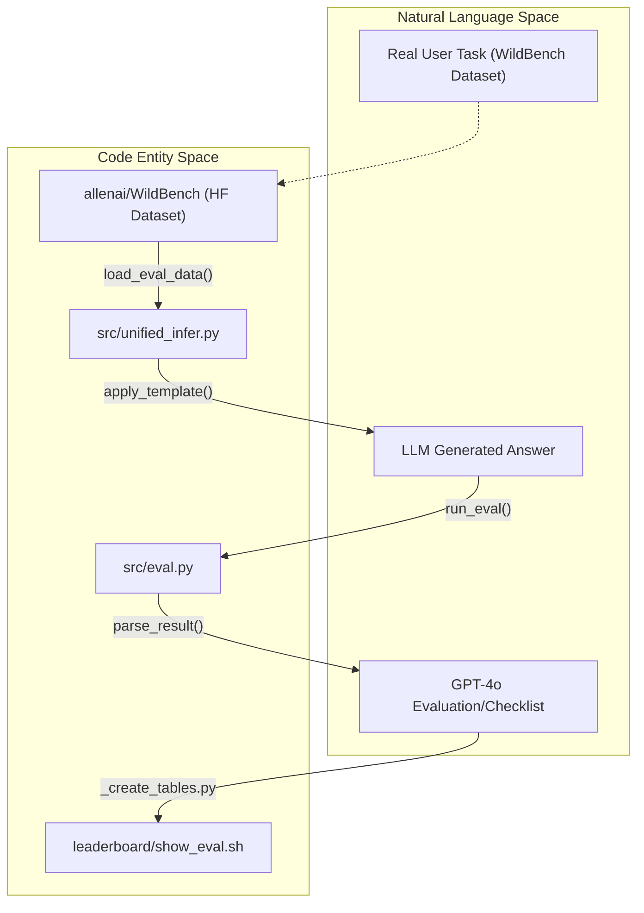

<!-- source: DeepWiki mcp.deepwiki.com · repo allenai/WildBench · page 1 WildBench Overview · fetched 2026-10-26 -->

# WildBench Overview

<details>
<summary>Relevant source files</summary>

The following files were used as context for generating this wiki page:

- [README.md](README.md)
- [docs/WildBench_paper.pdf](docs/WildBench_paper.pdf)
- [docs/gray_banner.png](docs/gray_banner.png)
- [docs/index.html](docs/index.html)
- [docs/wb_corr.png](docs/wb_corr.png)
- [docs/wb_eval.png](docs/wb_eval.png)
- [docs/wb_radar.png](docs/wb_radar.png)
- [docs/wb_stat.png](docs/wb_stat.png)
- [docs/wb_table.png](docs/wb_table.png)
- [requirements.txt](requirements.txt)
- [scripts/_common_hf.sh](scripts/_common_hf.sh)
- [scripts/_common_vllm.sh](scripts/_common_vllm.sh)

</details>


WildBench is a comprehensive framework for benchmarking Large Language Models (LLMs) using challenging, real-world tasks derived from user interactions. It focuses on a high-quality dataset of 1,024 examples across various task categories, utilizing an LLM-as-a-judge system to provide fine-grained performance metrics.

The project is structured into three primary phases: **Inference** (generating model responses), **Evaluation** (scoring or comparing responses using GPT-4o/GPT-4-Turbo), and **Leaderboard Generation** (aggregating results into public-facing metrics).

## Core Goals
*   **Real-World Difficulty:** Evaluate models on complex tasks that reflect actual user needs in the "wild".
*   **Multi-Dimensional Metrics:** Move beyond simple accuracy to include **WB-Score** (individual quality), **WB-Reward** (pairwise comparison), and **WB-Elo** (relative ranking).
*   **Efficiency:** Support fast, sharded inference and cost-effective evaluation via the OpenAI Batch API.

## High-Level System Architecture

The following diagram illustrates how the natural language benchmarking process is mapped to the specific code entities within the repository.

### Data and Execution Flow

**Sources:** [README.md:152-168](), [src/unified_infer.py:1-50](), [src/eval.py:1-40]()

---

## Major Subsystems

### 1. Inference Pipeline
The inference pipeline is responsible for generating outputs from models. It supports multiple backends (vLLM, HuggingFace, and various APIs) through a unified interface.
*   **Unified Interface:** `src/unified_infer.py` acts as the entry point for all model generations.
*   **Model Orchestration:** Scripts in `scripts/` (e.g., `_common_vllm.sh`) handle environment setup and data sharding.
*   **Template Management:** `src/fastchat_conversation.py` ensures prompts are formatted correctly for over 50 model families.

For details, see [Inference Pipeline](#2).

### 2. Evaluation Pipeline
Once responses are generated, the evaluation pipeline uses LLM judges to assess quality.
*   **Judge Models:** Primarily uses `gpt-4o` or `gpt-4-turbo` as judges.
*   **Evaluation Modes:** Supports "Score" (1-10 rating) and "Pairwise" (Model A vs Model B).
*   **Batch Processing:** Extensive use of the OpenAI Batch API to reduce costs and increase throughput via `src/openai_batch_eval/`.

For details, see [Evaluation Pipeline](#3).

### 3. Leaderboard & Metrics
The leaderboard system transforms raw JSON evaluation results into the metrics seen on the public website.
*   **WB-Score:** A re-scaled 1-10 score.
*   **WB-Reward:** Derived from pairwise comparisons.
*   **WB-Elo:** A relative rating calculated using Bradley-Terry modeling in `leaderboard/wb_elo.py`.

For details, see [Leaderboard System](#4).

---

## Repository Relationship Diagram

This diagram shows how the major code components interact to move a model from initial setup to the final leaderboard.

```mermaid
graph LR
    [scripts/_common_vllm.sh] -->|"calls"| [src/unified_infer.py]
    [src/unified_infer.py] -->|"uses"| [src/fastchat_conversation.py]
    [src/unified_infer.py] -->|"saves to"| [result_dirs/wild_bench_v2/]
    
    [result_dirs/wild_bench_v2/] -->|"input for"| [src/eval.py]
    [src/eval.py] -->|"saves to"| [eval_results/]
    
    [eval_results/] -->|"aggregated by"| [leaderboard/show_eval.sh]
    [leaderboard/show_eval.sh] -->|"outputs"| [leaderboard/data_dir/]
    [leaderboard/data_dir/] -->|"rendered in"| [docs/index.html]
```
**Sources:** [README.md:32-44](), [scripts/_common_vllm.sh:24-35](), [leaderboard/show_eval.sh:1-20]()

## Quick Links to Child Pages
*   **[Getting Started & Setup](#1.1):** Installation and running your first model.
*   **[Repository Structure & Key Concepts](#1.2):** Deep dive into the directory layout and WB metrics.

**Sources:** [README.md:1-170](), [requirements.txt:1-11](), [scripts/_common_vllm.sh:1-67](), [scripts/_common_hf.sh:1-64]()

---

