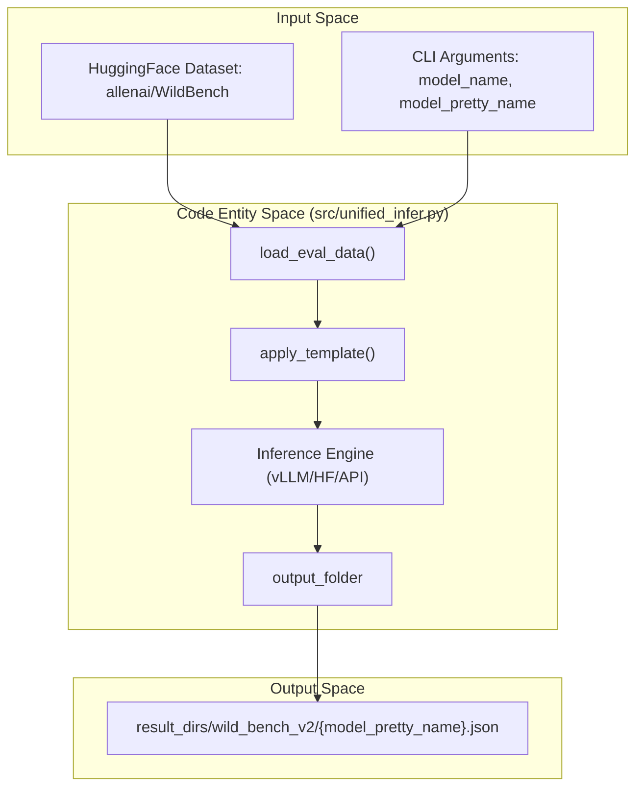
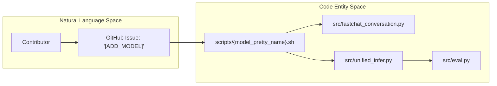

<!-- source: DeepWiki mcp.deepwiki.com · repo allenai/WildBench · page 1.1 Getting Started & Setup · fetched 2026-10-26 -->

# Getting Started & Setup

<details>
<summary>Relevant source files</summary>

The following files were used as context for generating this wiki page:

- [.github/ISSUE_TEMPLATE/add-new-model.md](.github/ISSUE_TEMPLATE/add-new-model.md)
- [.github/workflows/static.yml](.github/workflows/static.yml)
- [README.md](README.md)
- [requirements.txt](requirements.txt)
- [scripts/_common_hf.sh](scripts/_common_hf.sh)
- [scripts/_common_vllm.sh](scripts/_common_vllm.sh)

</details>


This page provides a comprehensive guide for setting up the WildBench environment, running model inference, and performing evaluations. It covers the technical requirements and the workflow for adding new models to the benchmark.

## Installation and Environment Setup

WildBench requires a Python 3.10 environment. The setup involves installing the `vLLM` engine for efficient inference and several API clients for judge-based evaluation.

### Dependencies
The project relies on the following core libraries:
*   `vllm`: Primary engine for local open-weight model inference [README.md:67-67]().
*   `openai`: Used for GPT-based judges and OpenAI-compatible model inference [requirements.txt:1-1]().
*   `datasets`: To load the WildBench evaluation data from HuggingFace [requirements.txt:2-2]().
*   `tenacity`: For handling API retries during inference and evaluation [requirements.txt:3-3]().
*   `fire`: For CLI argument parsing in Python scripts [requirements.txt:11-11]().

### Setup Commands
```bash
conda create -n zeroeval python=3.10
conda activate zeroeval
pip install vllm==0.5.1
pip install -r requirements.txt
```
*Sources: [README.md:63-69](), [requirements.txt:1-11]()*

---

## Configuring API Keys

WildBench uses LLM-as-a-judge for evaluation. To run the standard evaluation pipeline, you must configure environment variables for the supported providers.

| Provider | Environment Variable | Usage |
| :--- | :--- | :--- |
| OpenAI | `OPENAI_API_KEY` | GPT-4 Turbo/GPT-4o Judges (WB-Score/WB-Reward) |
| Anthropic | `ANTHROPIC_API_KEY` | Claude-3 reference models and judges |
| Google | `GOOGLE_API_KEY` | Gemini model inference |
| Together | `TOGETHER_API_KEY` | Together.AI hosted models |

*Sources: [README.md:123-129](), [requirements.txt:1-10]()*

---

## Running Your First Inference

The inference process generates model responses for the 1024 tasks in the WildBench dataset.

### Using the vLLM Shortcut
For models supported by vLLM, use the `_common_vllm.sh` script. This script handles both single-GPU and multi-GPU (data-parallel) execution.

```bash
bash scripts/_common_vllm.sh [hf_model_id] [model_pretty_name] [num_gpus]
```

### Data Flow: Inference to Output
The diagram below illustrates how `unified_infer.py` processes the dataset and saves results.

**Inference Execution Flow**


### Sharding and Merging
When `n_shards` > 1, the system spawns multiple background processes using `CUDA_VISIBLE_DEVICES` to isolate GPUs [scripts/_common_vllm.sh:44-60](). After all shards finish, `src/merge_results.py` consolidates the partial JSON files into a single model result [scripts/_common_vllm.sh:62-63]().

*Sources: [scripts/_common_vllm.sh:1-67](), [README.md:84-88]()*

---

## Evaluation and Leaderboard

Once inference is complete, the model must be evaluated by a judge (typically `gpt-4-turbo` or `gpt-4o`) to calculate the **WB-Score**.

### 1. Run Evaluation (Batch Mode)
The OpenAI Batch API is preferred for cost efficiency and high throughput.
```bash
bash evaluation/run_score_eval_batch.sh ${MODEL_PRETTY_NAME}
```
This script generates a `.jsonl` file for the OpenAI Batch API and submits it [README.md:39-39]().

### 2. Check Status
Monitor the progress of the batch job:
```bash
python src/openai_batch_eval/check_batch_status_with_model_name.py ${MODEL_PRETTY_NAME}
```
*Sources: [README.md:40-41]()*

### 3. Generate Leaderboard Table
After evaluation results are downloaded and placed in `eval_results/`, update the local leaderboard:
```bash
bash leaderboard/show_eval.sh score_only
```
*Sources: [README.md:43-43]()*

---

## Submitting a New Model

To add a model to the official leaderboard, contributors can either run the pipeline themselves or request the maintainers to do so.

### Submission via GitHub Issue
Use the **Add new model** template [GITHUB_ISSUE_TEMPLATE/add-new-model.md:1-24]().
*   **Open-weight models**: Provide the HuggingFace ID and specify if vLLM supports it.
*   **API-based models**: Provide the endpoint URL and coordinate API key access if necessary.

### Implementation Workflow
If implementing the model yourself:
1.  **Script Creation**: Create a new shell script in `scripts/` (e.g., `scripts/my-model.sh`) based on `_common_vllm.sh` or `_common_hf.sh` [README.md:97-100]().
2.  **Conversation Template**: Ensure the model's chat template is correctly mapped in `src/fastchat_conversation.py` or use the `--use_hf_conv_template` flag [README.md:101-101]().
3.  **Inference & Eval**: Run the inference and evaluation steps described above.
4.  **Pull Request**: Submit a PR including the new script in `scripts/`.

**Model Integration Flow**


*Sources: [.github/ISSUE_TEMPLATE/add-new-model.md:10-24](), [README.md:92-132]()*

---

