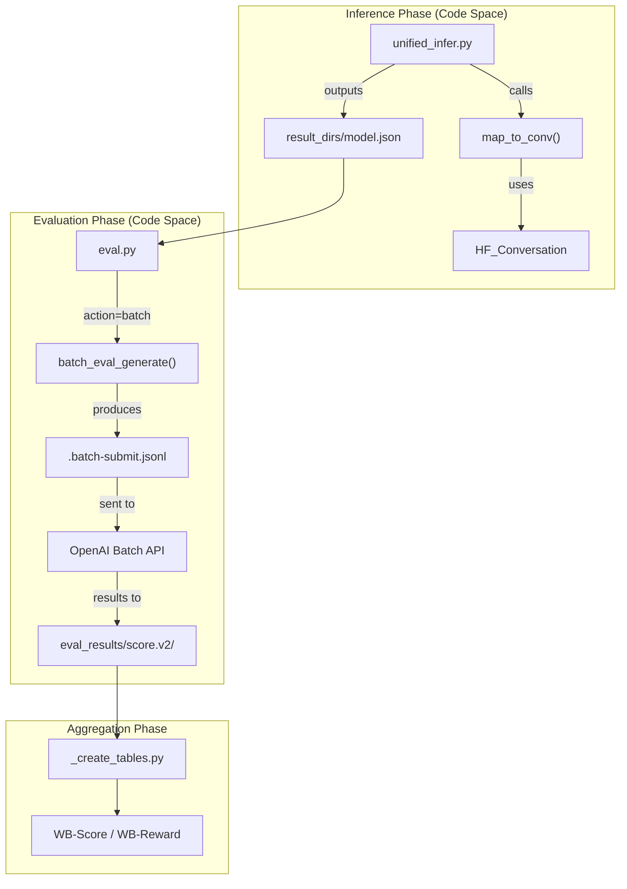
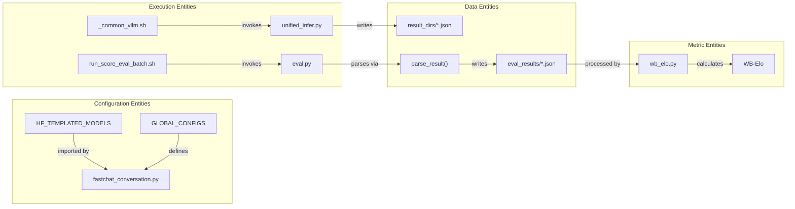

<!-- source: DeepWiki mcp.deepwiki.com · repo allenai/WildBench · page 1.2 Repository Structure & Key Concepts · fetched 2026-10-26 -->

# Repository Structure & Key Concepts

Relevant source files

The following files were used as context for generating this wiki page:

- [.gitignore](.gitignore)
- [EVAL.md](EVAL.md)
- [LICENSE](LICENSE)
- [README.md](README.md)
- [requirements.txt](requirements.txt)
- [scripts/Llama-3-Instruct-8B-SimPO.sh](scripts/Llama-3-Instruct-8B-SimPO.sh)
- [scripts/Yi-1.5-9B-Chat.sh](scripts/Yi-1.5-9B-Chat.sh)
- [scripts/_common_hf.sh](scripts/_common_hf.sh)
- [scripts/_common_vllm.sh](scripts/_common_vllm.sh)
- [src/eval.py](src/eval.py)
- [src/fastchat_conversation.py](src/fastchat_conversation.py)
- [src/global_configs.py](src/global_configs.py)
- [src/upload_results.py](src/upload_results.py)

This page provides a technical map of the WildBench repository and defines the core metrics and terminology used across the inference and evaluation pipelines.

## Repository Directory Map

The repository is organized into functional modules that separate data generation (inference), evaluation (judging), and presentation (leaderboard).

| Directory | Purpose | Key Entities |
|:---|:---|:---|
| `src/` | Core Python logic for the framework. | `unified_infer.py`, `eval.py`, `fastchat_conversation.py` |
| `scripts/` | Orchestration scripts for model inference. | `_common_vllm.sh`, `_common_hf.sh`, `_common_openai.sh` |
| `evaluation/` | Shell scripts and templates for running LLM-as-a-judge. | `run_score_eval_batch.sh`, `eval_template.score.v2.md` |
| `leaderboard/` | Scripts for aggregating raw results into final metrics. | `show_eval.sh`, `wb_elo.py`, `_create_tables.py` |
| `eval_results/` | Archive of evaluation JSON files from various judges. | `v2.0522/`, `v2.0625/` |
| `result_dirs/` | Local storage for raw model outputs (before evaluation). | `wild_bench_v2/` |
| `docs/` | Static assets and HTML for the project website. | `index.html`, `wb_radar.png` |

Sources: [README.md:97-103](), [README.md:141-147](), [scripts/_common_vllm.sh:10-11](), [EVAL.md:12-15]()

## Core Terminology & Metrics

WildBench (v2) introduces specific metrics to quantify LLM performance beyond simple accuracy.

### 1. WB-Score
The **WB-Score** is an individual performance metric. A judge (e.g., GPT-4o) assigns a raw score $Y$ from 1 to 10 based on task-specific checklists [README.md:158-159]().
*   **Formula:** Re-scaled as $(Y - 5) \times 2$.
*   **Interpretation:** A score of 5 (re-scaled to 0) represents a "borderline acceptable" response [README.md:159-160]().

### 2. WB-Reward & WB-Reward-Mix
**WB-Reward** is derived from pairwise comparisons between a model and a reference [README.md:160-162]().
*   **Values:** 100 (Much Better), 50 (Slightly Better), 0 (Tie), -50 (Slightly Worse), -100 (Much Worse) [README.md:164-168]().
*   **WB-Reward-Mix:** A composite metric (Mixture of Rewards) that aggregates pairwise rewards across multiple reference models (e.g., GPT-4-Turbo, Claude-3-Haiku, and Llama-2-70b) to reduce reference bias [README.md:170-173]().

### 3. Length Penalty (K)
The parameter `K` represents the length margin used during reward calculation to mitigate "verbosity bias." If a model is significantly longer than the reference but doesn't provide superior quality, its reward is adjusted [EVAL.md:55-56]().

### 4. Sharding
To accelerate inference on 1024 examples, the workload is split into `n_shards`. Each shard runs a subset of the data (e.g., `shard_size=256`) on a specific GPU [scripts/_common_vllm.sh:37-44]().

### 5. Pretty Name
The `model_pretty_name` is a standardized identifier used for directory naming and leaderboard display, often differing from the HuggingFace `model_name` (e.g., `Llama-3-8B-Instruct` vs `meta-llama/Meta-Llama-3-8B-Instruct`) [scripts/_common_vllm.sh:1-2]().

## Pipeline Architecture

The workflow transitions from **Natural Language Space** (user queries) to **Code Entity Space** (inference engines and judges) and finally back to structured metrics.

### Inference to Evaluation Flow
The following diagram maps the transition from generating responses to scoring them.

Sources: [src/unified_infer.py:1-25](), [src/fastchat_conversation.py:12-15](), [src/eval.py:35-43](), [src/eval.py:163-175](), [EVAL.md:20-28]()

### Component Relationship Diagram
This diagram illustrates how system names in documentation map to specific code entities and data structures.

Sources: [src/fastchat_conversation.py:9-10](), [scripts/_common_vllm.sh:24-35](), [src/eval.py:101-118](), [EVAL.md:37-41](), [README.md:139-143]()

## Key Implementation Details

### Data Parallelism & Merging
When `n_shards > 1`, the system spawns background processes using `CUDA_VISIBLE_DEVICES` to isolate GPUs. After all shards complete, `src/merge_results.py` consolidates the partial JSON files into a single model output file [scripts/_common_vllm.sh:44-62]().

### Conversation Handling
The `map_to_conv` function in `src/fastchat_conversation.py` acts as a factory, selecting either a hardcoded `Conversation` template or the `HF_Conversation` class which utilizes `tokenizer.apply_chat_template` [src/fastchat_conversation.py:12-41]().

### Result Parsing
The `parse_result` function in `src/eval.py` is critical for handling LLM judge outputs. It attempts `json.loads()` first, falling back to `extract_values_from_json` using regex if the judge provides a malformed JSON string [src/eval.py:101-118]().

Sources: `src/eval.py`, `src/fastchat_conversation.py`, `scripts/_common_vllm.sh`

---

