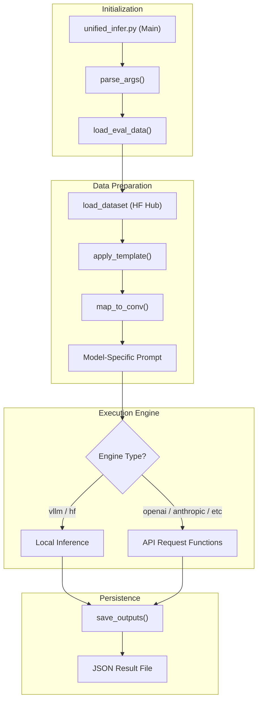
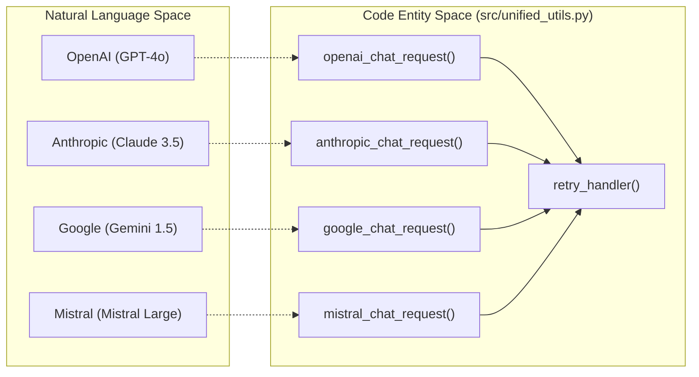

<!-- source: DeepWiki mcp.deepwiki.com · repo allenai/WildBench · page 2.1 unified_infer.py & unified_utils.py · fetched 2026-10-26 -->

# unified_infer.py & unified_utils.py

Relevant source files

The following files were used as context for generating this wiki page:

- [scripts/mistral-large-2402.sh](scripts/mistral-large-2402.sh)
- [src/hf_models.py](src/hf_models.py)
- [src/unified_infer.py](src/unified_infer.py)
- [src/unified_utils.py](src/unified_utils.py)

This page provides a deep dive into the core inference engine of WildBench. The system is designed to provide a "unified" interface for generating model responses across a wide variety of backends, including local open-weight models (via vLLM and HuggingFace Transformers) and various proprietary API providers.

## Core Components Overview

The inference pipeline is primarily driven by two files:
1.  `src/unified_infer.py`: The main entry point script that handles CLI arguments, model initialization, the generation loop, and result persistence [src/unified_infer.py:1-150]().
2.  `src/unified_utils.py`: A utility library containing data loading logic, conversation templating, and provider-specific API request wrappers [src/unified_utils.py:1-121]().

### Data Flow Diagram
The following diagram illustrates the flow of data from the initial dataset loading to the final saved model responses.

**Inference Data Flow**

Sources: [src/unified_infer.py:58-111](), [src/unified_utils.py:38-54](), [src/unified_utils.py:57-121]()

---

## CLI Arguments and Configuration

`unified_infer.py` uses `argparse` to configure the inference run. Key arguments include:

| Argument | Type | Default | Description |
| :--- | :--- | :--- | :--- |
| `--engine` | `str` | `"vllm"` | The backend to use (`vllm`, `hf`, `openai`, `anthropic`, `google`, `cohere`, `mistral`, `together`, `reka`, `yi`) [src/unified_infer.py:17](). |
| `--model_name` | `str` | `None` | The model identifier (e.g., HF path or API model ID) [src/unified_infer.py:20](). |
| `--data_name` | `str` | `"wild_bench"` | The dataset to load [src/unified_infer.py:26](). |
| `--batch_size` | `int` | `1` | Number of samples per batch (primarily for vLLM/HF) [src/unified_infer.py:27](). |
| `--start_index` / `--end_index` | `int` | `0` / `-1` | Indices for sharding and resuming [src/unified_infer.py:34-35](). |
| `--tensor_parallel_size` | `int` | `1` | Number of GPUs for vLLM [src/unified_infer.py:23](). |

Sources: [src/unified_infer.py:15-49]()

---

## Data Loading and Templating

### `load_eval_data`
This function is responsible for fetching the evaluation dataset (usually `allenai/WildBench` v2) and extracting the conversation history [src/unified_utils.py:57-74](). It returns a list of session IDs, the raw chat history, and the templated model inputs [src/unified_utils.py:121]().

### `apply_template`
This function converts raw chat histories into the specific string format required by the model.
- For local engines (`vllm`, `hf`), it uses `map_to_conv` from `fastchat_conversation.py` to apply the correct chat template (e.g., ChatML, Llama-3, etc.) [src/unified_utils.py:42-53]().
- For API engines, it often returns `"n/a"` as the API wrappers handle the message dictionary format directly [src/unified_utils.py:43]().

Sources: [src/unified_utils.py:38-54](), [src/unified_utils.py:57-121]()

---

## Provider-Specific Request Functions

WildBench supports a wide array of proprietary models through dedicated request wrappers in `unified_utils.py`. These functions are orchestrated by `retry_handler` to manage rate limits and transient errors.

**Code-to-Provider Mapping**

Sources: [src/unified_utils.py:145-310](), [src/unified_infer.py:11-12]()

### Key Request Wrappers:
- **`openai_chat_request`**: Supports OpenAI-compatible endpoints. It uses the `openai` library and handles both legacy (0.28.0) and modern API versions [src/unified_utils.py:145-177]().
- **`anthropic_chat_request`**: Uses the `anthropic` client for Claude models [src/unified_utils.py:228-246]().
- **`google_chat_request`**: Uses `google.generativeai` for Gemini models [src/unified_utils.py:179-204]().
- **`retry_handler`**: A decorator-like wrapper (though implemented as a higher-order function) that uses `tenacity` to provide exponential backoff for API calls [src/unified_utils.py:136-143]().

---

## Output Cleaning and Resume Logic

### Output Cleaning (`clear_output`)
To ensure consistent evaluation, `clear_output` removes common artifacts like `<|endoftext|>`, `</s>`, and `<end_of_turn>` from the generated strings [src/unified_utils.py:125-134]().

### Resume Logic
`unified_infer.py` implements a simple but effective resume mechanism:
1. It checks if the target `filepath` already exists [src/unified_infer.py:135]().
2. If it exists and `--overwrite` is not set, it loads the existing results [src/unified_infer.py:136-139]().
3. It calculates `num_skipped` based on the number of completed entries and slices the `todo_inputs` accordingly [src/unified_infer.py:140-144]().

Sources: [src/unified_utils.py:125-134](), [src/unified_infer.py:133-144]()

---

## Execution Engines

### vLLM Engine
When `--engine vllm` is used, the script initializes a `vllm.LLM` instance [src/unified_infer.py:65-70](). It uses `SamplingParams` to control generation and supports batching for high throughput [src/unified_infer.py:147-152]().

### HuggingFace Engine
When `--engine hf` is used, the script uses `DecoderOnlyModelManager` from `hf_models.py` [src/unified_infer.py:71-74](). This is typically used for models not yet supported by vLLM or for specific quantization needs like GPTQ [src/hf_models.py:153-157]().

Sources: [src/unified_infer.py:65-74](), [src/hf_models.py:97-160]()

---

