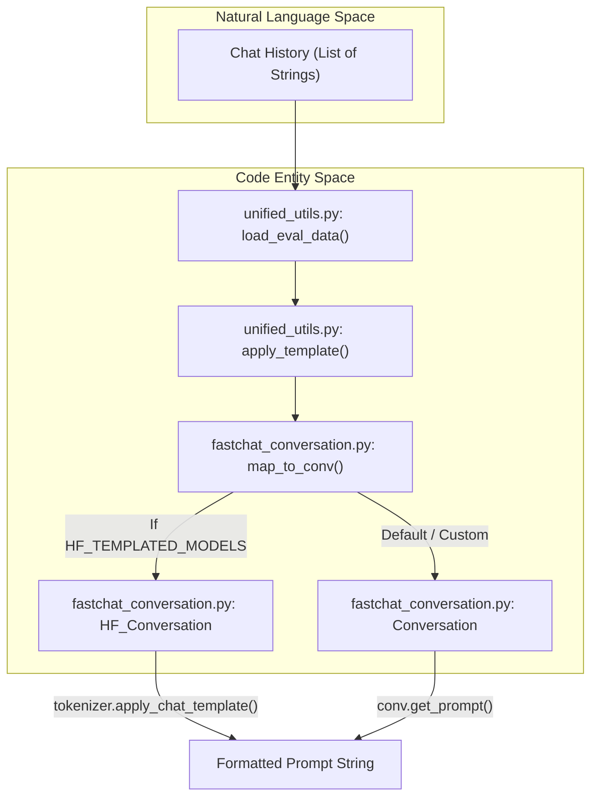
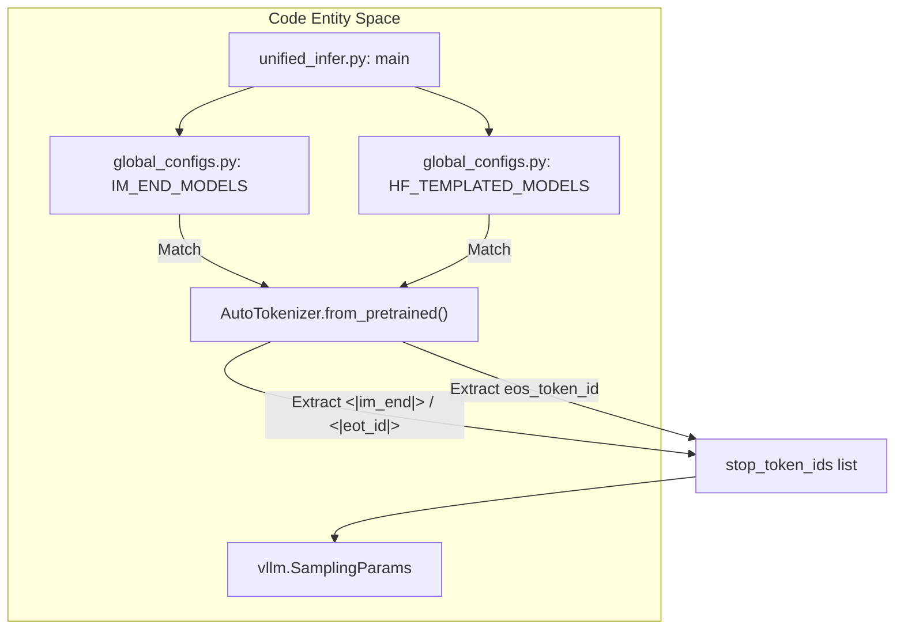

<!-- source: DeepWiki mcp.deepwiki.com · repo allenai/WildBench · page 2.2 Conversation Templates & Model Compatibility · fetched 2026-10-26 -->

# Conversation Templates & Model Compatibility

Relevant source files

The following files were used as context for generating this wiki page:

- [.gitignore](.gitignore)
- [LICENSE](LICENSE)
- [scripts/Yi-1.5-9B-Chat.sh](scripts/Yi-1.5-9B-Chat.sh)
- [scripts/mistral-large-2402.sh](scripts/mistral-large-2402.sh)
- [src/eval.py](src/eval.py)
- [src/fastchat_conversation.py](src/fastchat_conversation.py)
- [src/global_configs.py](src/global_configs.py)
- [src/unified_infer.py](src/unified_infer.py)
- [src/unified_utils.py](src/unified_utils.py)
- [src/upload_results.py](src/upload_results.py)

The WildBench inference pipeline relies on a robust templating system to format raw chat histories into model-specific prompt formats. This system handles the nuances of over 50 model families, ensuring that system prompts, user queries, and assistant responses are delineated correctly according to each model's training regime.

## Templating Architecture

The core logic for prompt formatting is contained within `src/fastchat_conversation.py`, which defines the structure for chat history and the rules for converting that history into a single string (for open-weight models) or a structured format (for APIs).

### The map_to_conv Factory
The `map_to_conv` function acts as a central dispatcher. It inspects the `model_name` and returns an appropriate conversation manager object [src/fastchat_conversation.py:12-41]().

1.  **HuggingFace Templated Models**: If a model is listed in `HF_TEMPLATED_MODELS`, it uses the `HF_Conversation` class, which leverages the model's own `tokenizer.apply_chat_template` [src/fastchat_conversation.py:13-15]().
2.  **Hardcoded Templates**: For other popular families like `gemma`, `llama-2`, `llama-3`, `mistral`, `yi`, and `qwen`, it retrieves a predefined template via `get_conv_template` [src/fastchat_conversation.py:16-37]().

### Data Flow: From Dataset to Prompt
The `apply_template` function in `src/unified_utils.py` orchestrates the transformation of chat history into model inputs [src/unified_utils.py:38-54]().

Title: Inference Templating Flow

Sources: [src/unified_utils.py:38-54](), [src/unified_utils.py:119-121](), [src/fastchat_conversation.py:12-41]()

## Key Classes & Structures

### HF_Conversation
This class is a wrapper for models that provide a `chat_template` within their HuggingFace `tokenizer_config.json`.
*   **Initialization**: Loads the tokenizer using `AutoTokenizer.from_pretrained` [src/fastchat_conversation.py:48]().
*   **Method**: `get_prompt()` calls `self.hf_tokenizer.apply_chat_template` with `add_generation_prompt=True` to ensure the prompt ends with the assistant's turn header [src/fastchat_conversation.py:64-67]().

### Conversation (Dataclass)
A highly configurable dataclass that manages manual prompt construction [src/fastchat_conversation.py:99-123]().
*   **Roles**: Defines role names (e.g., `("USER", "ASSISTANT")`) [src/fastchat_conversation.py:110]().
*   **Separator Styles**: Uses the `SeparatorStyle` enum to determine how to join messages [src/fastchat_conversation.py:116]().
*   **get_prompt()**: Implements logic for various styles such as `ADD_COLON_SINGLE`, `LLAMA2`, `CHATML`, etc. [src/fastchat_conversation.py:124-170]().

### SeparatorStyle
An `IntEnum` used by the `Conversation` class to handle different formatting requirements [src/fastchat_conversation.py:73-97](). Notable styles include:
*   `LLAMA2`: Specifically for Llama-2's complex `[INST] <<SYS>>...` format [src/fastchat_conversation.py:82]().
*   `CHATML`: The `<|im_start|>` and `<|im_end|>` format used by Qwen and Yi [src/fastchat_conversation.py:85]().
*   `URIAL`: Support for Untokenized Robust Instruction Alignment [src/fastchat_conversation.py:95]().

Sources: [src/fastchat_conversation.py:43-71](), [src/fastchat_conversation.py:73-123]()

## Configuration and Stop Tokens

WildBench manages model-specific behaviors through `src/global_configs.py` and dynamic detection in `src/unified_infer.py`.

### Global Config Lists
*   **HF_TEMPLATED_MODELS**: Models that should bypass manual templates in favor of the HF tokenizer template (e.g., `zephyr-7b-gemma-v0.1`, `dbrx-instruct`) [src/global_configs.py:2]().
*   **IM_END_MODELS**: Models that use specific ChatML-style end tokens which need to be registered as stop tokens to prevent "rambling" [src/global_configs.py:3]().

### Stop Token Detection
In `src/unified_infer.py`, the engine automatically configures `stop_token_ids` to ensure generation halts correctly [src/unified_infer.py:114-131]().

Title: Stop Token Logic

Sources: [src/global_configs.py:1-3](), [src/unified_infer.py:122-131](), [src/unified_infer.py:147-148]()

## Model Compatibility Implementation

When running inference, users can override default behaviors using CLI flags which modify the global configuration at runtime:
*   `--use_hf_conv_template`: Force-adds the model to `HF_TEMPLATED_MODELS` [src/unified_infer.py:80-81]().
*   `--use_imend_stop`: Force-adds the model to `IM_END_MODELS` [src/unified_infer.py:82-83]().

### Example: Yi-1.5 Compatibility
For the Yi-1.5 model family, the inference script `scripts/Yi-1.5-9B-Chat.sh` explicitly uses these flags to ensure the ChatML template and stop tokens are applied correctly [scripts/Yi-1.5-9B-Chat.sh:24]().

### Output Cleaning
Post-generation, `unified_utils.py` provides a `clear_output` function to strip common artifacts like `<|endoftext|>`, `</s>`, or `<pad>` that might remain if stop-token detection was incomplete [src/unified_utils.py:125-134]().

Sources: [src/unified_infer.py:80-83](), [scripts/Yi-1.5-9B-Chat.sh:24](), [src/unified_utils.py:125-134]()

---

