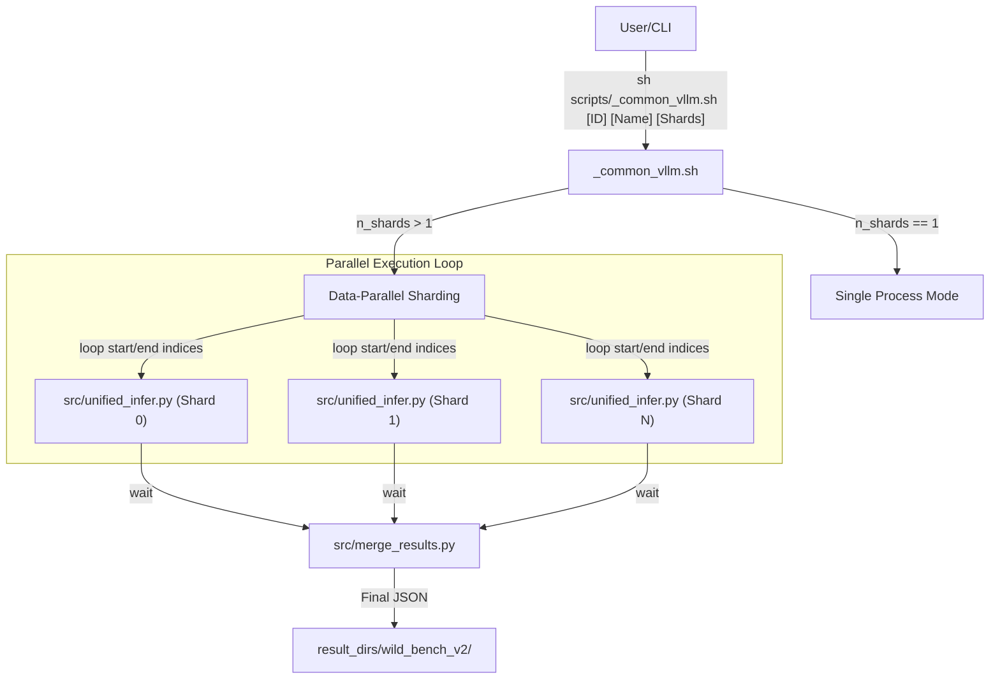
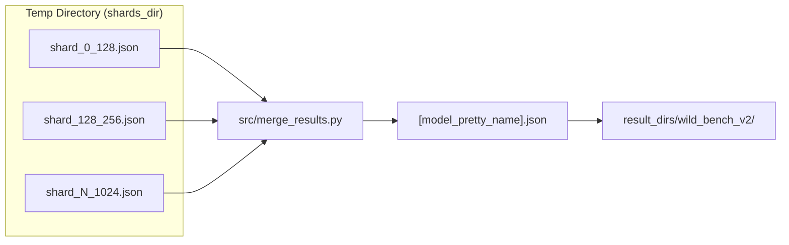

<!-- source: DeepWiki mcp.deepwiki.com · repo allenai/WildBench · page 2.3 Inference Scripts & Sharding · fetched 2026-10-26 -->

# Inference Scripts & Sharding

Relevant source files

The following files were used as context for generating this wiki page:

- [README.md](README.md)
- [eval_results/v2.0522/pairwise.v2/eval=gpt-4-turbo-2024-04-09/ref=Llama-2-70b-chat-hf/command-r-plus.json](eval_results/v2.0522/pairwise.v2/eval=gpt-4-turbo-2024-04-09/ref=Llama-2-70b-chat-hf/command-r-plus.json)
- [eval_results/v2.0522/pairwise.v2/eval=gpt-4-turbo-2024-04-09/ref=claude-3-haiku-20240307/command-r-plus.json](eval_results/v2.0522/pairwise.v2/eval=gpt-4-turbo-2024-04-09/ref=claude-3-haiku-20240307/command-r-plus.json)
- [eval_results/v2.0522/pairwise.v2/eval=gpt-4-turbo-2024-04-09/ref=gpt-4-turbo-2024-04-09/command-r-plus.json](eval_results/v2.0522/pairwise.v2/eval=gpt-4-turbo-2024-04-09/ref=gpt-4-turbo-2024-04-09/command-r-plus.json)
- [eval_results/v2.0522/score.v2/eval=gpt-4-turbo-2024-04-09/command-r-plus.json](eval_results/v2.0522/score.v2/eval=gpt-4-turbo-2024-04-09/command-r-plus.json)
- [requirements.txt](requirements.txt)
- [scripts/Hermes-2-Theta-Llama-3-8B.sh](scripts/Hermes-2-Theta-Llama-3-8B.sh)
- [scripts/Llama-2-13b-chat-hf.sh](scripts/Llama-2-13b-chat-hf.sh)
- [scripts/Llama-2-70b-chat-hf.sh](scripts/Llama-2-70b-chat-hf.sh)
- [scripts/Llama-2-7b-chat-hf.sh](scripts/Llama-2-7b-chat-hf.sh)
- [scripts/_common_hf.sh](scripts/_common_hf.sh)
- [scripts/_common_openai.sh](scripts/_common_openai.sh)
- [scripts/_common_vllm.sh](scripts/_common_vllm.sh)
- [scripts/claude-3-opus-20240229.sh](scripts/claude-3-opus-20240229.sh)
- [scripts/claude-3-sonnet-20240229.sh](scripts/claude-3-sonnet-20240229.sh)
- [scripts/cohere-command-r-plus.sh](scripts/cohere-command-r-plus.sh)
- [scripts/cohere-command-r.sh](scripts/cohere-command-r.sh)
- [scripts/cohere-command.sh](scripts/cohere-command.sh)
- [scripts/gemini-1.0-pro.sh](scripts/gemini-1.0-pro.sh)
- [scripts/gemini-1.5-flash.sh](scripts/gemini-1.5-flash.sh)
- [scripts/zephyr-7b-beta.sh](scripts/zephyr-7b-beta.sh)
- [src/merge_results.py](src/merge_results.py)
- [src/openai_batch_eval/check_batch_status_with_model_name.py](src/openai_batch_eval/check_batch_status_with_model_name.py)

The `scripts/` directory serves as the orchestration layer for running large-scale inference on the WildBench dataset. It manages the complexity of distributed execution across multiple GPUs and handles the integration of diverse backends (vLLM, HuggingFace, and various proprietary APIs) through a unified sharding logic.

## Common Orchestration Templates

WildBench provides standardized shell scripts that abstract the boilerplate required for different inference engines. These templates handle the logic for single-device execution versus multi-shard data parallelism.

*   **`_common_vllm.sh`**: The primary template for open-weight models supported by vLLM. It uses `--use_hf_conv_template` and `--use_imend_stop` by default [scripts/_common_vllm.sh:28-28]().
*   **`_common_hf.sh`**: A fallback template for models requiring the native HuggingFace `transformers` engine [scripts/_common_hf.sh:21-21]().
*   **`_common_openai.sh`**: A template for API-based models that use the OpenAI-compatible interface [scripts/_common_openai.sh:21-21]().

### Template Data Flow
The following diagram illustrates how a common script orchestrates the transition from user input to distributed execution.

**Inference Orchestration Flow**

Sources: [scripts/_common_vllm.sh:16-63](), [scripts/_common_hf.sh:16-60]()

## Data-Parallelism & Sharding Logic

WildBench implements a simple but effective data-parallelism strategy. The total dataset (typically 1024 examples) is divided into equal chunks, each processed by a separate instance of `src/unified_infer.py` running in the background.

### Shard Calculation
In multi-shard mode, the scripts calculate `shard_size` by dividing the total examples by the requested `n_shards` [scripts/_common_vllm.sh:38-42]().
*   **`start_index`**: The beginning of the shard [scripts/_common_vllm.sh:48-48]().
*   **`end_index`**: The end of the shard [scripts/_common_vllm.sh:48-48]().
*   **`CUDA_VISIBLE_DEVICES`**: Isolation is achieved by assigning a specific GPU ID to each background process [scripts/_common_vllm.sh:46-46]().

### Large Model Parallelism (Tensor Parallel)
For large models that cannot fit on a single GPU (e.g., Llama-3-70B), the scripts distinguish between **Data Parallelism** (sharding the dataset) and **Tensor Parallelism** (sharding the model weights).
*   In single-shard mode, `tensor_parallel_size` is set to the total available GPUs [scripts/_common_vllm.sh:19-30]().
*   In multi-shard mode, `tensor_parallel_size` is typically set to 1 per shard, allowing multiple smaller models to run in parallel on different GPUs [scripts/_common_vllm.sh:41-53]().

| Parameter | Role | Implementation |
| :--- | :--- | :--- |
| `n_shards` | Number of parallel processes | Shell `for` loop [scripts/cohere-command.sh:12-12]() |
| `shard_size` | Examples per process | `TOTAL_EXAMPLE / n_shards` [scripts/_common_vllm.sh:42-42]() |
| `tensor_parallel_size` | GPUs per model instance | Passed to `unified_infer.py` [scripts/_common_vllm.sh:53-53]() |
| `CUDA_VISIBLE_DEVICES` | Hardware isolation | Prepended to the python command [scripts/_common_hf.sh:42-42]() |

Sources: [scripts/_common_vllm.sh:16-60](), [scripts/zephyr-7b-beta.sh:12-30]()

## Result Aggregation

Since each shard writes its output to a temporary directory (`shards_dir`), a post-processing step is required to create a single submission file.

1.  **Temporary Storage**: Each shard instance saves its results into `result_dirs/wild_bench_v2/tmp_[model_pretty_name]/` [scripts/_common_vllm.sh:43-43]().
2.  **Wait Command**: The shell script uses `wait` to ensure all background processes complete [scripts/_common_vllm.sh:61-61]().
3.  **Merge**: `src/merge_results.py` is called to collect all JSON fragments from the temporary directory and combine them into a single file named `[model_pretty_name].json` [scripts/cohere-command.sh:24-24]().
4.  **Finalization**: The merged file is moved to the main `result_dirs/wild_bench_v2/` folder for evaluation [scripts/cohere-command.sh:25-25]().

**Data Flow: From Shards to Final Result**

Sources: [scripts/cohere-command.sh:11-25](), [scripts/Llama-2-13b-chat-hf.sh:16-35]()

## Per-Model Scripts

While common templates exist, many models have bespoke scripts to handle specific constraints or API requirements.

*   **API Rate Limiting**: Scripts for Claude, Gemini, and Cohere often use sharding (e.g., `n_shards=8`) not for GPU isolation, but to parallelize network requests and maximize throughput within rate limits [scripts/claude-3-opus-20240229.sh:8-12]().
*   **Model Constraints**: Some models have specific `MAX_TOKENS` limits (e.g., Command-R-Plus is limited to 4000) which are hardcoded in their specific script [scripts/cohere-command-r-plus.sh:5-5]().
*   **Legacy Configurations**: Older scripts like `zephyr-7b-beta.sh` or `Llama-2-13b-chat-hf.sh` contain hardcoded shard sizes and GPU counts [scripts/zephyr-7b-beta.sh:14-15](), [scripts/Llama-2-13b-chat-hf.sh:13-14]().

Sources: [scripts/claude-3-opus-20240229.sh:1-25](), [scripts/cohere-command-r-plus.sh:1-25](), [scripts/gemini-1.0-pro.sh:1-26]()

---

