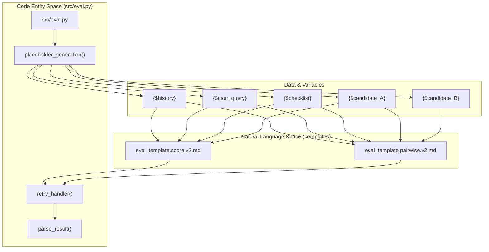
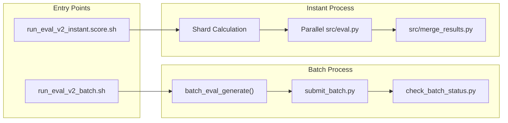

<!-- source: DeepWiki mcp.deepwiki.com · repo allenai/WildBench · page 3 Evaluation Pipeline · fetched 2026-10-26 -->

# Evaluation Pipeline

Relevant source files

The following files were used as context for generating this wiki page:

- [EVAL.md](EVAL.md)
- [eval_results/v2.0522/pairwise.v2/eval=gpt-4-turbo-2024-04-09/ref=Llama-2-70b-chat-hf/neo_7b_instruct_v0.1.json](eval_results/v2.0522/pairwise.v2/eval=gpt-4-turbo-2024-04-09/ref=Llama-2-70b-chat-hf/neo_7b_instruct_v0.1.json)
- [eval_results/v2.0522/pairwise.v2/eval=gpt-4-turbo-2024-04-09/ref=claude-3-haiku-20240307/neo_7b_instruct_v0.1.json](eval_results/v2.0522/pairwise.v2/eval=gpt-4-turbo-2024-04-09/ref=claude-3-haiku-20240307/neo_7b_instruct_v0.1.json)
- [eval_results/v2.0522/pairwise.v2/eval=gpt-4-turbo-2024-04-09/ref=gpt-4-turbo-2024-04-09/neo_7b_instruct_v0.1.json](eval_results/v2.0522/pairwise.v2/eval=gpt-4-turbo-2024-04-09/ref=gpt-4-turbo-2024-04-09/neo_7b_instruct_v0.1.json)
- [eval_results/v2.0522/score.v2/eval=gpt-4o-2024-05-13/neo_7b_instruct_v0.1.json](eval_results/v2.0522/score.v2/eval=gpt-4o-2024-05-13/neo_7b_instruct_v0.1.json)
- [evaluation/eval_template.pairwise.v2.md](evaluation/eval_template.pairwise.v2.md)
- [evaluation/eval_template.score.v2.md](evaluation/eval_template.score.v2.md)
- [evaluation/run_all_eval_batch.sh](evaluation/run_all_eval_batch.sh)
- [evaluation/run_eval_v2_instant.score.sh](evaluation/run_eval_v2_instant.score.sh)
- [scripts/Llama-3-Instruct-8B-SimPO.sh](scripts/Llama-3-Instruct-8B-SimPO.sh)

The WildBench evaluation pipeline implements an LLM-as-a-judge system to assess model performance across 1,024 diverse tasks. It supports two primary evaluation modes—**Score** and **Pairwise**—and provides two execution paths—**Batch** (via OpenAI Batch API) and **Instant** (via local parallel processing).

## Core Evaluation Modes

The pipeline operates in two distinct modes, governed by specific prompt templates and scoring rubrics.

| Mode | Template | Judge Logic | Output Format |
| :--- | :--- | :--- | :--- |
| **Score** | `eval_template.score.v2.md` | Single model assessment on a 1-10 scale. | JSON with `strengths`, `weaknesses`, and `score`. |
| **Pairwise** | `eval_template.pairwise.v2.md` | Comparison between a candidate and a reference model. | JSON with `choice` (A++, A+, A=B, B+, B++) and analysis. |

### Evaluation Flow Overview
The following diagram illustrates how the natural language prompts are constructed from code entities and placeholders.

**Diagram: Prompt Construction & Execution**

**Sources:** [src/eval.py:1-200](), [evaluation/eval_template.score.v2.md:1-67](), [evaluation/eval_template.pairwise.v2.md:1-76]()

---

## Judge Models
WildBench uses high-capability models as judges to ensure reliable evaluations.
*   **Primary Score Judge:** `gpt-4o-2024-05-13` is used for the current version (v2.0625) of WB-Score [evaluation/run_eval_v2_instant.score.sh:3-10]().
*   **Pairwise Judges:** Multiple models are used to calculate WB-Reward, including `gpt-4-turbo-2024-04-09`, `claude-3-haiku-20240307`, and `Llama-2-70b-chat-hf` [evaluation/run_all_eval_batch.sh:3-5]().

---

## Execution Paths

The pipeline provides two methods for running evaluations, depending on the scale and urgency of the task.

### 1. Batch Evaluation (Asynchronous)
This path is optimized for cost and high throughput using the OpenAI Batch API. It involves generating a `.jsonl` request file, submitting it, and polling for results.
*   **Scripts:** `run_eval_v2_batch.sh`, `submit_batch.py`, `check_batch_status_with_id.py`.
*   **Workflow:** Generate requests → Submit to OpenAI → Check status → Retrieve and format results [EVAL.md:6-42]().
*   **For details, see [Batch Evaluation via OpenAI Batch API](#3.3).**

### 2. Instant Evaluation (Synchronous)
This path uses local sharding to run evaluations in parallel across multiple background processes. It is faster for immediate results but subject to standard API rate limits.
*   **Scripts:** `run_eval_v2_instant.score.sh`, `run_eval_v2_instant.sh`.
*   **Workflow:** Calculate shards (default 8) → Spawn `src/eval.py` processes → Wait for completion → Run `src/merge_results.py` [evaluation/run_eval_v2_instant.score.sh:16-50]().
*   **For details, see [Instant (Synchronous) Evaluation](#3.4).**

**Diagram: Execution Path Logic**

**Sources:** [evaluation/run_eval_v2_instant.score.sh:16-50](), [EVAL.md:6-42](), [src/eval.py:1-100]()

---

## Sub-System Details

### [Evaluation Templates & Judge Prompts](#3.1)
Covers the markdown templates used to prompt the judge. It explains how `{$checklist}` is injected for fine-grained evaluation and how the rubrics (1-10 for scores, choice notation for pairwise) are defined.
*   **Key Files:** `evaluation/eval_template.score.v2.md`, `evaluation/eval_template.pairwise.v2.md`.

### [eval.py: The Judge Interface](#3.2)
The core Python script that interfaces with LLM providers. It handles placeholder replacement, positional bias mitigation (randomizing A/B order in pairwise), and parsing structured JSON responses from raw model output.
*   **Key Files:** `src/eval.py`.

### [Batch Evaluation via OpenAI Batch API](#3.3)
The full asynchronous workflow. Detailed documentation on using `submit_batch.py` and monitoring tools to manage large-scale evaluation runs.
*   **Key Files:** `src/openai_batch_eval/`, `evaluation/run_all_eval_batch.sh`.

### [Instant (Synchronous) Evaluation](#3.4)
Details on the sharding mechanism used to parallelize synchronous API calls. Explains how the `total_ex` (1024) is split and how `merge_results.py` consolidates the temporary shard files.
*   **Key Files:** `evaluation/run_eval_v2_instant.score.sh`, `src/merge_results.py`.

---

