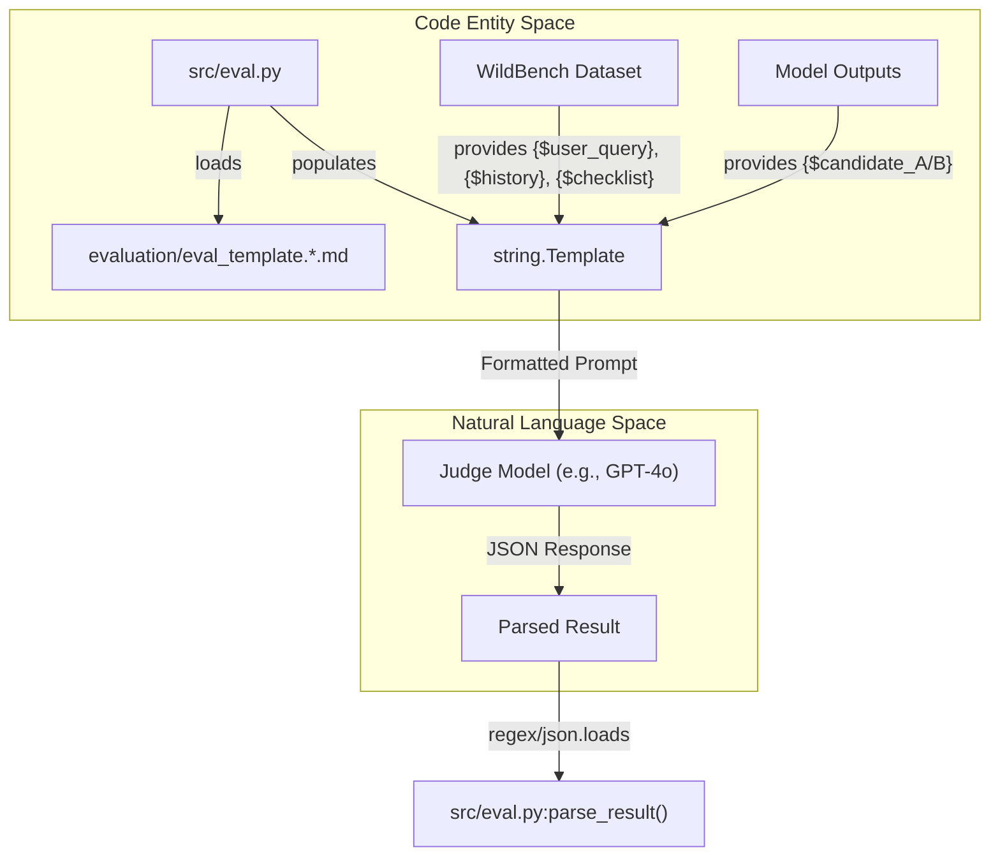
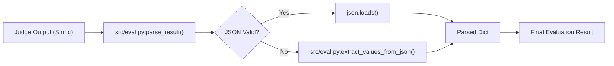

<!-- source: DeepWiki mcp.deepwiki.com · repo allenai/WildBench · page 3.1 Evaluation Templates & Judge Prompts · fetched 2026-10-26 -->

# Evaluation Templates & Judge Prompts

Relevant source files

The following files were used as context for generating this wiki page:

- [.gitignore](.gitignore)
- [LICENSE](LICENSE)
- [evaluation/eval_template.pairwise.v2.md](evaluation/eval_template.pairwise.v2.md)
- [evaluation/eval_template.score.v2.md](evaluation/eval_template.score.v2.md)
- [scripts/Yi-1.5-9B-Chat.sh](scripts/Yi-1.5-9B-Chat.sh)
- [src/eval.py](src/eval.py)
- [src/fastchat_conversation.py](src/fastchat_conversation.py)
- [src/global_configs.py](src/global_configs.py)
- [src/upload_results.py](src/upload_results.py)

This page provides a technical deep dive into the prompt engineering and template logic used by the WildBench evaluation system. WildBench employs LLM-as-a-judge using two primary paradigms: single-model scoring and pairwise comparison. These templates are designed to structure the judge's reasoning and ensure consistent JSON output for downstream parsing.

## Overview of Evaluation Templates

WildBench utilizes Markdown-based templates to instruct judge models (typically GPT-4o or GPT-4 Turbo). These templates contain specific placeholders that are dynamically populated by the evaluation script `src/eval.py` during the inference phase.

### Key Placeholder Variables
Both templates share a common set of variables injected at runtime:
*   `{$history}`: The conversation history leading up to the current query [evaluation/eval_template.score.v2.md:12]().
*   `{$user_query}`: The specific prompt or instruction provided by the user in the current turn [evaluation/eval_template.score.v2.md:19]().
*   `{$checklist}`: A set of task-specific criteria used to guide the judge [evaluation/eval_template.score.v2.md:37]().
*   `{$model_output}`: (Score mode) The response generated by the model being evaluated [evaluation/eval_template.score.v2.md:26]().
*   `{$candidate_A}` / `{$candidate_B}`: (Pairwise mode) The two competing model responses [evaluation/eval_template.pairwise.v2.md:26-33]().

### Data Flow: From Template to Judge
The following diagram illustrates how `src/eval.py` processes these templates and interacts with the judge API.

**Template Population and Judge Interaction**

**Sources:** [src/eval.py:35-68](), [evaluation/eval_template.score.v2.md:1-40](), [evaluation/eval_template.pairwise.v2.md:1-45]()

---

## Single-Model Scoring (eval_template.score.v2.md)

The scoring template asks the judge to provide an absolute quality rating on a scale of 1-10.

### Scoring Rubric
The judge is instructed to follow a specific rubric:
*   **1-2**: Very poor, makes no sense.
*   **3-4**: Poor, does not help the user meaningfully.
*   **5-6**: Fair, but contains factual errors or hallucinations.
*   **7-8**: Good, but has room for improvement.
*   **9-10**: Perfect, provides helpful and accurate information.

**Sources:** [evaluation/eval_template.score.v2.md:50-54]()

### Output Schema
The judge is required to return a JSON object containing:
1.  `strengths`: Analysis of what the model did well.
2.  `weaknesses`: Analysis of errors or omissions.
3.  `score`: The numeric rating.

**Sources:** [evaluation/eval_template.score.v2.md:61-65]()

---

## Pairwise Comparison (eval_template.pairwise.v2.md)

The pairwise template compares two models (A and B) side-by-side. To mitigate positional bias, `src/eval.py` randomly assigns models to the "A" or "B" slot [src/eval.py:170-171]().

### Choice Notation
The judge must choose one of five labels to indicate the relative performance:
| Label | Meaning |
| :--- | :--- |
| `A++` | Response A is much better than Response B |
| `A+` | Response A is slightly better than Response B |
| `A=B` | Both responses are of equal quality |
| `B+` | Response B is slightly better than Response A |
| `B++` | Response B is much better than Response A |

**Sources:** [evaluation/eval_template.pairwise.v2.md:55-59]()

### Output Schema
The judge provides a detailed breakdown before the final choice:
*   `analysis of A/B`: Individual critiques.
*   `reason of A=B / A>B / B>A`: Comparative justifications.
*   `choice`: One of the five labels mentioned above.

**Sources:** [evaluation/eval_template.pairwise.v2.md:67-74]()

---

## Checklist Injection

Checklists are a core feature of WildBench V2. They provide the judge with specific "aspects to check" (e.g., "Is the tone professional?", "Did the model follow the formatting constraint?"). 

In `src/eval.py`, the checklist is treated as a first-class variable retrieved from the dataset [evaluation/eval_template.score.v2.md:37](). The judge is instructed to use the checklist as a guide but is permitted to identify issues outside the provided list [evaluation/eval_template.score.v2.md:41]().

---

## Implementation Details in `src/eval.py`

### Parsing and Extraction
Because LLMs sometimes include conversational filler around the JSON block, `src/eval.py` implements robust parsing logic.

*   `parse_result()`: Attempts a standard `json.loads()`. If it fails, it falls back to `extract_values_from_json()` [src/eval.py:101-118]().
*   `extract_values_from_json()`: Uses regular expressions to find keys like `score` or `choice` even if the JSON structure is malformed or missing quotes [src/eval.py:71-99]().

### Cost Computation
The script includes a `compute_cost()` function that tracks token usage and financial cost based on the judge model's specific pricing (e.g., GPT-4o, Claude-3-Haiku) [src/eval.py:120-161]().

**Judge Response Processing Pipeline**

**Sources:** [src/eval.py:71-118]()

---

