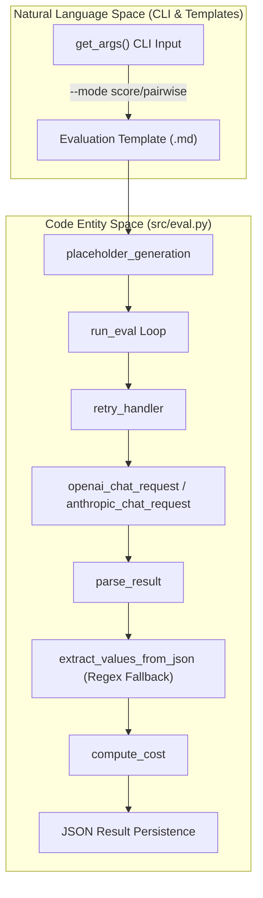
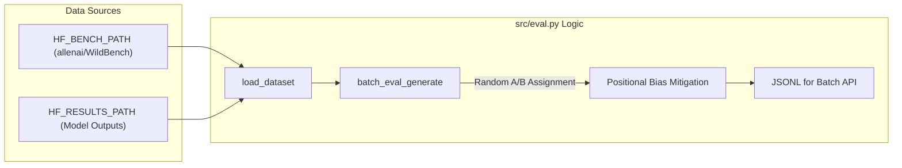

<!-- source: DeepWiki mcp.deepwiki.com · repo allenai/WildBench · page 3.2 eval.py: The Judge Interface · fetched 2026-10-26 -->

# eval.py: The Judge Interface

Relevant source files

The following files were used as context for generating this wiki page:

- [.gitignore](.gitignore)
- [LICENSE](LICENSE)
- [eval_results/v2.0522/pairwise.v2/eval=gpt-4-turbo-2024-04-09/ref=Llama-2-70b-chat-hf/neo_7b_instruct_v0.1.json](eval_results/v2.0522/pairwise.v2/eval=gpt-4-turbo-2024-04-09/ref=Llama-2-70b-chat-hf/neo_7b_instruct_v0.1.json)
- [eval_results/v2.0522/pairwise.v2/eval=gpt-4-turbo-2024-04-09/ref=claude-3-haiku-20240307/neo_7b_instruct_v0.1.json](eval_results/v2.0522/pairwise.v2/eval=gpt-4-turbo-2024-04-09/ref=claude-3-haiku-20240307/neo_7b_instruct_v0.1.json)
- [eval_results/v2.0522/pairwise.v2/eval=gpt-4-turbo-2024-04-09/ref=gpt-4-turbo-2024-04-09/neo_7b_instruct_v0.1.json](eval_results/v2.0522/pairwise.v2/eval=gpt-4-turbo-2024-04-09/ref=gpt-4-turbo-2024-04-09/neo_7b_instruct_v0.1.json)
- [eval_results/v2.0522/score.v2/eval=gpt-4o-2024-05-13/neo_7b_instruct_v0.1.json](eval_results/v2.0522/score.v2/eval=gpt-4o-2024-05-13/neo_7b_instruct_v0.1.json)
- [evaluation/run_all_eval_batch.sh](evaluation/run_all_eval_batch.sh)
- [evaluation/run_eval_v2_instant.score.sh](evaluation/run_eval_v2_instant.score.sh)
- [scripts/Yi-1.5-9B-Chat.sh](scripts/Yi-1.5-9B-Chat.sh)
- [src/eval.py](src/eval.py)
- [src/fastchat_conversation.py](src/fastchat_conversation.py)
- [src/global_configs.py](src/global_configs.py)
- [src/upload_results.py](src/upload_results.py)

`src/eval.py` serves as the primary orchestration layer for synchronous evaluation in WildBench. It manages the interaction between model outputs and LLM-as-a-judge models (e.g., GPT-4o, Claude-3) by preparing prompts, handling API communication, and parsing structured results. It supports two primary evaluation modes: **Score** (individual model assessment) and **Pairwise** (comparative assessment).

### 1. Orchestration Workflow

The script handles the end-to-end evaluation loop, from CLI argument parsing to final result persistence. It is designed to work either in "Instant" mode (running synchronously via `run_eval`) or in "Batch" mode (generating JSONL files for the OpenAI Batch API).

#### Data Flow and Logic
1.  **Argument Parsing**: `get_args()` defines the execution parameters including evaluation mode, templates, and model names [src/eval.py:35-68]().
2.  **Input Loading**: It loads benchmark data from `allenai/WildBench` [src/eval.py:26-27]() and model outputs from `allenai/WildBench-V2-Model-Outputs` [src/eval.py:28-31]().
3.  **Positional Bias Mitigation**: In pairwise mode, the script randomly assigns models to positions "A" and "B" to prevent the judge from favoring a specific position [src/eval.py:169-172]().
4.  **Execution Loop**: The `run_eval` function iterates through samples, applying the `retry_handler` to manage API stability [src/eval.py:18]().
5.  **Result Processing**: Raw strings from the judge are processed via `parse_result` [src/eval.py:101-118]() and cost is calculated via `compute_cost` [src/eval.py:120-161]().

**Sources:** [src/eval.py:35-172](), [src/eval.py:18-31]()

### 2. Core Functions and Implementation

#### Placeholder Generation and Formatting
The script uses Python's `string.Template` to inject variables into the evaluation markdown templates. 
*   In **Pairwise Mode**, it maps `model_A` and `model_B` outputs to `{$candidate_A}` and `{$candidate_B}` [src/eval.py:170-172]().
*   In **Score Mode**, it maps the target model output to the relevant template placeholder [src/eval.py:173-175]().

#### Result Parsing and Regex Fallback
Judge models are instructed to return JSON. `parse_result` first attempts a standard `json.loads()` [src/eval.py:109](). If this fails due to formatting issues (e.g., missing quotes or trailing text), it triggers `extract_values_from_json`, which uses regular expressions to isolate keys like `score`, `choice`, `strengths`, and `weaknesses` [src/eval.py:71-99]().

#### Cost Tracking
The `compute_cost` function tracks token usage for various judge models. It uses `tiktoken` for OpenAI models and provides hardcoded pricing for GPT-4, GPT-4o, and Claude-3 families [src/eval.py:120-161]().

**Sources:** [src/eval.py:71-118](), [src/eval.py:120-161](), [src/eval.py:163-176]()

### 3. System Architecture Diagrams

The following diagrams illustrate the transition from user-defined CLI parameters to the execution of code logic.

**Judge Execution Flow**

**Sources:** [src/eval.py:35-68](), [src/eval.py:101-118](), [src/eval.py:120-161](), [src/unified_utils.py:18-20]()

**Data Preparation for Evaluation**

**Sources:** [src/eval.py:26-31](), [src/eval.py:163-180]()

### 4. Batch vs. Instant Evaluation

`src/eval.py` is the engine for two different execution paths defined in the `evaluation/` directory:

| Feature | Instant Mode (`run_eval_v2_instant.sh`) | Batch Mode (`run_eval_v2_batch.sh`) |
| :--- | :--- | :--- |
| **Mechanism** | Spawns multiple `src/eval.py` processes in parallel [evaluation/run_eval_v2_instant.score.sh:32-44]() | Calls `batch_eval_generate` to create a `.jsonl` file [src/eval.py:163]() |
| **Parsing** | Immediate parsing via `parse_result` | Parsing occurs after batch retrieval via `batch_results_format.py` |
| **Concurrency** | Managed by shell `&` and `wait` [evaluation/run_eval_v2_instant.score.sh:44-46]() | Managed by OpenAI/Anthropic server-side |
| **Use Case** | Quick debugging or small shards | Full 1024-sample evaluation for leaderboard submission |

**Sources:** [evaluation/run_eval_v2_instant.score.sh:32-50](), [src/eval.py:163-180]()

---

