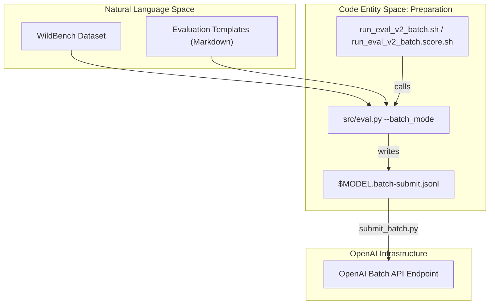
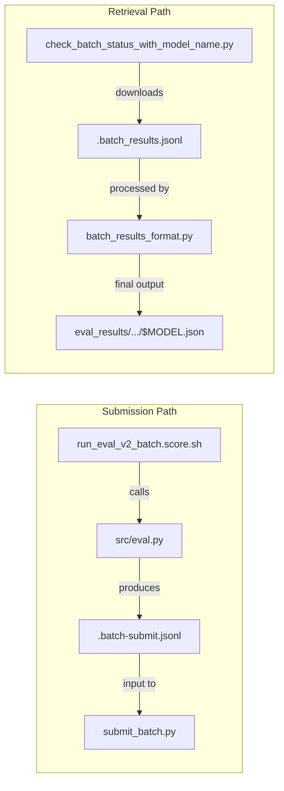

<!-- source: DeepWiki mcp.deepwiki.com · repo allenai/WildBench · page 3.3 Batch Evaluation via OpenAI Batch API · fetched 2026-10-26 -->

# Batch Evaluation via OpenAI Batch API

Relevant source files

The following files were used as context for generating this wiki page:

- [eval_results/v2.0522/pairwise.v2/eval=gpt-4-turbo-2024-04-09/ref=Llama-2-70b-chat-hf/command-r-plus.json](eval_results/v2.0522/pairwise.v2/eval=gpt-4-turbo-2024-04-09/ref=Llama-2-70b-chat-hf/command-r-plus.json)
- [eval_results/v2.0522/pairwise.v2/eval=gpt-4-turbo-2024-04-09/ref=Llama-2-70b-chat-hf/neo_7b_instruct_v0.1.json](eval_results/v2.0522/pairwise.v2/eval=gpt-4-turbo-2024-04-09/ref=Llama-2-70b-chat-hf/neo_7b_instruct_v0.1.json)
- [eval_results/v2.0522/pairwise.v2/eval=gpt-4-turbo-2024-04-09/ref=claude-3-haiku-20240307/command-r-plus.json](eval_results/v2.0522/pairwise.v2/eval=gpt-4-turbo-2024-04-09/ref=claude-3-haiku-20240307/command-r-plus.json)
- [eval_results/v2.0522/pairwise.v2/eval=gpt-4-turbo-2024-04-09/ref=claude-3-haiku-20240307/neo_7b_instruct_v0.1.json](eval_results/v2.0522/pairwise.v2/eval=gpt-4-turbo-2024-04-09/ref=claude-3-haiku-20240307/neo_7b_instruct_v0.1.json)
- [eval_results/v2.0522/pairwise.v2/eval=gpt-4-turbo-2024-04-09/ref=gpt-4-turbo-2024-04-09/command-r-plus.json](eval_results/v2.0522/pairwise.v2/eval=gpt-4-turbo-2024-04-09/ref=gpt-4-turbo-2024-04-09/command-r-plus.json)
- [eval_results/v2.0522/pairwise.v2/eval=gpt-4-turbo-2024-04-09/ref=gpt-4-turbo-2024-04-09/neo_7b_instruct_v0.1.json](eval_results/v2.0522/pairwise.v2/eval=gpt-4-turbo-2024-04-09/ref=gpt-4-turbo-2024-04-09/neo_7b_instruct_v0.1.json)
- [eval_results/v2.0522/score.v2/eval=gpt-4-turbo-2024-04-09/command-r-plus.json](eval_results/v2.0522/score.v2/eval=gpt-4-turbo-2024-04-09/command-r-plus.json)
- [eval_results/v2.0522/score.v2/eval=gpt-4o-2024-05-13/neo_7b_instruct_v0.1.json](eval_results/v2.0522/score.v2/eval=gpt-4o-2024-05-13/neo_7b_instruct_v0.1.json)
- [evaluation/run_all_eval_batch.sh](evaluation/run_all_eval_batch.sh)
- [evaluation/run_eval_v2_batch.score.sh](evaluation/run_eval_v2_batch.score.sh)
- [evaluation/run_eval_v2_batch.sh](evaluation/run_eval_v2_batch.sh)
- [evaluation/run_eval_v2_instant.score.sh](evaluation/run_eval_v2_instant.score.sh)
- [evaluation/run_score_eval_batch.sh](evaluation/run_score_eval_batch.sh)
- [scripts/Hermes-2-Theta-Llama-3-8B.sh](scripts/Hermes-2-Theta-Llama-3-8B.sh)
- [scripts/cohere-command-r-plus.sh](scripts/cohere-command-r-plus.sh)
- [src/openai_batch_eval/batch_results_format.py](src/openai_batch_eval/batch_results_format.py)
- [src/openai_batch_eval/check_batch_status_with_id.py](src/openai_batch_eval/check_batch_status_with_id.py)
- [src/openai_batch_eval/check_batch_status_with_model_name.py](src/openai_batch_eval/check_batch_status_with_model_name.py)
- [src/openai_batch_eval/submit_batch.py](src/openai_batch_eval/submit_batch.py)

The WildBench evaluation pipeline supports an asynchronous workflow using the OpenAI Batch API. This approach is significantly more cost-effective (50% discount) and avoids the rate-limit bottlenecks associated with synchronous API calls when evaluating large models or performing extensive pairwise comparisons [evaluation/run_eval_v2_batch.score.sh:13-17]().

## Workflow Overview

The batch evaluation process consists of four primary stages:
1.  **Preparation**: Generating a `.batch-submit.jsonl` file containing all evaluation requests formatted for the OpenAI Batch API.
2.  **Submission**: Uploading the file to OpenAI and initiating the batch job.
3.  **Monitoring**: Polling the API for job completion and downloading the raw results.
4.  **Formatting**: Converting the raw OpenAI batch output into the standard WildBench JSON schema used by the leaderboard.

### Data Flow Diagram: Natural Language to Code Entities

The following diagram illustrates how evaluation requests flow from the WildBench dataset through the batch system.

**Batch Submission Data Flow**

Sources: [evaluation/run_eval_v2_batch.score.sh:31-39](), [src/openai_batch_eval/submit_batch.py:1-10](), [evaluation/run_all_eval_batch.sh:1-12]()

---

## 1. Generating Submission Files

The generation of batch files is handled by specialized shell scripts that wrap `src/eval.py` with the `--batch_mode` flag [evaluation/run_eval_v2_batch.score.sh:31-32]().

*   **Scoring Mode**: `evaluation/run_eval_v2_batch.score.sh` generates requests for individual model scoring using a judge (defaulting to `gpt-4o-2024-05-13`) [evaluation/run_eval_v2_batch.score.sh:5-19]().
*   **Pairwise Mode**: `evaluation/run_eval_v2_batch.sh` generates requests for pairwise comparisons between the target model and a reference model (e.g., GPT-4 Turbo or Claude-3 Haiku) [evaluation/run_all_eval_batch.sh:3-5]().

The output is a `.jsonl` file where each line is a valid OpenAI Batch API request object. A `custom_id` is generated for each request to track the `session_id` and model names during post-processing [src/openai_batch_eval/batch_results_format.py:41-43]().

**Sources:** [evaluation/run_eval_v2_batch.score.sh:22-39](), [src/openai_batch_eval/batch_results_format.py:101-103]()

---

## 2. Submission and Monitoring

Once the `.jsonl` files are generated, they are submitted to OpenAI.

### Submitting Jobs
The script `src/openai_batch_eval/submit_batch.py` takes the path to the generated `.batch-submit.jsonl` and uploads it to the OpenAI `batches` endpoint [evaluation/run_all_eval_batch.sh:8-12]().

### Status Checking
Monitoring is performed using two scripts:
*   `check_batch_status_with_id.py`: Checks a specific job by its OpenAI Batch ID.
*   `check_batch_status_with_model_name.py`: Lists recent batches and filters them based on the model name stored in the batch metadata [src/openai_batch_eval/check_batch_status_with_model_name.py:9-17]().

When a batch reaches the `completed` status, `check_batch_status_with_model_name.py` automatically:
1.  Downloads the results to a `.batch_results.jsonl` file [src/openai_batch_eval/check_batch_status_with_model_name.py:24-32]().
2.  Triggers the formatting script to convert the raw output to WildBench JSON [src/openai_batch_eval/check_batch_status_with_model_name.py:33-36]().

**Sources:** [src/openai_batch_eval/check_batch_status_with_model_name.py:9-36](), [evaluation/run_all_eval_batch.sh:15]()

---

## 3. Results Formatting

The script `src/openai_batch_eval/batch_results_format.py` is the core utility for reconciling OpenAI's asynchronous output with the WildBench local results archive.

### Implementation Details
The script performs the following operations:
1.  **Mapping**: It loads the original submission file to map `custom_id` back to the original prompt and session metadata [src/openai_batch_eval/batch_results_format.py:18-25]().
2.  **Parsing**: It extracts the JSON response from the judge model's output [src/openai_batch_eval/batch_results_format.py:43-45]().
3.  **Normalization**:
    *   **Score Mode**: Extracts the `score` field and the model's response [src/openai_batch_eval/batch_results_format.py:107-113]().
    *   **Pairwise Mode**: Maps labels like `A++`, `A+`, `A=B` to numerical `extent` values (0, 1, or 2) and identifies the `winner` [src/openai_batch_eval/batch_results_format.py:70-93]().
4.  **Output**: Writes a structured JSON file to the appropriate subdirectory in `eval_results/` [src/openai_batch_eval/batch_results_format.py:122-125]().

### Data Structure Mapping
| Raw Batch Field | WildBench JSON Entity | Description |
| :--- | :--- | :--- |
| `custom_id` | `session_id` | Split by `\|\|` to retrieve original session [src/openai_batch_eval/batch_results_format.py:41-42]() |
| `response...content` | `parsed_result` | The judge's reasoning and final decision [src/openai_batch_eval/batch_results_format.py:43-52]() |
| `response...usage` | `meta_data.usage` | Token consumption for cost tracking [src/openai_batch_eval/batch_results_format.py:55]() |

**Sources:** [src/openai_batch_eval/batch_results_format.py:38-125]()

---

## 4. Summary of Batch Scripts

| Script | Purpose |
| :--- | :--- |
| `run_eval_v2_batch.sh` | Orchestrates pairwise batch file generation for multiple reference models. |
| `run_eval_v2_batch.score.sh` | Generates scoring batch files for the target model. |
| `submit_batch.py` | CLI tool to upload `.jsonl` to OpenAI API. |
| `check_batch_status_with_model_name.py` | Polling tool that downloads and formats results upon completion. |
| `batch_results_format.py` | Logic for converting raw API responses into WildBench standard schema. |

**Code Entity Relationship**

Sources: [evaluation/run_eval_v2_batch.score.sh:31-39](), [src/openai_batch_eval/check_batch_status_with_model_name.py:33-36](), [src/openai_batch_eval/batch_results_format.py:122-125]()

---

