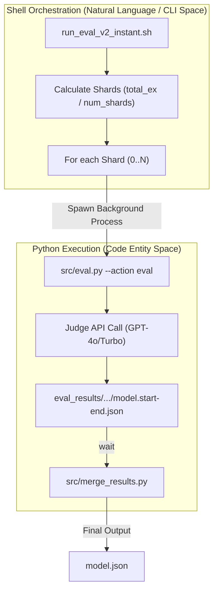
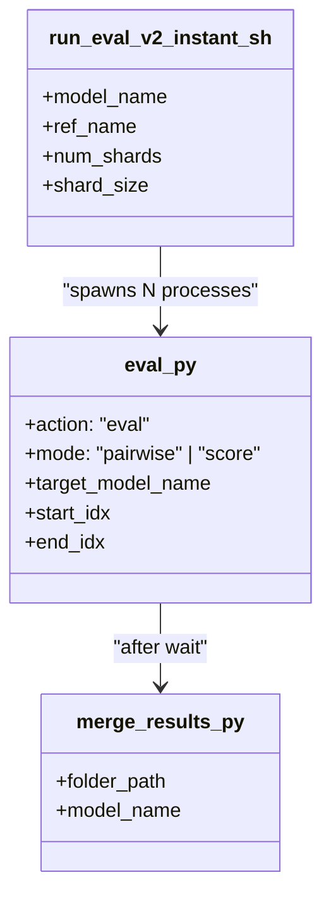

<!-- source: DeepWiki mcp.deepwiki.com · repo allenai/WildBench · page 3.4 Instant (Synchronous) Evaluation · fetched 2026-10-26 -->

# Instant (Synchronous) Evaluation

Relevant source files

The following files were used as context for generating this wiki page:

- [eval_results/v2.0522/pairwise.v2/eval=gpt-4-turbo-2024-04-09/ref=Llama-2-70b-chat-hf/neo_7b_instruct_v0.1.json](eval_results/v2.0522/pairwise.v2/eval=gpt-4-turbo-2024-04-09/ref=Llama-2-70b-chat-hf/neo_7b_instruct_v0.1.json)
- [eval_results/v2.0522/pairwise.v2/eval=gpt-4-turbo-2024-04-09/ref=claude-3-haiku-20240307/neo_7b_instruct_v0.1.json](eval_results/v2.0522/pairwise.v2/eval=gpt-4-turbo-2024-04-09/ref=claude-3-haiku-20240307/neo_7b_instruct_v0.1.json)
- [eval_results/v2.0522/pairwise.v2/eval=gpt-4-turbo-2024-04-09/ref=gpt-4-turbo-2024-04-09/neo_7b_instruct_v0.1.json](eval_results/v2.0522/pairwise.v2/eval=gpt-4-turbo-2024-04-09/ref=gpt-4-turbo-2024-04-09/neo_7b_instruct_v0.1.json)
- [eval_results/v2.0522/score.v2/eval=gpt-4o-2024-05-13/neo_7b_instruct_v0.1.json](eval_results/v2.0522/score.v2/eval=gpt-4o-2024-05-13/neo_7b_instruct_v0.1.json)
- [evaluation/run_all_eval_batch.sh](evaluation/run_all_eval_batch.sh)
- [evaluation/run_all_eval_instant.sh](evaluation/run_all_eval_instant.sh)
- [evaluation/run_eval_v2_instant.score.sh](evaluation/run_eval_v2_instant.score.sh)
- [evaluation/run_eval_v2_instant.sh](evaluation/run_eval_v2_instant.sh)
- [scripts/Phi-3-medium-128k-instruct.sh](scripts/Phi-3-medium-128k-instruct.sh)
- [scripts/Phi-3-mini-128k-instruct.sh](scripts/Phi-3-mini-128k-instruct.sh)
- [scripts/Yi-1.5-34B-Chat.sh](scripts/Yi-1.5-34B-Chat.sh)

Instant (Synchronous) evaluation is the primary execution path for running LLM-as-a-judge evaluations in WildBench without using the OpenAI Batch API. It leverages local multi-processing to shard the dataset and call judge APIs (OpenAI, Anthropic, etc.) in parallel, providing immediate feedback and results consolidation.

## Orchestration Logic

The synchronous evaluation is managed by two main shell scripts: `run_eval_v2_instant.sh` for pairwise comparisons and `run_eval_v2_instant.score.sh` for individual model scoring. These scripts automate the sharding of the 1024-example WildBench dataset, spawn background processes, and merge the resulting fragments.

### Execution Workflow
1.  **Shard Calculation**: The script divides the total examples (`total_ex=1024`) by the requested `num_shards` (default 8) to determine `shard_size` [evaluation/run_eval_v2_instant.sh:9-31]().
2.  **Process Spawning**: A `for` loop iterates through the shards, launching `src/eval.py` as a background process (`&`) for each range [evaluation/run_eval_v2_instant.sh:34-48]().
3.  **Synchronization**: The shell `wait` command ensures the script pauses until all parallel judge requests are completed [evaluation/run_eval_v2_instant.sh:50]().
4.  **Consolidation**: `src/merge_results.py` is called to aggregate the individual shard files (e.g., `model.0-128.json`) into a single final result file [evaluation/run_eval_v2_instant.sh:53]().

### Data Flow Diagram: Synchronous Evaluation
This diagram illustrates the transition from script orchestration to the Python execution space.

Sources: [evaluation/run_eval_v2_instant.sh:17-54](), [evaluation/run_eval_v2_instant.score.sh:16-50]()

---

## Core Components

### run_eval_v2_instant.score.sh
This script handles the "Score" mode where a judge (defaulting to `gpt-4o-2024-05-13`) evaluates a single model's response on a scale of 1-10 [evaluation/run_eval_v2_instant.score.sh:3-22]().

*   **Template**: Uses `evaluation/eval_template.score.v2.md` [evaluation/run_eval_v2_instant.score.sh:9]().
*   **Output Path**: Saves to `eval_results/v2.0625/score.v2/eval=${gpt_eval_name}/` [evaluation/run_eval_v2_instant.score.sh:10]().

### run_eval_v2_instant.sh
This script handles "Pairwise" mode, comparing the `target_model_name` against a `ref_model_name` (defaulting to `gpt-3.5-turbo-0125`) [evaluation/run_eval_v2_instant.sh:3-27]().

*   **Template**: Uses `evaluation/eval_template.pairwise.v2.md` [evaluation/run_eval_v2_instant.sh:11]().
*   **Output Path**: Saves to `eval_results/v2.0522/pairwise.v2/eval=${gpt_eval_name}/ref=${ref_name}/` [evaluation/run_eval_v2_instant.sh:12]().

### Process Synchronization and Merging
The use of `wait` and `merge_results.py` is critical for data integrity. The merge script looks for the model name pattern within the target directory and concatenates the JSON lists found in the shard files [scripts/Phi-3-mini-128k-instruct.sh:35-37]().

Sources: [evaluation/run_eval_v2_instant.score.sh:1-50](), [evaluation/run_eval_v2_instant.sh:1-54](), [scripts/Phi-3-mini-128k-instruct.sh:35-37]()

---

## Comparison: Instant vs. Batch Mode

| Feature | Instant (Synchronous) | Batch (Asynchronous) |
| :--- | :--- | :--- |
| **Trigger** | `run_eval_v2_instant.sh` | `run_eval_v2_batch.sh` |
| **Latency** | Real-time (minutes) | Delayed (up to 24 hours) |
| **Cost** | Standard API Pricing | 50% Discount (OpenAI) |
| **Parallelism** | Local background processes | OpenAI-side queueing |
| **Reliability** | Subject to local network/timeout | High (managed by provider) |
| **Consolidation** | `merge_results.py` | `batch_results_format.py` |

Sources: [evaluation/run_all_eval_batch.sh:1-15](), [evaluation/run_all_eval_instant.sh:1-10]()

---

## Technical Implementation Details

The `src/eval.py` script is the underlying engine for these shell wrappers. When invoked in "Instant" mode, it performs the following:

1.  **Index Slicing**: Uses `--start_idx` and `--end_idx` to select a subset of the WildBench data [evaluation/run_eval_v2_instant.sh:46]().
2.  **Request Handling**: Executes requests sequentially or via internal threading within the shard, depending on `src/eval.py` internal logic.
3.  **Regex Parsing**: Attempts to parse the judge's reasoning and final score/choice from the raw text output [eval_results/v2.0522/score.v2/eval=gpt-4o-2024-05-13/neo_7b_instruct_v0.1.json:4-8]().

### Entity Relationship: Evaluation Orchestration
This diagram maps the script parameters to the code entities in `src/eval.py`.

Sources: [evaluation/run_eval_v2_instant.sh:18-53](), [evaluation/run_eval_v2_instant.score.sh:17-49]()

---

