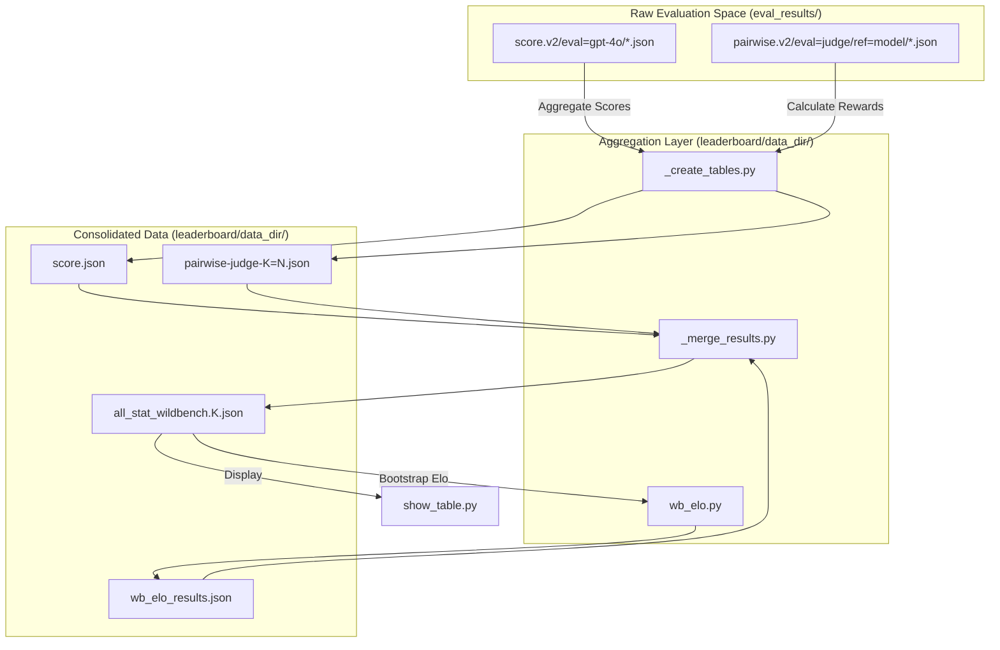
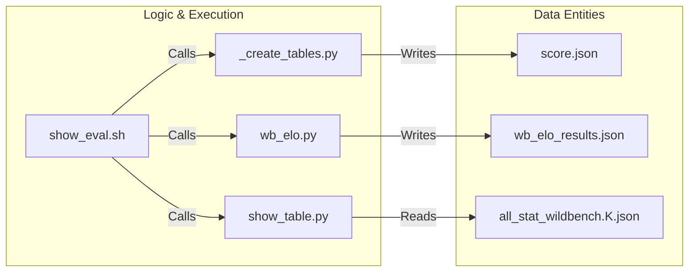

<!-- source: DeepWiki mcp.deepwiki.com · repo allenai/WildBench · page 4 Leaderboard System · fetched 2026-10-26 -->

# Leaderboard System

Relevant source files

The following files were used as context for generating this wiki page:

- [leaderboard/data_dir/all_stat_wildbench.2000.json](leaderboard/data_dir/all_stat_wildbench.2000.json)
- [leaderboard/data_dir/all_stat_wildbench.300.json](leaderboard/data_dir/all_stat_wildbench.300.json)
- [leaderboard/data_dir/all_stat_wildbench.3000.json](leaderboard/data_dir/all_stat_wildbench.3000.json)
- [leaderboard/data_dir/all_stat_wildbench.500.json](leaderboard/data_dir/all_stat_wildbench.500.json)
- [leaderboard/data_dir/score.json](leaderboard/data_dir/score.json)
- [leaderboard/data_dir/wb_elo_results.json](leaderboard/data_dir/wb_elo_results.json)
- [leaderboard/show_eval.sh](leaderboard/show_eval.sh)
- [leaderboard/show_table.py](leaderboard/show_table.py)

The **Leaderboard System** is the final stage of the WildBench pipeline. it aggregates raw evaluation results from `eval_results/` into a structured, multi-metric leaderboard. This system transforms individual judge scores and pairwise comparisons into standardized metrics like **WB-Score**, **WB-Reward**, and **WB-Elo**.

The orchestration is primarily handled by the `leaderboard/show_eval.sh` script, which sequences data processing, metric calculation, and table rendering.

## System Architecture

The pipeline moves from raw JSON results to consolidated statistics, finally generating a display-ready table.

### Data Flow Diagram
The following diagram illustrates how raw evaluation files are processed by the core Python entities to produce the leaderboard.

**Sources:** `leaderboard/show_eval.sh:1-43`(), `leaderboard/data_dir/_create_tables.py`(), `leaderboard/data_dir/_merge_results.py`()

## Core Components

### 1. Leaderboard Data Pipeline
The pipeline is triggered via `leaderboard/show_eval.sh`. It supports two modes: `score_only` (skipping expensive pairwise reward calculations) and the full evaluation. It runs multiple instances of `_create_tables.py` in parallel to handle different judges (GPT-4 Turbo, Llama-3, Haiku) and different length penalty constants ($K$).

For details, see [Leaderboard Data Pipeline](#4.1).

**Sources:** `leaderboard/show_eval.sh:6-24`()

### 2. WB-Elo Rating System
The Elo system, implemented in `wb_elo.py`, provides a robust ranking by simulating virtual pairwise matches derived from WB-Score data. It uses a bootstrap simulation (defaulting to 128 rounds) to calculate the mean, standard deviation, and confidence intervals for each model's rating.

For details, see [WB-Elo Rating System](#4.2).

**Sources:** `leaderboard/data_dir/wb_elo_results.json:1-12`(), `leaderboard/show_eval.sh:32-33`()

### 3. Data Files & Metrics Schema
The system produces several JSON files in `leaderboard/data_dir/`. The most critical is `all_stat_wildbench.{K}.json`, which contains a flat mapping of every model to its performance across all metrics, including task-specific scores (e.g., `WB_score.Coding & Debugging`) and aggregate ranks.

For details, see [Leaderboard Data Files & Metrics Schema](#4.3).

**Sources:** `leaderboard/data_dir/all_stat_wildbench.300.json:1-49`(), `leaderboard/data_dir/score.json:1-17`()

### 4. Table Rendering
The `show_table.py` script serves as the CLI interface for viewing the results. It supports different modes such as `main`, `taskwise_score`, and `taskwise_reward`, allowing users to filter and sort the leaderboard by specific columns like `WB_Elo` or `RewardScore_Avg`.

For details, see [show_table.py & data_utils.py](#4.4).

**Sources:** `leaderboard/show_table.py:16-27`(), `leaderboard/show_table.py:39-42`()

## Code Entity Association

This diagram maps the natural language concepts of the leaderboard to the specific Python scripts and data files that implement them.

**Sources:** `leaderboard/show_eval.sh:27-42`(), `leaderboard/show_table.py:8-10`()

## Metric Overview

| Metric Category | Code Keys | Description |
| :--- | :--- | :--- |
| **Elo** | `WB_Elo` | Aggregated rating with bootstrap stability. |
| **Score** | `WB_score`, `WB_score.task_macro` | 1-10 normalized score from GPT-4o judge. |
| **Reward** | `mixture_of_rewards.K=N` | Pairwise win-rate against reference models with length penalty. |
| **Metadata** | `Length` | Average response length of the model. |

**Sources:** `leaderboard/data_dir/all_stat_wildbench.500.json:34-48`(), `leaderboard/show_table.py:12-13`()

---

