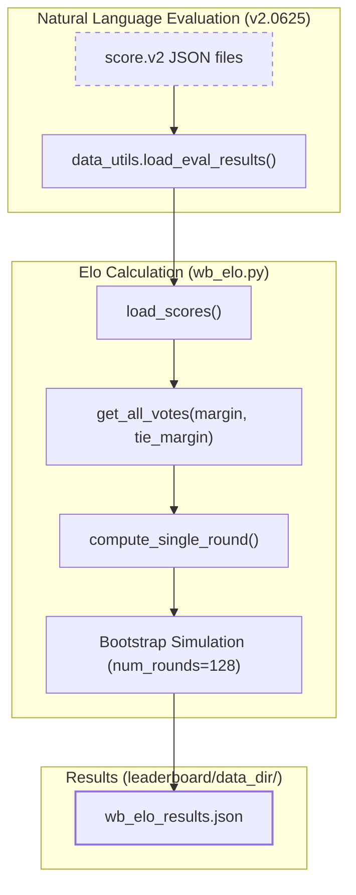
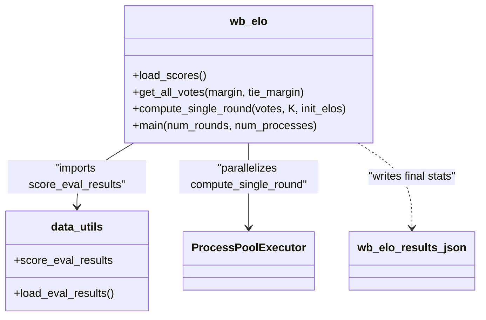

<!-- source: DeepWiki mcp.deepwiki.com · repo allenai/WildBench · page 4.2 WB-Elo Rating System · fetched 2026-10-26 -->

# WB-Elo Rating System

<details>
<summary>Relevant source files</summary>

The following files were used as context for generating this wiki page:

- [leaderboard/data_dir/all_stat_wildbench.2000.json](leaderboard/data_dir/all_stat_wildbench.2000.json)
- [leaderboard/data_dir/all_stat_wildbench.300.json](leaderboard/data_dir/all_stat_wildbench.300.json)
- [leaderboard/data_dir/all_stat_wildbench.3000.json](leaderboard/data_dir/all_stat_wildbench.3000.json)
- [leaderboard/data_dir/all_stat_wildbench.500.json](leaderboard/data_dir/all_stat_wildbench.500.json)
- [leaderboard/data_dir/score.json](leaderboard/data_dir/score.json)
- [leaderboard/data_dir/wb_elo_results.json](leaderboard/data_dir/wb_elo_results.json)
- [leaderboard/data_utils.py](leaderboard/data_utils.py)
- [leaderboard/show_eval.sh](leaderboard/show_eval.sh)
- [leaderboard/wb_elo.py](leaderboard/wb_elo.py)

</details>


The **WB-Elo Rating System** is the core statistical engine used by WildBench to convert absolute scores (WB-Score) and pairwise comparisons into a robust, relative ranking of models. It is primarily implemented in `leaderboard/wb_elo.py` and provides a more stable metric than raw averages by using bootstrap simulations and positional-bias mitigation.

## System Architecture and Data Flow

The system operates by transforming absolute evaluation data into virtual pairwise "votes" and then iteratively updating Elo ratings across multiple rounds to produce a distribution of scores (mean, standard deviation, and confidence intervals).

### Virtual Pairwise Generation
The function `get_all_votes` [leaderboard/wb_elo.py:38-84]() converts raw scores from the judge (e.g., GPT-4o) into pairwise outcomes.
1. **Score Comparison**: If $Score_A - Score_B \ge margin$, Model A is the winner [leaderboard/wb_elo.py:67-68]().
2. **Tie Handling**: If $|Score_A - Score_B| \le tie\_margin$, the result is recorded as a tie [leaderboard/wb_elo.py:72-73]().
3. **Data Cleaning**: Responses that are empty or end with "... (truncated)" are excluded to ensure quality [leaderboard/wb_elo.py:63-66]().

### Elo Computation Logic
The core computation occurs in `compute_single_round` [leaderboard/wb_elo.py:121-196](), which performs the following steps:
* **Initialization**: Ratings are initialized either to 1000 or to existing "anchor" ratings (like Arena Elo) if provided [leaderboard/wb_elo.py:133-138]().
* **Shuffling**: Votes are randomly sampled to ensure the order of updates doesn't bias the final rating [leaderboard/wb_elo.py:131]().
* **Probability Calculation**: Uses the standard Elo formula: $E_A = \frac{1}{1 + 10^{(R_B - R_A)/400}}$ [leaderboard/wb_elo.py:151]().
* **Rating Update**: $R_A = R_A + K \cdot (S_A - E_A)$, where $S_A$ is the actual outcome (1 for win, 0.5 for tie, 0 for loss) [leaderboard/wb_elo.py:170]().

### Length Margin Parameter
To mitigate the "verbosity bias" common in LLM-as-a-judge evaluations, `wb_elo.py` includes a `length_margin` parameter. If the difference in response lengths (in characters) between two models exceeds this margin, the vote is automatically forced to a "tie" [leaderboard/wb_elo.py:154-157](). This prevents models from gaining Elo simply by producing longer outputs.

**Sources:**
- [leaderboard/wb_elo.py:38-196]()
- [leaderboard/show_eval.sh:32-33]()

---

## Implementation Details

### Multi-Process Execution
The Elo system uses `ProcessPoolExecutor` to parallelize the bootstrap rounds across multiple CPU cores, controlled by the `--num_processes` flag [leaderboard/wb_elo.py:7-8]().

### Dynamic Elo Updates
When the `dynamic` flag is set to true [leaderboard/wb_elo.py:172](), the system allows anchor models (models with pre-existing known Elo ratings) to have their ratings updated during the simulation. To prevent anchor drift, an `interval` parameter is used: every $N$ updates, the model's current Elo is averaged with its initial anchor value [leaderboard/wb_elo.py:174-175]().

### From Natural Language Space to Code Entity Space

The following diagram illustrates how raw evaluation data (natural language judgments) is ingested and processed by the Elo system.

**Data Processing Pipeline**

**Sources:**
- [leaderboard/wb_elo.py:23-36]()
- [leaderboard/wb_elo.py:38-84]()
- [leaderboard/data_utils.py:64-90]()

---

## Output Schema: `wb_elo_results.json`

The final output is stored in `leaderboard/data_dir/wb_elo_results.json`. It contains both the configuration used for the run and the statistical summary for each model.

| Key | Description | Example Value |
| :--- | :--- | :--- |
| `avg` | Mean Elo rating across all bootstrap rounds | `1239.47` |
| `std` | Standard deviation of the rating | `6.27` |
| `median` | Median Elo rating | `1239.25` |
| `ci` | 95% Confidence Interval [lower, upper] | `[1228.26, 1252.77]` |
| `init_elo` | The anchor Elo used (if any) | `1280.0` |

**Configuration Block Example:**
```json
"config": {
    "K": 4,
    "num_rounds": 128,
    "margin": 2,
    "tie_margin": 2,
    "dynamic": true,
    "length_margin": 1500
}
```
**Sources:**
- [leaderboard/data_dir/wb_elo_results.json:1-12]()
- [leaderboard/data_dir/wb_elo_results.json:14-23]()

---

## Code Structure & Key Functions

### `leaderboard/wb_elo.py` Interaction Map



### Key Functions
* **`load_scores()`**: Iterates through `data_utils.score_eval_results` to populate global dictionaries `all_scores_by_id_model` and `all_outputs_by_id_model` [leaderboard/wb_elo.py:23-36]().
* **`get_all_votes()`**: The "Virtual Pairwise" generator. It iterates through every unique pair of models that responded to the same `session_id` [leaderboard/wb_elo.py:45-47]().
* **`main()`**: The entry point via `fire`. It handles the orchestration of bootstrap rounds, calculates the final statistics (mean, std, median) using `numpy`, and saves the result [leaderboard/wb_elo.py:220-270] (implied logic).

**Sources:**
- [leaderboard/wb_elo.py:1-11]()
- [leaderboard/wb_elo.py:23-84]()
- [leaderboard/data_utils.py:13-19]()

---

