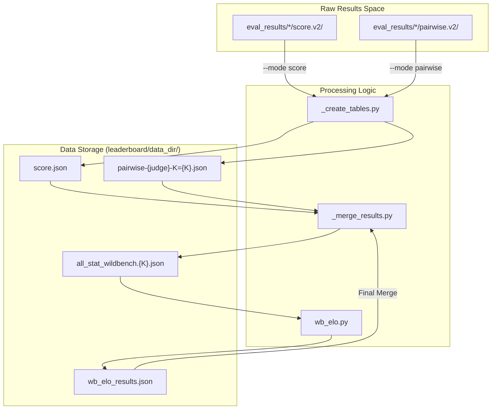
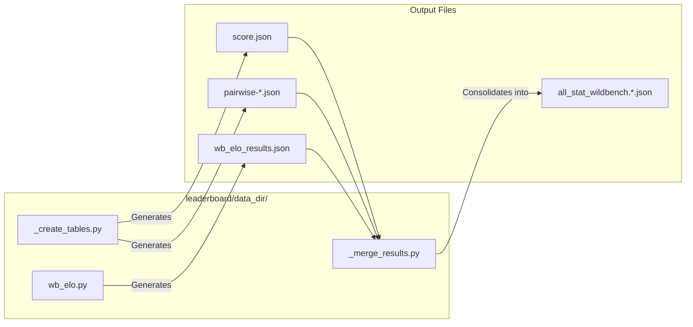

<!-- source: DeepWiki mcp.deepwiki.com · repo allenai/WildBench · page 4.3 Leaderboard Data Files & Metrics Schema · fetched 2026-10-26 -->

# Leaderboard Data Files & Metrics Schema

Relevant source files

The following files were used as context for generating this wiki page:

- [leaderboard/data_dir/all_stat.json](leaderboard/data_dir/all_stat.json)
- [leaderboard/data_dir/all_stat_wildbench.-1.json](leaderboard/data_dir/all_stat_wildbench.-1.json)
- [leaderboard/data_dir/all_stat_wildbench.100.json](leaderboard/data_dir/all_stat_wildbench.100.json)
- [leaderboard/data_dir/all_stat_wildbench.1000.json](leaderboard/data_dir/all_stat_wildbench.1000.json)
- [leaderboard/data_dir/all_stat_wildbench.1500.json](leaderboard/data_dir/all_stat_wildbench.1500.json)
- [leaderboard/data_dir/all_stat_wildbench.2000.json](leaderboard/data_dir/all_stat_wildbench.2000.json)
- [leaderboard/data_dir/all_stat_wildbench.300.json](leaderboard/data_dir/all_stat_wildbench.300.json)
- [leaderboard/data_dir/all_stat_wildbench.3000.json](leaderboard/data_dir/all_stat_wildbench.3000.json)
- [leaderboard/data_dir/all_stat_wildbench.500.json](leaderboard/data_dir/all_stat_wildbench.500.json)
- [leaderboard/data_dir/pairwise-gpt4t-K=-1.json](leaderboard/data_dir/pairwise-gpt4t-K=-1.json)
- [leaderboard/data_dir/pairwise-gpt4t-K=1000.json](leaderboard/data_dir/pairwise-gpt4t-K=1000.json)
- [leaderboard/data_dir/pairwise-gpt4t-K=1500.json](leaderboard/data_dir/pairwise-gpt4t-K=1500.json)
- [leaderboard/data_dir/pairwise-haiku-K=-1.json](leaderboard/data_dir/pairwise-haiku-K=-1.json)
- [leaderboard/data_dir/pairwise-llama-K=-1.json](leaderboard/data_dir/pairwise-llama-K=-1.json)
- [leaderboard/data_dir/score-sonnet.json](leaderboard/data_dir/score-sonnet.json)
- [leaderboard/data_dir/score.json](leaderboard/data_dir/score.json)
- [leaderboard/data_dir/wb_elo_results.json](leaderboard/data_dir/wb_elo_results.json)
- [leaderboard/show_eval.sh](leaderboard/show_eval.sh)

This page serves as a technical reference for the data structures and metric schemas used within the WildBench leaderboard system. All data files reside in the `leaderboard/data_dir/` directory and are generated through a pipeline involving table creation, result merging, and Elo rating calculation.

## Data Pipeline Overview

The leaderboard data is processed in a multi-stage pipeline orchestrated by `leaderboard/show_eval.sh`. It transforms raw evaluation results into structured JSON files suitable for the web frontend.

### Data Flow and Code Entities

The following diagram illustrates how raw evaluation results are transformed into the final leaderboard data files by various script entities.

**Leaderboard Data Generation Flow**

**Sources:** [leaderboard/show_eval.sh:1-43]()

## Primary Data Files

### 1. `score.json`
This file contains aggregated scores based on the `score.v2` evaluation mode. It categorizes model performance across the five core WildBench tasks.

*   **Schema**:
    *   `model`: The unique identifier for the model.
    *   `score`: The raw average score (1-10 scale).
    *   `adjusted_score`: The score centered/scaled for leaderboard display.
    *   `task_categorized_scores`: A dictionary mapping task names (e.g., "Coding & Debugging") to their respective average scores.
    *   `total`: Total number of instances evaluated.
    *   `avg_len`: Average character length of model responses.

**Sources:** [leaderboard/data_dir/score.json:1-193]()

### 2. `all_stat_wildbench.{K}.json`
These files are the "Master Tables" for the leaderboard, generated for specific length penalty values ($K$). They consolidate WildBench internal metrics with external benchmark data.

*   **Key Files**: `all_stat_wildbench.100.json`, `all_stat_wildbench.500.json`, `all_stat_wildbench.1000.json`, `all_stat_wildbench.-1.json` (where -1 denotes no length penalty).
*   **Metric Schema**:
    *   `WB_score`: The main WildBench score.
    *   `{judge}_reward.K={K}`: The win-rate reward calculated against a reference model using a specific judge (gpt4t, llama, or haiku).
    *   `mixture_of_rewards.K={K}`: An aggregated reward metric across multiple judges.
    *   `Rank_Avg`: The average rank of the model across different metrics.
    *   `Arena Elo`: External data imported from `all_stat.json`.

**Sources:** [leaderboard/data_dir/all_stat_wildbench.500.json:1-150](), [leaderboard/data_dir/all_stat_wildbench.-1.json:1-145]()

### 3. `wb_elo_results.json`
Stores the results of the Bootstrap Elo rating calculation performed by `wb_elo.py`.

*   **Config Section**: Records the parameters used for the run, such as `num_rounds` (default 128), `length_margin` (default 1500), and `K` (penalty coefficient).
*   **Elo Stat Section**:
    *   `avg`: The mean Elo rating from bootstrap rounds.
    *   `std`: Standard deviation of the rating.
    *   `ci`: A list containing the [95% lower, 95% upper] confidence interval.

**Sources:** [leaderboard/data_dir/wb_elo_results.json:1-233](), [leaderboard/show_eval.sh:33-33]()

### 4. `all_stat.json`
A static reference file containing performance data from external benchmarks to allow for side-by-side comparison on the leaderboard.

*   **Benchmarks included**: Arena-Hard v0.1, AE2.0, and Chatbot Arena Elo.

**Sources:** [leaderboard/data_dir/all_stat.json:1-224]()

## Metric Definitions

The following table describes the core metrics found within the schema:

| Metric Key | Description |
| :--- | :--- |
| `WB_score` | Average score (1-10) provided by the `gpt-4o` judge. |
| `WB_score.task_macro` | The macro-average of scores across the 5 task categories. |
| `mixture_of_rewards` | The average win-rate reward across three judges: GPT-4-Turbo, Llama-3-70B, and Claude-3-Haiku. |
| `K` | The length penalty coefficient. A higher K penalizes longer responses more aggressively if they do not provide proportional quality. |
| `Rank_Avg` | Computed as `(Rank_ScoreMacro + Rank_TaskMacroReward.K) / 2`. |
| `RewardScore_Avg` | A combined metric used for sorting: `(mixture_of_rewards + (WB_score - 5) * 10)`. |

**Sources:** [leaderboard/data_dir/all_stat_wildbench.500.json:34-48](), [leaderboard/data_dir/all_stat_wildbench.1500.json:44-47]()

## Implementation of Data Aggregation

The aggregation logic is split between `_create_tables.py` and `_merge_results.py`.

**Data Aggregation Entity Map**

### Script Roles
1.  **`_create_tables.py`**: Reads individual JSON files from `eval_results/` and produces the initial `score.json` and judge-specific `pairwise-{judge}-K={K}.json` files.
2.  **`_merge_results.py`**: Acts as the final joiner. It takes the scores, pairwise rewards, external benchmark stats (`all_stat.json`), and Elo ratings to produce the comprehensive `all_stat_wildbench.{K}.json`.
3.  **`wb_elo.py`**: Performs the heavy computation of Elo ratings using virtual pairwise comparisons derived from the scoring data.

**Sources:** [leaderboard/show_eval.sh:8-35]()

---

