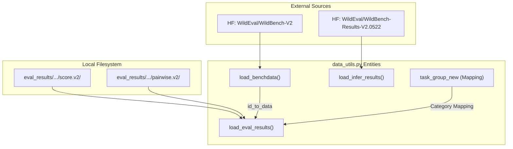
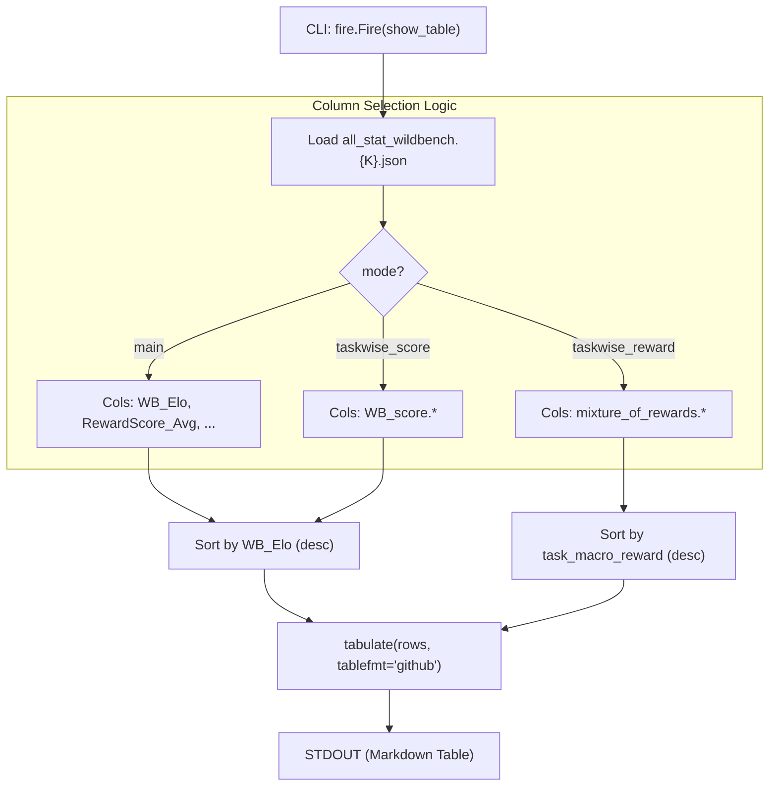

<!-- source: DeepWiki mcp.deepwiki.com · repo allenai/WildBench · page 4.4 show_table.py & data_utils.py · fetched 2026-10-26 -->

# show_table.py & data_utils.py

Relevant source files

The following files were used as context for generating this wiki page:

- [leaderboard/data_dir/all_stat_wildbench.-1.json](leaderboard/data_dir/all_stat_wildbench.-1.json)
- [leaderboard/data_dir/all_stat_wildbench.100.json](leaderboard/data_dir/all_stat_wildbench.100.json)
- [leaderboard/data_dir/all_stat_wildbench.1000.json](leaderboard/data_dir/all_stat_wildbench.1000.json)
- [leaderboard/data_dir/all_stat_wildbench.1500.json](leaderboard/data_dir/all_stat_wildbench.1500.json)
- [leaderboard/data_utils.py](leaderboard/data_utils.py)
- [leaderboard/show_table.py](leaderboard/show_table.py)

This page details the implementation of the WildBench leaderboard rendering logic and the shared data-loading utility layer. The system is divided into `show_table.py`, which handles the CLI-based visualization and ranking of results, and `data_utils.py`, which provides a unified interface for loading benchmark data and evaluation results from the filesystem and Hugging Face Hub.

## 1. data_utils.py: Shared Data Layer

`data_utils.py` acts as the central data access layer for the WildBench evaluation pipeline [leaderboard/data_utils.py:1-11](). It manages global states for benchmark data, model length information, and evaluation results to ensure consistency across different scripts.

### Key Data Structures and Paths
The utility defines the standard locations for evaluation results and the mapping for task categorization:
*   **`BASE_SCORE_RESULTS_PATH`**: Points to the GPT-4o based scoring results (`eval_results/v2.0625/score.v2/eval=gpt-4o-2024-05-13/`) [leaderboard/data_utils.py:18-18]().
*   **`BASE_EVAL_RESULTS_PATH`**: Points to the pairwise evaluation results judged by GPT-4 Turbo (`eval_results/v2.0522/pairwise.v2/eval=gpt-4-turbo-2024-04-09/`) [leaderboard/data_utils.py:19-19]().
*   **`task_group_new`**: A mapping dictionary that consolidates granular tags (e.g., "Editing", "Brainstorming") into higher-level categories like "Creative Tasks" or "Planning & Reasoning" [leaderboard/data_utils.py:22-35]().

### Core Functions

| Function | Description | Implementation Detail |
| :--- | :--- | :--- |
| `load_benchdata()` | Loads the WildBench-V2 dataset from Hugging Face. | Uses `load_dataset("WildEval/WildBench-V2", "v2.0522")` [leaderboard/data_utils.py:46-51](). |
| `load_eval_results()` | Aggregates score and pairwise results from local JSON files. | Iterates through `BASE_SCORE_RESULTS_PATH` and subdirectories of `BASE_EVAL_RESULTS_PATH` [leaderboard/data_utils.py:64-90](). |
| `formatter(x)` | Standardizes numeric output for the leaderboard. | Rounds non-string values to 1 decimal place [leaderboard/data_utils.py:38-43](). |
| `load_infer_results(model)` | Fetches raw model responses. | Loads from `WildEval/WildBench-Results-V2.0522` [leaderboard/data_utils.py:92-96](). |

### Data Flow Diagram: Utility Loading
The following diagram illustrates how `data_utils.py` interacts with external and local storage to populate the evaluation environment.

Title: WildBench Data Loading Flow

**Sources:** [leaderboard/data_utils.py:18-62](), [leaderboard/data_utils.py:64-96]()

---

## 2. show_table.py: Leaderboard Rendering

`show_table.py` is a CLI utility used to generate Markdown/GitHub-flavored tables from aggregated statistics [leaderboard/show_table.py:1-4](). It processes the JSON files generated by the pipeline (e.g., `all_stat_wildbench.{K}.json`) and applies formatting and ranking logic.

### Display Modes
The script supports three primary modes via the `mode` argument in `show_table(K, mode)` [leaderboard/show_table.py:7-7]():

1.  **`main`**: Shows the core metrics: `WB_Elo`, `RewardScore_Avg`, `WB_score.task_macro`, and `task_macro_reward.K={K}` [leaderboard/show_table.py:16-18]().
2.  **`taskwise_score`**: Focuses on the WB-Score across specific task categories (Creative, Reasoning, Math, etc.) [leaderboard/show_table.py:19-22]().
3.  **`taskwise_reward`**: Displays reward-based metrics (pairwise preferences) across task categories [leaderboard/show_table.py:23-25]().

### Implementation Logic
1.  **File Loading**: It constructs the path to the statistics file using the length penalty factor `K` [leaderboard/show_table.py:8-10]().
2.  **Column Selection**: It maintains a comprehensive list of all possible metrics [leaderboard/show_table.py:12-13]() and filters them based on the selected `mode`.
3.  **Ranking**: Models are sorted in descending order based on a `rank_column`. For `main` and `taskwise_score`, this is `WB_Elo`. For `taskwise_reward`, it uses `task_macro_reward.K={K}` [leaderboard/show_table.py:18-31]().
4.  **Tabulation**: Uses the `tabulate` library to output a GitHub-compatible table with a rank index [leaderboard/show_table.py:44-44]().

### Leaderboard Rendering Process
This diagram maps the CLI command to the internal data selection and formatting logic.

Title: show_table.py Execution Logic

**Sources:** [leaderboard/show_table.py:7-44](), [leaderboard/show_table.py:49-49]()

---

## 3. Data Schema Reference

The statistics files (e.g., `all_stat_wildbench.100.json`) contain a nested dictionary where keys are model names and values are metric mappings.

### Example Data Structure
As seen in the data files, each model entry includes:
*   **External Benchmarks**: `Arena-Hard v0.1`, `AE2.0` [leaderboard/data_dir/all_stat_wildbench.100.json:3-5]().
*   **Judge-Specific Rewards**: `haiku_reward.K=100`, `llama_reward.K=100`, `gpt4t_reward.K=100` [leaderboard/data_dir/all_stat_wildbench.100.json:8-10]().
*   **Categorized WB-Scores**: `WB_score.Creative Tasks`, `WB_score.Math & Data Analysis`, etc. [leaderboard/data_dir/all_stat_wildbench.100.json:36-40]().
*   **Aggregated Meta-Metrics**: `RewardScore_Avg` (average of reward and score), `WB_Elo`, and `Rank_Avg` [leaderboard/data_dir/all_stat_wildbench.100.json:46-48]().

### Impact of K (Length Penalty)
The statistics change significantly based on the `K` value provided to `show_table.py`:
*   **`K=100`**: Aggressive length penalty [leaderboard/data_dir/all_stat_wildbench.100.json]().
*   **`K=1500`**: Moderate length penalty [leaderboard/data_dir/all_stat_wildbench.1500.json]().
*   **`K=-1`**: No length penalty (raw scores) [leaderboard/data_dir/all_stat_wildbench.-1.json]().

**Sources:** [leaderboard/data_dir/all_stat_wildbench.100.json:1-49](), [leaderboard/data_dir/all_stat_wildbench.1500.json:1-49](), [leaderboard/data_dir/all_stat_wildbench.-1.json:1-49]()

---

