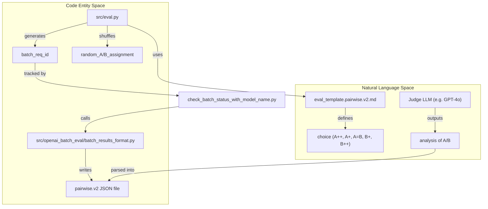
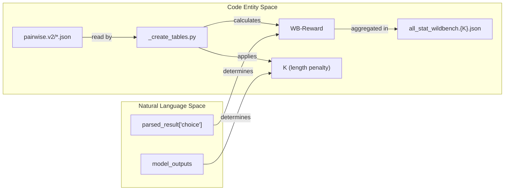

<!-- source: DeepWiki mcp.deepwiki.com · repo allenai/WildBench · page 5.1 Pairwise Evaluation Results · fetched 2026-10-26 -->

# Pairwise Evaluation Results

Relevant source files

The following files were used as context for generating this wiki page:

- [eval_results/v2.0522/pairwise.v2/eval=gpt-4-turbo-2024-04-09/ref=Llama-2-70b-chat-hf/Meta-Llama-3-70B-Instruct.json](eval_results/v2.0522/pairwise.v2/eval=gpt-4-turbo-2024-04-09/ref=Llama-2-70b-chat-hf/Meta-Llama-3-70B-Instruct.json)
- [eval_results/v2.0522/pairwise.v2/eval=gpt-4-turbo-2024-04-09/ref=Llama-2-70b-chat-hf/Nous-Hermes-2-Mixtral-8x7B-DPO.json](eval_results/v2.0522/pairwise.v2/eval=gpt-4-turbo-2024-04-09/ref=Llama-2-70b-chat-hf/Nous-Hermes-2-Mixtral-8x7B-DPO.json)
- [eval_results/v2.0522/pairwise.v2/eval=gpt-4-turbo-2024-04-09/ref=Llama-2-70b-chat-hf/command-r-plus.json](eval_results/v2.0522/pairwise.v2/eval=gpt-4-turbo-2024-04-09/ref=Llama-2-70b-chat-hf/command-r-plus.json)
- [eval_results/v2.0522/pairwise.v2/eval=gpt-4-turbo-2024-04-09/ref=Llama-2-70b-chat-hf/neo_7b_instruct_v0.1-ExPO.json](eval_results/v2.0522/pairwise.v2/eval=gpt-4-turbo-2024-04-09/ref=Llama-2-70b-chat-hf/neo_7b_instruct_v0.1-ExPO.json)
- [eval_results/v2.0522/pairwise.v2/eval=gpt-4-turbo-2024-04-09/ref=claude-3-haiku-20240307/Meta-Llama-3-70B-Instruct.json](eval_results/v2.0522/pairwise.v2/eval=gpt-4-turbo-2024-04-09/ref=claude-3-haiku-20240307/Meta-Llama-3-70B-Instruct.json)
- [eval_results/v2.0522/pairwise.v2/eval=gpt-4-turbo-2024-04-09/ref=claude-3-haiku-20240307/Nous-Hermes-2-Mixtral-8x7B-DPO.json](eval_results/v2.0522/pairwise.v2/eval=gpt-4-turbo-2024-04-09/ref=claude-3-haiku-20240307/Nous-Hermes-2-Mixtral-8x7B-DPO.json)
- [eval_results/v2.0522/pairwise.v2/eval=gpt-4-turbo-2024-04-09/ref=claude-3-haiku-20240307/command-r-plus.json](eval_results/v2.0522/pairwise.v2/eval=gpt-4-turbo-2024-04-09/ref=claude-3-haiku-20240307/command-r-plus.json)
- [eval_results/v2.0522/pairwise.v2/eval=gpt-4-turbo-2024-04-09/ref=claude-3-haiku-20240307/neo_7b_instruct_v0.1-ExPO.json](eval_results/v2.0522/pairwise.v2/eval=gpt-4-turbo-2024-04-09/ref=claude-3-haiku-20240307/neo_7b_instruct_v0.1-ExPO.json)
- [eval_results/v2.0522/pairwise.v2/eval=gpt-4-turbo-2024-04-09/ref=gpt-4-turbo-2024-04-09/Meta-Llama-3-70B-Instruct.json](eval_results/v2.0522/pairwise.v2/eval=gpt-4-turbo-2024-04-09/ref=gpt-4-turbo-2024-04-09/Meta-Llama-3-70B-Instruct.json)
- [eval_results/v2.0522/pairwise.v2/eval=gpt-4-turbo-2024-04-09/ref=gpt-4-turbo-2024-04-09/Nous-Hermes-2-Mixtral-8x7B-DPO.json](eval_results/v2.0522/pairwise.v2/eval=gpt-4-turbo-2024-04-09/ref=gpt-4-turbo-2024-04-09/Nous-Hermes-2-Mixtral-8x7B-DPO.json)
- [eval_results/v2.0522/pairwise.v2/eval=gpt-4-turbo-2024-04-09/ref=gpt-4-turbo-2024-04-09/command-r-plus.json](eval_results/v2.0522/pairwise.v2/eval=gpt-4-turbo-2024-04-09/ref=gpt-4-turbo-2024-04-09/command-r-plus.json)
- [eval_results/v2.0522/pairwise.v2/eval=gpt-4-turbo-2024-04-09/ref=gpt-4-turbo-2024-04-09/neo_7b_instruct_v0.1-ExPO.json](eval_results/v2.0522/pairwise.v2/eval=gpt-4-turbo-2024-04-09/ref=gpt-4-turbo-2024-04-09/neo_7b_instruct_v0.1-ExPO.json)
- [eval_results/v2.0522/score.v2/eval=gpt-4-turbo-2024-04-09/command-r-plus.json](eval_results/v2.0522/score.v2/eval=gpt-4-turbo-2024-04-09/command-r-plus.json)
- [scripts/Hermes-2-Theta-Llama-3-8B.sh](scripts/Hermes-2-Theta-Llama-3-8B.sh)
- [scripts/cohere-command-r-plus.sh](scripts/cohere-command-r-plus.sh)
- [src/openai_batch_eval/check_batch_status_with_model_name.py](src/openai_batch_eval/check_batch_status_with_model_name.py)

Pairwise evaluation is a core component of the WildBench assessment pipeline where a judge LLM (typically GPT-4 Turbo) compares the outputs of two models side-by-side. This "A vs B" comparison provides the foundation for calculating WB-Reward and Elo ratings.

## Directory Structure and Path Pattern

The pairwise results are archived in a hierarchical directory structure that captures the version of the evaluation suite, the judge model used, and the reference model against which candidates are compared.

**Path Pattern:**
`eval_results/{version}/pairwise.v2/eval={judge}/ref={reference}/{model}.json`

*   **`version`**: The release version of the WildBench evaluation (e.g., `v2.0522`) [eval_results/v2.0522/pairwise.v2/eval=gpt-4-turbo-2024-04-09/ref=gpt-4-turbo-2024-04-09/neo_7b_instruct_v0.1-ExPO.json:1-3]().
*   **`judge`**: The model performing the evaluation (e.g., `gpt-4-turbo-2024-04-09`).
*   **`reference`**: The model acting as `model_A` in the comparison. Common references include `gpt-4-turbo-2024-04-09`, `claude-3-haiku-20240307`, and `Llama-2-70b-chat-hf` [eval_results/v2.0522/pairwise.v2/eval=gpt-4-turbo-2024-04-09/ref=Llama-2-70b-chat-hf/neo_7b_instruct_v0.1-ExPO.json:1-21]().
*   **`model`**: The candidate model being evaluated (acting as `model_B`).

**Sources:**
- [eval_results/v2.0522/pairwise.v2/eval=gpt-4-turbo-2024-04-09/ref=gpt-4-turbo-2024-04-09/neo_7b_instruct_v0.1-ExPO.json:1-22]()
- [eval_results/v2.0522/pairwise.v2/eval=gpt-4-turbo-2024-04-09/ref=Llama-2-70b-chat-hf/neo_7b_instruct_v0.1-ExPO.json:1-50]()

---

## Result Schema (JSON)

Each `.json` file contains a list of objects, where each object represents a single evaluation session (one prompt from the dataset).

### Field Definitions

| Field | Type | Description |
| :--- | :--- | :--- |
| `session_id` | String | Unique identifier for the WildBench prompt session [eval_results/v2.0522/pairwise.v2/eval=gpt-4-turbo-2024-04-09/ref=gpt-4-turbo-2024-04-09/neo_7b_instruct_v0.1-ExPO.json:3-3]() |
| `parsed_result` | Object | The structured output from the judge LLM containing the qualitative analysis. |
| `parsed_result.choice` | String | The verdict: `A++`, `A+`, `A=B`, `B+`, or `B++` [eval_results/v2.0522/pairwise.v2/eval=gpt-4-turbo-2024-04-09/ref=gpt-4-turbo-2024-04-09/neo_7b_instruct_v0.1-ExPO.json:10-10]() |
| `parsed_result.analysis of A/B`| String | Detailed text analysis of the strengths/weaknesses of each model [eval_results/v2.0522/pairwise.v2/eval=gpt-4-turbo-2024-04-09/ref=gpt-4-turbo-2024-04-09/neo_7b_instruct_v0.1-ExPO.json:5-6]() |
| `winner` | String | The identifier of the winning model or `"tie"` [eval_results/v2.0522/pairwise.v2/eval=gpt-4-turbo-2024-04-09/ref=gpt-4-turbo-2024-04-09/neo_7b_instruct_v0.1-ExPO.json:23-23]() |
| `extent` | Integer | The strength of the win (0 for tie, 1 for `+`, 2 for `++`) [eval_results/v2.0522/pairwise.v2/eval=gpt-4-turbo-2024-04-09/ref=gpt-4-turbo-2024-04-09/neo_7b_instruct_v0.1-ExPO.json:24-24]() |
| `model_outputs` | Object | Map containing the raw text generated by both models for this session [eval_results/v2.0522/pairwise.v2/eval=gpt-4-turbo-2024-04-09/ref=gpt-4-turbo-2024-04-09/neo_7b_instruct_v0.1-ExPO.json:25-28]() |
| `meta_data` | Object | Usage statistics (tokens) and API request IDs [eval_results/v2.0522/pairwise.v2/eval=gpt-4-turbo-2024-04-09/ref=gpt-4-turbo-2024-04-09/neo_7b_instruct_v0.1-ExPO.json:12-20]() |

### Data Flow: From Evaluation to Result File

This diagram illustrates how the `src/eval.py` script generates these result files using the OpenAI Batch API or synchronous calls.

**Evaluation Process Flow**

**Sources:**
- [src/openai_batch_eval/check_batch_status_with_model_name.py:33-36]()
- [eval_results/v2.0522/pairwise.v2/eval=gpt-4-turbo-2024-04-09/ref=gpt-4-turbo-2024-04-09/neo_7b_instruct_v0.1-ExPO.json:4-11]()

---

## Reward Calculation Logic

The `choice` field in the pairwise results is the primary input for the leaderboard's reward calculations in `_create_tables.py`.

### Reward Mapping
WildBench uses a linear mapping from the qualitative choices to numerical reward values:
*   **A++ / B++**: Reward = 1 / -1 (Extent 2)
*   **A+ / B+**: Reward = 0.5 / -0.5 (Extent 1)
*   **A=B**: Reward = 0 (Extent 0)

### Length Penalty (K)
When calculating rewards, the system applies a length penalty `K`. If a model's response is significantly longer than the reference but doesn't provide proportional quality, its reward is penalized.

**Leaderboard Aggregation Flow**

**Sources:**
- [eval_results/v2.0522/pairwise.v2/eval=gpt-4-turbo-2024-04-09/ref=gpt-4-turbo-2024-04-09/neo_7b_instruct_v0.1-ExPO.json:10-24]()
- [scripts/cohere-command-r-plus.sh:24-25]() (Context on merging results before eval)

---

## Example Result Analysis

In the file `eval_results/v2.0522/pairwise.v2/eval=gpt-4-turbo-2024-04-09/ref=gpt-4-turbo-2024-04-09/neo_7b_instruct_v0.1-ExPO.json`, session `ae006110bb364606` shows a comparison between GPT-4 Turbo (Model A) and Neo-7B (Model B).

1.  **Observation**: The judge notes that Model B's response is empty [eval_results/v2.0522/pairwise.v2/eval=gpt-4-turbo-2024-04-09/ref=gpt-4-turbo-2024-04-09/neo_7b_instruct_v0.1-ExPO.json:6-6]().
2.  **Verdict**: The `choice` is `A++` [eval_results/v2.0522/pairwise.v2/eval=gpt-4-turbo-2024-04-09/ref=gpt-4-turbo-2024-04-09/neo_7b_instruct_v0.1-ExPO.json:10-10]().
3.  **Metadata**: The `extent` is `2`, and the `winner` is the reference model [eval_results/v2.0522/pairwise.v2/eval=gpt-4-turbo-2024-04-09/ref=gpt-4-turbo-2024-04-09/neo_7b_instruct_v0.1-ExPO.json:23-24]().

This specific result would contribute a reward of -1 to the Neo-7B model's average (since it lost to the reference) during the table creation phase.

**Sources:**
- [eval_results/v2.0522/pairwise.v2/eval=gpt-4-turbo-2024-04-09/ref=gpt-4-turbo-2024-04-09/neo_7b_instruct_v0.1-ExPO.json:1-29]()

---

