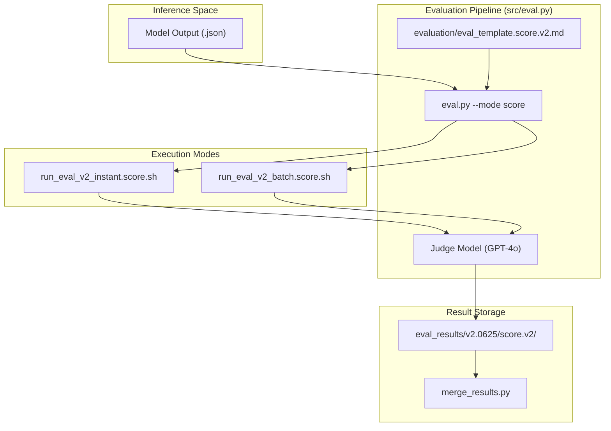
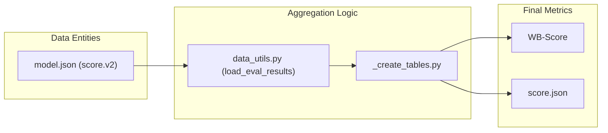

<!-- source: DeepWiki mcp.deepwiki.com · repo allenai/WildBench · page 5.2 Score Evaluation Results · fetched 2026-10-26 -->

# Score Evaluation Results

Relevant source files

The following files were used as context for generating this wiki page:

- [eval_results/v2.0522/pairwise.v2/eval=gpt-4-turbo-2024-04-09/ref=Llama-2-70b-chat-hf/Llama-3-Instruct-8B-SimPO-ExPO.json](eval_results/v2.0522/pairwise.v2/eval=gpt-4-turbo-2024-04-09/ref=Llama-2-70b-chat-hf/Llama-3-Instruct-8B-SimPO-ExPO.json)
- [eval_results/v2.0522/pairwise.v2/eval=gpt-4-turbo-2024-04-09/ref=Llama-2-70b-chat-hf/Starling-LM-7B-beta-ExPO.json](eval_results/v2.0522/pairwise.v2/eval=gpt-4-turbo-2024-04-09/ref=Llama-2-70b-chat-hf/Starling-LM-7B-beta-ExPO.json)
- [eval_results/v2.0522/pairwise.v2/eval=gpt-4-turbo-2024-04-09/ref=Llama-2-70b-chat-hf/neo_7b_instruct_v0.1.json](eval_results/v2.0522/pairwise.v2/eval=gpt-4-turbo-2024-04-09/ref=Llama-2-70b-chat-hf/neo_7b_instruct_v0.1.json)
- [eval_results/v2.0522/pairwise.v2/eval=gpt-4-turbo-2024-04-09/ref=claude-3-haiku-20240307/Llama-3-Instruct-8B-SimPO-ExPO.json](eval_results/v2.0522/pairwise.v2/eval=gpt-4-turbo-2024-04-09/ref=claude-3-haiku-20240307/Llama-3-Instruct-8B-SimPO-ExPO.json)
- [eval_results/v2.0522/pairwise.v2/eval=gpt-4-turbo-2024-04-09/ref=claude-3-haiku-20240307/Starling-LM-7B-beta-ExPO.json](eval_results/v2.0522/pairwise.v2/eval=gpt-4-turbo-2024-04-09/ref=claude-3-haiku-20240307/Starling-LM-7B-beta-ExPO.json)
- [eval_results/v2.0522/pairwise.v2/eval=gpt-4-turbo-2024-04-09/ref=claude-3-haiku-20240307/neo_7b_instruct_v0.1.json](eval_results/v2.0522/pairwise.v2/eval=gpt-4-turbo-2024-04-09/ref=claude-3-haiku-20240307/neo_7b_instruct_v0.1.json)
- [eval_results/v2.0522/pairwise.v2/eval=gpt-4-turbo-2024-04-09/ref=gpt-4-turbo-2024-04-09/Llama-3-Instruct-8B-SimPO-ExPO.json](eval_results/v2.0522/pairwise.v2/eval=gpt-4-turbo-2024-04-09/ref=gpt-4-turbo-2024-04-09/Llama-3-Instruct-8B-SimPO-ExPO.json)
- [eval_results/v2.0522/pairwise.v2/eval=gpt-4-turbo-2024-04-09/ref=gpt-4-turbo-2024-04-09/Starling-LM-7B-beta-ExPO.json](eval_results/v2.0522/pairwise.v2/eval=gpt-4-turbo-2024-04-09/ref=gpt-4-turbo-2024-04-09/Starling-LM-7B-beta-ExPO.json)
- [eval_results/v2.0522/pairwise.v2/eval=gpt-4-turbo-2024-04-09/ref=gpt-4-turbo-2024-04-09/neo_7b_instruct_v0.1.json](eval_results/v2.0522/pairwise.v2/eval=gpt-4-turbo-2024-04-09/ref=gpt-4-turbo-2024-04-09/neo_7b_instruct_v0.1.json)
- [eval_results/v2.0522/score.v2/eval=claude-3-5-sonnet-20240620/gpt-4o-2024-05-13.json](eval_results/v2.0522/score.v2/eval=claude-3-5-sonnet-20240620/gpt-4o-2024-05-13.json)
- [eval_results/v2.0522/score.v2/eval=gpt-4-turbo-2024-04-09/Llama-3-Instruct-8B-SimPO-ExPO.json](eval_results/v2.0522/score.v2/eval=gpt-4-turbo-2024-04-09/Llama-3-Instruct-8B-SimPO-ExPO.json)
- [eval_results/v2.0522/score.v2/eval=gpt-4-turbo-2024-04-09/Starling-LM-7B-beta-ExPO.json](eval_results/v2.0522/score.v2/eval=gpt-4-turbo-2024-04-09/Starling-LM-7B-beta-ExPO.json)
- [eval_results/v2.0522/score.v2/eval=gpt-4o-2024-05-13/neo_7b_instruct_v0.1.json](eval_results/v2.0522/score.v2/eval=gpt-4o-2024-05-13/neo_7b_instruct_v0.1.json)
- [eval_results/v2.0625/score.v2/eval=claude-3-5-sonnet-20240620/claude-3-5-sonnet-20240620.json](eval_results/v2.0625/score.v2/eval=claude-3-5-sonnet-20240620/claude-3-5-sonnet-20240620.json)
- [eval_results/v2.0625/score.v2/eval=claude-3-5-sonnet-20240620/gemini-1.5-pro.json](eval_results/v2.0625/score.v2/eval=claude-3-5-sonnet-20240620/gemini-1.5-pro.json)
- [eval_results/v2.0625/score.v2/eval=claude-3-5-sonnet-20240620/gpt-4o-2024-05-13.json](eval_results/v2.0625/score.v2/eval=claude-3-5-sonnet-20240620/gpt-4o-2024-05-13.json)
- [eval_results/v2.0625/score.v2/eval=claude-3-5-sonnet-20240620/gpt-4o-mini-2024-07-18.json](eval_results/v2.0625/score.v2/eval=claude-3-5-sonnet-20240620/gpt-4o-mini-2024-07-18.json)
- [eval_results/v2.0625/score.v2/eval=gpt-4o-2024-05-13/Mistral-Large-2.json](eval_results/v2.0625/score.v2/eval=gpt-4o-2024-05-13/Mistral-Large-2.json)
- [eval_results/v2.0625/score.v2/eval=gpt-4o-2024-05-13/gemma-2-2b-it.json](eval_results/v2.0625/score.v2/eval=gpt-4o-2024-05-13/gemma-2-2b-it.json)
- [eval_results/v2.0625/score.v2/eval=gpt-4o-2024-05-13/gemma-2-9b-it-DPO.json](eval_results/v2.0625/score.v2/eval=gpt-4o-2024-05-13/gemma-2-9b-it-DPO.json)
- [evaluation/run_all_eval_batch.sh](evaluation/run_all_eval_batch.sh)
- [evaluation/run_eval_v2_instant.score.sh](evaluation/run_eval_v2_instant.score.sh)
- [scripts/Llama-3-Instruct-8B-SimPO-ExPO.sh](scripts/Llama-3-Instruct-8B-SimPO-ExPO.sh)
- [scripts/Starling-LM-7B-beta-ExPO.sh](scripts/Starling-LM-7B-beta-ExPO.sh)

This page details the structure and schema of the score-based evaluation results in WildBench. These results are generated by an LLM-as-a-judge (typically GPT-4o or GPT-4 Turbo) which assigns a numerical score (1-10) to a model's response based on a specific rubric.

## Overview and Directory Structure

Score evaluation results are stored as JSON files within the `eval_results/` directory. The path follows a versioned pattern to distinguish between different evaluation iterations and judge models.

**Path Pattern:**
`eval_results/{version}/score.v2/eval={judge}/{model}.json`

### Versioning Differences
WildBench maintains two primary versions of score results based on the judge model and evaluation date:

1.  **v2.0522**: Historically used `gpt-4-turbo-2024-04-09` as the primary judge [evaluation/run_all_eval_batch.sh:3]().
2.  **v2.0625**: The current standard (since June 13, 2024), which uses `gpt-4o-2024-05-13` as the primary judge [evaluation/run_all_eval_batch.sh:2](), [evaluation/run_eval_v2_instant.score.sh:3]().

**Sources:**
- [evaluation/run_all_eval_batch.sh:1-12]()
- [evaluation/run_eval_v2_instant.score.sh:1-12]()

---

## Data Schema

Each JSON file contains a list of objects, where each object represents the evaluation of a single conversation session.

### Field Definitions

| Field | Type | Description |
| :--- | :--- | :--- |
| `session_id` | String | Unique identifier for the WildBench task [eval_results/v2.0625/score.v2/eval=gpt-4o-2024-05-13/gemma-2-2b-it.json:3](). |
| `parsed_result` | Object | The structured output from the judge LLM. |
| `parsed_result.score`| String | The 1-10 score assigned by the judge [eval_results/v2.0625/score.v2/eval=gpt-4o-2024-05-13/gemma-2-2b-it.json:7](). |
| `parsed_result.strengths`| String | Qualitative analysis of the model's response strengths [eval_results/v2.0625/score.v2/eval=gpt-4o-2024-05-13/gemma-2-2b-it.json:5](). |
| `parsed_result.weaknesses`| String | Qualitative analysis of the model's response weaknesses [eval_results/v2.0625/score.v2/eval=gpt-4o-2024-05-13/gemma-2-2b-it.json:6](). |
| `meta_data` | Object | Metadata regarding the evaluation request. |
| `meta_data.batch_req_id`| String | The ID for the OpenAI Batch API request [eval_results/v2.0625/score.v2/eval=gpt-4o-2024-05-13/gemma-2-2b-it.json:10](). |
| `meta_data.usage` | Object | Token consumption (prompt, completion, total) [eval_results/v2.0625/score.v2/eval=gpt-4o-2024-05-13/gemma-2-2b-it.json:11-15](). |
| `model_test` | String | The name of the model being evaluated [eval_results/v2.0625/score.v2/eval=gpt-4o-2024-05-13/gemma-2-2b-it.json:18](). |
| `score` | String | Redundant top-level field for the 1-10 score [eval_results/v2.0625/score.v2/eval=gpt-4o-2024-05-13/gemma-2-2b-it.json:19](). |
| `model_output` | String | The raw response text generated by the model under test [eval_results/v2.0625/score.v2/eval=gpt-4o-2024-05-13/gemma-2-2b-it.json:20](). |

**Sources:**
- [eval_results/v2.0625/score.v2/eval=gpt-4o-2024-05-13/gemma-2-2b-it.json:1-20]()
- [eval_results/v2.0625/score.v2/eval=gpt-4o-2024-05-13/Mistral-Large-2.json:1-21]()

---

## Evaluation Data Flow

The score evaluation can be triggered via the Batch API or instantly. The following diagram illustrates the flow from raw model inference to the final score result file.

### Implementation Logic: Inference to Score Result
This diagram maps the transition from "Natural Language Space" (Judge prompts/Model outputs) to "Code Entity Space" (Evaluation scripts).

**Sources:**
- [evaluation/run_eval_v2_instant.score.sh:19-26]()
- [evaluation/run_eval_v2_instant.score.sh:49]()
- [evaluation/run_all_eval_batch.sh:12]()

---

## WB-Score Calculation

The scores stored in these JSON files are the primary input for the **WB-Score** metric. 

1.  **Parsing**: `src/eval.py` uses `parse_result` to extract the numerical score from the judge's JSON/Markdown response [eval_results/v2.0625/score.v2/eval=gpt-4o-2024-05-13/gemma-2-2b-it.json:4-8]().
2.  **Aggregation**: The scores for all 1024 instances are collected.
3.  **Averaging**: The WB-Score is typically the average of these individual scores, often segmented by task category (e.g., Coding, Creative Writing) during leaderboard generation.

### From JSON Results to Leaderboard
This diagram shows how the individual score entities are processed by the leaderboard subsystem.

**Sources:**
- [eval_results/v2.0625/score.v2/eval=gpt-4o-2024-05-13/Mistral-Large-2.json:2-21]()
- [evaluation/run_eval_v2_instant.score.sh:49]()

---

## Batch vs. Instant Evaluation Comparison

The codebase provides two scripts for generating these result files, differing in their execution strategy:

| Feature | `run_eval_v2_instant.score.sh` | `run_eval_v2_batch.score.sh` |
| :--- | :--- | :--- |
| **Judge Interface** | `src/eval.py` (Synchronous) | OpenAI Batch API (Asynchronous) |
| **Parallelism** | Sharding via background processes [evaluation/run_eval_v2_instant.score.sh:32-44]() | Server-side batch processing |
| **Consolidation** | Calls `src/merge_results.py` [evaluation/run_eval_v2_instant.score.sh:49]() | `batch_results_format.py` (post-retrieval) |
| **Target Folder** | `eval_results/v2.0625/score.v2/` [evaluation/run_eval_v2_instant.score.sh:10]() | `eval_results/v2.0625/score.v2/` |

**Sources:**
- [evaluation/run_eval_v2_instant.score.sh:9-50]()
- [evaluation/run_all_eval_batch.sh:8-12]()

---

