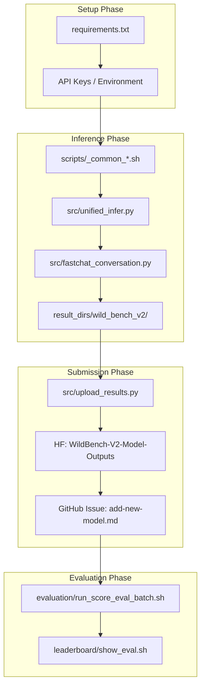

<!-- source: DeepWiki mcp.deepwiki.com · repo allenai/WildBench · page 7 Contributing: Adding a New Model · fetched 2026-10-26 -->

# Contributing: Adding a New Model

Relevant source files

The following files were used as context for generating this wiki page:

- [.github/ISSUE_TEMPLATE/add-new-model.md](.github/ISSUE_TEMPLATE/add-new-model.md)
- [.gitignore](.gitignore)
- [EVAL.md](EVAL.md)
- [LICENSE](LICENSE)
- [README.md](README.md)
- [requirements.txt](requirements.txt)
- [scripts/Llama-3-Instruct-8B-SimPO.sh](scripts/Llama-3-Instruct-8B-SimPO.sh)
- [scripts/Yi-1.5-9B-Chat.sh](scripts/Yi-1.5-9B-Chat.sh)
- [scripts/_common_hf.sh](scripts/_common_hf.sh)
- [scripts/_common_vllm.sh](scripts/_common_vllm.sh)
- [scripts/claude-3-opus-20240229.sh](scripts/claude-3-opus-20240229.sh)
- [scripts/claude-3-sonnet-20240229.sh](scripts/claude-3-sonnet-20240229.sh)
- [scripts/cohere-command-r.sh](scripts/cohere-command-r.sh)
- [scripts/cohere-command.sh](scripts/cohere-command.sh)
- [scripts/gemini-1.0-pro.sh](scripts/gemini-1.0-pro.sh)
- [scripts/gemini-1.5-flash.sh](scripts/gemini-1.5-flash.sh)
- [src/eval.py](src/eval.py)
- [src/fastchat_conversation.py](src/fastchat_conversation.py)
- [src/global_configs.py](src/global_configs.py)
- [src/upload_results.py](src/upload_results.py)

This page provides a high-level guide for contributors who wish to add new models to the WildBench benchmark. The process involves generating model responses (inference), uploading results, and triggering the evaluation pipeline.

## Overview of the Contribution Workflow

Adding a model follows a standard pipeline from environment setup to result submission. For models on HuggingFace supported by vLLM, a "Shortcut" is available to streamline the process.

### Workflow Diagram
The following diagram maps the contribution steps to the relevant scripts and code entities.

**Model Addition Lifecycle**

**Sources:** [README.md:30-44](), [README.md:53-88](), [.github/ISSUE_TEMPLATE/add-new-model.md:1-24]()

---

## 1. Inference Scripts

The first step is generating model outputs for the 1024 WildBench examples. WildBench provides common shell templates to handle different model backends.

### Open-Weight Models
Most open-weight models use the `vllm` or `hf` (HuggingFace) engines.
- **Shortcut:** Use `bash scripts/_common_vllm.sh [hf_model_id] [model_pretty_name] [num_gpus]` [README.md:82-88]().
- **Custom Templates:** If the model requires specific logic, create a new script in `scripts/` (e.g., `scripts/Yi-1.5-9B-Chat.sh`) by copying an existing template [README.md:97-100]().
- **Conversation Templates:** Ensure the model's chat template is defined in `src/fastchat_conversation.py` or use the `--use_hf_conv_template` flag [README.md:101](), [src/fastchat_conversation.py:12-41]().

For more details, see [Open-Weight Model Scripts](#7.1).

### API-Based Models
For proprietary models, WildBench supports several providers (OpenAI, Anthropic, Google, Cohere, etc.) via `src/unified_infer.py`.
- **Engine Flags:** Use `--engine` followed by `openai`, `anthropic`, `google`, `cohere`, `mistral`, `reka`, or `together` [README.md:122-129]().
- **Sharding:** API scripts often use `n_shards` to manage rate limits by splitting the 1024 examples into parallel chunks [scripts/cohere-command.sh:7-12]().

For more details, see [API-Based Model Scripts](#7.2).

**Sources:** [README.md:92-130](), [scripts/_common_vllm.sh:1-67](), [scripts/cohere-command.sh:1-26]()

---

## 2. Result Management and Upload

Once inference is complete, the results are typically stored in `result_dirs/wild_bench_v2/` as a single JSON file merged by `src/merge_results.py` [scripts/_common_vllm.sh:62-63]().

### Uploading to HuggingFace
To have results verified and published on the leaderboard, they must be uploaded to the official results repository: `allenai/WildBench-V2-Model-Outputs` [src/upload_results.py:8]().
- **Tool:** Use `src/upload_results.py` which validates that the file contains exactly 1024 samples before pushing to the Hub [src/upload_results.py:12-32]().
- **Requirement:** A `HUGGINGFACE_TOKEN` environment variable is required [src/upload_results.py:29]().

**Sources:** [src/upload_results.py:1-32](), [scripts/_common_vllm.sh:63]()

---

## 3. Evaluation and Submission

After inference, you should verify the model's performance using the evaluation pipeline.

### Running Evaluation
- **WB-Score:** Run `bash evaluation/run_score_eval_batch.sh ${MODEL_PRETTY_NAME}` to trigger GPT-4o based scoring [README.md:141-143]().
- **Local Review:** Check the status of batch jobs using `src/openai_batch_eval/check_batch_status_with_model_name.py` [README.md:41]().

### Filing a GitHub Issue
To finalize the contribution, use the "Add new model" issue template in the repository. This notifies the maintainers to review the results and update the official leaderboard [README.md:136-138]().

**Issue Template Fields:**
- HuggingFace Model ID and Pretty Name.
- Support status (vLLM/HF/API).
- Link to paper or blog post.

**Sources:** [README.md:38-44](), [README.md:139-148](), [.github/ISSUE_TEMPLATE/add-new-model.md:1-24]()

---

## Technical Reference: Code Entities

| Entity | Role | File Path |
| :--- | :--- | :--- |
| `unified_infer.py` | Main entry point for generating model responses. | [src/unified_infer.py]() |
| `map_to_conv` | Factory function for conversation templates. | [src/fastchat_conversation.py:12]() |
| `load_and_upload` | Function to push results to HuggingFace Hub. | [src/upload_results.py:12]() |
| `_common_vllm.sh` | Standard template for vLLM-supported models. | [scripts/_common_vllm.sh]() |
| `_common_hf.sh` | Standard template for native Transformers models. | [scripts/_common_hf.sh]() |

**Sources:** [src/fastchat_conversation.py:12-41](), [src/upload_results.py:12-32](), [scripts/_common_vllm.sh:1-5]()

---

