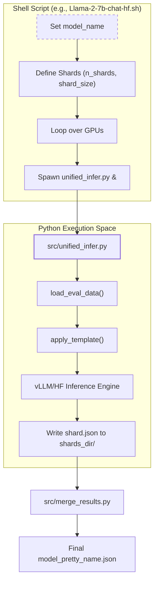
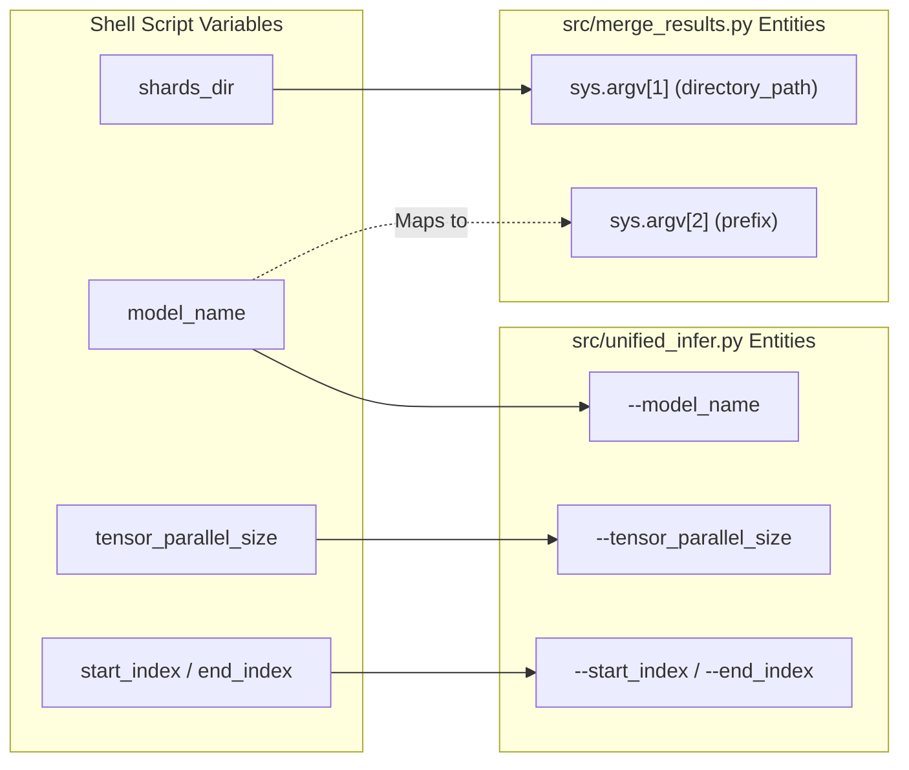

<!-- source: DeepWiki mcp.deepwiki.com · repo allenai/WildBench · page 7.1 Open-Weight Model Scripts · fetched 2026-10-26 -->

# Open-Weight Model Scripts

Relevant source files

The following files were used as context for generating this wiki page:

- [scripts/Llama-2-13b-chat-hf.sh](scripts/Llama-2-13b-chat-hf.sh)
- [scripts/Llama-2-70b-chat-hf.sh](scripts/Llama-2-70b-chat-hf.sh)
- [scripts/Llama-2-7b-chat-hf.sh](scripts/Llama-2-7b-chat-hf.sh)
- [scripts/Meta-Llama-3-70B-Instruct.sh](scripts/Meta-Llama-3-70B-Instruct.sh)
- [scripts/Meta-Llama-3-8B-Instruct.sh](scripts/Meta-Llama-3-8B-Instruct.sh)
- [scripts/Mistral-7B-Instruct-v0.1.sh](scripts/Mistral-7B-Instruct-v0.1.sh)
- [scripts/Mistral-7B-Instruct-v0.2.sh](scripts/Mistral-7B-Instruct-v0.2.sh)
- [scripts/Mixtral-8x7B-Instruct-v0.1.sh](scripts/Mixtral-8x7B-Instruct-v0.1.sh)
- [scripts/Nous-Hermes-2-Mixtral-8x7B-DPO.sh](scripts/Nous-Hermes-2-Mixtral-8x7B-DPO.sh)
- [scripts/Qwen1.5-7B-Chat@together.sh](scripts/Qwen1.5-7B-Chat@together.sh)
- [scripts/SELM-Zephyr-7B-iter-3.sh](scripts/SELM-Zephyr-7B-iter-3.sh)
- [scripts/Yi-34B-Chat.sh](scripts/Yi-34B-Chat.sh)
- [scripts/gemma-2b-it.sh](scripts/gemma-2b-it.sh)
- [scripts/gemma-7b-it.sh](scripts/gemma-7b-it.sh)
- [scripts/zephyr-7b-beta.sh](scripts/zephyr-7b-beta.sh)
- [scripts/zephyr-7b-gemma-v0.1.sh](scripts/zephyr-7b-gemma-v0.1.sh)
- [src/merge_results.py](src/merge_results.py)

This page details the implementation and usage of inference scripts for open-weight models within the WildBench repository. These scripts orchestrate the generation of model responses by interfacing with `src/unified_infer.py` using either vLLM or Hugging Face (HF) backends. They are designed to handle distributed inference through data-parallelism and tensor-parallelism.

## Overview of Inference Orchestration

Inference for open-weight models is typically managed via shell scripts located in the `scripts/` directory. These scripts configure model-specific parameters and execute the inference engine across multiple GPUs.

### Key Inference Parameters
The following parameters are standard across most open-weight scripts:
*   `TEMP`: Temperature for sampling (default: `0`) [scripts/zephyr-7b-beta.sh:3]().
*   `TOP_P`: Nucleus sampling probability (default: `1.0`) [scripts/zephyr-7b-beta.sh:3]().
*   `MAX_TOKENS`: Maximum generation length (default: `4096`) [scripts/zephyr-7b-beta.sh:3]().
*   `batch_size`: Number of concurrent requests (default: `4`) [scripts/zephyr-7b-beta.sh:4]().
*   `tensor_parallel_size`: Number of GPUs used for a single model instance (sharding the model weights) [scripts/Llama-2-70b-chat-hf.sh:15]().

### Data-Parallelism Loop Pattern
For smaller models (e.g., 7B, 13B), WildBench uses a data-parallelism pattern to speed up inference by splitting the dataset into shards and running them concurrently on separate GPUs.

1.  **Sharding Logic**: The dataset is divided into `n_shards` of size `shard_size` [scripts/zephyr-7b-beta.sh:14-15]().
2.  **Background Execution**: A `for` loop spawns multiple `unified_infer.py` processes in the background using `&` [scripts/zephyr-7b-beta.sh:17-30]().
3.  **Isolation**: `CUDA_VISIBLE_DEVICES` is used to assign each shard to a specific GPU [scripts/zephyr-7b-beta.sh:19]().
4.  **Synchronization**: The script uses `wait` to ensure all shards finish before merging [scripts/zephyr-7b-beta.sh:31]().

**Sources:** [scripts/zephyr-7b-beta.sh:11-31](), [scripts/Llama-2-7b-chat-hf.sh:11-32](), [scripts/Mistral-7B-Instruct-v0.2.sh:10-30]()

---

## Inference Data Flow

The following diagram illustrates how the shell scripts bridge the gap between high-level model configuration and the execution of `unified_infer.py`.

### Diagram: Model Script Execution Flow

**Sources:** [scripts/Llama-2-7b-chat-hf.sh:1-35](), [src/merge_results.py:7-13]()

---

## Implementation Details

### Result Merging with `merge_results.py`
When using data-parallelism, results are saved into a temporary directory (`shards_dir`). The `src/merge_results.py` script is then called to consolidate these files.

*   **Input**: Takes the directory path and the model prefix as arguments [src/merge_results.py:7-8]().
*   **Sorting**: It identifies shard files based on the naming convention `prefix.start-end.json` and sorts them by their start index to maintain dataset order [src/merge_results.py:26-39]().
*   **Output**: Produces a single JSON file containing the full list of merged results [src/merge_results.py:56-57]().

### Model-Specific Configurations
Different models require specific flags passed to `unified_infer.py`:

| Model Family | Script Example | Specific Flags / Notes |
| :--- | :--- | :--- |
| **Llama-2** | `Llama-2-7b-chat-hf.sh` | Standard vLLM/HF setup [scripts/Llama-2-7b-chat-hf.sh:20-30](). |
| **Llama-2 (Large)** | `Llama-2-70b-chat-hf.sh` | Uses `tensor_parallel_size 4` on 4 GPUs without sharding [scripts/Llama-2-70b-chat-hf.sh:4,15](). |
| **Zephyr/SELM** | `SELM-Zephyr-7B-iter-3.sh` | Uses `--use_hf_conv_template` and `--use_imend_stop` [scripts/SELM-Zephyr-7B-iter-3.sh:24](). |
| **Mixtral** | `Nous-Hermes-2-Mixtral...` | Uses `tensor_parallel_size 4` for MoE weights [scripts/Nous-Hermes-2-Mixtral-8x7B-DPO.sh:6,13](). |
| **Yi** | `Yi-34B-Chat.sh` | Standard multi-GPU setup [scripts/Yi-34B-Chat.sh:4,14](). |

**Sources:** [scripts/Llama-2-7b-chat-hf.sh:1-35](), [scripts/Llama-2-70b-chat-hf.sh:1-20](), [scripts/SELM-Zephyr-7B-iter-3.sh:24](), [src/merge_results.py:26-57]()

---

## Code Entity Mapping

This diagram maps the variables and logic found in the shell scripts to the underlying Python classes and functions.

### Diagram: Script Variable to Code Entity Mapping

**Sources:** [scripts/zephyr-7b-beta.sh:1-32](), [src/merge_results.py:7-13](), [scripts/Llama-2-13b-chat-hf.sh:20-34]()

## Usage Summary
To run inference for an open-weight model:
1.  Navigate to the root directory.
2.  Execute the desired script: `bash scripts/Llama-2-7b-chat-hf.sh`.
3.  The script will:
    *   Launch parallel shards on available GPUs [scripts/Llama-2-7b-chat-hf.sh:17-32]().
    *   Wait for completion [scripts/Llama-2-7b-chat-hf.sh:33]().
    *   Merge shards into `result_dirs/wild_bench_v2/Llama-2-7b-chat-hf.json` [scripts/Llama-2-7b-chat-hf.sh:34-35]().

**Sources:** [scripts/Llama-2-7b-chat-hf.sh:17-35](), [scripts/zephyr-7b-beta.sh:17-33]()

---

