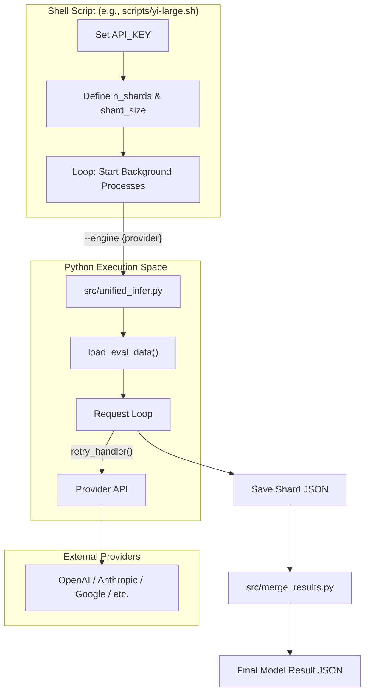
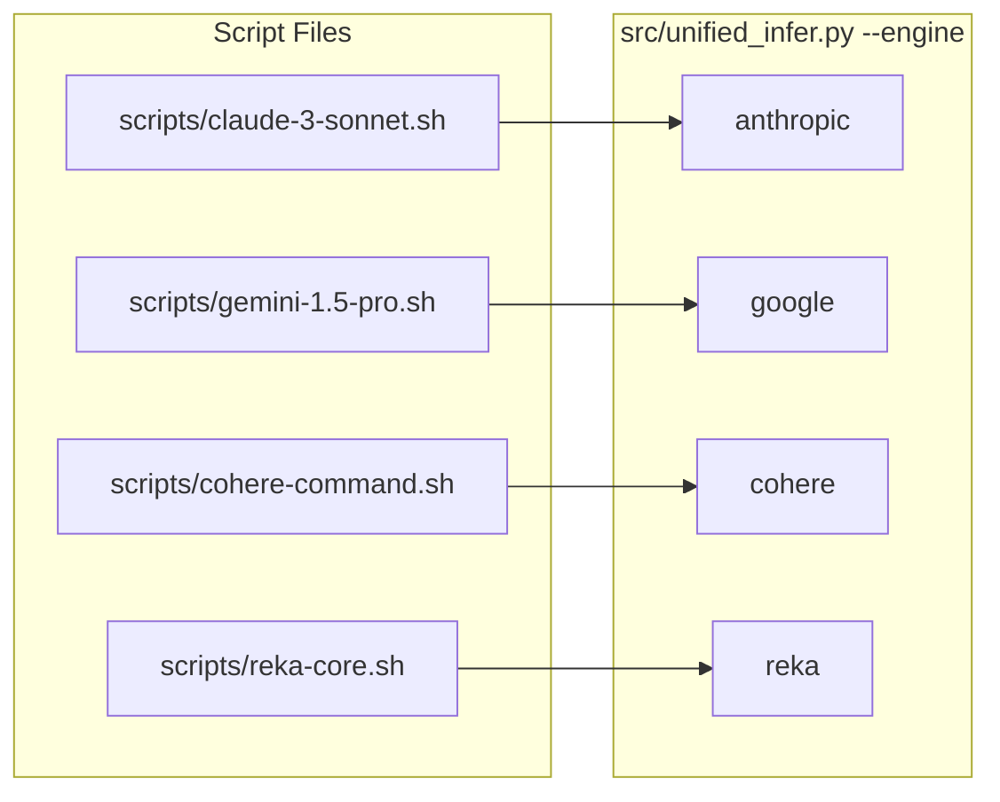

<!-- source: DeepWiki mcp.deepwiki.com · repo allenai/WildBench · page 7.2 API-Based Model Scripts · fetched 2026-10-26 -->

# API-Based Model Scripts

<details>
<summary>Relevant source files</summary>

The following files were used as context for generating this wiki page:

- [eval_results/v2.0522/pairwise.v2/eval=gpt-4-turbo-2024-04-09/ref=Llama-2-70b-chat-hf/command-r-plus.json](eval_results/v2.0522/pairwise.v2/eval=gpt-4-turbo-2024-04-09/ref=Llama-2-70b-chat-hf/command-r-plus.json)
- [eval_results/v2.0522/pairwise.v2/eval=gpt-4-turbo-2024-04-09/ref=claude-3-haiku-20240307/command-r-plus.json](eval_results/v2.0522/pairwise.v2/eval=gpt-4-turbo-2024-04-09/ref=claude-3-haiku-20240307/command-r-plus.json)
- [eval_results/v2.0522/pairwise.v2/eval=gpt-4-turbo-2024-04-09/ref=gpt-4-turbo-2024-04-09/command-r-plus.json](eval_results/v2.0522/pairwise.v2/eval=gpt-4-turbo-2024-04-09/ref=gpt-4-turbo-2024-04-09/command-r-plus.json)
- [eval_results/v2.0522/score.v2/eval=gpt-4-turbo-2024-04-09/command-r-plus.json](eval_results/v2.0522/score.v2/eval=gpt-4-turbo-2024-04-09/command-r-plus.json)
- [scripts/Hermes-2-Theta-Llama-3-8B.sh](scripts/Hermes-2-Theta-Llama-3-8B.sh)
- [scripts/_common_openai.sh](scripts/_common_openai.sh)
- [scripts/claude-3-opus-20240229.sh](scripts/claude-3-opus-20240229.sh)
- [scripts/claude-3-sonnet-20240229.sh](scripts/claude-3-sonnet-20240229.sh)
- [scripts/cohere-command-r-plus.sh](scripts/cohere-command-r-plus.sh)
- [scripts/cohere-command-r.sh](scripts/cohere-command-r.sh)
- [scripts/cohere-command.sh](scripts/cohere-command.sh)
- [scripts/gemini-1.0-pro.sh](scripts/gemini-1.0-pro.sh)
- [scripts/gemini-1.5-flash.sh](scripts/gemini-1.5-flash.sh)
- [scripts/gemini-1.5-pro.sh](scripts/gemini-1.5-pro.sh)
- [scripts/reka-core-20240501.sh](scripts/reka-core-20240501.sh)
- [scripts/reka-edge-20240208.sh](scripts/reka-edge-20240208.sh)
- [scripts/reka-flash-20240226.sh](scripts/reka-flash-20240226.sh)
- [scripts/yi-large.sh](scripts/yi-large.sh)
- [src/openai_batch_eval/check_batch_status_with_model_name.py](src/openai_batch_eval/check_batch_status_with_model_name.py)

</details>


This page details the implementation and orchestration of inference scripts for proprietary models accessed via APIs (e.g., OpenAI, Anthropic, Google, Cohere, Reka, Yi). Unlike open-weight models that require local GPU resources for hosting, API-based models use the `unified_infer.py` engine to dispatch requests to remote endpoints while managing rate limits through sharding and parallel execution.

## Overview of API Inference Flow

The inference process for API models follows a structured pipeline:
1.  **Configuration**: Defining model identifiers and generation parameters (temperature, top_p).
2.  **Sharding**: Splitting the 1024 WildBench examples into smaller chunks to maximize throughput and manage API rate limits.
3.  **Execution**: Launching multiple `unified_infer.py` instances in the background.
4.  **Consolidation**: Using `merge_results.py` to aggregate shard files into a single JSON result.

### System Architecture: API Inference

The following diagram illustrates how the shell scripts interface with the core Python engine and external providers.

**API Inference Data Flow**

Sources: [scripts/yi-large.sh:1-25](), [scripts/_common_openai.sh:29-52](), [src/unified_infer.py:1-50]()

---

## The Common OpenAI Template

The `scripts/_common_openai.sh` script serves as a reusable template for OpenAI-compatible models. It handles both single-process execution and data-parallelism.

### Key Logic and Sharding
The script calculates `shard_size` based on a total of 1024 examples [scripts/_common_openai.sh:30-34](). It uses a `for` loop to spawn background processes, assigning each a specific index range via `--start_index` and `--end_index` [scripts/_common_openai.sh:36-49]().

| Parameter | Default Value | Description |
| :--- | :--- | :--- |
| `TEMP` | `0` | Greedy decoding for reproducibility [scripts/_common_openai.sh:5](). |
| `TOP_P` | `1.0` | Nucleus sampling probability [scripts/_common_openai.sh:5](). |
| `MAX_TOKENS` | `4096` | Maximum output length [scripts/_common_openai.sh:5](). |
| `batch_size` | `1` | Typically set to 1 for API reliability [scripts/_common_openai.sh:6](). |

Sources: [scripts/_common_openai.sh:1-58]()

---

## Provider-Specific Implementations

While many models follow the OpenAI template, different providers require specific environment variables and engine flags in `unified_infer.py`.

### Required API Keys
Before running these scripts, the corresponding environment variable must be exported:
*   **Anthropic**: `ANTHROPIC_API_KEY` [scripts/claude-3-sonnet-20240229.sh:1]()
*   **Google**: `GOOGLE_API_KEY` [scripts/gemini-1.0-pro.sh:1]()
*   **Cohere**: `COHERE_API_KEY` [scripts/cohere-command.sh:1]()
*   **Yi**: `YI_API_KEY` [scripts/yi-large.sh:1]()

### Script Variations
Specific models may have unique constraints. For example, `cohere/command-r-plus` is restricted to 4000 tokens [scripts/cohere-command-r-plus.sh:5]().

**Model to Engine Mapping**

Sources: [scripts/claude-3-sonnet-20240229.sh:16](), [scripts/gemini-1.5-pro.sh:16](), [scripts/cohere-command.sh:16](), [scripts/reka-core-20240501.sh:16]() (referenced via similar scripts)

---

## Sharding for Rate-Limit Management

API providers often impose requests-per-minute (RPM) limits. WildBench manages this by sharding the workload. 

1.  **Shard Calculation**: The dataset is divided (usually into 8 shards of 128 examples each) [scripts/gemini-1.0-pro.sh:8-9]().
2.  **Parallel Execution**: Background processes are launched using the `&` operator [scripts/yi-large.sh:21]().
3.  **Synchronization**: The `wait` command ensures all shards complete before merging [scripts/yi-large.sh:23]().
4.  **Merging**: `src/merge_results.py` takes the temporary directory and model name to produce the final output [scripts/yi-large.sh:24]().

### Example Execution Loop
```bash
for ((start = 0, end = (($shard_size)), gpu = $start_gpu; gpu < $n_shards+$start_gpu; start += $shard_size, end += $shard_size, gpu++)); do
    python src/unified_infer.py \
        --data_name wild_bench \
        --start_index $start --end_index $end \
        --engine google \
        --model_name $model_name \
        --output_folder $shards_dir/ &
done
wait
```
Sources: [scripts/gemini-1.5-flash.sh:12-23](), [scripts/cohere-command.sh:12-23]()

---

## Result Consolidation

After the sharded inference completes, the results are stored in a temporary directory (e.g., `result_dirs/wild_bench_v2/tmp_{model_pretty_name}`) [scripts/cohere-command-r.sh:11]().

The `merge_results.py` script performs the following:
1.  Reads all JSON files in the temporary shard directory.
2.  Sorts entries by their original index to maintain dataset order.
3.  Writes a single JSON file named `{model_pretty_name}.json` to the final `output_dir` [scripts/cohere-command-r.sh:24-25]().

Sources: [scripts/cohere-command-r.sh:11-25](), [scripts/yi-large.sh:10-25]()

---

