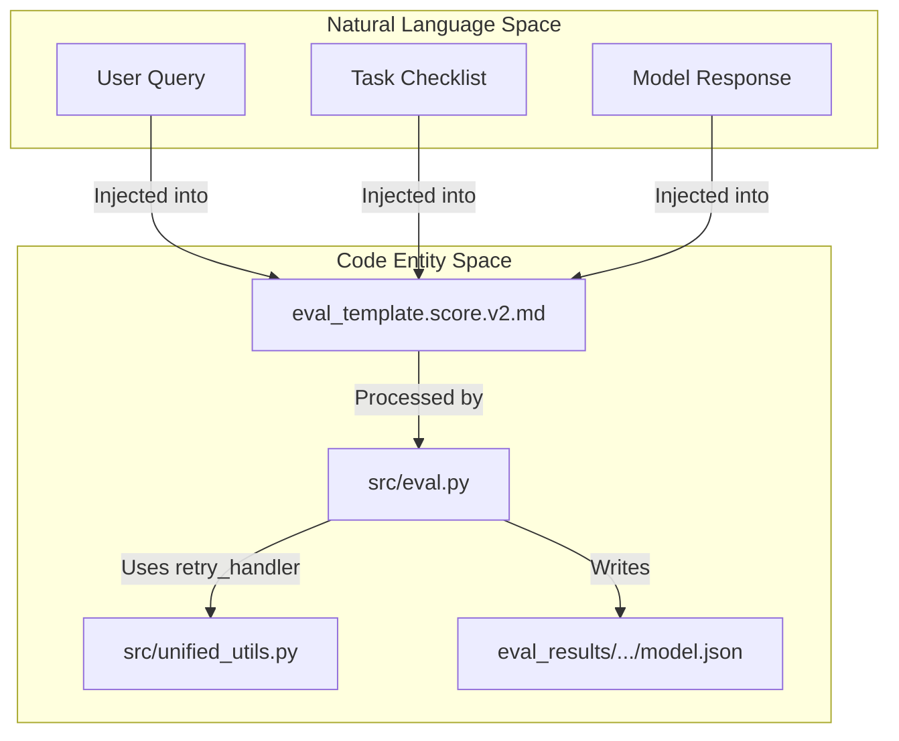
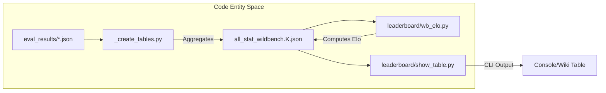

<!-- source: DeepWiki mcp.deepwiki.com · repo allenai/WildBench · page 8 Glossary · fetched 2026-10-26 -->

# Glossary

Relevant source files

The following files were used as context for generating this wiki page:

- [.gitignore](.gitignore)
- [LICENSE](LICENSE)
- [README.md](README.md)
- [eval_results/v2.0522/pairwise.v2/eval=gpt-4-turbo-2024-04-09/ref=Llama-2-70b-chat-hf/neo_7b_instruct_v0.1.json](eval_results/v2.0522/pairwise.v2/eval=gpt-4-turbo-2024-04-09/ref=Llama-2-70b-chat-hf/neo_7b_instruct_v0.1.json)
- [eval_results/v2.0522/pairwise.v2/eval=gpt-4-turbo-2024-04-09/ref=claude-3-haiku-20240307/neo_7b_instruct_v0.1.json](eval_results/v2.0522/pairwise.v2/eval=gpt-4-turbo-2024-04-09/ref=claude-3-haiku-20240307/neo_7b_instruct_v0.1.json)
- [eval_results/v2.0522/pairwise.v2/eval=gpt-4-turbo-2024-04-09/ref=gpt-4-turbo-2024-04-09/neo_7b_instruct_v0.1.json](eval_results/v2.0522/pairwise.v2/eval=gpt-4-turbo-2024-04-09/ref=gpt-4-turbo-2024-04-09/neo_7b_instruct_v0.1.json)
- [eval_results/v2.0522/score.v2/eval=gpt-4o-2024-05-13/neo_7b_instruct_v0.1.json](eval_results/v2.0522/score.v2/eval=gpt-4o-2024-05-13/neo_7b_instruct_v0.1.json)
- [evaluation/run_all_eval_batch.sh](evaluation/run_all_eval_batch.sh)
- [evaluation/run_eval_v2_instant.score.sh](evaluation/run_eval_v2_instant.score.sh)
- [leaderboard/data_dir/all_stat_wildbench.-1.json](leaderboard/data_dir/all_stat_wildbench.-1.json)
- [leaderboard/data_dir/all_stat_wildbench.100.json](leaderboard/data_dir/all_stat_wildbench.100.json)
- [leaderboard/data_dir/all_stat_wildbench.1000.json](leaderboard/data_dir/all_stat_wildbench.1000.json)
- [leaderboard/data_dir/all_stat_wildbench.1500.json](leaderboard/data_dir/all_stat_wildbench.1500.json)
- [leaderboard/data_dir/all_stat_wildbench.2000.json](leaderboard/data_dir/all_stat_wildbench.2000.json)
- [leaderboard/data_dir/all_stat_wildbench.300.json](leaderboard/data_dir/all_stat_wildbench.300.json)
- [leaderboard/data_dir/all_stat_wildbench.3000.json](leaderboard/data_dir/all_stat_wildbench.3000.json)
- [leaderboard/data_dir/all_stat_wildbench.500.json](leaderboard/data_dir/all_stat_wildbench.500.json)
- [leaderboard/data_dir/score.json](leaderboard/data_dir/score.json)
- [leaderboard/data_dir/wb_elo_results.json](leaderboard/data_dir/wb_elo_results.json)
- [leaderboard/show_eval.sh](leaderboard/show_eval.sh)
- [requirements.txt](requirements.txt)
- [scripts/Yi-1.5-9B-Chat.sh](scripts/Yi-1.5-9B-Chat.sh)
- [scripts/_common_hf.sh](scripts/_common_hf.sh)
- [scripts/_common_vllm.sh](scripts/_common_vllm.sh)
- [scripts/mistral-large-2402.sh](scripts/mistral-large-2402.sh)
- [src/eval.py](src/eval.py)
- [src/fastchat_conversation.py](src/fastchat_conversation.py)
- [src/global_configs.py](src/global_configs.py)
- [src/unified_infer.py](src/unified_infer.py)
- [src/unified_utils.py](src/unified_utils.py)
- [src/upload_results.py](src/upload_results.py)

This page provides definitions for the core terminology, domain concepts, and metrics used within the WildBench codebase. It maps high-level concepts to their technical implementations and data structures.

## Core Evaluation Concepts

### WB-Score
The primary individual performance metric. Models are scored on a scale of 1-10 by an LLM judge (typically GPT-4o). The raw score $Y$ is rescaled using the formula $(Y-5) \times 2$ to center the baseline at 0, where 5 represents a borderline acceptable response.
*   **Implementation**: Computed in `_create_tables.py` and stored in `score.json`.
*   **Source**: [README.md:158-159](), [leaderboard/data_dir/score.json:5-7]()

### WB-Reward
A pairwise comparison metric where a judge evaluates Model A against a Reference Model B.
*   **Scoring Rubric**: Much Better (100), Slightly Better (50), Tie (0), Slightly Worse (-50), Much Worse (-100).
*   **Implementation**: Parsed in `src/eval.py` using the `pairwise.v2` template.
*   **Source**: [README.md:160-168](), [src/eval.py:1-50]()

### WB-Elo
A rating derived from WB-Score data by simulating virtual pairwise battles. It uses a bootstrap simulation (default 128 rounds) to estimate model strength with confidence intervals.
*   **Implementation**: `leaderboard/wb_elo.py` calculates these values based on the `get_all_votes` logic.
*   **Data File**: `leaderboard/data_dir/wb_elo_results.json`.
*   **Source**: [leaderboard/data_dir/wb_elo_results.json:1-12](), [leaderboard/data_dir/all_stat_wildbench.300.json:48]()

### Length Penalty (K)
A parameter used to mitigate "verbosity bias" in LLM-as-a-judge evaluations. $K$ represents a character length threshold; if a model response exceeds the reference by more than $K$, it may be penalized in reward calculations.
*   **Values**: Common values include 100, 300, 500, 1000, 1500, 2000, 3000, and -1 (no penalty).
*   **Source**: [leaderboard/data_dir/all_stat_wildbench.300.json:1-10](), [leaderboard/data_dir/all_stat_wildbench.1500.json:1-10]()

---

## Technical Entities and Data Flow

### Natural Language Space to Code Entity Space

The following diagrams illustrate how abstract evaluation concepts are instantiated as specific code objects and files.

**Evaluation Execution Flow**

**Sources**: [src/eval.py:1-100](), [src/unified_utils.py:38-54]()

**Leaderboard Aggregation Flow**

**Sources**: [leaderboard/show_eval.sh:1-20](), [leaderboard/data_dir/all_stat_wildbench.300.json:1-50]()

---

## Terminology Reference Table

| Term | Definition | Code Pointer |
| :--- | :--- | :--- |
| **Pretty Name** | A sanitized, human-readable identifier for a model used in file paths and tables. | `args.model_pretty_name` in [src/unified_infer.py]() |
| **Engine** | The backend used for inference (e.g., `vllm`, `hf`, `openai`, `anthropic`). | `args.engine` in [src/unified_utils.py:38-42]() |
| **Checklist** | 5-10 task-specific questions generated to guide the judge. | `item["checklist"]` in [src/eval.py]() |
| **Session ID** | Unique identifier for a specific conversation/example in WildBench. | `item["session_id"]` in [src/unified_utils.py:100]() |
| **Task Macro** | An average metric calculated by first averaging within task categories, then across categories. | `WB_score.task_macro` in [leaderboard/data_dir/score.json:6]() |
| **Sharding** | Splitting the dataset into chunks for parallel inference/evaluation. | `n_shards` in [scripts/_common_vllm.sh:85-88]() |
| **Retry Handler** | A decorator using `tenacity` to handle API rate limits and failures. | `retry_handler` in [src/unified_utils.py:16-20]() |
| **Conversation Template** | Logic to format raw text into model-specific chat headers (e.g., `[INST]`). | `map_to_conv` in [src/fastchat_conversation.py]() |

---

## Data Schemas

### Result File Schema (`eval_results/`)
Individual evaluation files contain the judge's reasoning and the final metric.
*   **session_id**: Links back to the original dataset.
*   **parsed_result**: A dictionary containing `score` (for score mode) or `choice` and `extent` (for pairwise mode).
*   **model_output**: The raw text generated by the model under test.
*   **Source**: [eval_results/v2.0522/score.v2/eval=gpt-4o-2024-05-13/neo_7b_instruct_v0.1.json:1-10]()

### All-Stat Schema (`leaderboard/data_dir/`)
The consolidated metrics used to render the leaderboard.
*   **mixture_of_rewards**: A weighted combination of rewards from multiple judges (e.g., GPT-4T, Llama-3, Haiku).
*   **Rank_Avg**: The average rank of a model across multiple metrics.
*   **RewardScore_Avg**: A hybrid metric combining WB-Score and WB-Reward.
*   **Source**: [leaderboard/data_dir/all_stat_wildbench.300.json:44-47]()

**Sources**:
- [README.md:150-170]()
- [src/unified_utils.py:38-121]()
- [leaderboard/data_dir/score.json:1-15]()
- [leaderboard/data_dir/wb_elo_results.json:1-22]()