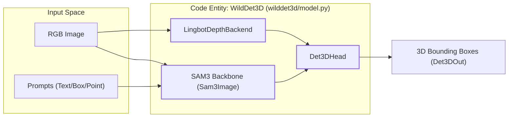
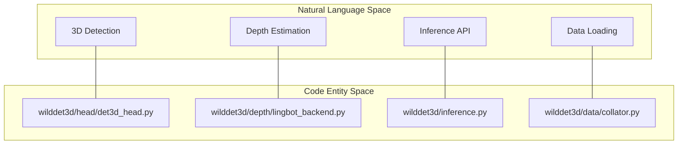

<!-- source: DeepWiki mcp.deepwiki.com · repo allenai/WildDet3D · page 1 WildDet3D Overview · fetched 2026-10-26 -->

# WildDet3D Overview

Relevant source files

The following files were used as context for generating this wiki page:

- [.gitignore](.gitignore)
- [.gitmodules](.gitmodules)
- [README.md](README.md)
- [assets/model_architecture.png](assets/model_architecture.png)
- [assets/teaser.png](assets/teaser.png)
- [assets/wilddet3d_banner.svg](assets/wilddet3d_banner.svg)
- [assets/wilddet3d_logo.svg](assets/wilddet3d_logo.svg)

WildDet3D is a promptable 3D object detection system designed to operate "in the wild." It extends the capabilities of 2D promptable models like SAM to the 3D domain, allowing users to detect and localize objects in 3D space using various input prompts such as text descriptions, 2D bounding boxes, or points.

The system is built on a unified architecture that combines high-resolution vision backbones, geometric depth estimation, and a specialized 3D detection head to produce accurate 3D bounding boxes (position, dimensions, and orientation) from monocular RGB images.

## Key Capabilities

WildDet3D supports a flexible detection paradigm through five distinct prompting modes:
*   **Text:** Detect objects based on natural language descriptions (e.g., "a wooden chair").
*   **Visual (Point/Box):** Detect objects by providing a 2D location or region.
*   **Visual + Label:** Refine visual selections with semantic category information.
*   **Geometric:** Use 3D spatial hints to guide detection.
*   **Geometric + Label:** Combine spatial hints with semantic labels.

For a detailed breakdown of these modes and core terminology, see [Key Concepts & Prompting Modes](#1.2).

## Architecture Summary

The WildDet3D architecture consists of three primary pillars that work in parallel to process visual and geometric information:

1.  **SAM3 Backbone:** A high-resolution ViT backbone (based on SAM3) that handles 2D feature extraction and prompt processing [wilddet3d/model.py:22-30]().
2.  **LingBot-Depth Backend:** A geometry-aware branch that provides depth latents and intrinsic predictions using a DINOv2-based encoder [wilddet3d/depth/lingbot_backend.py:18-35]().
3.  **3D Detection Head:** A transformer-based head that fuses 2D features with depth information to regress 3D parameters [wilddet3d/head/det3d_head.py:15-40]().

### System Architecture Flow
Title: WildDet3D High-Level Data Flow

Sources: [wilddet3d/model.py:85-115](), [wilddet3d/data_types.py:10-45]()

## Repository Organization

The repository is structured to separate core model logic, training infrastructure (using the `vis4d` framework), and various deployment demos.

| Directory | Purpose |
| :--- | :--- |
| `wilddet3d/` | Core library: model definitions, 3D heads, and geometry operations. |
| `configs/` | Configuration files for training and evaluation experiments. |
| `demo/` | Integration examples (iPhone, Meta Quest, VLM, Tracking). |
| `third_party/` | Submodules for SAM3 and LingBot-Depth backends. |
| `ckpt/` | Local storage for model weights (ignored by git). |

### Component Mapping
Title: Component to Code Mapping

Sources: [wilddet3d/head/det3d_head.py:10-20](), [wilddet3d/depth/lingbot_backend.py:5-15](), [wilddet3d/inference.py:20-50](), [wilddet3d/data/collator.py:10-30]()

## Getting Started

To begin using WildDet3D, you must set up the environment, initialize submodules, and download the necessary checkpoints. The system relies on `vis4d` for its training and evaluation pipeline.

*   **Installation:** Requires cloning submodules in `third_party/` and installing dependencies from `requirements.txt`.
*   **Checkpoints:** Pretrained weights are hosted on HuggingFace and should be placed in the `ckpt/` directory.

For step-by-step instructions, see [Getting Started: Installation & Setup](#1.1).

## Training and Evaluation

WildDet3D uses a complex loss formulation involving 2D detection losses, 3D box regression, and depth consistency losses. Evaluation is performed on benchmarks like **WildDet3D-Bench** and **Omni3D** using COCO-style 3D metrics.

*   **Training:** Managed via `vis4d` experiments [configs/base/train.py]().
*   **Evaluation:** Supports various modes (with or without depth, different prompt types) [wilddet3d/eval/detect3d.py]().

For details on the training pipeline, see [Training Pipeline](#3). For evaluation metrics, see [Evaluation](#4).

---

