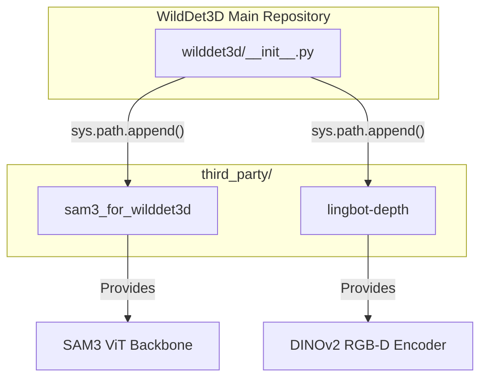
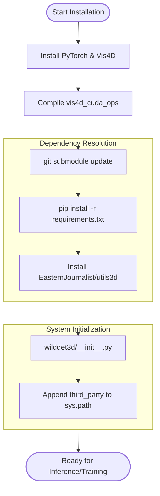

<!-- source: DeepWiki mcp.deepwiki.com · repo allenai/WildDet3D · page 1.1 Getting Started: Installation & Setup · fetched 2026-10-26 -->

# Getting Started: Installation & Setup

<details>
<summary>Relevant source files</summary>

The following files were used as context for generating this wiki page:

- [.gitmodules](.gitmodules)
- [LICENSE](LICENSE)
- [requirements.txt](requirements.txt)

</details>


This guide provides step-by-step instructions for setting up the WildDet3D environment. WildDet3D is built upon the `vis4d` framework and integrates two major third-party submodules: SAM3 for 2D perception and LingBot-Depth for geometric understanding.

## Prerequisites and Core Dependencies

The installation process requires a specific sequence to ensure that CUDA-accelerated operations and framework dependencies are correctly compiled.

### 1. Primary Environment Setup
WildDet3D requires Python 3.10+, PyTorch 2.5.1, and the `vis4d` ecosystem.

```bash
# Install PyTorch and TorchVision with CUDA 12.1 support
pip install torch==2.5.1 torchvision==0.20.1 --index-url https://download.pytorch.org/whl/cu121

# Install the Vis4D framework
pip install vis4d==1.0.0

# Install Vis4D CUDA operations (requires NVCC for compilation)
pip install git+https://github.com/SysCV/vis4d_cuda_ops.git --no-build-isolation --no-cache-dir
```
*Sources: [requirements.txt:1-6]()*

### 2. Secondary Dependencies
After the core framework is installed, install the remaining packages listed in `requirements.txt`. Note that `utils3d` must be installed directly from the source repository to access the `utils3d.pt` and `utils3d.np` namespaces used in the codebase.

```bash
pip install -r requirements.txt
```
*Sources: [requirements.txt:8-48]()*

| Dependency | Purpose |
| :--- | :--- |
| `utils3d` | 3D geometry utilities and point cloud operations [requirements.txt:21]() |
| `setuptools<80` | Compatibility for `pkg_resources` used in SAM3 [requirements.txt:30]() |
| `ml_collections` | Configuration management for evaluation and training [requirements.txt:43]() |
| `pyarrow` | Handling parquet-backed datasets like Waymo v2 [requirements.txt:47]() |

## Repository Setup & Submodules

WildDet3D relies on two external repositories managed as Git submodules. These are located in the `third_party/` directory and are injected into the Python path at runtime.

### Cloning Submodules
To initialize the submodules after cloning the main repository:

```bash
git submodule update --init --recursive
```
*Sources: [.gitmodules:1-7]()*

### Submodule Architecture
The following diagram illustrates how the submodules interface with the main WildDet3D system.

**Submodule Integration Map**

*Sources: [.gitmodules:1-7]()*

## Model Checkpoints

WildDet3D follows a strict directory convention for model weights. Checkpoints should be placed in a `ckpt/` directory at the root of the repository.

### Directory Structure
```text
WildDet3D/
├── ckpt/
│   ├── wilddet3d_final.pth       # Main WildDet3D weights
│   ├── sam3_checkpoint.pth       # SAM3 pretrained backbone
│   └── lingbot_depth.pth         # LingBot-Depth pretrained weights
├── data/
├── third_party/
└── wilddet3d/
```

### Checkpoint Loading
The system uses `skip_pretrained` and `sam3_checkpoint` parameters in the model builder to manage which components are loaded from the unified WildDet3D checkpoint versus standalone third-party weights.

## Licensing

WildDet3D is distributed under the **SAM License** (updated November 19, 2025). 

### Key Terms
*   **Grant of Rights**: Non-exclusive, worldwide, royalty-free license to use, reproduce, and create derivative works [LICENSE:30-31]().
*   **Redistribution**: Any distribution of SAM Materials or derivatives must include a copy of the Agreement [LICENSE:33-34]().
*   **Attribution**: Research publications using these materials must acknowledge their use [LICENSE:36-38]().
*   **Restrictions**: Use is prohibited for military, warfare, nuclear industries, or illegal weapons development [LICENSE:41]().

*Sources: [LICENSE:1-62]()*

## Installation Flowchart

The following diagram maps the installation steps to the code entities and files involved.

**Installation Logic Flow**

*Sources: [requirements.txt:1-21](), [.gitmodules:1-7]()*

---

