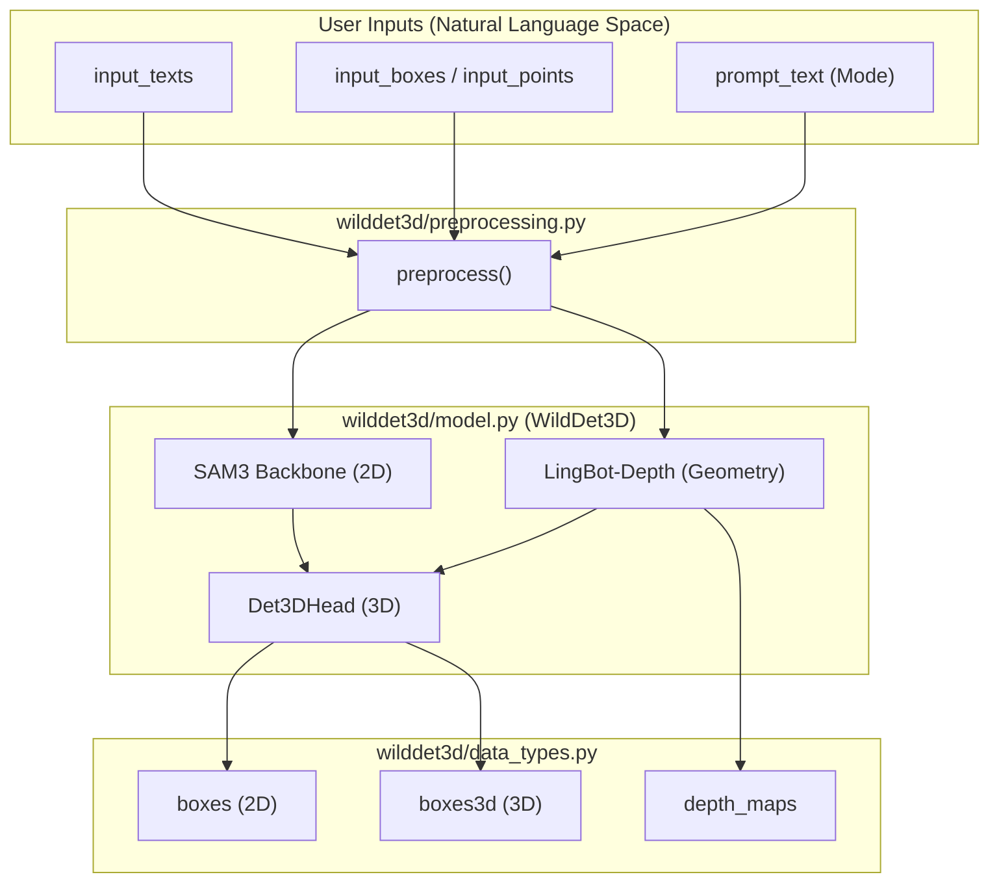
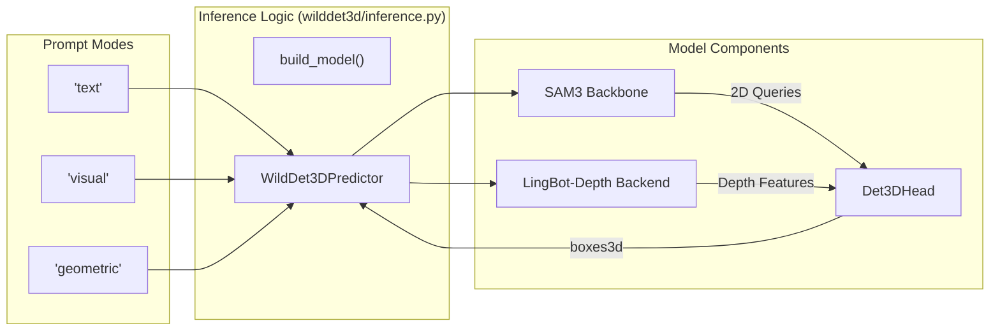

<!-- source: DeepWiki mcp.deepwiki.com · repo allenai/WildDet3D · page 1.2 Key Concepts & Prompting Modes · fetched 2026-10-26 -->

# Key Concepts & Prompting Modes

Relevant source files

The following files were used as context for generating this wiki page:

- [README.md](README.md)
- [assets/qualitative_box_prompt.jpg](assets/qualitative_box_prompt.jpg)
- [assets/qualitative_text_prompt.jpg](assets/qualitative_text_prompt.jpg)
- [docs/INFERENCE.md](docs/INFERENCE.md)

This page explains the fundamental detection paradigm of WildDet3D, its five distinct prompting modes, and the core terminology used throughout the codebase. WildDet3D transitions 3D object detection from a fixed-vocabulary task to a flexible, "in-the-wild" promptable task.

## The In-the-Wild Detection Paradigm

WildDet3D is designed to perform 3D detection on arbitrary images without requiring ground truth camera intrinsics or a predefined set of object categories [docs/INFERENCE.md:47-48](). It achieves this by combining a foundation 2D detector (SAM3) with a metric depth estimation backend (LingBot-Depth) and a specialized 3D detection head [README.md:153-155]().

### Core Terminology
*   **Prompt**: An input that specifies *what* to detect. This can be text, a 2D bounding box, or a point [docs/INFERENCE.md:7-15]().
*   **Geometric Lifting**: The process of taking a 2D prompt (box/point) and estimating the 3D properties (depth, dimensions, orientation) of the underlying object [docs/INFERENCE.md:12-13]().
*   **One-to-Many (O2M)**: A mode where one prompt (like "car") results in multiple detections [docs/INFERENCE.md:9-11]().
*   **One-to-One (O1O)**: A mode where one prompt (like a specific box) results in exactly one 3D detection [docs/INFERENCE.md:12-13]().
*   **Predicted Intrinsics**: The model's ability to estimate camera focal length and principal point when they are not provided [docs/INFERENCE.md:160-164]().

## Prompting Modes

WildDet3D supports five primary prompting modes, defined by the combination of `input_texts`, `input_boxes`/`input_points`, and the `prompt_text` string passed to the predictor [docs/INFERENCE.md:7-13]().

### 1. Text Prompt (Open-Vocabulary)
The model detects all instances of categories provided in a list of strings.
*   **Input**: `input_texts=["category1", "category2"]`
*   **Behavior**: One-to-many matching.
*   **Code Implementation**: Handled by the SAM3 backbone which generates queries based on text embeddings [docs/INFERENCE.md:61-75]().

### 2. Visual Prompt
Uses a 2D box or point as a visual example to find all similar objects in the image.
*   **Input**: `input_boxes` + `prompt_text="visual"`
*   **Behavior**: One-to-many matching based on visual similarity [docs/INFERENCE.md:77-92]().

### 3. Visual + Label Prompt
Refines the visual prompt search by adding a category constraint.
*   **Input**: `input_boxes` + `prompt_text="visual: category"`
*   **Behavior**: One-to-many matching, filtered by the semantic label [docs/INFERENCE.md:94-104]().

### 4. Geometric Prompt
Directly lifts a specific 2D user-provided prompt to a 3D bounding box.
*   **Input**: `input_boxes` + `prompt_text="geometric"`
*   **Behavior**: One-to-one matching. The model focuses exclusively on the object at the prompt location [docs/INFERENCE.md:106-116]().

### 5. Geometric + Label Prompt
Lifts a 2D prompt to 3D while explicitly assigning it a semantic category.
*   **Input**: `input_boxes` + `prompt_text="geometric: category"`
*   **Behavior**: One-to-one matching with a label override [docs/INFERENCE.md:118-126]().

---

## Data Flow: From Prompt to 3D Box

The following diagram illustrates how different prompt types are processed through the system components to produce the final `boxes3d` output.

**System Data Flow and Component Mapping**

Sources: `[docs/INFERENCE.md:20-34]()`, `[docs/INFERENCE.md:142-152]()`, `[README.md:153-155]()`

---

## Technical Implementation Details

### Prompt Encoding
Prompts are processed by the `WildDet3DPredictor` in `wilddet3d/inference.py`. Depending on the mode, prompts are converted into queries for the SAM3 transformer decoder.
*   **Text prompts** are encoded using a language backbone (e.g., CLIP or similar) to create semantic queries [docs/INFERENCE.md:61-75]().
*   **Visual/Geometric prompts** are encoded via a geometry encoder within SAM3 that translates pixel coordinates into positional embeddings [README.md:153-155]().

### 3D Lifting Mechanism
The `Det3DHead` receives 2D object queries and fuses them with `depth_latents` provided by the `LingBot-Depth` backend.
1.  **Depth Map Generation**: The backend produces a metric depth map used for point cloud reasoning [docs/INFERENCE.md:152]().
2.  **3D Parameter Prediction**: The head regresses 10 parameters for each box: `(center_x, center_y, center_z, width, height, length, rotation_6d)` [docs/INFERENCE.md:147]().

**Code Entity Association: Prompting to Code Modules**

Sources: `[docs/INFERENCE.md:5-13]()`, `[docs/INFERENCE.md:25-29]()`, `[docs/INFERENCE.md:140-152]()`

### Output Structure
The model returns a standardized set of tensors for every inference call, regardless of the prompt mode [docs/INFERENCE.md:140-152]():

| Attribute | Type | Description |
| :--- | :--- | :--- |
| `boxes` | `Tensor[N, 4]` | 2D xyxy boxes in original image coordinates. |
| `boxes3d` | `Tensor[N, 10]` | 3D boxes: center (3), dims (3), rotation (4 via 6D). |
| `scores` | `Tensor[N]` | Final confidence (fused 2D and 3D scores). |
| `depth_maps` | `Tensor[1, H, W]` | Metric depth map in meters. |

Sources: `[docs/INFERENCE.md:140-152]()`

---

