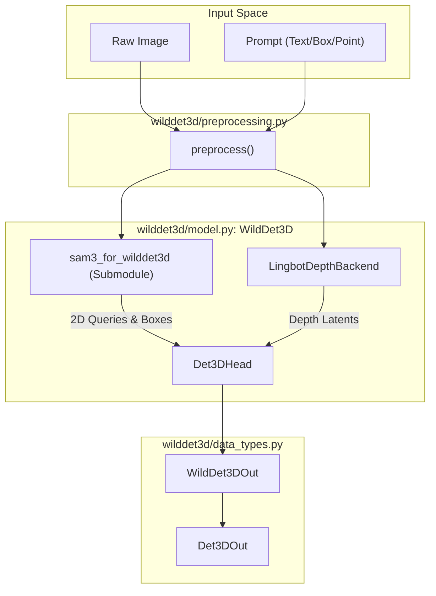
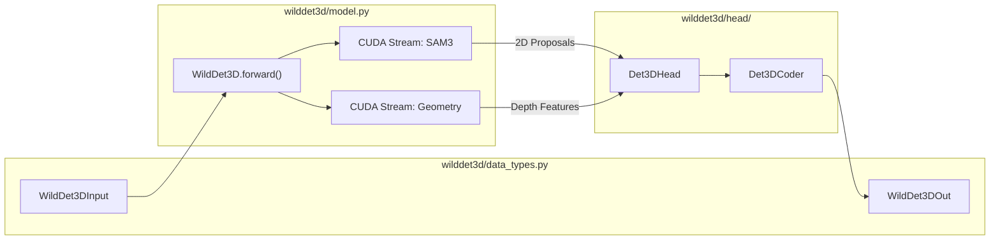

<!-- source: DeepWiki mcp.deepwiki.com · repo allenai/WildDet3D · page 2 Core Model Architecture · fetched 2026-10-26 -->

# Core Model Architecture

Relevant source files

The following files were used as context for generating this wiki page:

- [README.md](README.md)
- [assets/model_architecture.png](assets/model_architecture.png)
- [wilddet3d/__init__.py](wilddet3d/__init__.py)

WildDet3D is a unified framework for promptable 3D object detection. It integrates a 2D open-vocabulary backbone (SAM3), a robust geometry backend (LingBot-Depth), and a specialized 3D detection head. The architecture is designed to handle multiple prompt modalities (text, boxes, points) and generalize to "in-the-wild" scenarios where camera intrinsics may be unknown.

### System Overview

The pipeline follows a sequential-parallel execution flow. Images and prompts are first processed by the SAM3 backbone to identify 2D regions of interest, while the geometry backend simultaneously extracts depth features. These streams are then fused in the 3D head to produce oriented 3D bounding boxes.

#### Unified Pipeline Diagram
This diagram illustrates how high-level system components map to specific code entities and how data flows between them.

**Sources:** [wilddet3d/model.py:1-18](), [wilddet3d/preprocessing.py:1-20](), [wilddet3d/__init__.py:1-29]()

---

### Component Breakdown

#### 1. WildDet3D Model & Forward Pass
The `WildDet3D` class is the central `nn.Module` that orchestrates the entire pipeline. It manages the lifecycle of the backbone and depth modules, including specialized checkpoint loading and parallel execution using CUDA streams to minimize latency.
*   **Key File:** `wilddet3d/model.py`
*   **For details, see [WildDet3D Model & Forward Pass](#2.1)**

#### 2. SAM3 Backbone & 2D Detection
The model utilizes a modified Segment Anything Model 3 (SAM3) as its 2D foundation. It consists of a ViT backbone (`Sam3Image`) and a prompt encoder that handles five distinct query types (Text, Visual, Visual+Label, Geometric, Geometric+Label). It is responsible for generating the initial 2D object proposals.
*   **Key Submodule:** `third_party/sam3`
*   **For details, see [SAM3 Backbone & 2D Detection](#2.2)**

#### 3. Geometry Backend: LingBot-Depth
Geometry is handled by the `LingbotDepthBackend`, which utilizes a DINOv2-based RGB-D encoder. This module provides critical spatial context by predicting monocular depth and extracting `depth_latents`. It also features an `EarlyDepthFusionLingbot` module for ControlNet-style feature integration.
*   **Key File:** `wilddet3d/depth/lingbot_backend.py`
*   **For details, see [Geometry Backend: LingBot-Depth](#2.3)**

#### 4. 3D Detection Head & Box Coder
The `Det3DHead` performs the final lifting from 2D to 3D. It uses cross-attention to fuse SAM3 2D features with LingBot depth features. The `Det3DCoder` then decodes these features into 3D parameters, including 6D rotation encoding and canonical normalization.
*   **Key Directory:** `wilddet3d/head/`
*   **For details, see [3D Detection Head & Box Coder](#2.4)**

---

### Data Flow and Internal Interfaces

The architecture relies on strictly defined data structures to pass information between the 2D backbone and the 3D head. The following diagram shows the relationship between the internal classes and the processing logic.

#### Code Entity Interaction Diagram

**Sources:** [wilddet3d/model.py:40-100](), [wilddet3d/data_types.py:1-50](), [wilddet3d/head/det3d_head.py:1-30]()

### Core Processing Specifications

| Component | Responsibility | Primary Class/Function |
| :--- | :--- | :--- |
| **Preprocessing** | Resizing to 1008x1008, padding, and intrinsic adjustment. | `preprocess()` |
| **2D Backbone** | Open-vocabulary feature extraction and 2D box proposal. | `Sam3Image` |
| **Depth Engine** | Predicting metric depth and providing spatial latents. | `LingbotDepthBackend` |
| **3D Head** | Fusing 2D/Depth features and regressing 3D parameters. | `Det3DHead` |
| **Post-processing** | 3D NMS and coordinate rescaling. | `RoI2Det3D` |

**Sources:** [wilddet3d/preprocessing.py:10-50](), [wilddet3d/model.py:20-60](), [wilddet3d/inference.py:100-150]()

---
**Child Pages:**
*   [WildDet3D Model & Forward Pass](#2.1)
*   [SAM3 Backbone & 2D Detection](#2.2)
*   [Geometry Backend: LingBot-Depth](#2.3)
*   [3D Detection Head & Box Coder](#2.4)
*   [Data Types & Preprocessing](#2.5)

---

