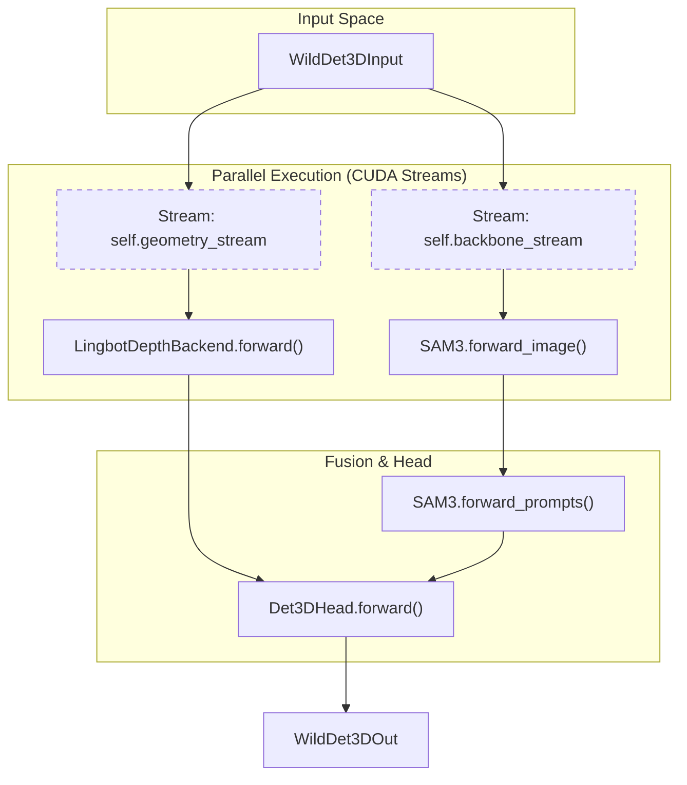
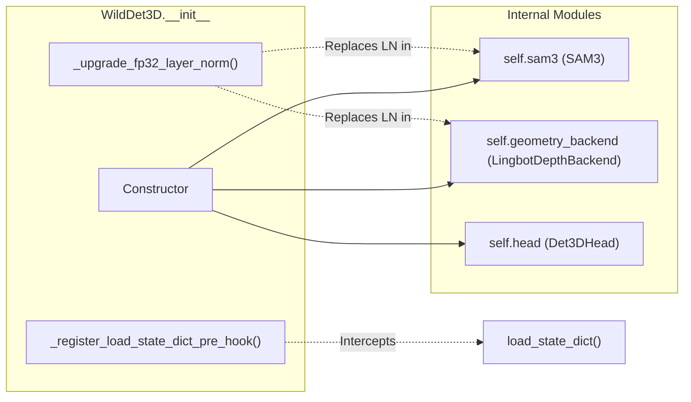

<!-- source: DeepWiki mcp.deepwiki.com · repo allenai/WildDet3D · page 2.1 WildDet3D Model & Forward Pass · fetched 2026-10-26 -->

# WildDet3D Model & Forward Pass

Relevant source files

The following files were used as context for generating this wiki page:

- [wilddet3d/__init__.py](wilddet3d/__init__.py)
- [wilddet3d/connector.py](wilddet3d/connector.py)
- [wilddet3d/data/__init__.py](wilddet3d/data/__init__.py)

The `WildDet3D` class is the central `nn.Module` that orchestrates the execution of the open-vocabulary 3D detection pipeline. It integrates a 2D foundation model (SAM3), a geometry backend (LingBot-Depth), and a specialized 3D detection head. A key feature of this implementation is the use of asynchronous execution via CUDA streams to parallelize the heavy vision backbone and geometry encoding stages.

## WildDet3D Architecture Overview

The model is designed as a unified architecture that processes an RGB image alongside various prompt types (text, boxes, points, or masks) to output oriented 3D bounding boxes.

### Key Components
*   **SAM3 Backbone (`self.sam3`)**: A ViT-based image encoder and prompt-guided transformer decoder that generates 2D detections and instance features [wilddet3d/model.py:44-46]().
*   **Geometry Backend (`self.geometry_backend`)**: A DINOv2-based depth encoder (LingBot-Depth) that provides global geometry context and depth latents [wilddet3d/model.py:47-49]().
*   **3D Head (`self.head`)**: A module that fuses 2D instance features with geometry latents to predict 3D box parameters (center, dimensions, 6D rotation) [wilddet3d/model.py:50-52]().

### Data Flow Diagram: Natural Language to Code Entities
This diagram maps the high-level conceptual flow to the specific code structures defined in `wilddet3d/model.py`.

Sources: [wilddet3d/model.py:101-155](), [wilddet3d/data_types.py:43-78]()

---

## The Forward Pass Implementation

The `forward()` method in `wilddet3d/model.py` implements a multi-stream execution pattern to maximize GPU utilization.

### Parallel Backbone Execution
The model initializes two dedicated CUDA streams: `self.backbone_stream` and `self.geometry_stream` [wilddet3d/model.py:54-55](). 

1.  **Backbone Stream**: Executes `self.sam3.forward_image()` to extract ViT features from the input image [wilddet3d/model.py:110-112]().
2.  **Geometry Stream**: Simultaneously executes `self.geometry_backend()` to predict depth and extract geometry latents [wilddet3d/model.py:114-116]().
3.  **Synchronization**: The main stream waits for both asynchronous tasks to complete using `torch.cuda.current_stream().wait_stream()` before proceeding to the prompt decoding stage [wilddet3d/model.py:118-119]().

### Prompt Decoding and 3D Projection
Once the image features and geometry latents are ready:
1.  **2D Decoding**: `self.sam3.forward_prompts()` processes the input prompts (e.g., text embeddings or box coordinates) against the image features to produce 2D instance queries [wilddet3d/model.py:121-133]().
2.  **3D Head Execution**: The `self.head` takes the instance features from SAM3 and the geometry latents from LingBot to compute the final 3D bounding boxes [wilddet3d/model.py:135-151]().

Sources: [wilddet3d/model.py:101-155]()

---

## Checkpoint Loading & FP32 LayerNorm Upgrade

WildDet3D employs a custom hook system to handle the transition from pretrained weights to the specific architectural requirements of 3D detection.

### The `_upgrade_fp32_layer_norm` Pattern
To ensure numerical stability during training and inference, especially when using mixed precision, the model provides a utility to upgrade standard `LayerNorm` layers to a specialized `Fp32LayerNorm` [wilddet3d/model.py:189-211](). This is applied recursively to the SAM3 and Geometry components during initialization if configured [wilddet3d/model.py:72-76]().

### State Dict Hooks
The model uses a `_register_load_state_dict_pre_hook` to manage checkpoint compatibility [wilddet3d/model.py:78-100]().
*   **Prefix Handling**: It automatically strips or adds prefixes (like `model.`) to match the expected keys in the state dict [wilddet3d/model.py:86-90]().
*   **Shape Mismatch**: It handles potential shape mismatches in positional embeddings if the input resolution differs from the pretrained checkpoint [wilddet3d/model.py:92-95]().

### Code Entity Mapping: Model Initialization
This diagram illustrates how the `WildDet3D` constructor sets up its internal state and hooks.

Sources: [wilddet3d/model.py:38-100](), [wilddet3d/model.py:189-211]()

---

## Input and Output Structures

The model relies on structured dataclasses defined in `wilddet3d/data_types.py` to pass data between components.

| Class | Purpose | Key Fields |
| :--- | :--- | :--- |
| `WildDet3DInput` | Encapsulates all data for a forward pass. | `image`, `intrinsics`, `text_queries`, `prompt_boxes`, `prompt_masks` |
| `WildDet3DOut` | The primary output of the `WildDet3D` module. | `det3d` (list of `Det3DOut`), `depth_outputs` |
| `Det3DOut` | Per-instance 3D detection results. | `boxes_3d`, `scores_3d`, `labels`, `features_2d` |

Sources: [wilddet3d/data_types.py:11-78]()

---

