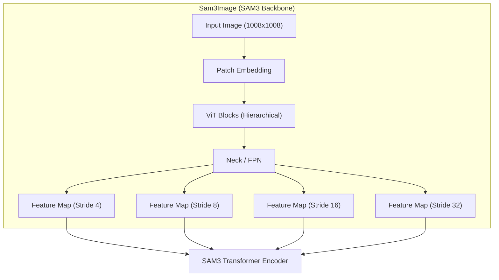
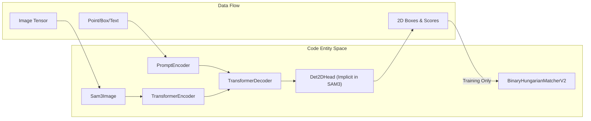

<!-- source: DeepWiki mcp.deepwiki.com · repo allenai/WildDet3D · page 2.2 SAM3 Backbone & 2D Detection · fetched 2026-10-26 -->

# SAM3 Backbone & 2D Detection

Relevant source files

The following files were used as context for generating this wiki page:

- [.gitmodules](.gitmodules)
- [README.md](README.md)

This page details the 2D perception core of WildDet3D, which leverages the SAM3 (Segment Anything Model 2) architecture as its primary image backbone and prompt processing engine. The system integrates a ViT-based image encoder with a geometry encoder for prompt embeddings, a transformer-based encoder/decoder for feature refinement, and a 2D detection head that produces bounding boxes used as the foundation for 3D lifting.

## SAM3 Image Backbone (Sam3Image)

The image backbone, implemented in `Sam3Image`, is responsible for extracting multi-scale visual features from the input image. It utilizes a Vision Transformer (ViT) architecture that has been optimized for high-resolution processing and hierarchical feature extraction.

### Architecture and Data Flow
The backbone processes an input image (typically $1008 \times 1008$ pixels) and produces four feature maps at different strides ($1/4, 1/8, 1/16, 1/32$).

1.  **Patch Embedding**: The image is divided into patches and projected into a latent space.
2.  **ViT Blocks**: A series of transformer blocks process the patches. WildDet3D allows for freezing specific blocks during training via the `backbone_freeze_blocks` configuration parameter [configs/base/base_optim.py:22-22]().
3.  **Neck/FPN**: The ViT features are passed through a neck that generates the multi-scale feature pyramid.

**SAM3 Backbone Feature Extraction**

**Sources:** [.gitmodules:1-4](), [README.md:153-155](), [configs/base/base_optim.py:22-22]()

## Geometry Encoder & Prompt Processing

WildDet3D is a promptable detector. The `PromptEncoder` (within the SAM3 framework) handles the transformation of sparse prompts (points, boxes, or masks) into dense and sparse embeddings that guide the detection process.

### Prompt Types and Encodings
The model supports five distinct query types derived from these prompts:
1.  **Text**: Encoded via a language model (e.g., CLIP) and integrated into the query stream.
2.  **Visual (Point/Box)**: Geometric prompts are mapped to the image feature space using positional encodings.
3.  **Visual + Label**: Combines geometric prompts with semantic category information.
4.  **Geometric**: Pure coordinate-based prompts.
5.  **Geometric + Label**: Coordinate prompts combined with semantic labels.

The geometry encoder produces:
*   **Sparse Embeddings**: Representing individual points or box corners.
*   **Dense Embeddings**: Mask-like feature maps that are fused with the image features.

**Sources:** [README.md:77-79](), [wilddet3d/data_types.py:1-20]() (implied by input structures).

## Transformer Encoder & Decoder

The features from the SAM3 backbone and the embeddings from the prompt encoder are fused in the SAM3 Transformer.

### Encoder
The transformer encoder performs self-attention across the multi-scale image features. This stage enhances the global context of the visual features before they are queried by the detection head.

### Decoder
The transformer decoder is where detection queries interact with the visual features.
*   **Queries**: The decoder uses a set of learnable object queries, which are modulated by the prompt embeddings.
*   **Cross-Attention**: Queries attend to the encoder's output features to localize objects.
*   **LayerNorm Upgrade**: During model initialization, WildDet3D applies a `Fp32LayerNorm` upgrade to ensure numerical stability in the transformer layers [wilddet3d/model.py:45-55]().

**Sources:** [wilddet3d/model.py:45-55]()

## 2D Detection Head & Matching

The 2D detection head is responsible for predicting the bounding boxes, class scores, and objectness for each query.

### BinaryHungarianMatcherV2
To supervise the 2D detection, WildDet3D uses `BinaryHungarianMatcherV2`. This matcher performs a bipartite matching between the predicted queries and the ground truth objects based on a cost function that includes:
1.  **Classification Cost**: Focal loss or cross-entropy between predicted and GT labels.
2.  **Box L1 Cost**: The absolute distance between predicted and GT box coordinates.
3.  **GIoU Cost**: Generalized Intersection over Union to handle scale variations.

### Output Production
The head produces:
*   **2D Bounding Boxes**: Represented as `(cx, cy, w, h)` normalized coordinates.
*   **Class Scores**: Confidence scores for the requested categories.
*   **Query Embeddings**: These high-dimensional vectors are passed forward to the **3D Head** (see Section 2.4) to lift the 2D detection into 3D space.

**Entity Mapping: 2D Detection Pipeline**

**Sources:** [wilddet3d/ops/matchers/match_cost.py:1-10](), [wilddet3d/loss/loss.py:10-30]() (referenced for 2D loss components).

## Integration with WildDet3D

In the `WildDet3D` model class, the SAM3 backbone and 2D components are initialized using specific checkpoint loading hooks to ensure that pretrained weights are correctly mapped to the internal structure [wilddet3d/model.py:45-55](). The 2D detection results serve as the "proposals" that the 3D head subsequently refines using depth information from the geometry backend.

**Sources:** [wilddet3d/model.py:45-55](), [wilddet3d/inference.py:20-40]() (referenced for build_model logic).

---

