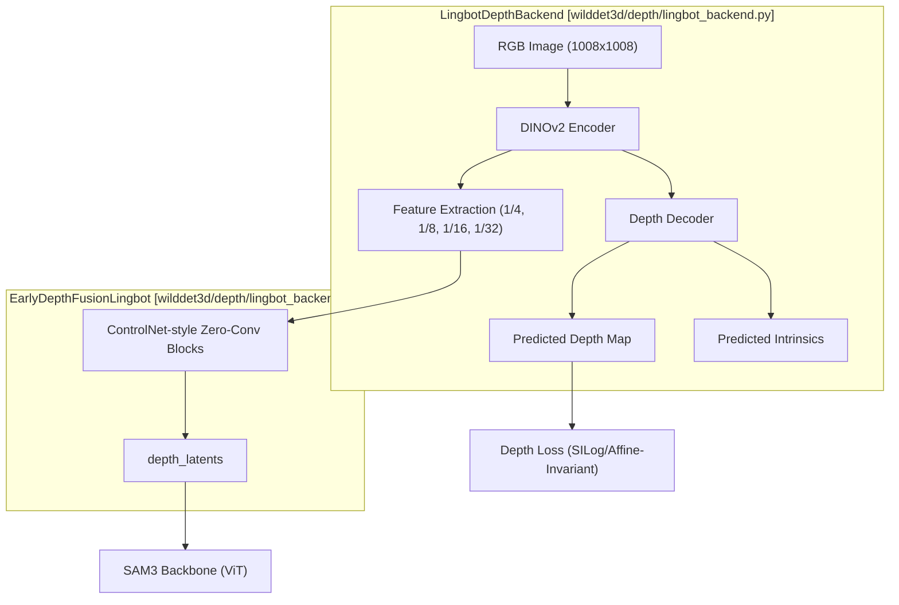
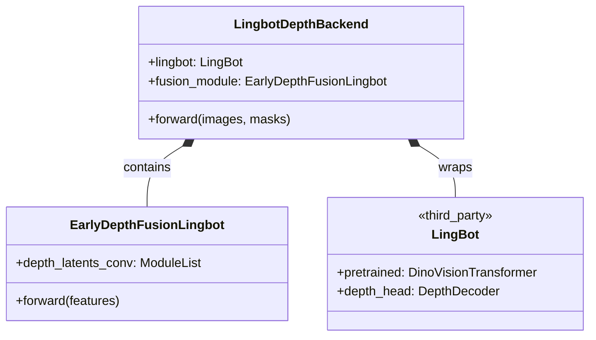

<!-- source: DeepWiki mcp.deepwiki.com · repo allenai/WildDet3D · page 2.3 Geometry Backend: LingBot-Depth · fetched 2026-10-26 -->

# Geometry Backend: LingBot-Depth

Relevant source files

The following files were used as context for generating this wiki page:

- [.gitmodules](.gitmodules)

The `LingbotDepthBackend` serves as the geometric foundation of the WildDet3D architecture. It provides monocular depth estimation, intrinsic parameter prediction, and high-dimensional depth latents that are fused into the primary detection backbone. By leveraging a DINOv2-based encoder-decoder structure, it enables the model to understand the 3D spatial layout of a scene from a single RGB image.

## Overview and Integration

The geometry backend is encapsulated in the `LingbotDepthBackend` class [wilddet3d/depth/lingbot_backend.py:32-42](). It integrates the `LingBot` model from the `third_party/lingbot_depth` submodule [wilddet3d/depth/lingbot_backend.py:53-61]().

The backend performs three primary roles:
1.  **Depth Estimation**: Predicting metric or relative depth maps from RGB input.
2.  **Intrinsic Prediction**: Estimating camera focal lengths and principal points when they are not provided in the input.
3.  **Feature Fusion**: Extracting `depth_latents` via a ControlNet-style "Early Fusion" module to condition the 2D backbone on geometric cues.

### Data Flow: RGB to Geometry
The following diagram illustrates how the `LingbotDepthBackend` processes input images and interacts with the `EarlyDepthFusionLingbot` module.

**LingBot-Depth Data Flow**

Sources: [wilddet3d/depth/lingbot_backend.py:155-212](), [wilddet3d/depth/lingbot_backend.py:228-268]()

## Depth Training Modes

The backend supports three distinct training modes defined in `LingbotDepthBackendConfig` [wilddet3d/depth/lingbot_backend.py:22-30]():

| Mode | Description | Logic in Code |
| :--- | :--- | :--- |
| `monocular` | Standard monocular depth estimation from RGB. | [wilddet3d/depth/lingbot_backend.py:180-184]() |
| `masked` | Depth estimation where parts of the image are masked (used for specific pre-training tasks). | [wilddet3d/depth/lingbot_backend.py:186-191]() |
| `copy_through` | Passes ground truth depth through (used during specific debugging or upper-bound testing). | [wilddet3d/depth/lingbot_backend.py:193-196]() |

## Early Depth Fusion (ControlNet-style)

The `EarlyDepthFusionLingbot` class [wilddet3d/depth/lingbot_backend.py:228-239]() implements a fusion mechanism inspired by ControlNet. Instead of simply concatenating depth maps to RGB, it processes the intermediate features of the DINOv2 encoder to create geometric residuals.

### Key Components
*   **Feature Alignment**: The module takes four scales of features from the DINOv2 backbone (strides 4, 8, 16, 32) [wilddet3d/depth/lingbot_backend.py:255-260]().
*   **Zero-Convolution**: Each feature scale is passed through a `Conv2d` layer initialized with zeros (or small weights) to ensure that, at the start of training, the geometry branch does not disrupt the pretrained RGB features [wilddet3d/depth/lingbot_backend.py:241-253]().
*   **Latent Extraction**: These features are returned as `depth_latents` and are added to the SAM3 ViT backbone features during the forward pass of the main `WildDet3D` model [wilddet3d/model.py:246-253]().

**Entity Mapping: Fusion Implementation**

Sources: [wilddet3d/depth/lingbot_backend.py:32-80](), [wilddet3d/depth/lingbot_backend.py:228-239]()

## Intrinsic Prediction

A critical feature for "in-the-wild" detection is the ability to estimate camera intrinsics when they are unknown. The `LingbotDepthBackend` can predict the focal length ($f_x, f_y$) and principal point ($c_x, c_y$).

*   **Logic**: If the configuration `predict_intrinsics` is enabled, the model uses a specialized head within the LingBot architecture to output a 4-dimensional vector [wilddet3d/depth/lingbot_backend.py:202-212]().
*   **Normalization**: Predicted intrinsics are typically normalized relative to the image dimensions (1008x1008) [wilddet3d/depth/lingbot_backend.py:207-210]().
*   **Usage**: These predicted values are used by the `Det3DHead` to project 3D boxes back into the 2D image plane during inference if ground truth intrinsics are missing [wilddet3d/model.py:280-285]().

## Implementation Details

### Initialization
The backend initializes the `LingBot` model by injecting the `third_party/lingbot_depth` path into the system path [wilddet3d/depth/lingbot_backend.py:53-56](). It loads the DINOv2 weights and sets up the fusion layers based on the `embed_dim` of the detection backbone (typically 1152 for ViT-H or 768 for ViT-L) [wilddet3d/depth/lingbot_backend.py:73-77]().

### Forward Pass
The `forward` method [wilddet3d/depth/lingbot_backend.py:155-161]() accepts a batch of images and returns a dictionary containing:
*   `depth_pred`: The estimated depth map [wilddet3d/depth/lingbot_backend.py:214]().
*   `depth_latents`: A list of feature maps for the SAM3 backbone [wilddet3d/depth/lingbot_backend.py:215]().
*   `intrinsics_pred`: (Optional) The predicted camera parameters [wilddet3d/depth/lingbot_backend.py:216]().

### Sources:
- Configuration and Class Definition: [wilddet3d/depth/lingbot_backend.py:10-42]()
- Model Setup and Submodule Loading: [wilddet3d/depth/lingbot_backend.py:53-110]()
- Forward Pass and Logic: [wilddet3d/depth/lingbot_backend.py:155-218]()
- Fusion Module Implementation: [wilddet3d/depth/lingbot_backend.py:228-268]()
- Main Model Integration: [wilddet3d/model.py:240-260]()

---

