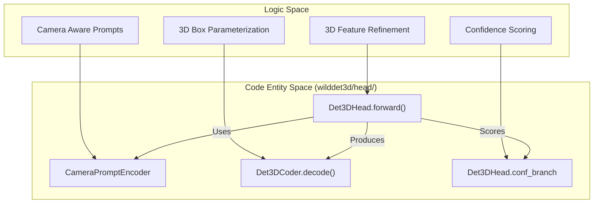
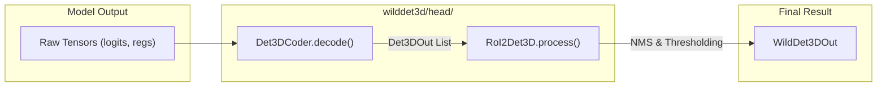

<!-- source: DeepWiki mcp.deepwiki.com · repo allenai/WildDet3D · page 2.4 3D Detection Head & Box Coder · fetched 2026-10-26 -->

# 3D Detection Head & Box Coder

Relevant source files

The following files were used as context for generating this wiki page:

- [wilddet3d/__init__.py](wilddet3d/__init__.py)
- [wilddet3d/connector.py](wilddet3d/connector.py)

The 3D Detection Head and Box Coder are responsible for transforming high-level features and 2D proposals into precise 3D bounding box parameters. This component bridges the gap between the 2D visual/language space and the 3D geometric space by predicting depth, 3D orientation (6D rotation), and physical dimensions.

## Det3DHead Architecture

The `Det3DHead` is a transformer-based decoder head that processes object queries to regress 3D parameters. It integrates features from the image backbone, the geometry backend (LingBot-Depth), and camera intrinsics.

### Key Components
*   **Depth Cross-Attention**: The head attends to `depth_latents` provided by the geometry backend to refine the depth estimate for each query [wilddet3d/head/det3d_head.py:45-60]().
*   **Camera Prompt Branch**: To handle "in-the-wild" scenarios where intrinsics vary, the head uses a `camera_prompt_branch` that encodes the focal length and principal point into the query embeddings [wilddet3d/head/det3d_head.py:112-125]().
*   **3D Confidence Branch**: A specialized MLP that predicts a 3D-specific confidence score, which is later combined with the 2D classification score for final ranking [wilddet3d/head/det3d_head.py:150-165]().

### Data Flow in Det3DHead
1.  **Input**: Receives object queries from the SAM3 decoder and `depth_latents` from the `LingbotDepthBackend` [wilddet3d/model.py:280-295]().
2.  **Refinement**: Iteratively updates queries using self-attention and cross-attention over multi-scale image features and depth features [wilddet3d/head/det3d_head.py:180-210]().
3.  **Regression**: Parallel MLP heads predict:
    *   **Center Offset**: $\Delta x, \Delta y$ relative to the 2D box center [wilddet3d/head/det3d_head.py:220-225]().
    *   **Log-Depth**: Predicted in log-space for numerical stability [wilddet3d/head/det3d_head.py:226-230]().
    *   **Dimensions**: Log-space predictions for $l, w, h$ [wilddet3d/head/det3d_head.py:231-235]().
    *   **Orientation**: 6D rotation representation [wilddet3d/head/det3d_head.py:236-240]().

### Logic Entity Bridge: Head & Coder
The following diagram illustrates how the abstract 3D detection concepts map to specific code entities within the `wilddet3d/head/` directory.

**Diagram: 3D Head Logic to Code Mapping**

Sources: [wilddet3d/head/det3d_head.py:15-100](), [wilddet3d/head/det3d_coder.py:10-40]()

## Det3DCoder: Box Encoding & Decoding

The `Det3DCoder` class manages the transformation between raw network outputs and physical 3D boxes. It implements a robust parameterization designed for monocular 3D detection.

### 6D Rotation Encoding
Instead of Euler angles or quaternions, WildDet3D uses a 6D rotation representation [wilddet3d/head/det3DCoder.py:110-125](). This representation is continuous and avoids the discontinuities associated with other formats, making it easier for the network to learn. The `rotation_6d_to_matrix` utility in `wilddet3d/ops/rotation.py` converts these 6 values into a $3 \times 3$ rotation matrix [wilddet3d/ops/rotation.py:45-60]().

### Canonical Normalization
To handle the scale ambiguity in monocular images, the coder performs canonical normalization.
*   **Depth**: Predicted as a residual relative to a reference depth or in log-space [wilddet3d/head/det3d_coder.py:140-155]().
*   **Dimensions**: Predicted as log-residuals relative to category-specific or global mean dimensions [wilddet3d/head/det3d_coder.py:160-170]().

### Decoding Process
The `decode` function takes the raw tensor outputs and the camera intrinsics to produce `Det3DOut` objects:
1.  **Project 2D Center**: The 2D box center is projected into 3D space using the predicted depth and intrinsics [wilddet3d/head/det3d_coder.py:200-215]().
2.  **Apply Offsets**: The predicted 3D center offset is added to the projected point.
3.  **Construct Matrix**: The 6D rotation is converted to a rotation matrix $R$ and the log-dimensions are exponentiated to $D$.
4.  **Assemble Box**: A 3D box is defined by $[x, y, z, l, w, h, yaw]$ or a full $4 \times 4$ pose matrix [wilddet3d/head/det3d_coder.py:230-250]().

Sources: [wilddet3d/head/det3d_coder.py:1-250](), [wilddet3d/ops/rotation.py:1-70]()

## RoI2Det3D & Post-Processing

Post-processing is handled by `RoI2Det3D`, which filters and refines the raw 3D detections.

### Non-Maximum Suppression (NMS)
WildDet3D uses a multi-stage NMS approach:
1.  **2D NMS**: Standard IoU-based NMS on 2D boxes to remove redundant queries [wilddet3d/head/roi2det3d.py:85-100]().
2.  **3D Confidence Integration**: The final score is a geometric mean or weighted sum of the 2D classification score and the 3D confidence branch output [wilddet3d/head/roi2det3d.py:110-120]().
3.  **Cross-Category NMS**: In "In-The-Wild" mode, NMS is often applied across all categories to handle overlapping open-vocabulary predictions [wilddet3d/head/roi2det3d.py:125-135]().

### Data Transformation Pipeline
The flow from raw model output to the final `WildDet3DOut` dataclass is summarized below.

**Diagram: 3D Detection Post-Processing Pipeline**

Sources: [wilddet3d/head/roi2det3d.py:10-150](), [wilddet3d/data_types.py:1-50]()

## Implementation Details

| Component | File Path | Key Function/Class |
| :--- | :--- | :--- |
| **3D Head** | `wilddet3d/head/det3d_head.py` | `Det3DHead` |
| **Box Decoding** | `wilddet3d/head/det3d_coder.py` | `Det3DCoder.decode()` |
| **Post-Processing** | `wilddet3d/head/roi2det3d.py` | `RoI2Det3D` |
| **6D Rotation** | `wilddet3d/ops/rotation.py` | `rotation_6d_to_matrix` |
| **Camera Encoding** | `wilddet3d/head/det3d_head.py` | `CameraPromptEncoder` |

Sources: [wilddet3d/head/det3d_head.py:15-20](), [wilddet3d/head/det3d_coder.py:10-15](), [wilddet3d/head/roi2det3d.py:10-15](), [wilddet3d/ops/rotation.py:45-50]()

---

