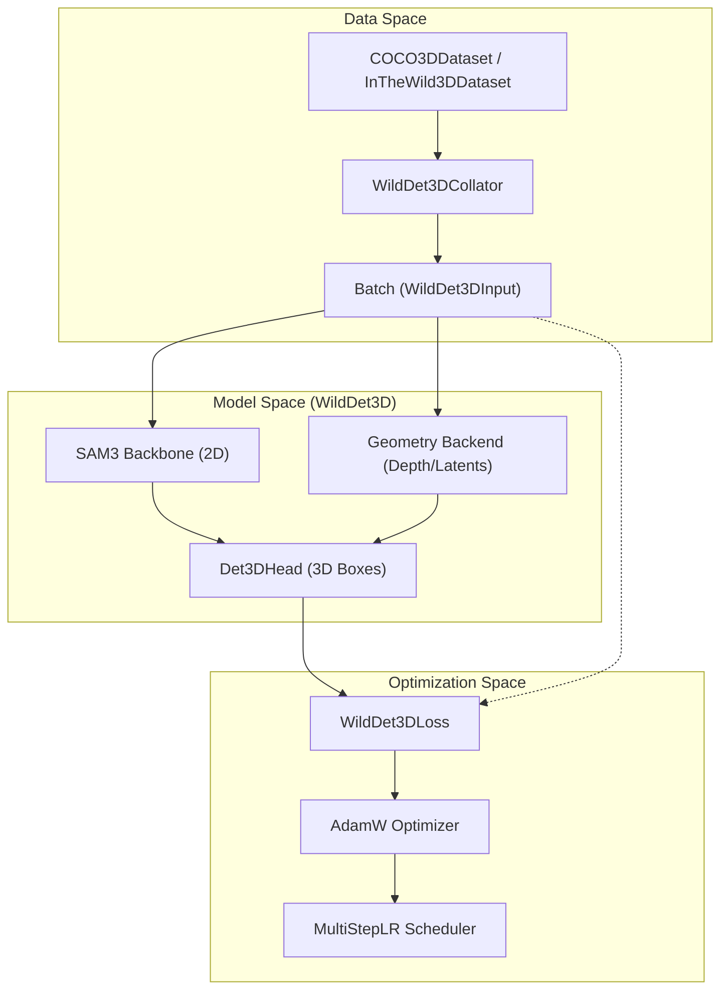
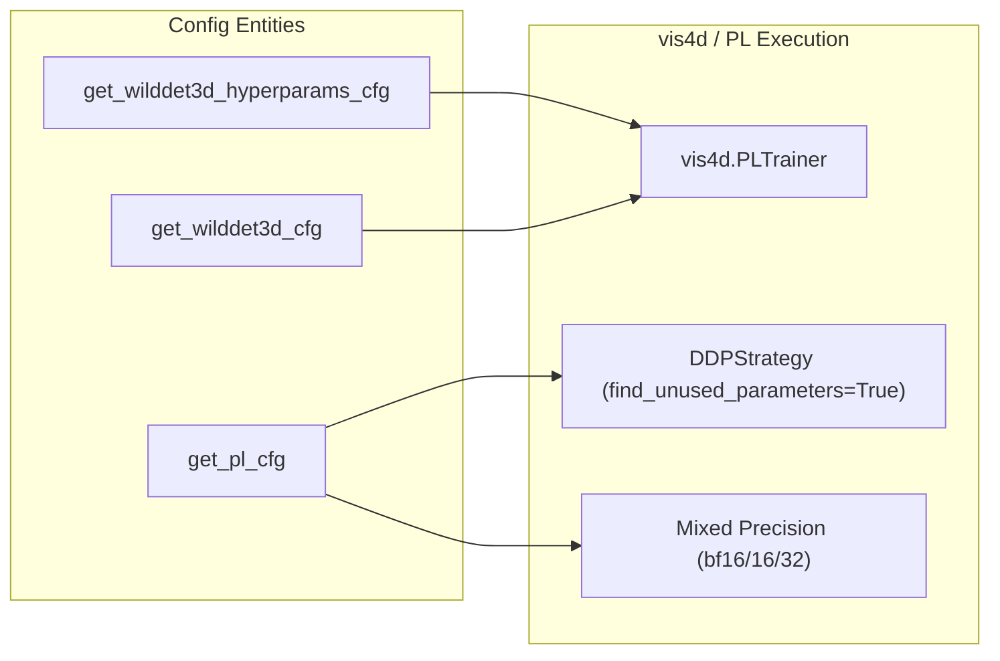

<!-- source: DeepWiki mcp.deepwiki.com · repo allenai/WildDet3D · page 3 Training Pipeline · fetched 2026-10-26 -->

# Training Pipeline

Relevant source files

The following files were used as context for generating this wiki page:

- [configs/base/model.py](configs/base/model.py)
- [configs/base/pl.py](configs/base/pl.py)
- [docs/TRAINING.md](docs/TRAINING.md)

WildDet3D utilizes the **vis4d** framework to manage its training lifecycle, integrating PyTorch Lightning for distributed training and experiment management. The pipeline is designed to handle multi-modal inputs (RGB, depth, and prompts) while optimizing a complex multi-task loss function that spans 2D detection, depth estimation, and 3D bounding box regression.

### System Architecture Overview

The training system is organized into four major pillars: a flexible configuration system based on `ml_collections`, a multi-stage data pipeline, a hybrid loss function for 2D/3D grounding, and a specialized optimizer strategy for fine-tuning large pretrained models.

#### Training Logic Flow
The following diagram illustrates how a training step moves from data loading through the model to loss computation.

"Training Step Data & Logic Flow"

**Sources:** [configs/base/model.py:115-130](), [wilddet3d/model.py:10-50](), [wilddet3d/loss/loss.py:20-100]()

---

### Configuration System
The configuration system uses `ml_collections.ConfigDict` to define experiments. It separates hyperparameters (epochs, learning rates) from structural model configurations. The `vis4d` integration allows these configs to be easily overridden via CLI for different datasets or ablation studies.

*   **ExperimentParameters**: Defined in `get_wilddet3d_hyperparams_cfg`, these handle training-specific scalars like `base_lr`, `num_epochs`, and `accumulate_grad_batches`.
*   **Model Config**: Defined in `get_wilddet3d_cfg`, this handles structural choices like `geometry_backend_type` (e.g., `lingbot_depth` or `unidepth_v2`) and freeze strategies.

For details, see [Configuration System](#3.3).

**Sources:** [configs/base/model.py:18-112](), [configs/base/model.py:115-160]()

---

### Data Pipeline & Datasets
WildDet3D supports a variety of datasets including **Omni3D**, **Waymo**, and the custom **In-the-Wild** benchmarks. The pipeline utilizes a specialized `WildDet3DCollator` to convert per-image annotations into per-prompt batches suitable for the transformer architecture.

*   **Transforms**: Images are typically resized to 1008×1008 with center padding.
*   **Prompting**: The pipeline supports five distinct prompting modes, which are sampled during training to ensure the model generalizes to text, visual, and geometric cues.

For details, see [Data Pipeline & Datasets](#3.2).

**Sources:** [configs/base/model.py:21-22](), [wilddet3d/data/collator.py:10-50]()

---

### Loss Functions
The `WildDet3DLoss` class implements a composite objective function. It combines standard 2D detection losses with 3D-specific geometric losses and auxiliary depth supervision.

| Category | Loss Components |
| :--- | :--- |
| **2D Detection** | Focal Loss (Classification), L1 + GIoU (Box Regression) |
| **3D Regression** | Delta Center, Log Depth, Log Dimensions, 6D Rotation |
| **Geometry** | SILog (Scale-Invariant Log), Affine-Invariant Depth Loss |
| **Matching** | One-to-Many (O2M) matching for queries |

For details, see [Loss Functions](#3.1).

**Sources:** [wilddet3d/loss/loss.py:20-150](), [configs/base/model.py:180-185]()

---

### Optimizer & Training Schedule
The training process uses the **AdamW** optimizer with a **MultiStepLR** schedule. A key feature of the WildDet3D pipeline is the differential learning rate strategy:
*   **Pretrained Components**: SAM3 and Geometry backbones often use a reduced learning rate (e.g., 0.1x `base_lr`).
*   **New Components**: The 3D Head and fusion layers use the full `base_lr`.
*   **Freeze Strategies**: Configurations like `backbone_freeze_blocks` allow for partial freezing of the ViT backbone to save memory and prevent forgetting.

For details, see [Optimizer & Training Schedule](#3.4).

**Sources:** [configs/base/model.py:23-31](), [configs/base/model.py:71-75](), [configs/base/pl.py:40-52]()

---

### Training Execution (PyTorch Lightning)
The execution is managed via `get_pl_cfg`, which configures the `PLTrainer`. Key settings include:
*   **Precision**: Supports `bf16-mixed` or `16-mixed` via the `MIXED_PRECISION` environment variable.
*   **Gradient Clipping**: Default `gradient_clip_val` is set to 0.1.
*   **DDP Strategy**: Uses `ddp_find_unused_parameters_true` to accommodate frozen geometry encoders that may not contribute to every forward pass.

"Configuration to Execution Mapping"

**Sources:** [configs/base/pl.py:12-52](), [configs/base/model.py:18-50]()

---

