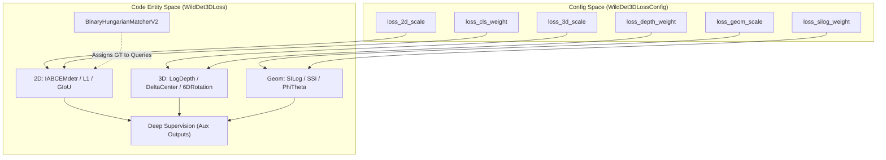
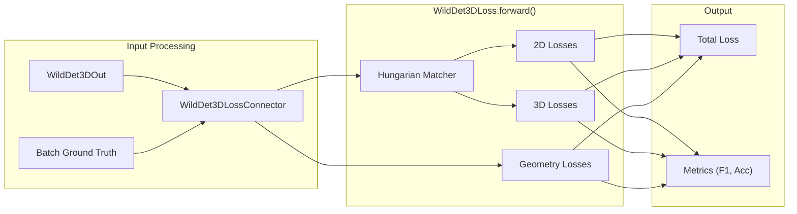

<!-- source: DeepWiki mcp.deepwiki.com · repo allenai/WildDet3D · page 3.1 Loss Functions · fetched 2026-10-26 -->

# Loss Functions

Relevant source files

The following files were used as context for generating this wiki page:

- [configs/base/loss.py](configs/base/loss.py)
- [wilddet3d/__init__.py](wilddet3d/__init__.py)

The WildDet3D training pipeline utilizes a composite loss strategy to optimize 2D detection, 3D spatial reasoning, and geometric scene understanding simultaneously. The primary entry point is the `WildDet3DLoss` class, which handles the complex task of matching predicted queries to ground truth targets across multiple decoder layers and auxiliary outputs.

### Loss Architecture Overview

WildDet3D uses a `LossModule` [configs/base/loss.py:127-134]() to wrap the core `WildDet3DLoss` [configs/base/loss.py:111-114](). This structure allows for the separate logging of individual loss components (e.g., `loss_cls`, `loss_depth`, `loss_silog`) while maintaining a unified optimization objective.

The loss calculation is divided into three primary domains:
1.  **2D Detection Losses**: Classification and box regression inherited from the SAM3/DETR paradigm.
2.  **3D Detection Losses**: Spatial parameters including depth, 3D dimensions, and 6D rotation.
3.  **Geometry Backend Losses**: Scene-level geometric consistency (SILog, affine-invariant depth).

#### Data Flow: Code Entity Mapping
The following diagram illustrates how configuration parameters map to the functional loss components within the codebase.

**Loss Configuration to Implementation Mapping**

Sources: [configs/base/loss.py:15-50](), [configs/base/loss.py:74-108]()

---

### 2D Detection Losses

The 2D components focus on identifying objects and localizing them within the image plane. These losses are scaled globally by `loss_2d_scale` [configs/base/loss.py:77]().

*   **Classification (`loss_cls_weight`)**: Uses the `IABCEMdetr` (Image-Attribute-Box-Category-Embedding) classification loss, consistent with the SAM3 backbone [configs/base/loss.py:23]().
*   **Box Regression (`loss_bbox_weight`)**: L1 loss applied to the normalized 2D box coordinates [configs/base/loss.py:24]().
*   **GIoU Loss (`loss_giou_weight`)**: Generalized Intersection over Union loss to handle varying box scales and overlaps [configs/base/loss.py:25]().

Sources: [configs/base/loss.py:19-25](), [configs/base/loss.py:81-83]()

---

### 3D Detection Losses

The 3D head predicts spatial parameters that are supervised using specialized regression losses. These are scaled by `loss_3d_scale` [configs/base/loss.py:78]().

| Loss Component | Config Key | Description |
| :--- | :--- | :--- |
| **Delta Center** | `loss_delta_2d_weight` | Supervizes the 2D offset from the box center to the projected 3D center [configs/base/loss.py:27](). |
| **Log Depth** | `loss_depth_weight` | Regression of the object's depth in log-space for scale invariance [configs/base/loss.py:28](). |
| **Log Dimensions** | `loss_dim_weight` | Regression of 3D size (L, W, H) in log-space [configs/base/loss.py:29](). |
| **6D Rotation** | `loss_rot_weight` | Supervision of the 6D rotation representation used for orientation [configs/base/loss.py:30](). |
| **3D Confidence** | `loss_3d_conf_weight` | Optional head supervised by a mix of depth accuracy and 3D IoU [configs/base/loss.py:40-42](). |

Sources: [configs/base/loss.py:26-30](), [configs/base/loss.py:38-42]()

---

### Geometry Backend Losses

These losses supervise the `LingbotDepthBackend`, ensuring the model learns a consistent geometric representation of the entire scene, not just the detected objects. They are scaled by `loss_geom_scale` [configs/base/loss.py:79]().

*   **SILog Loss (`loss_silog_weight`)**: Scale-Invariant Logarithmic loss for depth estimation, crucial for monocular depth consistency [configs/base/loss.py:32]().
*   **Affine-Invariant Loss (`loss_opt_ssi_weight`)**: Scale-and-Shift Invariant (SSI) loss, often used in foundation depth models like UniDepthV2 [configs/base/loss.py:35]().
*   **Angular Losses (`loss_phi_weight`, `loss_theta_weight`)**: Supervise the predicted camera intrinsics (vertical and horizontal field of view) [configs/base/loss.py:33-34]().

Sources: [configs/base/loss.py:31-35](), [configs/base/loss.py:90-93]()

---

### Matching and Supervision

WildDet3D employs advanced matching and supervision strategies to stabilize training.

#### O2M Matching and Auxiliary Outputs
The model supports **One-to-Many (O2M)** matching [configs/base/loss.py:46](), allowing multiple queries to match a single ground truth object during training to provide a denser gradient signal. Additionally, **Deep Supervision** is applied to the auxiliary outputs of the transformer decoder layers. The `aux_loss_weight` [configs/base/loss.py:37]() controls the contribution of these intermediate layers to the total loss.

#### Loss Data Flow
The `WildDet3DLossConnector` [configs/base/loss.py:121]() acts as the bridge between the model's forward pass and the loss calculation. It takes the `WildDet3DOut` dataclass and the ground truth batch, restructuring them for the `WildDet3DLoss` class.

**Internal Loss Processing Flow**

Sources: [configs/base/loss.py:118-122](), [wilddet3d/__init__.py:16-18]()

#### Metrics and Logging
Certain values are computed as metrics (e.g., `metric_ce_f1`, `metric_presence_acc`) but are explicitly excluded from the optimization gradient via the `exclude_attributes` list in `LossModule` [configs/base/loss.py:129-134](). This ensures they are logged to tools like WandB without affecting the loss scale.

Sources: [configs/base/loss.py:116-134]()

---

