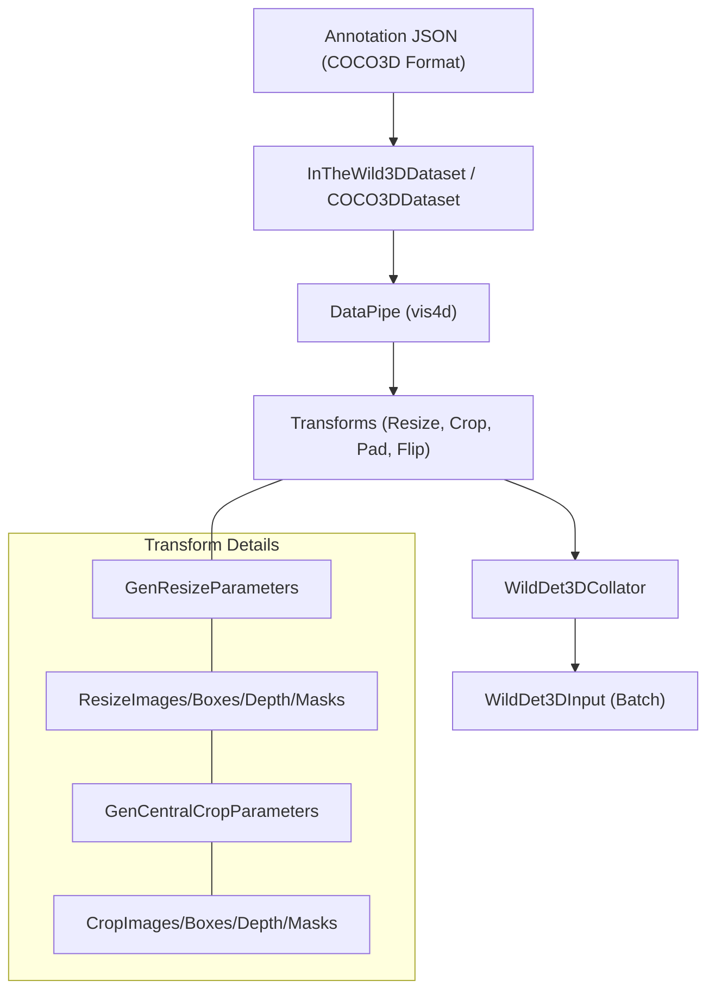
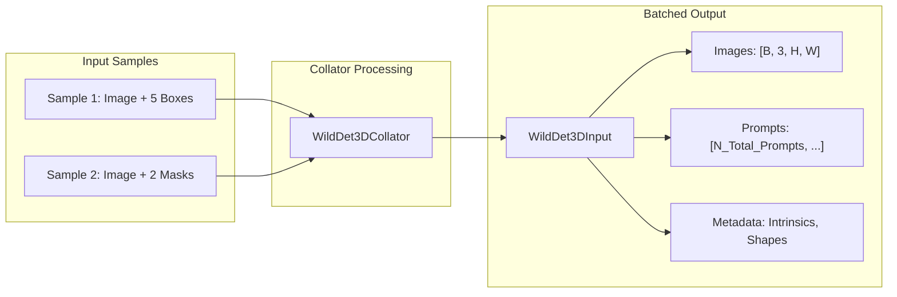

<!-- source: DeepWiki mcp.deepwiki.com · repo allenai/WildDet3D · page 3.2 Data Pipeline & Datasets · fetched 2026-10-26 -->

# Data Pipeline & Datasets

Relevant source files

The following files were used as context for generating this wiki page:

- [configs/base/dataset/in_the_wild.py](configs/base/dataset/in_the_wild.py)
- [configs/base/dataset/transform.py](configs/base/dataset/transform.py)
- [data/in_the_wild/annotations/InTheWild_v3_val.json](data/in_the_wild/annotations/InTheWild_v3_val.json)
- [data/in_the_wild/annotations/InTheWild_v3_val_class_map.json](data/in_the_wild/annotations/InTheWild_v3_val_class_map.json)
- [data/in_the_wild/annotations/Stereo4D_test.json](data/in_the_wild/annotations/Stereo4D_test.json)
- [data/in_the_wild/annotations/Stereo4D_val.json](data/in_the_wild/annotations/Stereo4D_val.json)
- [data/in_the_wild/annotations/Stereo4D_val_class_map.json](data/in_the_wild/annotations/Stereo4D_val_class_map.json)
- [wilddet3d/data/__init__.py](wilddet3d/data/__init__.py)
- [wilddet3d/data/datasets/__init__.py](wilddet3d/data/datasets/__init__.py)
- [wilddet3d/data/datasets/coco3d.py](wilddet3d/data/datasets/coco3d.py)

This page documents the data ingestion, transformation, and batching pipeline for WildDet3D. The pipeline is built on the `vis4d` framework, extending it to handle 3D bounding boxes, multi-modal prompts (text, masks, boxes), and monocular depth maps.

## Overview of Data Flow

The data flow starts from annotation JSON files, passes through specialized dataset classes, undergoes geometric and appearance transformations, and is finally batched by a custom collator that handles the conversion from per-image samples to per-prompt training instances.

**Sources:** [configs/base/dataset/in_the_wild.py:9-17](), [configs/base/dataset/transform.py:46-108](), [wilddet3d/data/datasets/coco3d.py:30-91]()

---

## Datasets & Annotation Formats

WildDet3D uses a COCO-style JSON format extended for 3D detection. Key additions include camera intrinsics (`K`), 3D centers (`center_cam`), dimensions, and rotations.

### InTheWild3DDataset
This dataset is the primary entry point for "In-the-Wild" evaluation and training. It inherits from `COCO3DDataset` and provides specific logic for loading class maps and handling mask annotations [configs/base/dataset/in_the_wild.py:11-14]().

*   **Annotation Files**: Located in `data/in_the_wild/annotations/`. Examples include `InTheWild_v3_val.json` [data/in_the_wild/annotations/InTheWild_v3_val.json:1]() and `Stereo4D_test.json` [data/in_the_wild/annotations/Stereo4D_test.json:1]().
*   **Class Mapping**: A JSON dictionary mapping string category names to integer IDs, used to unify disparate datasets [data/in_the_wild/annotations/InTheWild_v3_val_class_map.json:1]().

### COCO3DDataset
A base class for 3D detection that handles loading images, 2D boxes, 3D boxes, and depth maps [wilddet3d/data/datasets/coco3d.py:30-32]().

*   **Filtering**: Implements `_filter_data` to remove empty samples or samples missing depth maps if `with_depth` is enabled [wilddet3d/data/datasets/coco3d.py:96-129]().
*   **3D Box Representation**: Decodes 3D annotations into a 10-element vector (center_x, center_y, center_z, w, h, l, roll, pitch, yaw, class_id) [wilddet3d/data/datasets/coco3d.py:169-202]().

**Sources:** [wilddet3d/data/datasets/coco3d.py:30-91](), [configs/base/dataset/in_the_wild.py:19-53]()

---

## Data Transforms

Transforms in WildDet3D ensure that 2D image changes (resizing, cropping, padding) are consistently applied to all associated geometric data (2D/3D boxes, camera intrinsics, and depth maps).

### Transform Categories
| Transform Type | Classes | Purpose |
| :--- | :--- | :--- |
| **Resizing** | `ResizeImages`, `ResizeBoxes2D`, `ResizeIntrinsics`, `ResizeDepthMaps`, `ResizeMasks2D` | Scales all inputs to a target resolution (e.g., 1008x1008) while updating focal lengths and principal points [configs/base/dataset/transform.py:23-28](). |
| **Cropping** | `CropImages`, `CropBoxes2D`, `CropBoxes3D`, `CropIntrinsics`, `CropMasks2D` | Extracts sub-regions; `CropIntrinsics` adjusts the principal point (cx, cy) based on the crop offset [configs/base/dataset/transform.py:8-14](). |
| **Padding** | `CenterPadImages`, `CenterPadBoxes2D`, `CenterPadIntrinsics`, `CenterPadMasks2D` | Pads images to a fixed shape; crucial for maintaining batch consistency in transformer backbones [configs/base/dataset/transform.py:37-42](). |
| **Augmentation** | `FlipImages`, `FlipBoxes3D`, `RandomApply` | Horizontal flipping for training; requires mirroring the 3D rotation and updating the principal point [configs/base/dataset/transform.py:15-21](). |

### Training vs. Testing Pipeline
The training pipeline includes random scaling (0.75x to 1.25x) and horizontal flipping [configs/base/dataset/transform.py:52-85](). The test pipeline is deterministic, using fixed resizing and center padding to ensure reproducibility [configs/base/dataset/transform.py:165-195]().

**Sources:** [configs/base/dataset/transform.py:1-43](), [configs/base/dataset/transform.py:46-108]()

---

## Batching & Collation

The `WildDet3DCollator` (conceptually described in the pipeline) is responsible for transforming standard image-centric batches into the prompt-centric format required by the SAM3 backbone.

### Key Logic:
1.  **Coordinate Normalization**: Transforms 2D boxes and points into a normalized [0, 1] range relative to the padded image size.
2.  **Prompt Aggregation**: Flattens prompts from multiple images into a single sequence for the transformer decoder, maintaining a mapping back to the original image indices.
3.  **Intrinsics Handling**: Batches the $3 \times 3$ camera matrices. If intrinsics are missing in the data, a default focal length heuristic is applied during preprocessing.

**Sources:** [configs/base/dataset/in_the_wild.py:143-147](), [configs/base/dataset/transform.py:89-103]()

---

## Configuration Patterns

The dataset configuration uses `ml_collections` and `vis4d.config.class_config` to instantiate the data pipeline.

*   **`get_in_the_wild_dataset_cfg`**: Construct the dataset object, handles caching (via `cache_as_binary` and `.pkl` files), and sets filtering thresholds like `truncation_thres` and `visibility_thres` [configs/base/dataset/in_the_wild.py:19-90]().
*   **`DataPipe`**: A `vis4d` wrapper that combines the dataset with the `preprocess_fn` (the composed transforms) [configs/base/dataset/in_the_wild.py:143-147]().

**Sources:** [configs/base/dataset/in_the_wild.py:19-90](), [configs/base/dataset/in_the_wild.py:93-147]()

---

