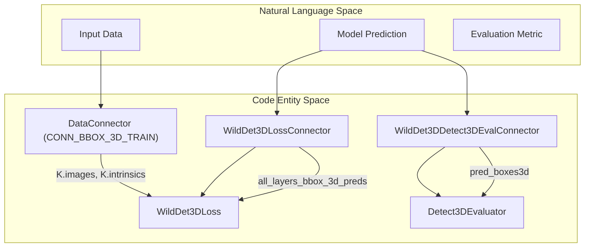
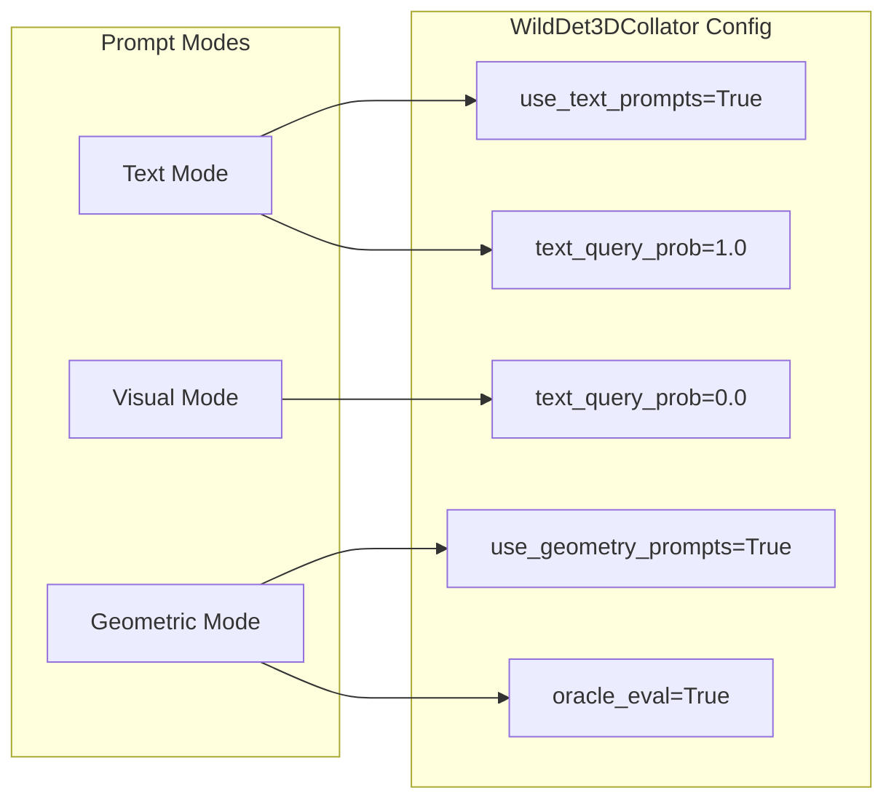

<!-- source: DeepWiki mcp.deepwiki.com · repo allenai/WildDet3D · page 3.3 Configuration System · fetched 2026-10-26 -->

# Configuration System

Relevant source files

The following files were used as context for generating this wiki page:

- [configs/__init__.py](configs/__init__.py)
- [configs/base/__init__.py](configs/base/__init__.py)
- [configs/base/base_connector.py](configs/base/base_connector.py)
- [configs/base/base_optim.py](configs/base/base_optim.py)
- [configs/base/callback.py](configs/base/callback.py)
- [configs/base/connector.py](configs/base/connector.py)
- [configs/base/data.py](configs/base/data.py)
- [configs/base/dataset/cubifyanything.py](configs/base/dataset/cubifyanything.py)
- [configs/base/dataset/foundationpose.py](configs/base/dataset/foundationpose.py)
- [configs/base/dataset/omni3d.py](configs/base/dataset/omni3d.py)
- [configs/base/dataset/open.py](configs/base/dataset/open.py)
- [configs/base/dataset/stereo4d.py](configs/base/dataset/stereo4d.py)
- [configs/base/dataset/threeeed.py](configs/base/dataset/threeeed.py)
- [configs/base/dataset/waymo.py](configs/base/dataset/waymo.py)
- [configs/base/model.py](configs/base/model.py)
- [configs/base/optim.py](configs/base/optim.py)
- [configs/base/pl.py](configs/base/pl.py)
- [configs/base/transforms.py](configs/base/transforms.py)

The WildDet3D configuration system is built upon the **vis4d** framework and **ml_collections**. It employs a hierarchical structure where base components (models, losses, optimizers) are defined as modular functions and then composed into specific `ExperimentConfig` objects. This system handles the complexity of multi-modal prompting (text, visual, geometric) and multi-dataset training/evaluation.

## Core Configuration Structure

WildDet3D uses the `ExperimentConfig` and `ExperimentParameters` pattern from vis4d. The `ExperimentParameters` class (defined in individual experiment files) acts as a schema for hyperparameters, while the `ExperimentConfig` defines the actual object graph (data pipes, model architecture, callbacks) by calling factory functions from the `configs/base/` directory.

### Configuration Components

| Component | Directory / File | Description |
| :--- | :--- | :--- |
| **Model** | `configs/base/model.py` | Defines the `WildDet3D` architecture, including SAM3 and LingBot-Depth backends. |
| **Loss** | `configs/base/loss.py` | Configures `WildDet3DLoss`, including 2D/3D regression and geometry losses. |
| **Optimizer** | `configs/base/optim.py` | Implements `AdamW` with differential learning rates for pretrained components. |
| **Data** | `configs/base/data.py` | Manages `DataPipe` setup and the critical `WildDet3DCollator`. |
| **Connector** | `configs/base/connector.py` | Maps model outputs to loss functions and evaluators via `DataConnector`. |
| **Callbacks** | `configs/base/callback.py` | Configures logging, visualization, and evaluation metrics. |

**Sources:** `configs/base/base_connector.py:1-7`, `configs/base/data.py:1-23`, `configs/base/callback.py:27-35`.

---

## Data Flow & Connectors

The system uses `DataConnector` and `CallbackConnector` to decouple the model's internal output format from the requirements of loss functions and evaluators. This is managed via "key mapping" dictionaries.

### Key Connector Definitions
*   **`CONN_BBOX_3D_TRAIN`**: Maps raw data (images, intrinsics, depth) for training [configs/base/base_connector.py:25-33]().
*   **`CONN_GDINO3D_LOSS`**: Maps model predictions (3D boxes, class scores, token masks) to the loss module [configs/base/base_connector.py:8-23]().
*   **`CONN_COCO_DET3D_EVAL`**: Standard mapping for COCO-style 3D evaluation [configs/base/base_connector.py:45-51]().

### Diagram: Configuration Entity Mapping (Data Flow)
This diagram bridges the high-level configuration concepts to the specific code entities that handle data transformation.

**Sources:** `configs/base/base_connector.py:8-51`, `configs/base/connector.py:4-12`.

---

## Dataset-Specific Configurations

WildDet3D supports a wide array of datasets through specialized factory functions in `configs/base/dataset/`. These functions typically return a `DataPipe` or a list of `ConfigDict` objects.

### Supported Datasets
*   **Omni3D**: Managed via `get_omni3d_dataset_cfg`. It handles multiple sub-datasets like KITTI, nuScenes, and ARKitScenes [configs/base/dataset/omni3d.py:23-38]().
*   **CubifyAnything (CA-1M)**: Configured via `get_ca1m_dataset_cfg`. It includes specific thresholds for truncation and visibility [configs/base/dataset/cubifyanything.py:21-51]().
*   **FoundationPose**: Used for GSO (Google Scanned Objects) data, providing depth and 3D box labels [configs/base/dataset/foundationpose.py:21-51]().
*   **Open Evaluation**: `configs/base/dataset/open.py` provides configs for zero-shot evaluation on ScanNet, Argoverse V2, and LabelAny3D COCO [configs/base/dataset/open.py:30-109]().
*   **Stereo4D**: Configured for "In-The-Wild" validation using `get_stereo4d_test_cfg` [configs/base/dataset/stereo4d.py:62-81]().

---

## The Prompting & Collation System

A unique aspect of WildDet3D's configuration is the `WildDet3DCollator`. Unlike standard collators that just stack tensors, this component converts per-image data into **per-prompt** batches to support the model's 5 prompting modes.

### Collation Variants
The system defines several module-level collation functions in `configs/base/data.py` to support different training and testing scenarios:

| Function | Mode | Description |
| :--- | :--- | :--- |
| `wilddet3d_collate_fn` | Training | Default: 70% text queries, 30% visual queries [configs/base/data.py:42-66](). |
| `wilddet3d_test_collate_fn` | Testing | Pure text queries, no filtering of empty images [configs/base/data.py:69-90](). |
| `wilddet3d_oracle_collate_fn` | Oracle | Uses GT 2D boxes as prompts to measure pure 3D regression [configs/base/data.py:93-114](). |
| `wilddet3d_5mode_collate_fn` | Multi-Modal | Full support for Text, Visual, Visual+Label, Geometric, and Geometric+Label [configs/base/data.py:142-172](). |

### Diagram: Prompt Mode Configuration Logic
Associates prompting modes with the specific parameters in `WildDet3DCollator`.

**Sources:** `configs/base/data.py:69-114`, `configs/base/data.py:158-171`.

---

## Optimizer & Scheduling

The optimizer configuration in `configs/base/base_optim.py` handles the complexity of training a model with both frozen pretrained components and new randomly initialized heads.

### Parameter Groups & Freezing
The `get_freeze_encoder_decoder_param_groups` function implements a specific strategy for fine-tuning:
*   **Frozen (lr_mult=0.0)**: Encoder, Decoder, Backbone, Neck, Language Model [configs/base/base_optim.py:79-83]().
*   **Trained (lr_mult=1.0)**: `depth_memory_fusion`, `bbox3d_head` [configs/base/base_optim.py:85-86]().
*   **Fine-tuned (lr_mult=0.1)**: `geometry_backend` (pretrained depth) [configs/base/base_optim.py:87]().

### Scheduler
The system uses a combination of `LinearLR` for warmup (typically 1000 iterations) and `MultiStepLR` for the main training phase [configs/base/base_optim.py:30-48]().

**Sources:** `configs/base/base_optim.py:13-59`, `configs/base/base_optim.py:62-88`.

---

