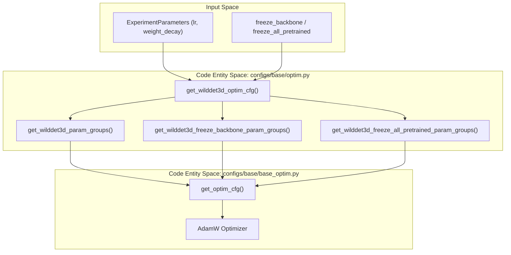
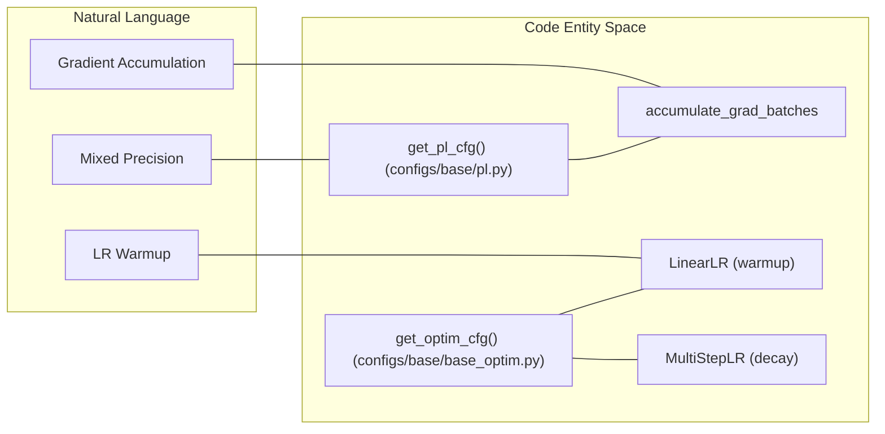

<!-- source: DeepWiki mcp.deepwiki.com · repo allenai/WildDet3D · page 3.4 Optimizer & Training Schedule · fetched 2026-10-26 -->

# Optimizer & Training Schedule

Relevant source files

The following files were used as context for generating this wiki page:

- [configs/base/base_optim.py](configs/base/base_optim.py)
- [configs/base/optim.py](configs/base/optim.py)
- [configs/base/pl.py](configs/base/pl.py)

WildDet3D utilizes the `vis4d` framework's configuration system to manage optimization, learning rate schedules, and parameter-specific freezing strategies. The system is designed to handle a mix of large pretrained backbones (SAM3, DINOv2) and newly initialized 3D detection components.

## Optimizer Configuration

The primary optimizer used is **AdamW** [configs/base/base_optim.py:6-54](). The configuration is managed via `get_wilddet3d_optim_cfg`, which provides three distinct training modes to balance stability and performance [configs/base/optim.py:126-175]().

### Training Modes

| Mode | Description | Affected Components |
| :--- | :--- | :--- |
| **Default** | Finetunes pretrained parts at 0.1x LR. | `sam3.backbone`, `geometry_backend.encoder` |
| **Freeze Backbone** | Freezes vision and depth backbones entirely. | `sam3.backbone`, `geometry_backend.encoder` (LR=0.0) |
| **Freeze All Pretrained** | Only trains the 3D-specific modules. | Everything except `bbox3d_head` and `early_depth_fusion` |

### Differential Learning Rates
WildDet3D employs differential learning rates by assigning `lr_mult` factors to specific `custom_keys` in the parameter groups [configs/base/optim.py:28-63]().

*   **1.0x LR (Full):** New components like `bbox3d_head`, `early_depth_fusion`, and the SAM3 `transformer` decoder [configs/base/optim.py:47-63]().
*   **0.1x LR (Reduced):** Pretrained backbones like `sam3.backbone` and the `geometry_backend.encoder` (DINOv2) to prevent catastrophic forgetting [configs/base/optim.py:54-56]().
*   **0.0x LR (Frozen):** Explicitly disables gradients for components when `freeze_backbone` or `freeze_all_pretrained` is enabled [configs/base/optim.py:113-123]().

### Data Flow: Optimizer Construction
The following diagram illustrates how the `ExperimentParameters` are transformed into a `vis4d` optimizer configuration.

**Optimizer Logic Flow**

Sources: [configs/base/optim.py:126-175](), [configs/base/base_optim.py:13-59]()

## Training Schedule

The training schedule is a `MultiStepLR` policy combined with a linear warmup phase [configs/base/base_optim.py:29-48]().

1.  **Warmup Phase:** A `LinearLR` scheduler increases the learning rate from `0.1 * base_lr` to the full `base_lr` over the first 1000 iterations [configs/base/base_optim.py:30-37]().
2.  **Main Phase:** The model trains at the base learning rate.
3.  **Decay Phase:** The learning rate is multiplied by `gamma=0.1` at specific milestones defined in `params.step_1` and `params.step_2` [configs/base/base_optim.py:39-48]().

Sources: [configs/base/base_optim.py:29-48]()

## Gradient & Hardware Settings

Training stability and efficiency are managed through the PyTorch Lightning configuration in `configs/base/pl.py`.

*   **Gradient Accumulation:** Managed via `accumulate_grad_batches`, allowing for larger effective batch sizes on limited GPU memory [configs/base/pl.py:41]().
*   **Gradient Clipping:** Set to `0.1` to prevent exploding gradients during the training of the 3D head [configs/base/pl.py:40]().
*   **Mixed Precision:** Supports `fp32`, `fp16-mixed`, and `bf16-mixed` via the `MIXED_PRECISION` environment variable [configs/base/pl.py:21-25]().
*   **DDP Strategy:** Uses `ddp_find_unused_parameters_true` to handle scenarios where parts of the model (like frozen backbone blocks) do not participate in the forward pass [configs/base/pl.py:46-50]().

### Schedule and Precision Logic
The relationship between the PL Trainer and the optimization parameters is shown below.

**Trainer and Schedule Association**

Sources: [configs/base/pl.py:12-52](), [configs/base/base_optim.py:29-48]()

## Freezing Strategies

Beyond simple LR multipliers, the model supports structural freezing.

### Backbone Block Freezing
In addition to setting `lr_mult=0.0`, the system supports `backbone_freeze_blocks`. When this is used, the frozen blocks have `requires_grad=False` [configs/base/optim.py:34-37](). This is computationally more efficient than just setting a zero learning rate as it avoids gradient computation for those layers.

### Freeze All Pretrained
This mode is used for rapid prototyping of the 3D detection head. It freezes the entire SAM3 stack and the DINOv2 depth encoder, training only the `bbox3d_head` and the `early_depth_fusion` module [configs/base/optim.py:97-123]().

Sources: [configs/base/optim.py:34-50](), [configs/base/optim.py:97-123]()

---

