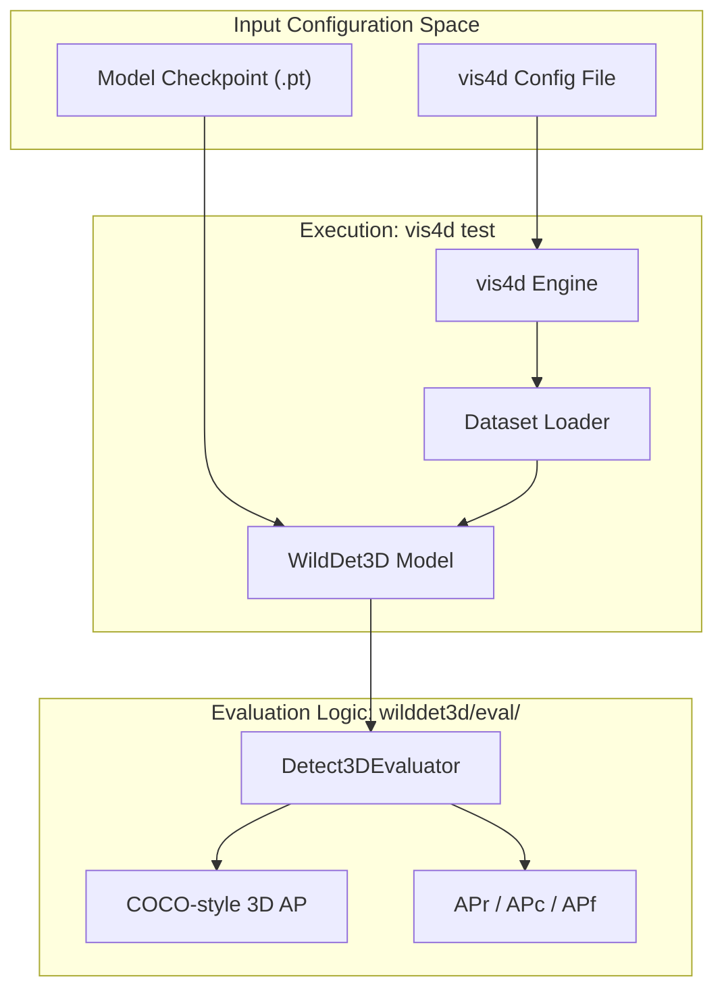
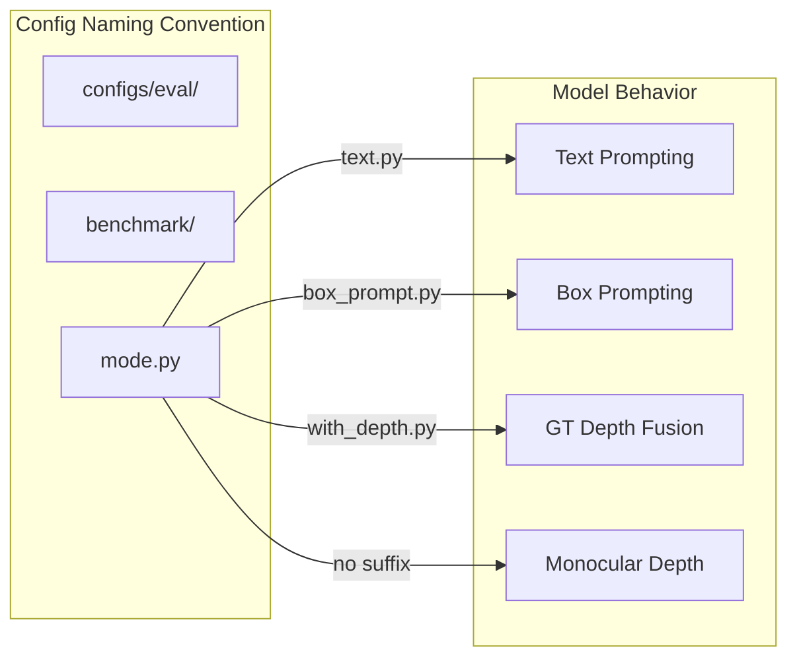

<!-- source: DeepWiki mcp.deepwiki.com · repo allenai/WildDet3D · page 4 Evaluation · fetched 2026-10-26 -->

# Evaluation

<details>
<summary>Relevant source files</summary>

The following files were used as context for generating this wiki page:

- [configs/eval/__init__.py](configs/eval/__init__.py)
- [docs/EVALUATION.md](docs/EVALUATION.md)

</details>


WildDet3D utilizes the [vis4d](https://github.com/SysCV/vis4d) framework to conduct large-scale 3D object detection evaluations across diverse datasets. The evaluation system is designed to handle multiple prompting modes (Text, Box) and varying levels of sensor input (with or without ground-truth depth).

The evaluation pipeline bridges the gap between 2D open-vocabulary detection and 3D spatial reasoning by measuring how well the model generalizes to "in-the-wild" scenarios and zero-shot benchmarks like ScanNet and Argoverse2.

### Evaluation Workflow Overview

The following diagram illustrates how the evaluation configuration, model, and evaluator interact during a test run.

**Evaluation System Architecture**

Sources: [docs/EVALUATION.md:3-11](), [wilddet3d/eval/detect3d.py:1-20]()

### Benchmarks and Datasets

WildDet3D is evaluated on a mix of training-domain and zero-shot benchmarks to verify its robustness:

*   **Omni3D**: The primary training benchmark, covering datasets like KITTI, nuScenes, SUNRGBD, and Objectron [docs/EVALUATION.md:21-32]().
*   **Zero-Shot Indoor (ScanNet)**: Evaluates 3D scene understanding in indoor environments not seen during training [docs/EVALUATION.md:37-47]().
*   **Zero-Shot Outdoor (Argoverse2)**: Evaluates autonomous driving object detection in a zero-shot capacity [docs/EVALUATION.md:52-62]().
*   **Stereo4D**: Focused on dynamic 3D object detection from stereo video sequences [docs/EVALUATION.md:67-77]().
*   **In-the-Wild**: A large-scale evaluation using diverse, open-vocabulary categories [docs/EVALUATION.md:82-92]().

For details on specific dataset configurations and how to run them, see [Evaluation Benchmarks & Configs](#4.1).

### Evaluation Metrics

The core of the evaluation system is the `Detect3DEvaluator`, which implements COCO-style metrics adapted for 3D space.

| Metric | Description |
|---|---|
| **AP** | Average Precision computed using 3D IoU thresholds (e.g., 0.25, 0.5) [docs/EVALUATION.md:15-17](). |
| **APr / APc / APf** | AP split by category frequency: Rare, Common, and Frequent [wilddet3d/eval/detect3d.py:1-10](). |
| **APRel3D** | Relative 3D AP metrics for assessing depth and scale accuracy [wilddet3d/eval/detect3d.py:1-10](). |

For a deep dive into the mathematical implementation and the `COCO3D` annotation API, see [Detect3DEvaluator & Metrics](#4.2).

### Running Evaluations

Evaluations are triggered via the `vis4d test` command. The configuration files follow a strict naming convention to define the prompting mode and depth availability.

**Command Structure**
```bash
vis4d test --config configs/eval/<benchmark>/<mode>.py \
    --gpus 1 --ckpt ckpt/wilddet3d.pt
```
Sources: [docs/EVALUATION.md:5-11]()

**Config Mapping to Code Entities**

Sources: [docs/EVALUATION.md:97-107]()

---

### Child Pages

*   [Evaluation Benchmarks & Configs](#4.1): Detailed documentation of `configs/eval/`, including `in_the_wild` and `stereo4d` setups, and the logic behind the `with_depth` variants.
*   [Detect3DEvaluator & Metrics](#4.2): Technical breakdown of `wilddet3d/eval/detect3d.py`, covering 3D IoU computation, center-distance matching, and frequency-based AP splits.

---

