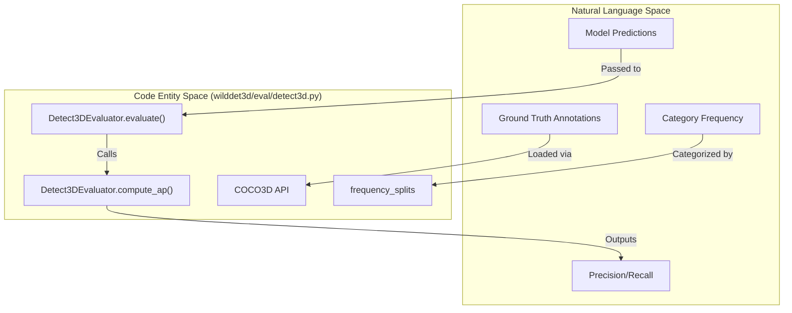
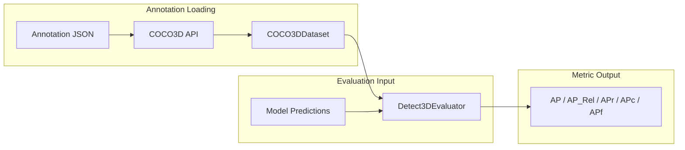

<!-- source: DeepWiki mcp.deepwiki.com · repo allenai/WildDet3D · page 4.2 Detect3DEvaluator & Metrics · fetched 2026-10-26 -->

# Detect3DEvaluator & Metrics

Relevant source files

The following files were used as context for generating this wiki page:

- [data/in_the_wild/annotations/InTheWild_v3_val.json](data/in_the_wild/annotations/InTheWild_v3_val.json)
- [data/in_the_wild/annotations/InTheWild_v3_val_class_map.json](data/in_the_wild/annotations/InTheWild_v3_val_class_map.json)
- [wilddet3d/data/datasets/coco3d.py](wilddet3d/data/datasets/coco3d.py)

The `Detect3DEvaluator` is the primary evaluation component in WildDet3D, responsible for computing performance metrics for 3D object detection. It implements a COCO-style Average Precision (AP) evaluation adapted for 3D space, supporting multiple matching criteria (IoU and center distance), frequency-based category splits, and cross-dataset evaluation through the `COCO3D` annotation API.

## Core Evaluation Logic

The evaluation process follows a standard detection pipeline: matching predicted 3D boxes to ground truth boxes based on a specific threshold, then calculating precision-recall curves.

### 1. Matching Criteria
The evaluator supports two primary methods for determining if a prediction matches a ground truth object:
*   **3D IoU**: Standard Intersection over Union calculated in 3D space. Thresholds typically range from 0.05 to 0.5 [wilddet3d/eval/detect3d.py:284-285]().
*   **Center Distance**: Matching based on the Euclidean distance between box centers in 3D camera coordinates. This is often more robust for small objects or distant detections where IoU might be zero despite a close proximity [wilddet3d/eval/detect3d.py:286-287]().

### 2. Metric Computation
The evaluator produces several key metrics:
*   **AP (Average Precision)**: Calculated across multiple IoU/Distance thresholds [wilddet3d/eval/detect3d.py:346-348]().
*   **AP_Rel**: A relative 3D metric that evaluates the accuracy of the 3D box relative to its 2D projection [wilddet3d/eval/detect3d.py:288-289]().
*   **Frequency Splits**: To handle the long-tail distribution of "In-the-Wild" data, AP is split into:
    *   **APr (Rare)**: Categories with few instances.
    *   **APc (Common)**: Categories with moderate instance counts.
    *   **APf (Frequent)**: Categories with high instance counts [wilddet3d/eval/detect3d.py:349-351]().

### Data Flow and System Mapping

The following diagram illustrates how the evaluation entities in the code relate to the conceptual evaluation flow.

**Evaluation System Entity Mapping**

Sources: [wilddet3d/eval/detect3d.py:19-25](), [wilddet3d/eval/detect3d.py:270-280]()

## COCO3D Annotation API

WildDet3D uses a specialized `COCO3D` class (extending the standard `pycocotools.COCO`) to handle 3D-specific metadata in JSON annotations.

### Annotation Structure
The `COCO3D` API expects a JSON format where each annotation contains:
*   `center_cam`: 3D coordinates (x, y, z) in the camera frame [wilddet3d/data/datasets/coco3d.py:200]().
*   `dimensions`: 3D box size (width, height, length) [wilddet3d/data/datasets/coco3d.py:201]().
*   `R_cam`: 3x3 rotation matrix [wilddet3d/data/datasets/coco3d.py:204]().
*   `K`: 3x3 camera intrinsic matrix per image [data/in_the_wild/annotations/InTheWild_v3_val.json:1]().

### Filtering and Preprocessing
During data loading, the `COCO3DDataset` applies several filters to ensure ground truth quality:
*   **Truncation/Visibility**: Filters objects based on how much of the box is within the image frame [wilddet3d/data/datasets/coco3d.py:49-50]().
*   **Height Thresholds**: Removes objects that are too small or too large in 2D pixels to be reliably detected [wilddet3d/data/datasets/coco3d.py:51-52]().
*   **Behind Camera**: Automatically ignores annotations where the 3D center has a negative depth [wilddet3d/data/datasets/coco3d.py:187-188]().

**Data Loading and API Interaction**

Sources: [wilddet3d/data/datasets/coco3d.py:30-54](), [wilddet3d/data/datasets/coco3d.py:141-150]()

## Key Functions and Implementation Details

### Detect3DEvaluator Implementation
The class is initialized with a `dataset_name` and a `class_map` to align model outputs with ground truth IDs [wilddet3d/eval/detect3d.py:246-255]().

| Function | Role |
| :--- | :--- |
| `process()` | Accumulates predictions from different ranks in a distributed setting [wilddet3d/eval/detect3d.py:261-268](). |
| `evaluate()` | Orchestrates the full evaluation: loads GT, matches predictions, and calls AP computation [wilddet3d/eval/detect3d.py:270-344](). |
| `compute_ap()` | Performs the actual PR-curve integration for a set of matches [wilddet3d/eval/detect3d.py:346-355](). |

### Category Mapping
Because "In-the-Wild" detection involves thousands of potential categories, the system uses a `class_map` (e.g., `InTheWild_v3_val_class_map.json`) to map string labels to contiguous integer IDs used by the evaluator [data/in_the_wild/annotations/InTheWild_v3_val_class_map.json:1]().

### Metric Thresholds
The evaluator defaults to standard COCO 3D IoU thresholds: `[0.05, 0.1, 0.25, 0.5]`. For center distance matching, it typically uses thresholds in meters (e.g., `[0.5, 1.0, 2.0]`) depending on the dataset scale [wilddet3d/eval/detect3d.py:284-287]().

Sources: [wilddet3d/eval/detect3d.py:246-355](), [wilddet3d/data/datasets/coco3d.py:137-150](), [data/in_the_wild/annotations/InTheWild_v3_val_class_map.json:1]()

---

