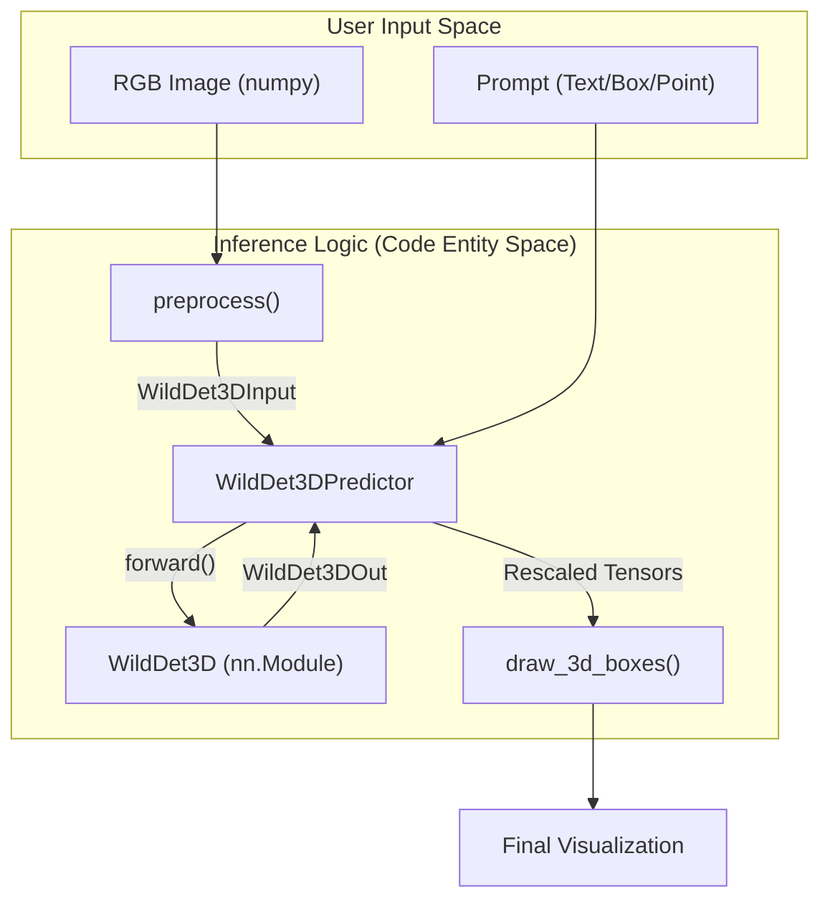
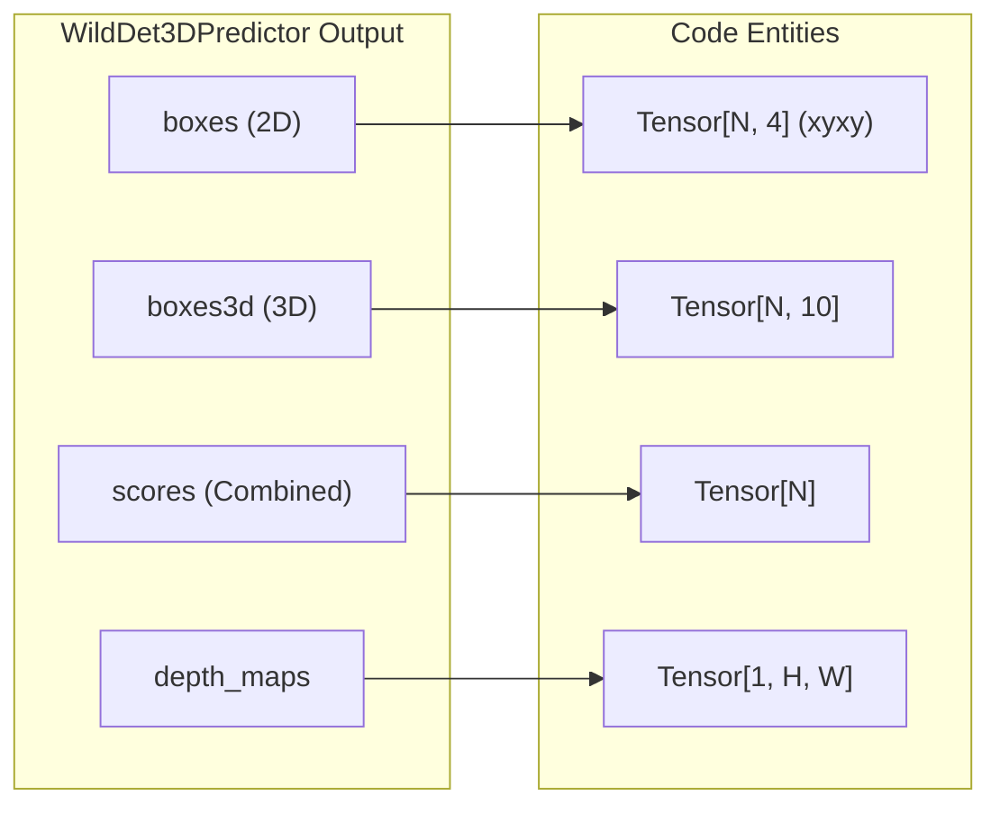

<!-- source: DeepWiki mcp.deepwiki.com · repo allenai/WildDet3D · page 5 Inference API · fetched 2026-10-26 -->

# Inference API

Relevant source files

The following files were used as context for generating this wiki page:

- [docs/INFERENCE.md](docs/INFERENCE.md)
- [wilddet3d/__init__.py](wilddet3d/__init__.py)

The WildDet3D Inference API provides a high-level interface for performing open-vocabulary and promptable 3D object detection on monocular images. It encapsulates the complexity of the dual-backbone architecture (SAM3 and LingBot-Depth) and the 3D detection head into a unified predictor class. The API supports five distinct prompting modes, ranging from simple text queries to geometric lifting of 2D boxes into 3D space.

### System Architecture Overview

The following diagram illustrates how the inference components bridge the gap between high-level user inputs and the underlying code entities.

**Inference Data Flow**

**Sources:** [wilddet3d/__init__.py:16-20](), [docs/INFERENCE.md:19-34]()

---

## Model Initialization and Preprocessing

The entry point for inference is `build_model()`, which constructs the `WildDet3DPredictor` wrapper. This wrapper handles the complexities of device placement, checkpoint loading, and post-processing (such as NMS and score thresholding).

Before passing images to the model, they must be processed via `preprocess()`. This function ensures images are resized to the required $1008 \times 1008$ resolution, applies center padding, and handles camera intrinsics. If no intrinsics are provided, the system generates default values and flags the model to use its internal intrinsic prediction branch.

### Key Components
*   **`build_model()`**: Configures the inference engine, including confidence thresholds and NMS settings [docs/INFERENCE.md:36-49]().
*   **`preprocess()`**: Normalizes RGB images and tracks padding/scaling factors to allow the model to rescale outputs back to the original image coordinates [docs/INFERENCE.md:50-57]().

For detailed parameter documentation and implementation details, see **[build_model() & WildDet3DPredictor](#5.1)**.

**Sources:** [wilddet3d/inference.py:1-20](), [wilddet3d/preprocessing.py:1-20](), [docs/INFERENCE.md:24-34]()

---

## Prompting Modes

WildDet3D is unique in its ability to handle multiple prompt types within a single forward pass. The `WildDet3DPredictor.forward()` method interprets these prompts to determine the detection behavior.

| Mode | Input Parameters | Description |
| :--- | :--- | :--- |
| **Text** | `input_texts` | Standard open-vocabulary detection. |
| **Visual** | `input_boxes` + `prompt_text="visual"` | Finds all objects similar to the provided 2D box (one-to-many). |
| **Visual+Label** | `input_boxes` + `prompt_text="visual: car"` | Constrains visual similarity search to a specific category. |
| **Geometric** | `input_boxes` + `prompt_text="geometric"` | Lifts the specific 2D box prompt into a 3D box (one-to-one). |
| **Geometric+Label** | `input_boxes` + `prompt_text="geometric: car"` | Lifts the 2D box to 3D while assigning a category label. |

**Sources:** [docs/INFERENCE.md:5-15](), [docs/INFERENCE.md:59-138]()

---

## Output Format and Post-Processing

The inference engine returns a standardized set of tensors, typically bundled as a `WildDet3DOut` dataclass or a list of tensors for batched processing.

**Inference Output Mapping**

The 3D boxes are represented as 10-dimensional tensors containing the center $(x, y, z)$, dimensions $(w, h, l)$, and a 6D rotation encoding [docs/INFERENCE.md:142-152](). The `WildDet3DPredictor` automatically rescales these 2D and 3D coordinates from the internal $1008 \times 1008$ coordinate system back to the original image dimensions provided during preprocessing.

**Sources:** [wilddet3d/data_types.py:1-25](), [docs/INFERENCE.md:140-153]()

---

## Visualization Utilities

Visualizing 3D detections on a 2D image plane requires accurate projection and depth-aware rendering. The `wilddet3d.vis.visualize` module provides `draw_3d_boxes()`, which handles:
*   **Anti-aliased Projection**: Projecting 8-corner 3D boxes onto the 2D image.
*   **Near-Plane Clipping**: Ensuring boxes behind or intersecting the camera plane are handled correctly.
*   **Confidence Overlays**: Displaying both 2D and 3D confidence scores alongside class labels.

For advanced use cases, the API also supports exporting detections as **GLB 3D meshes** for viewing in standard 3D software or web-based viewers.

For details on rendering and export options, see **[Visualization Utilities](#5.2)**.

**Sources:** [wilddet3d/vis/visualize.py:1-30](), [docs/INFERENCE.md:168-188]()

---

