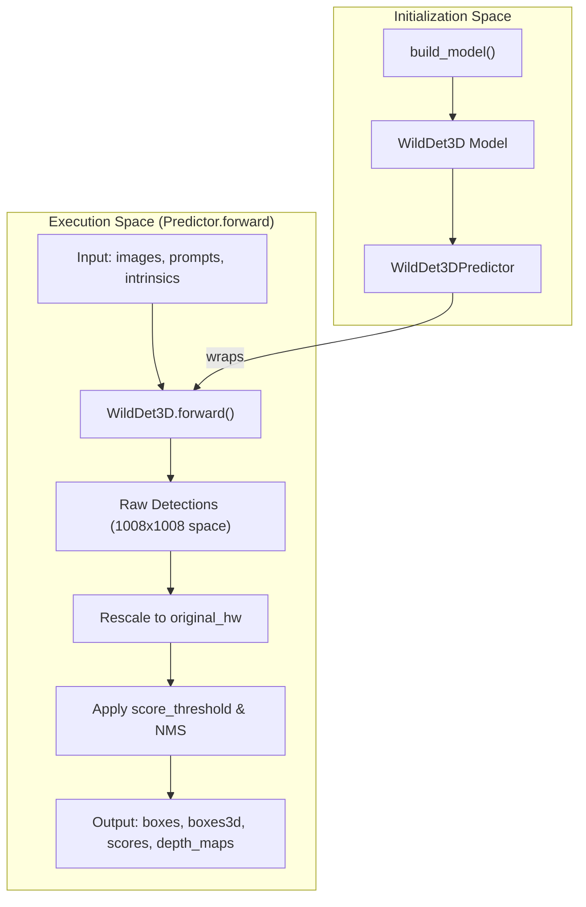
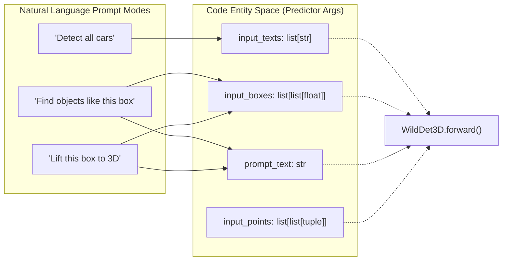

<!-- source: DeepWiki mcp.deepwiki.com · repo allenai/WildDet3D · page 5.1 build_model() & WildDet3DPredictor · fetched 2026-10-26 -->

# build_model() & WildDet3DPredictor

Relevant source files

The following files were used as context for generating this wiki page:

- [docs/INFERENCE.md](docs/INFERENCE.md)
- [wilddet3d/__init__.py](wilddet3d/__init__.py)

This page documents the high-level inference API for WildDet3D, primarily centered around the `build_model()` factory function and the `WildDet3DPredictor` class. These components abstract the complexity of the underlying model architecture, handling checkpoint loading, device management, and the transformation of raw inputs into 3D detections.

## Overview of build_model()

The `build_model()` function is the primary entry point for initializing the WildDet3D system. It handles the instantiation of the `WildDet3D` model and wraps it in a `WildDet3DPredictor` instance to provide a simplified inference interface [wilddet3d/inference.py:17-17]().

### Parameters and Configuration

| Parameter | Default | Description |
|---|---|---|
| `checkpoint` | (Required) | Path to the WildDet3D `.ckpt` or `.pt` file containing the trained weights. |
| `sam3_checkpoint` | `"pretrained/sam3/sam3_detector.pt"` | Path to the SAM3 pretrained weights used for the 2D backbone. |
| `score_threshold` | `0.3` | Minimum confidence score for a detection to be returned [docs/INFERENCE.md:42-42](). |
| `nms` | `True` | Boolean flag to enable/disable Non-Maximum Suppression post-processing. |
| `iou_threshold` | `0.6` | Intersection over Union threshold used during NMS [docs/INFERENCE.md:44-44](). |
| `device` | `"cuda"` | The torch device to load the model onto. |
| `skip_pretrained` | `False` | If `True`, skips loading standalone SAM3/LingBot weights. This is faster if the `checkpoint` already contains the full state dict [docs/INFERENCE.md:46-46](). |
| `use_predicted_intrinsics` | `False` | When `True`, the model uses its internal geometry head to predict camera intrinsics for "in-the-wild" images [docs/INFERENCE.md:47-47](). |

**Sources:** [docs/INFERENCE.md:36-49](), [wilddet3d/inference.py:17-17]()

---

## WildDet3DPredictor Interface

The `WildDet3DPredictor` class encapsulates the `WildDet3D` model [wilddet3d/inference.py:17-17](). It provides a unified `__call__` (forward) method that handles multiple prompting modes and performs the necessary coordinate rescaling to map detections back to the original image space.

### Logical Data Flow: Inference Entry Point

The following diagram illustrates how `build_model()` initializes the system and how `WildDet3DPredictor` orchestrates the inference process.

**Diagram: Inference Initialization and Execution**

**Sources:** [wilddet3d/inference.py:17-17](), [docs/INFERENCE.md:141-152]()

---

## Prompt Handling and Batch Creation

The `WildDet3DPredictor` supports five primary prompt modes, which are converted into a unified internal format for the model's transformer decoder.

### Supported Prompt Modes

1.  **Text Prompt**: Uses `input_texts` (e.g., `["car", "chair"]`) to perform open-vocabulary detection [docs/INFERENCE.md:61-63]().
2.  **Visual Prompt**: Uses `input_boxes` + `prompt_text="visual"` to find objects similar to a visual example (One-to-Many) [docs/INFERENCE.md:77-79]().
3.  **Visual+Label**: Combines a visual box with a text constraint (e.g., `"visual: car"`) [docs/INFERENCE.md:94-97]().
4.  **Geometric Prompt**: Uses `input_boxes` + `prompt_text="geometric"` to lift a specific 2D box to 3D (One-to-One) [docs/INFERENCE.md:106-108]().
5.  **Geometric+Label**: Similar to geometric but provides an explicit class label for the 3D head [docs/INFERENCE.md:118-120]().

### Mapping Prompts to Code Entities

The following diagram bridges the high-level prompt concepts to the specific arguments and data structures used in `WildDet3DPredictor.forward()`.

**Diagram: Prompt to Code Entity Mapping**

**Sources:** [docs/INFERENCE.md:5-15](), [docs/INFERENCE.md:128-138]()

---

## Output Rescaling and Formats

Because the internal model operates on a fixed resolution (typically $1008 \times 1008$ with padding), the `WildDet3DPredictor` must rescale outputs to match the original image dimensions provided by the `preprocess()` function [docs/INFERENCE.md:57-57]().

### Output Structure
The results are returned as a tuple of per-image lists [docs/INFERENCE.md:141-142]():

*   **`boxes`**: `list[Tensor[N, 4]]` - 2D bounding boxes in `[x1, y1, x2, y2]` pixel coordinates relative to the original image [docs/INFERENCE.md:146-146]().
*   **`boxes3d`**: `list[Tensor[N, 10]]` - 3D boxes represented as `[cx, cy, cz, w, h, l, rot_6d]`. The `rot_6d` component uses a 6-parameter rotation encoding [docs/INFERENCE.md:147-147]().
*   **`scores`**: `list[Tensor[N]]` - Combined confidence scores, often derived from the geometric mean of 2D and 3D confidence [docs/INFERENCE.md:148-148]().
*   **`class_ids`**: `list[Tensor[N]]` - Indices mapping back to the provided `input_texts` or the prompt sequence [docs/INFERENCE.md:151-151]().
*   **`depth_maps`**: `list[Tensor[1, H, W]]` - Metric depth maps in meters, aligned with the original image resolution [docs/INFERENCE.md:152-152]().

### Predicted Intrinsics
If `return_predicted_intrinsics=True` is passed to the predictor, an additional `predicted_K` tensor of shape `[B, 3, 3]` is returned [docs/INFERENCE.md:157-164](). This is critical for in-the-wild inference where the focal length and principal point are unknown.

**Sources:** [docs/INFERENCE.md:140-164](), [wilddet3d/inference.py:17-17]()

---

